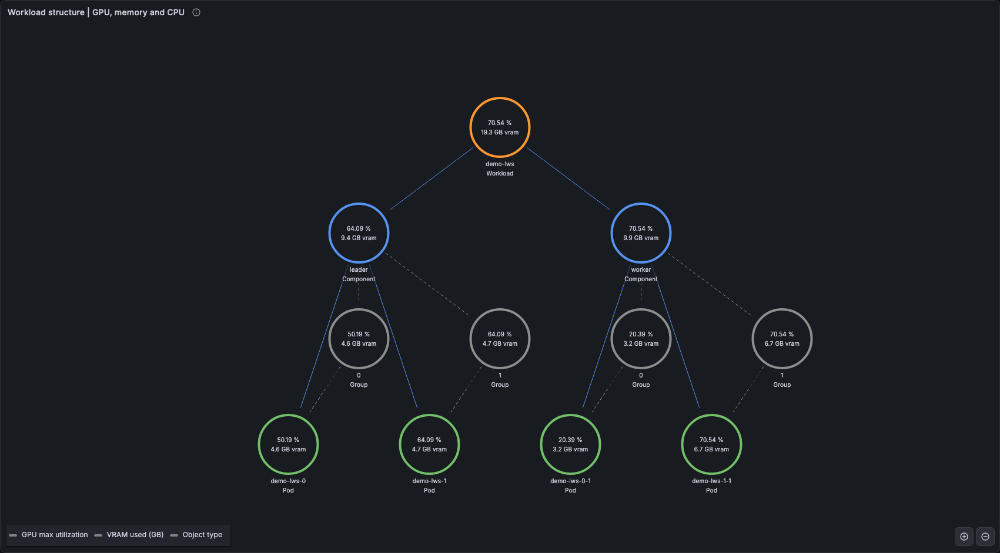
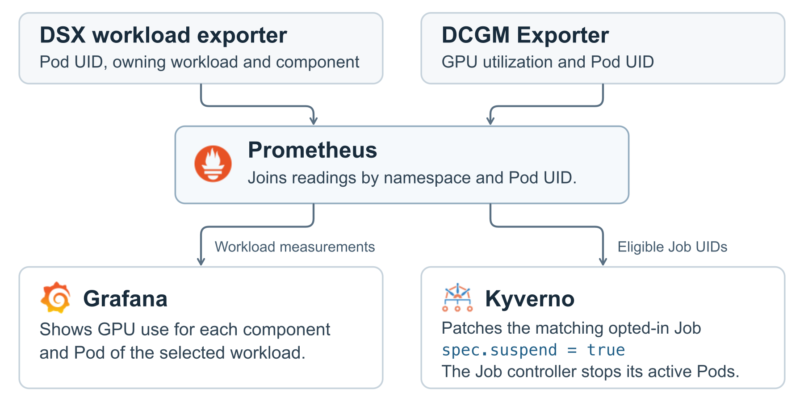

<!-- SPDX-License-Identifier: Apache-2.0 -->
<!-- Copyright (c) 2026 NVIDIA Corporation -->

# Find idle GPUs by workload with the NVIDIA DSX workload exporter

A PyTorch training job holds three GPUs. Its utilization averages 29%. Should you give up a GPU, or would that slow down training? In this simulated run, the master GPU is 87% busy. The two workers report 0% and 1%. The average hides which part of the job deserves a closer look.

The DSX workload exporter adds the missing context. It tells Prometheus which workload owns each Pod and what role that Pod plays. In Grafana, you can use that mapping to see which workers are quiet. If your jobs carry a team label, you can also group GPU use by owner. For a job that can restart safely, the same mapping gives a Kyverno policy a way to identify the exact Kubernetes object to suspend.

## Connect a GPU reading to the workload that owns it

NVIDIA DCGM Exporter reports GPU measurements such as utilization and framebuffer memory use. With Kubernetes mapping enabled, it can identify the Pod using a GPU. What it cannot tell from the device is whether that Pod is the master of a training job, a worker, or part of an inference service. That relationship lives in Kubernetes.

NVIDIA Workload Map describes the structure and status of each supported workload kind. For example, the PyTorchJob definition identifies its master and workers from Kubeflow's replica-type label. The DSX workload exporter uses those definitions and Kubernetes ownership information to publish a metric called `dsx_workload_pod_info`. The metric has a value of 1 and carries the Pod UID, root workload UID, workload name, and component as labels. [PyTorchJob definition](../catalog/kubeflow-org-pytorchjob-v1.yaml) and [introduction to NVIDIA Workload Map](https://developer.nvidia.com/blog/support-new-ai-frameworks-faster-using-nvidia-workload-map/).

For the example training job, the worker's mapping has the following labels, shown here with the UIDs and other labels omitted for readability.

```prometheus
dsx_workload_pod_info{workload_kind="PyTorchJob", workload_name="llm-finetune", pod_name="llm-finetune-worker-0", component="worker"} 1
```

A replacement Pod can reuse that name, but Kubernetes gives it a new UID. Joining GPU readings to the mapping by Pod UID keeps the new worker's measurements separate from the previous worker's. Keeping the workload UID also distinguishes different runs that reuse a job name.

You can attach ownership information once, on the job itself. For example, if the root object carries `example.com/team: research`, a configured exporter label rule can add `team="research"` to each Pod's mapping. Include `team` in the query's join and grouping to compare GPU use across teams. The team label comes from the root workload, so the owner does not need to label every worker. [Exporter label configuration](../dsx-workload-exporter/configuration.md#configured-labels).

## See what a job average hides

To view GPU activity by component, have Prometheus scrape the workload exporter and DCGM Exporter. Enable Pod UID reporting in DCGM Exporter and verify that its samples carry the workload Pod's namespace and UID. The query below assumes one cluster, one scrape job for each exporter, and one valid utilization reading (0 to 100 percent) per dedicated GPU. Load the project's Pod attribution recording rule first. It combines exporter replicas that agree on a mapping and drops conflicting mappings. [Collector setup](../../dsx-workload-exporter/examples/grafana/setup.md) and [recording rule](../../dsx-workload-exporter/examples/grafana/recording-rules.yaml).

```promql
avg by (namespace, workload_name, workload_uid, component) (
  (DCGM_FI_DEV_GPU_UTIL{namespace!="", pod_uid!=""} >= 0
   and DCGM_FI_DEV_GPU_UTIL <= 100)
  * on (namespace, pod_uid) group_left (workload_name, workload_uid, component)
    dsx:pod_attribution:unique{workload_kind="PyTorchJob",
      owner_resolution="resolved", observation_valid="true", component!="<unknown>"}
)
```

Multiplying by the mapping's value of 1 keeps the GPU percentage and adds the labels from Workload Map. With the three example readings, grouping by component gives two rows for the same job.

| Component | GPU utilization per Pod | Component average |
| --- | --- | --- |
| Master | 87% | 87% |
| Worker | 0%, 1% | 0.5% |

This result points to the workers. Are they waiting for input? Were they quiet only while the job initialized? Check the resource history before changing the allocation. A Pod with no GPU measurement contributes no row to the query. Substituting zero would turn a telemetry gap into apparent idle capacity.

## Inspect the workload in Grafana

Start in Workload Overview. Select a workload name to open Workload Structure, then follow a component down to an individual Pod. Figures 1 and 2 show an earlier dashboard version and a different workload, a LeaderWorkerSet called `demo-lws`. Its GPU measurements are simulated. The structure view puts the leader and workers side by side even though their Pod names look alike.



*Figure 1. The worker in group 0 shows about 20% GPU utilization. Its counterpart in group 1 shows about 71%. Each parent node shows the highest GPU utilization among its Pods.*

Use the time range to see what preceded a drop in activity. The same dashboard aligns workload phases with GPU, CPU, and memory history. Phases come from `dsx_workload_status`. Workload Map translates the controller's conditions into phases such as Running and Failed, so you can use these panels across workload kinds. Choose the interval where the activity changed and compare it with application logs from the same Pods.


*Figure 2. GPU utilization drops close to zero twice while the workload stays Running and its RAM working set stays steady.*

CPU and memory follow the same attribution pattern. For example, if a workload requests eight CPU cores but uses less than a tenth of one for hours, look at each component before changing its requests. The kubelet's cAdvisor endpoint supplies CPU and working-set memory measurements. To compare them with requests, add a source of Kubernetes resource requests such as kube-state-metrics. [Resource query examples](../dsx-workload-exporter/queries.md).

## Suspend an idle Job with Kyverno

A quiet worker in a busy training job calls for investigation. A different workload might be safe to stop automatically. Consider a restartable Kubernetes Job that runs one Pod with one container and one dedicated GPU. In the Workload Map policy tutorial, the owner opts the Job into suspension by adding the label `tutorial.workloadmap.run.ai/action: suspend`.



*Figure 3. Prometheus evaluates the measurements over time. Kyverno checks the eligible workload's UID before requesting a change.*

The tutorial's Prometheus rules require nine consecutive valid observations, 15 seconds apart. The Job must be Running and its GPU must report below 5% on each reading over those two minutes. A missing observation breaks the sequence. On a background scan, Kyverno checks the current Job and sets `spec.suspend` to `true` only for a matching result. The Kubernetes Job controller then removes the active Pod, releasing its GPU allocation. The Job object remains. To confirm suspension, run `kubectl -n ai-lab get job idle-training -o jsonpath='{.spec.suspend}'`. The result is `true`.

To run the Job again, its owner removes the opt-in or changes it to `observe` and sets `spec.suspend` to `false`. The controller creates a new Pod. The application needs its own checkpoint if it must continue where it stopped.

A second policy in the tutorial operates without GPU measurements. It deletes an opted-in Job or Deployment that stays in the exporter's Failed phase for two minutes. For a Deployment, the example rechecks that the current rollout exceeded its progress deadline before deleting the object. Keep this deletion policy in a disposable namespace. Kyverno checks the workload UID but deletes by name, so it could delete a replacement created under the same name between those operations. [Read the tutorial and both Kyverno policies](https://github.com/AviadHayumi/workload-map/blob/0c47036c8239731e11c91951b5b28d7b7d0de83a/docs/tutorials/act-on-workload-change/act-on-workload-changes.md).

## Try it on one workload

To explore the dashboards without GPU hardware, start the local kind demo. Open Workload Overview and compare `gpu-active`, which generates GPU measurements, with `cpu-only`, which has none. Then select `gpu-active` and inspect the individual Pods. [Local Grafana demo](../../hack/demo-grafana-exporter/README.md).

On a GPU cluster, install the exporter with Helm and import Workload Overview and Workload Structure into Grafana. Start with a job whose owner knows its expected behavior. Compare the busiest and quietest component over the same interval, then decide with the owner whether the next step is debugging, adjusting resource requests, or opting into a policy. [Exporter installation](../dsx-workload-exporter/installation.md) and [Grafana dashboards](../../dsx-workload-exporter/examples/grafana/README.md).
