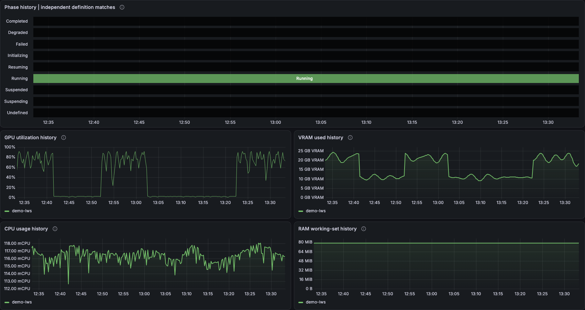

<!-- SPDX-License-Identifier: Apache-2.0 -->
<!-- Copyright (c) 2026 NVIDIA Corporation -->

# Find idle GPUs by workload with the NVIDIA DSX workload exporter


*Figure 1. Grafana shows which Pods are using the GPUs. For an opted-in Kubernetes Job, Kyverno can use the same data to decide when to suspend it.*

Two workers in the same Kubernetes LeaderWorkerSet average 45.5% GPU utilization. In the project's Grafana example, one worker is at 20% while the other is at 71%. If you're investigating why GPU use is uneven, the first thing you need is the name of the quieter Pod.

The DSX workload exporter tells Prometheus which workload owns each Pod and what role it plays. That mapping lets you follow a GPU reading in Grafana from the workload down to a specific worker. For a restartable Kubernetes Job, it also lets a Kyverno policy identify which Job to suspend when GPU use stays low. The dashboard example uses simulated GPU readings.

## Connect a GPU reading to the workload that owns it

NVIDIA DCGM Exporter reports GPU measurements such as utilization and framebuffer memory use. With Kubernetes mapping enabled, it can identify the Pod using a GPU. To find that Pod's role and the workload it belongs to, you also need the ownership information in Kubernetes.

NVIDIA Workload Map describes the structure and status of each supported workload kind. A LeaderWorkerSet runs groups of Pods. Each group has a leader and its workers. The catalog definition identifies leaders from a worker index of zero and workers from an annotation naming their leader. The DSX workload exporter uses the definition to publish `dsx_workload_pod_info`. Its value is 1. Its labels include the Pod UID, root workload UID, workload name and component. [LeaderWorkerSet definition](../catalog/leaderworkerset-x-k8s-io-leaderworkerset-v1.yaml) and [introduction to NVIDIA Workload Map](https://developer.nvidia.com/blog/support-new-ai-frameworks-faster-using-nvidia-workload-map/).

In the example, these labels identify the quieter Pod as a worker in the first replica group. The sample shows only the labels used here.

```prometheus
dsx_workload_pod_info{workload_kind="LeaderWorkerSet", workload_name="demo-lws", pod_name="demo-lws-0-1", component="worker", replica_group_id="0"} 1
```

A replacement Pod can reuse that name, but Kubernetes gives it a new UID. Joining GPU readings to the mapping by Pod UID keeps the new worker's measurements separate from the previous worker's. The workload UID serves the same purpose if someone recreates the LeaderWorkerSet under its old name.

You can also label the root workload with the team that owns it. For example, if the LeaderWorkerSet carries `example.com/team: research`, a configured exporter label rule can add `team="research"` to each Pod's mapping. Include `team` in the query's join and grouping to compare GPU use across teams. [Exporter label configuration](../dsx-workload-exporter/configuration.md#configured-labels).

## See what a workload average hides

To view GPU activity by component, have Prometheus scrape the workload exporter and DCGM Exporter. Enable Pod UID reporting in DCGM Exporter and verify that its samples carry the workload Pod's namespace and UID. The query below assumes one cluster, one scrape job for each exporter, and one valid utilization reading (0 to 100 percent) per dedicated GPU. Load the project's Pod attribution recording rule first. It combines exporter replicas that agree on a mapping and drops conflicting mappings. [Collector setup](../../dsx-workload-exporter/examples/grafana/setup.md) and [recording rule](../../dsx-workload-exporter/examples/grafana/recording-rules.yaml).

```promql
avg by (namespace, workload_name, workload_uid, component) (
  (DCGM_FI_DEV_GPU_UTIL{namespace!="", pod_uid!=""} >= 0
   and DCGM_FI_DEV_GPU_UTIL <= 100)
  * on (namespace, pod_uid) group_left (workload_name, workload_uid, component)
    dsx:pod_attribution:unique{workload_kind="LeaderWorkerSet",
      owner_resolution="resolved", observation_valid="true", component!="<unknown>"}
)
```

Multiplying by the mapping's value of 1 keeps the GPU percentage and adds the labels from Workload Map. With one reading per Pod, the four values shown in the Grafana example give these averages.

| Component | GPU utilization per Pod | Component average |
| --- | --- | --- |
| Leader | 50.19%, 64.09% | 57.1% |
| Worker | 20.39%, 70.54% | 45.5% |

The workers have the lower average. To see how much of that difference comes from one Pod, keep `pod_uid` in the outer `avg by` or open the workload tree in Grafana. A Pod with no GPU measurement contributes no row to the query. Substituting zero would turn a telemetry gap into apparent idle capacity.

## Inspect the workload in Grafana

Start in Workload Overview. Select a workload name to open Workload Structure. In Figure 2, follow `demo-lws` through the worker component to group 0. The Pod at the end of that branch, `demo-lws-0-1`, is the quieter worker. Both screenshots show an earlier version of the dashboards.


*Figure 2. The group 0 worker reads 20.39% and the group 1 worker reads 70.54%. The root displays the highest GPU utilization among its Pods.*

Use the time range to see what preceded a drop in activity. The same dashboard aligns workload phases with GPU, CPU, and memory history. Phases come from `dsx_workload_status`. Workload Map translates the controller's status into phases such as Running and Failed, so you can use these panels across workload kinds. Choose the interval where the activity changed and compare it with application logs from the same Pods.



*Figure 3. GPU utilization drops close to zero twice while the workload stays Running and its RAM working set stays steady.*

CPU and memory follow the same attribution pattern. For example, if a workload requests eight CPU cores but uses less than a tenth of one for hours, look at each component before changing its requests. The kubelet's cAdvisor endpoint supplies CPU and working-set memory measurements. To compare them with requests, add a source of Kubernetes resource requests such as kube-state-metrics. [Resource query examples](../dsx-workload-exporter/queries.md).

## Suspend an idle Job with Kyverno

The worker at 20% is worth investigating. The suspension policy in Figure 1 covers a different case. It applies to a restartable Kubernetes Job that runs one Pod with one container and one dedicated GPU. In the Workload Map policy tutorial, the owner opts the Job into suspension by adding the label `tutorial.workloadmap.run.ai/action: suspend`.

The tutorial's Prometheus rules require nine consecutive valid observations, 15 seconds apart. The Job must be Running and its GPU must report below 5% on each reading over those two minutes. A missing observation breaks the sequence. On a background scan, Kyverno checks the current Job and sets `spec.suspend` to `true` only for a matching result. The Kubernetes Job controller then removes the active Pod, releasing its GPU allocation. The Job object remains. To confirm suspension, run `kubectl -n ai-lab get job idle-training -o jsonpath='{.spec.suspend}'`. The result is `true`.

To run the Job again, its owner removes the opt-in or changes it to `observe` and sets `spec.suspend` to `false`. The controller creates a new Pod. The application needs its own checkpoint if it must continue where it stopped.

A second policy in the tutorial operates without GPU measurements. It deletes an opted-in Job or Deployment that stays in the exporter's Failed phase for two minutes. For a Deployment, the example rechecks that the current rollout exceeded its progress deadline before deleting the object. Keep this deletion policy in a disposable namespace. Kyverno checks the workload UID but deletes by name, so it could delete a replacement created under the same name between those operations. [Read the tutorial and both Kyverno policies](https://github.com/AviadHayumi/workload-map/blob/0c47036c8239731e11c91951b5b28d7b7d0de83a/docs/tutorials/act-on-workload-change/act-on-workload-changes.md).

## Try it on one workload

To explore the dashboards without GPU hardware, start the local kind demo. Open Workload Overview and compare `gpu-active`, which generates GPU measurements, with `cpu-only`, which has none. Then select `gpu-active` and inspect the individual Pods. [Local Grafana demo](../../hack/demo-grafana-exporter/README.md).

On a GPU cluster, install the exporter with Helm and import Workload Overview and Workload Structure into Grafana. Start with a job whose owner knows its expected behavior. Compare the busiest and quietest component over the same interval, then decide with the owner whether the next step is debugging, adjusting resource requests, or opting into a policy. [Exporter installation](../dsx-workload-exporter/installation.md) and [Grafana dashboards](../../dsx-workload-exporter/examples/grafana/README.md).
