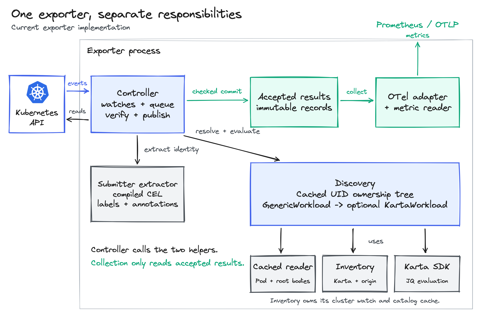
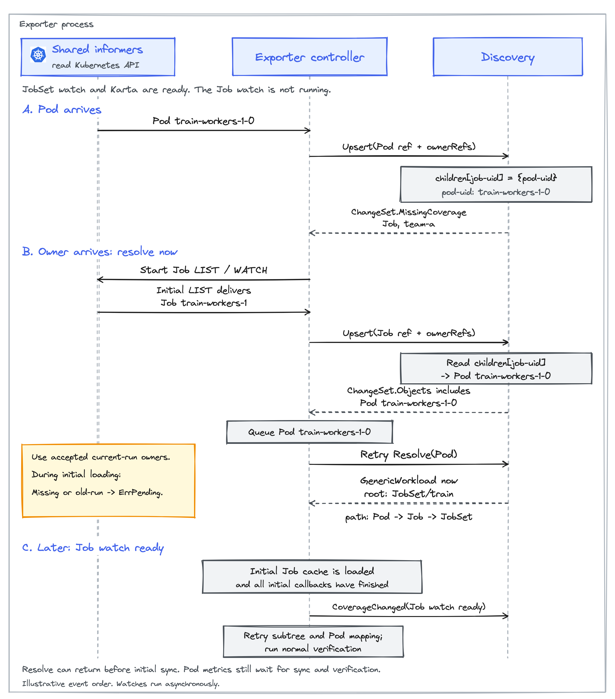

<!-- SPDX-License-Identifier: Apache-2.0 -->
<!-- Copyright (c) 2026 NVIDIA Corporation -->

# Karta metrics exporter: implementation design

- Status: implementation design for the current PoC
- Author: @AviadHayumi
- Public contract: [KEP-0001][kep] and [Helm configuration][configuration]

## From one Pod to workload metrics

JobSet `train` in namespace `team-a` declares `leader` with one replica and `workers` with two.
Each Job creates one Pod in this example. Following a Pod's owner references
through its Job leads to the root JobSet.


The exporter passes the root JobSet and the highlighted Pod to the Karta SDK.
This fragment is from `spec.structureDefinition` in the JobSet Karta:

```yaml
childComponents:
  - name: replicatedjob
    specDefinition:
      podTemplateSpecPath: .spec.replicatedJobs[].template.spec.template
    instanceIdPath: .spec.replicatedJobs[].name
    podSelector:
      componentInstanceSelector:
        idPath: '.metadata.labels["jobset.sigs.k8s.io/replicatedjob-name"]'
      replicaSelector:
        keyPath: '.metadata.labels["jobset.sigs.k8s.io/job-index"]'
```

The Karta field determines which object the expression reads.
`podTemplateSpecPath` and `instanceIdPath` read the root JobSet.
Paths under `podSelector` read the Pod being mapped.

For Pod `train-workers-1-0`:

1. Component: `replicatedjob` is the only component with a Pod template, so the SDK selects it. No component label is needed on the Pod.

   <details>
   <summary>When a Karta has several child components</summary>

   The Karta defines which Pod field to read and what value to match. These are the relevant selectors from the PyTorchJob Karta:

   ```yaml
   childComponents:
     - name: master
       podSelector:
         componentTypeSelector:
           keyPath: '.metadata.labels["training.kubeflow.org/replica-type"]'
           value: master
     - name: worker
       podSelector:
         componentTypeSelector:
           keyPath: '.metadata.labels["training.kubeflow.org/replica-type"]'
           value: worker
   ```

   For a Pod whose `training.kubeflow.org/replica-type` label is `worker`:

   - The `master` selector does not match: `worker != master`.
   - The `worker` selector matches: `worker == worker`.
   - The SDK returns the matching component's `name`: `component="worker"`.

   Matching uses the selector's `value`, not the component name. The Karta author selects the exact label or annotation in `keyPath`, which the SDK reads from the Pod using JQ.

   If selectors overlap, the first match wins. If none match, mapping fails.

   </details>

2. Instance: the SDK compares the value read from the Pod with the instance names read from the JobSet:

   ```text
   JobSet instance names:                 ["leader", "workers"]
   Pod's replicatedjob-name label:        "workers"
   Exact match:                          "workers" == "workers"
   Result:                               component_instance="workers"
   ```

   A Pod labeled `leader` matches `leader` instead. A value outside the JobSet's instance names fails the mapping.
3. Replica group: `replicaSelector.keyPath` reads `1` from the Pod's `job-index` label. That becomes replica group `1`.

Status is evaluated on the root JobSet. Its `Completed=True` condition matches
Karta's `Completed` status rule.

These results produce two metrics. Selected labels and the matching phase are shown:

```prometheus
karta_pod_workload_info{workload_name="train",pod_name="train-workers-1-0",component="replicatedjob",component_instance="workers",replica_group_id="1"} 1
karta_workload_status{workload_name="train",phase="Completed"} 1
```

## Controller and startup

`controller.Runtime` is the Go struct that implements the exporter controller.
It runs in one process with these components:

| Component | Responsibility |
| --- | --- |
| `Runtime` | Watches Kubernetes objects, queues changes and verifies results before saving them. |
| `Discovery` | Resolves an object to its root and evaluates that root's Karta. |
| Definition inventory | Returns the selected Karta and its source for a root kind. |
| Submitter extractor | Reads one object's metadata and returns an identity string. |
| Store | Keeps immutable results per root UID. |
| Collector | Reads the store and records metric values and labels through OpenTelemetry (OTel). |



The exporter constructs these components before starting watches. Startup fails
if the configuration or enabled submitter CEL expression is invalid. Shutdown
is graceful.

[Configuration][configuration] defines filters and defaults. Namespace selection
limits watches. Workload filters apply after resolution. Excluding a JobSet also excludes its Jobs and Pods from workload metrics.

<details>
<summary>Construct and run the components</summary>

[`exporter/cmd/main.go`](../../../exporter/cmd/main.go) creates a dynamic client
for full objects and a metadata client for ownership reads. Its REST mapper
finds the API resource for a group/version/kind (GVK), such as `batch/v1 Job`
to `jobs`.

The inventory and `runtimeOptions.Definitions` receive the same selection
settings. `ignoredOwners` contains the GVKs from `ignoredOwnerKinds`. This example enables
submitter extraction with a configured expression. When disabled, the controller
receives nil instead. `provider` uses the selected OTel reader. `metricOptions`
selects phases and the optional submitter label.

```go
inventory, err := kartadefinitioninventory.New(client, definitionOptions)
if err != nil {
    return err
}
submitter, err := submitterextractor.New(submittedByExpression)
if err != nil {
    return err
}
reader := controller.NewInformerReader()
discovery := workloaddiscovery.New(reader, inventory, ignoredOwners...)
metricsStore := store.New()

runtime, err := controller.NewRuntime(
    client, metadataClient, mapper,
    reader, discovery, inventory, submitter, metricsStore,
    runtimeOptions,
)
if err != nil {
    return err
}
registration, err := collector.New(
    provider.Meter("karta-exporter"), metricsStore, metricOptions,
)
if err != nil {
    return err
}

results := make(chan error, 2)
go func() { results <- inventory.Run(ctx) }()
go func() { results <- runtime.Run(ctx) }()
```

</details>

## Resolve ownership, then interpret the root

Discovery reads cached objects through the `CachedReader` interface.
The controller supplies `InformerReader` as its implementation and manages
the watches, scope and readiness. When Discovery needs another watch, it
returns a request to the controller. This keeps informer management outside
Discovery.

### From Pod to workload

This example follows `Pod -> Job -> JobSet`. Only the JobSet Karta is selected.

| Watch | Starts when | Cached data |
| --- | --- | --- |
| Pods | Exporter starts | Full objects |
| JobSets | JobSet Karta is selected | Full objects |
| Jobs | A Pod names a Job owner | Metadata only |

Complete objects include metadata, spec and status. Kinds with a selected Karta are cached in full.



An owner watch is added through this flow:

1. The Pod informer sends an add or update event. The controller calls `Discovery.Upsert` with the Pod's reference and owners.
2. The Pod names a Job as its owner, but Jobs are not watched yet. Discovery still records `Job UID -> Pod UID` in `children`. It returns the Job's GVK and namespace in `ChangeSet.MissingCoverage` so the controller can start that watch.
3. The controller queues that request. When it processes the request, it starts or reuses a shared Job metadata informer for the namespace.
4. The initial Job list delivers `train-workers-1`. The controller calls `Discovery.Upsert`. Discovery reads `children[job-uid]` and includes Pod `train-workers-1-0` in `ChangeSet.Objects`. The controller queues that Pod again.
5. The controller retries `Resolve`. Once every owner in the Pod's path has arrived on its current watch, resolution returns the JobSet root. This can succeed before the whole watch finishes loading.
6. The controller waits until the initial objects are cached and their add callbacks have run. It checks `informer.HasSynced` and `registration.HasSynced`, then calls `Discovery.CoverageChanged` to retry subtree traversal and Pod mapping. Pod metrics publish after verification.

During startup, one Pod may arrive before another in the same workload. Waiting avoids treating that partial set as the whole workload. The current PoC also delays individual Pod mapping, even when that Pod's inputs are already present.

The exporter is still eventually consistent. Related watches can deliver changes at different times. Initial synchronization does not replace API verification.

If Kubernetes cannot serve or read the required kind, ownership remains unresolved.

`Resolve(ctx, podRef)` returns from the current cache without waiting.
A missing owner returns `ErrPending` while its watch loads. After loading,
a missing parent, wrong UID, cycle or multiple controller owners returns
`ErrUnresolvedOwner`. Read failures do not turn an intermediate owner into a root.

<details>
<summary>Discovery and its ownership index</summary>

The relevant fields are:

```go
type Discovery struct {
    mu        sync.RWMutex
    reader    CachedReader
    inventory kartadefinitioninventory.Interface
    ownership *OwnershipIndex
}

type CachedReader interface {
    Get(context.Context, ObjectRef) (*unstructured.Unstructured, error)
}

type ObjectRef struct {
    GVK             schema.GroupVersionKind
    Namespace       string
    Name            string
    UID             types.UID
    ResourceVersion string
}

type OwnershipIndex struct {
    nodes    map[types.UID]*OwnerNode
    children map[types.UID]map[types.UID]struct{}
    byKind   map[schema.GroupKind]map[types.UID]struct{}
}

type OwnerNode struct {
    objects map[schema.GroupVersionKind]observation
    parents map[types.UID]struct{}
}
```

`nodes` shares objects by UID. `children` finds descendants affected by an owner
change, including children received before their parent. `byKind` finds objects
affected by a Karta change. Pods can be parents too.

An `observation` records the reference, owners and source watch. Full objects
stay in informers. Each resolution walks the shared graph without caching a
complete path. Conflicting owners for one UID across API versions fail resolution.

The controller calls `Upsert`, `Delete`, `CoverageChanged` and
`DefinitionChanged`. Their `ChangeSet` returns affected objects, roots and
missing watches.

</details>

### Return the root and its interpretation

The controller receives a `GenericWorkload`, associates the Pod UID with its
root UID and queues that root for evaluation:

```go
type GenericWorkload struct {
    root       ObjectRef
    Path       []ObjectRef
    Resolution OwnerResolution
    karta      *KartaWorkload
    state      CapturedState
}

type KartaWorkload struct {
    root      ObjectRef
    selection kartadefinitioninventory.Selection
    discovery *Discovery
    state     CapturedState
}
```

```text
GenericWorkload.Root(): JobSet team-a/train, UID jobset-uid
GenericWorkload.Path: [Pod train-workers-1-0, Job train-workers-1, JobSet train]
GenericWorkload.Resolution: resolved
GenericWorkload.KartaWorkload(): selected JobSet interpretation
```

`OwnerResolution` is a string enum: `resolved` or `ignored_owner` on success.
`CapturedState` records calculation inputs for later checks with
`Discovery.IsCurrent`. It does not verify API freshness.

Discovery follows controller owners to the root before choosing a Karta.
In `Pod -> ReplicaSet -> Deployment`, only the Deployment's Karta applies.
The same rule keeps LeaderWorkerSet as the root through intermediate
StatefulSets and Pods, even if a StatefulSet has a Karta.

An exact `ignoredOwnerKinds` entry stops before reading that owner. Ignoring
`leaderworkerset.x-k8s.io/v1/LeaderWorkerSet` makes the leader StatefulSet the
root with `owner_resolution="ignored_owner"`. The path below it must still
resolve. The LWS object can still emit its own status and creation time if it
has a selected Karta.

## Choose the root Karta

Discovery passes the root GVK to inventory `Lookup`. It returns a cached copy
of the selected definition and its origin:

<details>
<summary>Inventory interface and result</summary>

```go
type Interface interface {
    Lookup(schema.GroupVersionKind) (Selection, error)
}

type Selection struct {
    Definition *v1alpha1.Karta
    GVK        schema.GroupVersionKind
    Origin     Origin
}

type Origin struct {
    Source          Source
    Name            string
    UID             types.UID
    ResourceVersion string
}

type Source string
const (
    SourceCatalog Source = "catalog"
    SourceCluster Source = "cluster"
)
```

</details>

Selection uses group/kind across versions. Each enabled source admits definitions
matching its include list or label selector, or all definitions when both are
empty. Exclusions win. Cluster definitions override catalog definitions.
The oldest cluster definition wins, then lexical name. Catalog ties use lexical
name. An invalid winner returns an error without fallback.

`Selection.GVK` supplies the root version. `Origin` supplies the definition name
and source for status labels, plus UID and resourceVersion for cluster Kartas.
A different root version requires a full-object watch and verification of the
same root UID.

Catalog-only lookup is ready after construction. Cluster lookup needs `Run`.
Every enabled source must initialize before absence can be confirmed. A failed
source is an error even when a catalog candidate exists. The inventory and
controller watch Kartas independently, so the controller waits for their
selection and source state to agree. [Definition selection](./consistency.md#definition-selection)
describes that check.

`Resolve` returns the workload and error separately. Selection can fail after
ownership succeeds, leaving `workload.Root().UID` available:

| `Resolve` result | Controller behavior |
| --- | --- |
| Success with Karta | Evaluate this root with the returned definition snapshot. |
| Success without Karta | Emit generic identity and verified creation time, with `<unknown>` component and instance, empty group and no status. |
| Selection error with root UID in the result | No generic fallback. Verified creation time remains usable. Derive no new mapping or status. |
| Ownership error without root UID | Retry or retain an applicable previous result. |

Pod roots are an exception: Pod-info, status and creation rows require a selected
Pod Karta, including when an ignored owner makes the Pod a root. Catalog
`core-pod-v1` gives component `pod`, empty instance/group and Pod status.
Resource-type health is independent. The [configuration guide](../../karta-metrics-exporter/configuration.md#definition-sources-and-owner-boundaries)
defines this exception. The KEP's generic-root paragraph does not state it.

## Evaluate components and status

After successful resolution, the controller uses `workload.KartaWorkload()`
to evaluate the root. The handle keeps one definition snapshot, so a definition
change requires resolution again. The full `pod` object must match the UID and
resourceVersion of the reference used for resolution:

```go
interpretation := workload.KartaWorkload()
if interpretation == nil {
    // Runtime handles the generic-root case separately.
    return nil
}
batch := discovery.NewEvaluationBatch()
status, statusErr := interpretation.Status(ctx, batch)
mapping, mappingErr := interpretation.PodMapping(ctx, pod, batch)
```

One batch shares root calculations across status and sibling Pods. Status and
each mapping can succeed independently:

```go
type StatusResult struct {
    Defined bool
    Matched []v1alpha1.ResourceStatus
    state   CapturedState
}
type PodMapping struct {
    Component string
    Instance  string
    Group     string
    state     CapturedState
}
```

Both results expose `State()` for input checks. Periodic API verification queues
a new root evaluation batch, so JQ runs again even on unchanged objects.
During root reconciliation, the controller calls `workload.Walk` to collect
Pods among the root and observed descendants. This does not prove complete
Pod membership.

The [JobSet example](#from-one-pod-to-workload-metrics) shows the SDK's mapping
rules. The group value is a key, not a Pod index or replica count. For LWS, the
worker component inherits its nearest replica key expression through logical
Karta `ownerRef` links. Reading `group-index="2"` from the Pod gives
`{Component: "worker", Instance: "", Group: "2"}`. These links are separate
from Kubernetes owners. Without an expression, mapping returns an empty group. Extraction errors
fail mapping. [Evaluation details](./consistency.md#cached-objects-and-karta-evaluation)
cover the SDK calls and LWS selectors.

`KartaWorkload.Status` calls the SDK root component's `GetStatus(ctx)` on the
full root object without extracting scale. No status definition means no status
rows. Otherwise it returns all matching phases,
or `Undefined` when none match. An expression error fails evaluation.

## Submitter identity

The extractor evaluates one object's metadata and GVK:

```go
type Interface interface {
    Evaluate(context.Context, metav1.Object, schema.GroupVersionKind) (Submitter, error)
}
type Submitter struct { Identity string }
```

CEL receives `labels`, `annotations` and `resource` (namespace, name, group,
version and kind). It cannot read spec, status or Kubernetes APIs.

```cel
"team.example/submitted-by" in annotations
  ? annotations["team.example/submitted-by"] : ""
```

For JobSet `train` with this annotation set to `alice`, the result is
`Submitter{Identity: "alice"}`. Each associated Pod is evaluated separately.
A missing annotation returns empty identity. Successful metadata results are
cached across status-only changes.

The controller compares the root and every associated Pod, including Pods
hidden by `podSelector`. Equal nonempty identities give Pod-info and status
one shared `submitted_by`. Empty values do not conflict. All-empty results,
conflicts, extraction errors or unverified membership leave it empty.
Invalid mapping/status rows also clear it. Disabling extraction omits the label.
A submitter error alone leaves other verified results available.

To verify that set is complete, the controller lists all namespace Pods and
verifies their paths, including those outside the workload. Reading only known Pods could miss
one with a different identity. An unresolved Pod blocks renewal for the whole
namespace and can temporarily clear other workloads' identities.
[Membership checks](./consistency.md#pod-membership-and-pagination) describe
invalidation and expiry.

Empty identity means unknown. Changing it creates a different metric series.
CEL only reads identity. [Admission policies](./consistency.md#submitter-update-protection)
separately record the authenticated CREATE caller and protect it on UPDATE.

## Verification and delivery

Evaluation uses cached objects. The controller separately checks them against
complete API LISTs, shared by namespace and resource. UID and resourceVersion
must match within the same API version. Before saving a calculation, it also
checks that objects, owners, definition and scope have not changed locally.

Object work, root evaluation, API verification and membership checks share a
rate-limited queue. Repeated keys combine. Events queue verification immediately;
periodic checks continue between events. Evaluation uses completed checks and
does not wait for synchronous API reads.

Under its publication lock, the controller saves a `store.Publication` through
`Store.Publish`. It contains the root, phases, creation timestamp, Pod mappings
and shared submitter. Status, creation time, membership and each mapping have
separate verification deadlines and failure state, so one result can remain
available when another fails. [Consistency details](./consistency.md) cover the
checks, timings and locking.

The collector registers OTel observable gauges. Its callback calls
`Store.Capture()` once, receiving immutable records, health, failure state and
one timestamp. It converts record fields to labels and calls
`observer.ObserveFloat64` with each value and attribute set. It does no API,
ownership or expression work. [Memory and collection](./consistency.md#memory-and-collection)
describes the store's Pod pages. The captured view is consistent within the
exporter, not an atomic Kubernetes snapshot.

The collector emits [health metrics][kep] from the same view:

| Scope | Output |
| --- | --- |
| Resource type | Runtime records namespace/GVK collection health. The collector emits `1` with reason `none` when valid, or `0` on failure or expiry. |
| Known workload | Recorded failures or invalid status/mapping produce `0`. Recovery removes affected failure rows. There is no healthy workload row. |

Prometheus is
the default reader and serves `/metrics`. OTLP instead uses periodic
HTTP/protobuf or gRPC delivery, with no `/metrics` or ServiceMonitor.
Only one mode runs. Both keep health endpoints. Omitted OTLP samples rely on
backend expiry. Prometheus translation, scope info and target info are disabled
to preserve labels and names. SDK overflow aggregation is disabled to avoid
merging identities.

## Updates and failures

`observation_valid` describes verification, so an observed `Failed` workload can
still be valid. An ordinary input update omits affected rows while reevaluation
is pending. After a later failure or verification expiry, the exporter may emit
the last result again with `observation_valid="false"` and empty submitter.
It must still match the root UID and definition snapshot, plus the Pod UID for
Pod-info. On reconciliation, ownership failures also set retained rows'
`owner_resolution="unknown"`. Consumers must filter validity.

The full root needs fresh verification after any resourceVersion change, including
status-only writes. Creation time is omitted until verification succeeds. A
status-expression error alone leaves an independently verified timestamp available.

| Change | Controller behavior |
| --- | --- |
| Pod resourceVersion changes, including status-only updates | Omit its Pod-info row until reevaluation. Leave unchanged root and sibling results available. Membership changes can clear their shared submitter. |
| Root resourceVersion changes | Omit status, dependent Pod-info and creation-time rows pending reevaluation and verification. Restore each successful result independently. |
| Selected Karta edited or replaced | Remove its old status and mappings immediately. Evaluate the new snapshot. |
| Karta deleted | Select another candidate or confirm absence. Generic roots remain; Pod roots need another Pod Karta. |
| Pod moves to another root, object is deleted or leaves scope | Remove old output. Later failures cannot restore it. |

Every accepted Job update with a new `resourceVersion` queues descendant Pods
for `Resolve`, even when owners are unchanged. Duplicate callbacks for the same
version and watch run are ignored. Deletion retries surviving dependents.

`ErrPending` adds no failure reason. `ErrStale` means the calculation's inputs
changed before it finished. The controller discards it and retries, preserving
newer output. Other sentinel errors map to the [KEP's failure reasons][kep].
The controller checks them with `errors.Is`. Cancellation remains a context error.
Without applicable history, there is no mapping or phase to retain.
[Failure handling](./consistency.md#controller-errors-and-watch-failures)
covers errors and watch replacement.

## Readiness and current limits

`/healthz` reports process health. `/readyz` requires current configuration,
source verification and synchronized Pod and required-kind watches. It does
not wait for every workload calculation. Optional-kind failures leave unrelated
workloads running. A required kind affects readiness even when traversal ignores
it. Replicas with overlapping namespaces duplicate watch work. Separate namespace
sets divide it.

- Discovery resolves cluster-scoped roots, but the controller omits their Pod-info, status and creation rows. Resource-type health is separate. Cluster-scoped output still needs a KEP decision.
- Detailed reconciliation logging is not implemented in the PoC.

[kep]: ../../../keps/0001-metrics-exporter/README.md
[configuration]: ../../karta-metrics-exporter/configuration.md
