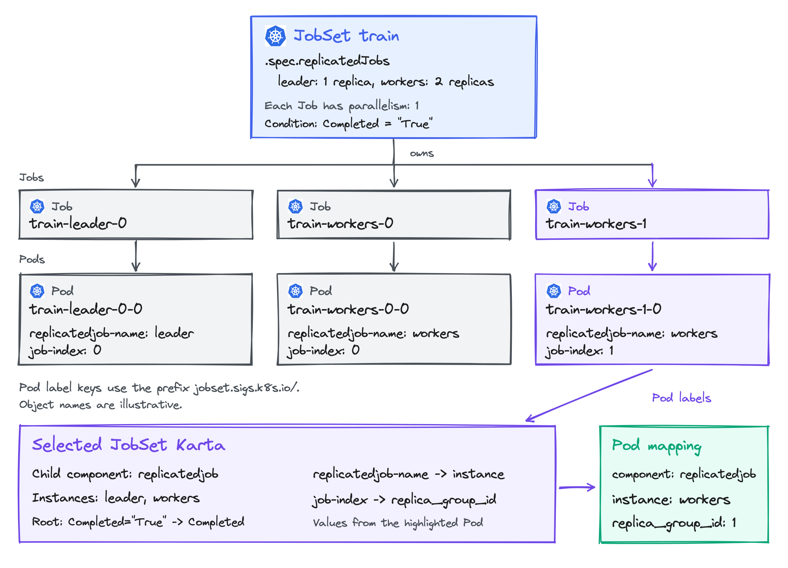
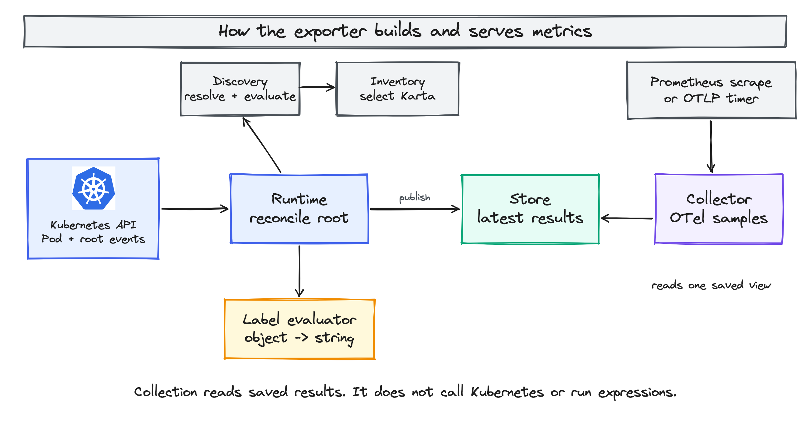
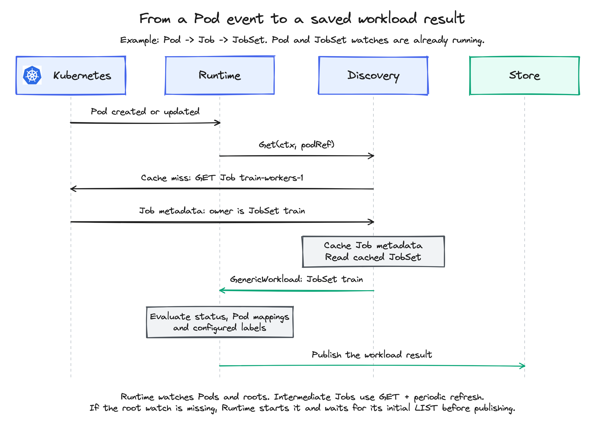

<!-- SPDX-License-Identifier: Apache-2.0 -->
<!-- Copyright (c) 2026 NVIDIA Corporation -->

# Karta metrics exporter: implementation design

[KEP-0001](../../../keps/0001-metrics-exporter/README.md) defines the metrics.
This design shows how the exporter builds them for namespaced workloads.
The Go examples define the proposed component contracts.

## From one Pod to workload metrics

A Pod's owner may be a Job, while the workload you want to monitor is a JobSet.
The exporter follows Kubernetes controller owners to find that workload.
Its Karta describes how to read workload status and map Pods to components.

Take JobSet `train` in namespace `team-a`, with one leader and two workers.
Each Job creates one Pod:



These are the relevant input fields, with the other object fields omitted:

```yaml
# JobSet team-a/train
spec:
  replicatedJobs:
    - name: leader
      replicas: 1
    - name: workers
      replicas: 2
status:
  conditions:
    - type: Completed
      status: "True"
---
# Pod team-a/train-workers-1-0, owned by Job train-workers-1
metadata:
  labels:
    jobset.sigs.k8s.io/replicatedjob-name: workers
    jobset.sigs.k8s.io/job-index: "1"
```

For this example, the JobSet Karta uses the following fragment. It adds an
explicit `replicaSelector` to the current catalog definition:

```yaml
childComponents:
  - name: replicatedjob
    specDefinition:
      podTemplateSpecPath: .spec.replicatedJobs[].template.spec.template
    instanceIdPath: .spec.replicatedJobs[].name
    podSelector:
      componentInstanceSelector:
        idPath: '.metadata.labels["jobset.sigs.k8s.io/replicatedjob-name"]'
      replicaSelector:
        keyPath: '.metadata.labels["jobset.sigs.k8s.io/job-index"]'
```

The SDK evaluates `podTemplateSpecPath` and `instanceIdPath` against the JobSet.
It evaluates the paths under `podSelector` against the Pod:

| Result | Input and operation | Value |
| --- | --- | --- |
| Component | `replicatedjob` is the only component with a Pod template. | `replicatedjob` |
| Component instance | JobSet names are `["leader", "workers"]`. The Pod label is `"workers"`. It matches `"workers" == "workers"`. | `workers` |
| Replica group | Read the Pod's `job-index` label. This is a group key, not a Pod count. | `1` |
| Workload status | Read the JobSet's `Completed=True` condition through its Karta status rule. | `Completed` |

The resulting samples include these labels:

```prometheus
karta_pod_workload_info{workload_name="train",pod_name="train-workers-1-0",component="replicatedjob",component_instance="workers",replica_group_id="1"} 1
karta_workload_status{workload_name="train",phase="Completed"} 1
```

## Components

All components run in one exporter process. Runtime connects them:

| Component | Owns |
| --- | --- |
| Runtime | Watches, workqueues, refresh timers and reconciliation. |
| Discovery | Cached owner links, root resolution and calls into the Karta SDK. |
| Definition inventory | Selected Karta definitions and their source. |
| Label evaluator | Compiled CEL for one object. |
| Store | The latest saved results, keyed by root UID. |
| Collector | OTel instruments and conversion of saved results to metrics. |



Startup validates configuration, compiles CEL and creates these components.
Runtime starts the inventory, watches and workers. Collector registers its OTel
callback. Shutdown cancels their shared context, stops workers, unregisters the
callback and closes the OTel provider.

## Watch Pods and workload roots

Runtime always watches Pod metadata in selected namespaces. It also starts full
object watches for workload types with selected Kartas and for `requiredKinds`.
This finds workloads before they have Pods.

After Discovery resolves a root, Runtime starts a watch if one does not already
cover it. This applies even when that root has no Karta. Watches are shared by API
resource and namespace, not created separately for each workload. A root Pod
reuses the Pod watch. This iteration covers namespaced roots only. Runtime does
not start a cluster-wide workload watch or publish workload rows for a
cluster-scoped root. Discovery still follows that root; it must not promote a
namespaced child instead.

For `Pod -> Job -> JobSet`, the Pod and root JobSet are watched. Discovery reads
the Job's metadata with GET. It does not request a Job watch just to follow that
link. A Job may still be present in another watch because Jobs were selected as
workloads. Discovery can reuse that observation. Dynamic root watches require
LIST/WATCH permission for that resource. A denial reports `permission_denied`;
it does not silently fall back to GET-only root observation. See
[workload RBAC](../../karta-metrics-exporter/configuration.md#deployment-and-permissions).



Namespace selection limits watches. Root selectors filter output after ownership
is resolved. Excluding a JobSet also excludes its descendant Pods from output;
it does not turn its Jobs into roots. `podSelector` filters Pod metric rows, not
the Pod watch. Karta's own Pod selectors determine component mapping instead.

Pod metadata is enough for ownership and metadata-based selectors. A root Pod,
a Karta expression reading Pod spec/status, or a Pod-source CEL rule needs the
full Pod. Runtime GETs it and checks that its UID and resourceVersion match the
resolved input. A mismatch retries the calculation.

An undiscovered type with no Karta and no Pods cannot be found by Pod traversal.
Add it to `requiredKinds` to observe roots of that type before Pods appear.

## Resolve the root

Runtime calls `Discovery.Get(ctx, podRef)`. Discovery follows controller owner
references to the true root. It uses cached objects first and GETs missing or
expired owner metadata. Each fetched UID must match the owner reference.

For Pod `train-workers-1-0`, with the Pod and JobSet already cached:

```text
Read Pod -> GET Job train-workers-1 -> read JobSet train

Workload.Root: JobSet team-a/train
Workload.Path: [Pod train-workers-1-0, Job train-workers-1, JobSet train]
Workload.Resolution: resolved
MissingCoverage: [] (the JobSet watch already exists)
```

If JobSet coverage is missing, the same result requests a JobSet watch. Runtime handles that request through the shared watch manager.

```go
type ObjectRef struct {
	GVK             schema.GroupVersionKind
	Namespace       string
	Name            string
	UID             types.UID
	ResourceVersion string
}

type OwnerResolution string

const (
	Resolved     OwnerResolution = "resolved"
	IgnoredOwner OwnerResolution = "ignored_owner"
	UnknownOwner OwnerResolution = "unknown"
)

type GenericWorkload struct {
	Root       ObjectRef
	Path       []ObjectRef // Input first, root last.
	Resolution OwnerResolution
	state      CapturedState
}

type WatchRequest struct {
	GVK       schema.GroupVersionKind
	Namespace string
}

type Result struct {
	Workload        *GenericWorkload
	MissingCoverage []WatchRequest
}
```

`Get` returns `(Result, error)`. `MissingCoverage` lists the watches Runtime needs
to start. For now, it contains only the resolved root when no existing watch
covers it. Otherwise it is empty. Intermediate owners are not included.

Once the root is known, its missing coverage can be returned even if Karta
selection fails. An unresolved owner chain returns no coverage request. Runtime
starts the requested watch and retries after accepting its initial LIST. It then
publishes using the watched root and verified intermediate GET results.

### Cache owner links

Discovery is one testable struct. Its replaceable dependencies are the object
reader and definition inventory:

```go
type Discovery struct {
	reader    ObjectReader
	inventory inventory.Interface
	mu        sync.RWMutex
	index     OwnershipIndex
}

type ObjectReader interface {
	Cached(ObjectRef) (*unstructured.Unstructured, bool)
	GetMetadata(context.Context, ObjectRef) (*metav1.PartialObjectMetadata, error)
}
```

The reader has two methods:

- `Cached` reads Runtime's informer cache without calling Kubernetes.
- `GetMetadata` calls Kubernetes when an owner is missing or expired in the cache.

Discovery decides when a GET is needed and checks the response before caching it.
The reader converts cached Pod metadata to an unstructured object containing
apiVersion, kind and metadata. It does not add spec or status fields.

Discovery does not start goroutines or watches. Runtime feeds accepted create,
update and delete observations into it.

The index stores each object once by UID. Each node records its controller owner
and its direct children. Several Pods can therefore reuse the same Job entry:

```go
type OwnerNode struct {
	Ref      ObjectRef
	OwnerUID types.UID
	Children map[types.UID]struct{}
}

type OwnershipIndex struct {
	nodes map[types.UID]*OwnerNode
}
```

The cache also records the object's local revision and freshness deadline.
Unresolved owner references remain pending links, not invented root objects.
A GET response is accepted only if the entry revision, scope and failure state
have not changed since the read started. Its expiry is measured from the start of the read. A slow response
cannot overwrite a newer watch event or extend its own useful lifetime.
An update to an owner link finds dependent Pods through the children index.
Deletion removes unused entries; unresolved links remain while live children
still refer to them. Concurrent GETs for the same owner share the request.

Runtime refreshes referenced intermediate owners before their cached metadata
expires. Reads are shared across dependent Pods. A changed owner queues those
Pods to resolve again. A deleted or replaced owner fails resolution. A failed
refresh invalidates dependent mappings immediately. A mapping also expires at
the earliest deadline of its required inputs, even if no refresh completes.

Without intermediate watches, a change can remain unnoticed until the next
refresh. Root and Pod watches do not remove that delay. The refresh interval and
expiry must be measured before choosing defaults. A scrape never renews them.

A traversal is O(depth), even when every object is cached. A cache miss adds an
API read; it does not change the number of owner links followed. The index uses
O(objects + owner links) memory. Changing a link visits its affected descendants,
not every workload in the cluster.

### Choose the root before its Karta

In `Pod -> StatefulSet -> LeaderWorkerSet`, having only a StatefulSet Karta does
not make the StatefulSet the root. The root remains LeaderWorkerSet.

Only `ignoredOwnerKinds` stops traversal early. Ignoring the exact LeaderWorkerSet
GVK makes the StatefulSet the root with `owner_resolution="ignored_owner"`.
Missing owners below that boundary still fail. An ignored object may independently
have its own selected Karta and workload metrics.

## Select a Karta and evaluate the workload

Discovery asks the inventory for the resolved root's GVK:

```go
type Interface interface {
	Lookup(schema.GroupVersionKind) (Selection, error)
}

type Selection struct {
	Definition *v1alpha1.Karta
	GVK        schema.GroupVersionKind
	Origin     Origin
}

type Source string

const (
	SourceCatalog Source = "catalog"
	SourceCluster Source = "cluster"
)

type Origin struct {
	Source          Source
	Name            string
	UID             types.UID // Cluster definition only.
	ResourceVersion string    // Cluster definition only.
}
```

The inventory watches cluster Kartas and loads the SDK's catalog. Lookup reads
its cache. Selected cluster definitions win over catalog ones for the same
group/kind. A failed source is an error, not permission to fall back. Confirmed
absence returns a selection with no definition. [Configuration](../../karta-metrics-exporter/configuration.md#definition-sources-and-owner-boundaries)
defines inclusion, exclusion and tie-breaking.

Non-Pod root watches hold full objects. If the selected Karta uses another API
version, Runtime observes that representation and verifies the same root UID.
Coverage is keyed by group, version, resource and namespace, so this can require
a second watch. Both versions refer to one root UID and one publication.
ResourceVersions are checked within each representation, not ordered across them.

A generic workload exposes `KartaWorkload()` when a definition exists. That handle
keeps the selected definition snapshot. Runtime uses one batch per root reconcile, after handling
resolution errors and required root-watch startup. Here `pods` contains that
root's observed descendant Pods:

```go
genericWorkload := result.Workload
kartaWorkload := genericWorkload.KartaWorkload()
if kartaWorkload != nil {
    batch := discovery.NewEvaluationBatch()
    status, statusErr := kartaWorkload.Status(ctx, batch)
    for _, pod := range pods {
        mapping, mappingErr := kartaWorkload.PodMapping(ctx, pod, batch)
        // Each Pod mapping has its own result and error.
    }
    // Runtime handles status/statusErr independently.
}
```

Status evaluates the full root object through the Karta SDK. Mapping evaluates
the Pod against the root's component instances. One batch shares root calculations
across status and sibling Pods. A later batch evaluates the expressions again.

| Result | Fields |
| --- | --- |
| `StatusResult` | `Defined` says status rules exist. `Matched` contains matching phases, or `Undefined` if none match. |
| `PodMapping` | `Component`, `Instance` and `Group` contain the mapping from the opening example. |

Without status rules there are no status rows. A missing replica expression gives
an empty group. An unknown instance or failed expression fails that mapping.
For multiple components, each component's Pod selector is evaluated against the
Pod. The first match chooses the component; no match fails mapping.

A root without a Karta still supplies generic Pod identity and creation time.
Component and instance are `<unknown>` and group is empty. It has no status.
A selection error does not use this fallback. Bare-Pod output follows the explicit
Pod-definition opt-in in the configuration guide.

## Evaluate extra metric labels

The label evaluator compiles one CEL expression and evaluates one full object:

```go
type LabelEvaluator interface {
	Evaluate(context.Context, *unstructured.Unstructured) (string, error)
}

func NewLabelEvaluator(expression string) (LabelEvaluator, error)
```

CEL receives the object as `object`, including `apiVersion`, `kind`, metadata,
spec and status. For example:

```yaml
# Input: JobSet team-a/train
metadata:
  labels:
    example.com/team: research
```

```cel
has(object.metadata.labels) && "example.com/team" in object.metadata.labels
  ? object.metadata.labels["example.com/team"] : ""
```

The result is `"research"`. Runtime saves `team="research"` on the configured
metric record. The evaluator does not call Kubernetes, cache identities or write
to Store. It returns an empty string when no value is found and an error when
evaluation fails. Invalid expressions and statically known non-string result
types reject startup. Expressions with a dynamic result type are checked on each
evaluation; a non-string value is an evaluation error.
Initial limits are 8 KiB per expression, 10,000 CEL cost units per evaluation and
512 bytes per returned value. Compilation checks expression size and the known result type.
Evaluation enforces cost and output limits. Exceeding a limit returns an error.

Runtime owns source order and cached values. For `[workload, pod]`, it evaluates
the root first, then that Pod after an empty result or error. Errors are reported
without dropping the base metric. A workload metric never picks an arbitrary Pod.

Initial discovery evaluates existing objects. Later events follow the configured
create/update selection. A root update can refresh labels on its Pods. In
`continuous` mode, a new value replaces the old one and an empty result removes it.
In `untilValue` mode, the first nonempty value stays until the subject or configuration
changes. This includes a value obtained from the Pod fallback.

The cache key includes the metric, subject UID and label name. Deletion, scope
exit, changed workload association or changed configuration clears it. Restart
rebuilds it. The [configuration example](../../karta-metrics-exporter/configuration.md#metric-labels)
shows source restrictions, defaults and reserved names.

## Reconcile and publish

Pod events queue owner resolution. A watched workload event uses the same
`Get` operation with that object's reference. A Job owned by a JobSet resolves
to the JobSet even when neither has Pods. A Job with no owner resolves to itself.
A changed association removes the old output and queues both affected roots.
Resolved objects queue the root UID.

A rate-limited workqueue allows different roots to run concurrently, with
only one reconciliation for a root key at a time. Events during that calculation
schedule another pass.

Runtime gets the root and its observed Pods, evaluates Karta and configured
labels, then prepares one publication. A workload with no Pods follows the same
path with an empty Pod list. A Pod event may recalculate its siblings within that
root; it does not recalculate the cluster.

Before saving, Runtime checks `CapturedState`: the object versions, owner links,
selected definition and Pod-set revision used by the calculation. If an accepted
change made them stale, it discards the result and retries. A sibling Pod arriving
during evaluation changes the Pod-set revision even if the root did not change.

Local revisions detect changes already accepted by the exporter. They do not
prove that Kubernetes has no newer change. API reads and watch health provide
freshness evidence with an expiry. Each mapping depends on its entire owner path.
Root status and creation time depend on the root, not on unrelated Pods.

Runtime's publication mutex covers final checks and Store updates. Event handlers
take that same mutex when accepting changes. Discovery protects its index with a
separate RWMutex. API calls, Karta expressions and CEL run outside these locks.
This is not a lock-free design. The short critical section prevents stale work
from replacing a newer result.

## Store contract

Store holds the latest publication per root UID. Runtime writes it. Collector
only reads it. Startup calls `Store.BindPublication(lock, clock)` with Runtime's
publication mutex before workers or collection begin. A publication groups the root and its Pod results:

```go
type Publication struct {
	Workload       WorkloadRecord
	Status         Evidence
	Creation       Evidence
	PodPages       []*PodPage
	FailureReasons []string
}

type WorkloadRecord struct {
	UID              types.UID
	Ref              ObjectRef
	HasStatus        bool     // False means no status rows.
	Phases           []string // Matching phases, not all configured phases.
	CreatedTimestamp int64
	StatusLabels     map[string]string // Configured labels for status only.
}

type PodRecord struct {
	UID             types.UID
	Name            string
	Component       string
	Instance        string
	Group           string
	OwnerResolution OwnerResolution
	Labels          map[string]string
}

type PublishedPod struct {
	Record  PodRecord
	Mapping Evidence
}

type PodPage struct{ Rows []PublishedPod }

type Evidence struct {
	ExpiresAt    time.Time
	Reason       string
	Dependencies []string // Keys used to track shared read/watch failures.
}
```

These excerpts show the stored data relevant to the handoff. Workload records
also carry the built-in identity and Karta labels from the KEP. Pod records use
their containing publication's workload identity. Each mapping has its own owner
resolution, so one failed Pod path can be unknown while root status stays valid.

| Runtime operation | Store call | Effect |
| --- | --- | --- |
| Add or replace a result | `Publish(record)` | Replace the complete publication for that root UID. |
| Read the current result | `Published(uid)` | Return the immutable publication, or nil. |
| Remove a workload | `RemovePublication(uid)` | Remove its root and all its Pod rows. Missing UIDs are a no-op. |
| Remove or replace one Pod | `Publish(record.WithPod(podUID, replacement))` | Replace that Pod row while preserving the root and other Pods. Nil removes the row. |
| Record or clear a dependency failure | `SetPublicationFailure(key, reason)` | Update failure state used by dependent evidence. Empty reason clears that failure. |
| Update resource-type health | `SetPublicationHealth(health)` | Replace the current health records. |

Runtime holds the publication mutex for Store writes and read-modify-write
operations. Write methods take only Store's own mutex; they do not reacquire
Runtime's mutex. Capture takes the locks in that same order.

Full reconciliation publishes a complete root. Event handlers use `WithPod` for
removal, reparenting or invalidation under the publication mutex. A calculation
still has to pass its final input checks before replacing that result.

`Publish` transfers ownership of the record, including maps and slices. Runtime
must not mutate it afterward. `WithPod` builds a replacement and reuses unchanged
Pod pages. It scans the workload's Pod rows; it is not an O(1) update.

A Pod moving between roots removes its old row before adding the new one. Runtime
holds the publication mutex across both changes. Deletion and scope exit also
remove saved results. Failed old work cannot restore a deleted UID.

Runtime may publish even when values stay unchanged, for example after renewing
freshness evidence. Store does not notify Collector or send metrics itself.
Before clearing a shared failure, Runtime removes or marks pre-failure results
invalid. Only evidence from fresh verification can restore validity.

## Collector contract

Collector registers the four KEP gauges with the OTel Meter. Its only data
source is a read interface:

```go
type Options struct {
	WorkloadPhases []string // All phases by default; selected phases otherwise.
}

func New(meter metric.Meter, source Capturer, options Options) (metric.Registration, error)

type Capturer interface {
	Capture() CapturedView
}

type CapturedView struct {
	At       time.Time
	Records  []*Publication
	Health   []HealthRecord
	failures map[string]string
}

type HealthRecord struct {
	GVK       schema.GroupVersionKind
	Namespace string
	Evidence  Evidence
}

func (v CapturedView) Valid(e Evidence) (bool, string)
```

`Valid` checks explicit failure, captured dependency failures, then expiry.
Missing or expired evidence returns `api_unavailable`. The callback uses this
method rather than reading Store's live state. `HealthRecord` describes resource
coverage in a namespace, with no object name or UID.

A Prometheus scrape or OTel periodic reader invokes the callback. It calls
`Capture()` once, then walks every saved publication. Capture freezes one time,
health/failure state and immutable record references. It does not copy every Pod
row. It briefly takes Runtime's publication mutex, then Store's read lock.
Formatting runs after both are released.

Store saves the matching phases. Collector uses its configured phase list to
emit 1 for a match and 0 for every other phase. `HasStatus=false` omits status
entirely, even when the configured phase list is nonempty. It also emits verified creation
time. For each Pod,
it emits the mapping and saved labels. It applies the KEP's validity rules:

- Invalid retained status or mapping emits `observation_valid="false"`.
- Invalid creation evidence omits the timestamp.
- Resource-type health emits 0 or 1. Workload health emits failures only.

Collector does not discover owners, call Kubernetes or run expressions. It merges
saved custom labels with the built-in attributes. It cannot change Store.
An in-progress collection may finish using an older captured view. The next one
sees completed Store updates.

Capture costs O(roots + health records + failure keys). Collection visits all
emitted series and their evidence dependencies. It sends a full current snapshot,
not only changed values. Removed rows disappear from later snapshots; stored
backend history remains. OTLP receivers need their own stale-series handling.

Shared coverage remains while a selected kind, required kind or live resolved
root needs it. Output filtering alone does not release the watch. Removed roots
are also reconciled from completed relists, so a missed delete event cannot leave
permanent rows.

## Changes and failures

| Event | Runtime action |
| --- | --- |
| Pod created or updated | Resolve its owners and queue the affected root. Update configured labels for the event. |
| Watched workload created or updated | Resolve ownership again, then queue the resulting root, including roots with no Pods. |
| Intermediate owner changes at refresh | Update the cached link and queue dependent Pods and affected roots. |
| Karta added | Start the selected type's watch and calculate existing workloads. |
| Selected Karta changed | Invalidate its old interpretation and recalculate affected roots and Pods. |
| Karta deleted | Select another candidate or use generic output after confirming absence. Keep watches needed by resolved roots. |
| Pod, root or namespace removed from scope | Remove its saved output and release unused cache entries and watches. |
| Root watch fails | Invalidate dependent observations and retry the watch. Unrelated roots continue. |

Ordinary updates hide affected results while they are recalculated. Runtime
keeps the last verified result in a separate history cache. It removes affected
rows from the published view while work is pending. This avoids presenting a
known outdated mapping as current; unaffected results remain visible. A rapidly
changing workload can have gaps until reconciliation catches up. After a read or verification
failure, it may republish compatible history with invalid evidence.
They must still refer to the same root UID and definition, and the same Pod UID
for mappings. Ownership failure sets `owner_resolution="unknown"`. With no
compatible previous result, omit the affected output. Deletion is not retention. Runtime clears history on deletion or scope exit.

Runtime uses `errors.Is` on wrapped sentinel errors:

| Error | Meaning and action |
| --- | --- |
| `ErrPending` | A required cache or root watch has not synchronized. Retry after initialization. |
| `ErrPermissionDenied` | Required Kubernetes read denied. Report `permission_denied`. |
| `ErrUnavailable` | Read/source unavailable or evidence expired. Report `api_unavailable`. |
| `ErrUnresolvedOwner` | Missing/replaced owner, cycle or invalid chain. Report `unresolved_owner`. |
| `ErrInvalidDefinition` | Invalid selected Karta. Remove that interpretation and report `invalid_definition`. |
| `ErrEvaluation` | Karta calculation failed. Report `evaluation_failed` for that result. |
| `ErrStale` | Inputs changed during calculation. Discard and retry. |

Cancellation remains a context error. Label-evaluation errors affect only the
custom label, as described above. Detailed errors belong in logs, not labels.

`/healthz` checks process health. `/readyz` requires current configuration,
initialized definition sources, the Pod watch and required-kind watches.
A failure in a dynamically discovered root watch affects that root's observations.
It does not make unrelated workloads unavailable.

## Verification

Discovery tests cover shared owner paths, UID replacement, explicit ignore
boundaries and refresh races. Watch tests prove that traversal starts coverage
for a new root but never for an intermediate owner.

Store tests cover root replacement, single-Pod removal, reparenting, concurrent
capture and evidence expiry. Collector tests feed saved records directly and
check all four metric families, including deletion and invalid results.

Label tests cover source priority, both evaluation modes, value removal and UID
recreation. End-to-end tests combine JobSet, LWS and a root without a Karta. They
check the same saved labels through Prometheus and OTLP.

These are implementation acceptance cases. This documentation change does not
establish their results or a performance limit. Refresh defaults and scale under
mixed updates need measurements from the implementation.
