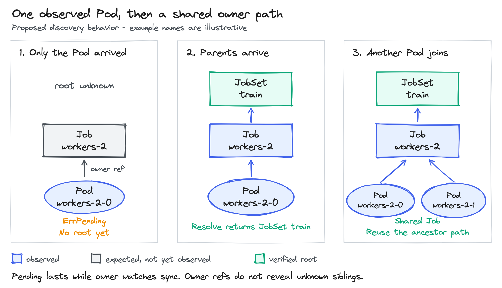
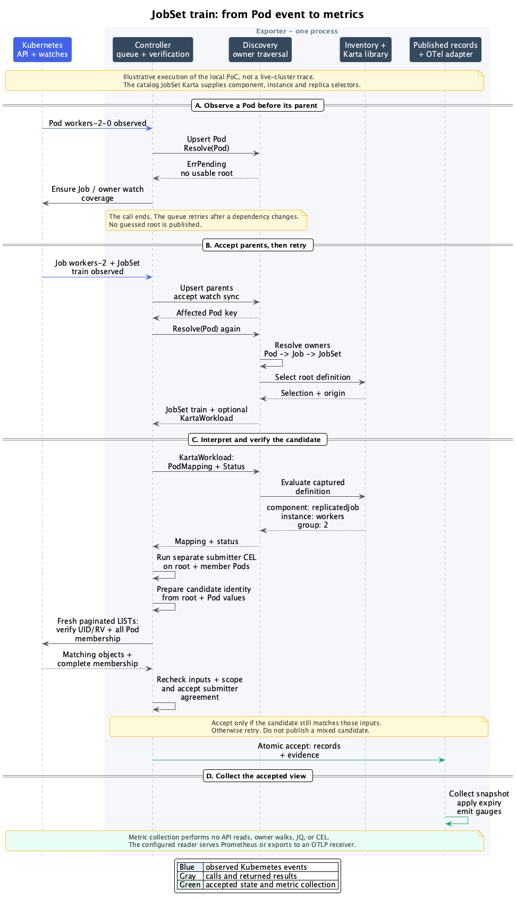

<!-- SPDX-License-Identifier: Apache-2.0 -->
<!-- Copyright (c) 2026 NVIDIA Corporation -->

# Karta metrics exporter: implementation design

- Status: implementation design, with a local PoC
- Author: @AviadHayumi
- Updated: 2026-10-20
- Public contract: [KEP-0001][kep] and [Helm configuration][configuration]

## One Pod, four coordinates

Resource exporters report CPU, memory and GPU measurements for Pods. The Karta exporter supplies the workload identity needed to group those measurements. It also reports workload status, including workloads with no Pods.

Consider the [JobSet quickstart](../../examples/quickstart/jobset.yaml). Its root declares these named instances. Job templates are omitted:

```yaml
apiVersion: jobset.x-k8s.io/v1alpha2
kind: JobSet
metadata:
  name: train
spec:
  replicatedJobs:
    - name: leader
      replicas: 1
    - name: workers
      replicas: 4
```

A Pod in worker Job `2` has this metadata:

```yaml
metadata:
  name: train-workers-2-0
  labels:
    jobset.sigs.k8s.io/replicatedjob-name: workers
    jobset.sigs.k8s.io/job-index: "2"
```

The objects carry this controller-owner chain. UIDs are shortened here:

| Object | UID | Controller owner reference |
| --- | --- | --- |
| Pod `train-workers-2-0` | `pod-uid` | Job `train-workers-2`, UID `job-uid`. |
| Job `train-workers-2` | `job-uid` | JobSet `train`, UID `jobset-uid`. |
| JobSet `train` | `jobset-uid` | None. |

Discovery verifies each reference against the observed object. It then selects the root's JobSet Karta. The catalog definition already contains all three selectors needed by this example:

```yaml
name: replicatedjob
instanceIdPath: .spec.replicatedJobs[].name
podSelector:
  componentInstanceSelector:
    idPath: '.metadata.labels["jobset.sigs.k8s.io/replicatedjob-name"]'
  replicaSelector:
    keyPath: '.metadata.labels["jobset.sigs.k8s.io/job-index"]'
```

Discovery uses the existing Karta library. `jobSet` is the full root object. `pod` is the full Pod. These calls show the JobSet mapping; error handling is omitted:

```go
factory := resource.NewComponentFactoryFromObject(karta, jobSet)
summary, _ := instructions.NewStructureSummary(karta)
query := resource.NewPodQuerier(pod)

name, _ := instructions.InferPodComponent(ctx, query, summary)
// "replicatedjob"
instance, _ := instructions.InferPodComponentInstance(ctx, query, name, factory)
// pointer to "workers"
component, _ := factory.GetComponent(name)
group, _, _ := query.ExtractReplicaKey(ctx, component.GetPodSelector().ReplicaSelector)
// "2"
```

Component inference selects `replicatedjob`, JobSet's only Pod-producing component. Instance inference reads the declared names from the JobSet and matches the Pod's instance label against them. Replica extraction reads the group label from the Pod.

| Coordinate | Result |
| --- | --- |
| Workload | JobSet `train`, with its verified UID. |
| Component | `replicatedjob`. |
| Named instance | `workers`. |
| Replica group | `2`. |

The Pod name determines none of these values. A definition without a replica selector produces an empty group. The SDK treats the group as a key; it does not check it against replica counts. Missing or undeclared required instances are evaluation errors.

## Ownership before interpretation

A selected Karta never stops the controller-owner walk. A LeaderWorkerSet worker can have this chain:

```text
worker Pod -> worker StatefulSet -> leader Pod -> leader StatefulSet -> LeaderWorkerSet
```

The root remains LeaderWorkerSet even if only StatefulSet has a Karta. Karta lookup uses the resolved root's group and kind. Definitions for intermediate owners are not evaluated.

Every owner read from the informer store must match the reference UID. Cycles, multiple controller owners and incomplete paths fail resolution.

A missing owner in a synchronized cache returns `ErrUnresolvedOwner`. It does not prove the owner is absent from the API server. Separate watches may deliver the Pod first. The parent event retries its waiting children; no root is invented during that gap.

Only `ignoredOwnerKinds` creates an intentional boundary. It matches the next owner reference's exact group, version and kind before reading it from the informer store. A different API version does not match the ignore entry. The last verified object below that boundary becomes the root with `owner_resolution="ignored_owner"`. No owners are ignored by default. A missing or denied owner below the boundary still fails.

For the LWS chain above:

```yaml
exporter:
  ignoredOwnerKinds:
    - leaderworkerset.x-k8s.io/v1/LeaderWorkerSet
```

The walk stops at the leader StatefulSet, directly below LeaderWorkerSet. That StatefulSet becomes the generic root. Its Karta, if selected, supplies interpretation. The worker StatefulSet does not become the root just because it has a Karta.

Ignoring LWS changes this traversal, not selection of the LWS object itself. A selected LWS can still emit its own status and creation time while its Pods belong to the StatefulSet root. Use root exclusion rules to remove that independent LWS output.

If no Karta is selected for the resolved root, the result is a valid generic workload. Pod identity uses the verified root, component and instance are `<unknown>`, and group is empty. Creation time remains available; status does not.

Bare Pods require a selected core Pod Karta. The catalog contains `core-pod-v1`, excluded by default. Clearing that exclusion selects its interpretation: component `pod`, empty instance and group, and status from the Pod. A selected cluster Pod Karta instead supplies its own interpretation. The controller suppresses Pod-info, status and creation rows for a Pod root without a selected Pod Karta. This also applies when an ignored owner makes the Pod the root. Resource-type health remains independent.

Root selection applies after ownership resolution. With a Karta, resource rules match the selected definition's API version and its mapped resource. Without one, each observed root representation is checked separately. Each generic Pod row requires its verified owner version to pass. Changing a definition's version can therefore change output scope. `<unknown>` is the defined generic coordinate, not a guessed value after ownership failure. Excluding a root does not promote its child.

Parents can arrive after their Pods. Until the required watch synchronizes, resolution is pending. Once synchronized, a missing parent is an unresolved owner. A reported denial, timeout or watch failure is never hidden as pending.



## Component selection and status

LeaderWorkerSet illustrates a different rule. Its Karta has a logical `group` containing Pod-producing `leader` and `worker` components. The group has no Pod template and is not a Kubernetes object.

| Definition field | Evaluator input | Result |
| --- | --- | --- |
| Leader component type selector | Pod label `worker-index="0"`. | Component `leader`. |
| Worker component type selector | Pod annotation `leader-name` exists. | Component `worker`. |
| Group replica selector | Same Pod's `group-index="2"` label. | Group `2`. |
| Root status expression | Full LeaderWorkerSet object. | Positive `.status.replicas`, with equal ready and updated replica counts, matches `Running`. |

For example, this worker Pod produces component `worker`, an empty instance and group `2`:

```yaml
metadata:
  labels:
    leaderworkerset.sigs.k8s.io/worker-index: "1"
    leaderworkerset.sigs.k8s.io/group-index: "2"
  annotations:
    leaderworkerset.sigs.k8s.io/leader-name: leader-2
```

The table uses shortened keys; all have the same prefix shown above. A nonzero worker index alone does not select the worker component.

The exporter calls `instructions.InferPodComponent` with the SDK structure summary. Only components with a Pod definition are candidates. Candidates follow SDK order: the root component, then child components in definition order. With several candidates, the first matching component type selector wins. With one, the SDK selects it directly. Zero candidates or no matching selector returns `ErrEvaluation` for mapping. Root status remains independent. It then calls `InferPodComponentInstance`. LWS has no named instance, so the exported instance is empty.

Replica selection starts at the selected component. It then visits Karta parent components through the definition's `ownerRef` field. These are logical component links, unrelated to Kubernetes `ownerReferences`.

The nearest selector with a nonempty key path wins. It evaluates that path on the same Pod. An extraction error stops mapping; it does not fall back to an ancestor. With no configured path anywhere, group is empty. For LWS, the path comes from logical component `group` and applies to leader and worker Pods. Discovery owns this traversal and uses the SDK to extract the selected key.

Status uses the root component's `GetStatus(ctx)` independently of Pod mapping. No status definition returns no status. Successful rules with no match return `Undefined`; several phases may match. An expression error returns an error, never `Undefined`. Status failure does not invalidate independently verified creation metadata or successful Pod mapping. Scale extraction is unnecessary.

## Responsibilities and data


The local PoC connects these components in one exporter process. [Behavior checks](./behavior-checks.md) distinguish component tests, connected Kind tests and scale measurements:

| Component | Responsibility |
| --- | --- |
| Controller | Watches, workqueue, scope, fresh API verification, submitter agreement and publication. |
| Discovery | Controller-owner tree, root resolution, selected Karta interpretation and evaluation caches. |
| Definition inventory | Concurrent lookup of the selected definition and its origin. |
| Submitter | Compiled CEL evaluated on one object's metadata. |
| OTel adapter | Format one captured publication view into four metric families. |

Discovery reads existing informer stores. It starts no watches and performs no API calls. The controller owns watch registration and explicit verification reads. Full objects remain in informer stores; the ownership tree stores compact identity and owner facts.

The core is a reusable `Discovery` struct. The controller supplies observed objects and a cache reader. The inventory is its replaceable definition lookup dependency.

```go
// Core dependencies; private cache and revision fields are omitted.
type Discovery struct {
    mu        sync.RWMutex
    reader    CachedReader
    inventory kartadefinitioninventory.Interface
    ownership *OwnershipIndex
}

type CachedReader interface {
    Get(context.Context, ObjectRef) (*unstructured.Unstructured, error)
}

type ObjectRef struct {
    GVK             schema.GroupVersionKind
    Namespace       string
    Name            string
    UID             types.UID
    ResourceVersion string
}

func New(CachedReader, kartadefinitioninventory.Interface,
    ...schema.GroupVersionKind) *Discovery

func (d *Discovery) Resolve(context.Context, ObjectRef) (GenericWorkload, error)
func (d *Discovery) NewEvaluationBatch() EvaluationBatch
func (d *Discovery) IsCurrent(...CapturedState) bool
```

The optional GVKs passed to `New` are ignored-owner boundaries. They do not select Kartas.

The ownership tree is stored in maps keyed by UID. These are the relevant fields from the implementation; cache and revision fields are omitted:

```go
type OwnershipIndex struct {
    nodes    map[types.UID]*OwnerNode
    children map[types.UID]map[types.UID]struct{}
    byKind   map[schema.GroupKind]map[types.UID]struct{}
}

type OwnerNode struct {
    objects map[schema.GroupVersionKind]observation
    parents map[types.UID]struct{}
}
```

An `observation` contains the object reference, controller-owner references and watch generation. Several API representations can belong to one UID. Disagreement between their owners invalidates the path. Event arrival order does not choose a parent.

Reverse child links let an owner update find its affected descendants. A missing parent can be represented by a child link before that parent arrives. Pods can also be parents, as in LeaderWorkerSet.

The controller feeds accepted events to the same `Discovery` instance:

```go
func (d *Discovery) Upsert(ObservedObject) ChangeSet
func (d *Discovery) Delete(ObjectRef) ChangeSet
func (d *Discovery) CoverageChanged(CoverageChange) ChangeSet
func (d *Discovery) DefinitionChanged(schema.GroupKind) ChangeSet

type ObservedObject struct {
    Ref      ObjectRef
    Owners   []metav1.OwnerReference
    WatchKey CoverageKey
    Run      uint64
}

type CoverageKey struct {
    Resource  schema.GroupVersionResource
    Namespace string
}

type CoverageChange struct {
    Key        CoverageKey
    Run        uint64
    FullObject bool
    Ready      bool
    Removed    bool
    Err        error
}
```

`Run` identifies one watch lifetime. The controller assigns a new value when it replaces a watch. It is carried by the observation, not `ObjectRef`.

`Upsert` updates owner edges. `Delete` removes only the supplied UID. `CoverageChanged` invalidates paths that depend on the changed watch. `DefinitionChanged` invalidates interpretation for the root group/kind.

Each returns a `ChangeSet`:

- `Objects` identifies changed objects and affected descendants. Their dependent results must be checked again.
- `Roots` identifies workloads needing reconciliation. An unchanged root is not invalid merely because its Pod changed.
- `MissingCoverage` names the GVK, namespace and whether full objects are required. The controller starts that watch and retries.

`GenericWorkload` exposes the input-to-root `Path` and `Resolution` fields. `Resolution` is `resolved` or `ignored_owner`. Its root and captured state have accessors. `KartaWorkload` adds the selected definition and SDK evaluation:

```go
type GenericWorkload struct {
    root       ObjectRef
    Path       []ObjectRef
    Resolution OwnerResolution
    karta      *KartaWorkload
    state      CapturedState
}

type KartaWorkload struct {
    root      ObjectRef
    selection kartadefinitioninventory.Selection
    discovery *Discovery
    state     CapturedState
}

func (w GenericWorkload) Root() ObjectRef
func (w GenericWorkload) KartaWorkload() *KartaWorkload
func (w GenericWorkload) State() CapturedState
func (w GenericWorkload) Walk(
    context.Context, func(ObjectRef, *ObjectRef) error,
) (CapturedState, error)

func (w *KartaWorkload) Status(context.Context, EvaluationBatch) (StatusResult, error)
func (w *KartaWorkload) PodMapping(context.Context, *corev1.Pod, EvaluationBatch) (PodMapping, error)

type StatusResult struct {
    Defined bool
    Matched []v1alpha1.ResourceStatus
    state   CapturedState
}

type PodMapping struct {
    Component string
    Instance  string
    Group     string
    state     CapturedState
}
```

Both results expose `State()`. `CapturedState` is an opaque token for the local inputs used by a calculation. A zero token is invalid. `IsCurrent` checks those inputs before publication. It does not replace fresh API verification.

`EvaluationBatch` shares SDK preparation and root calculations across sibling Pods in one round. It has no public configuration.

`Resolve` selects the Karta once. `KartaWorkload()` returns that interpretation, or nil for confirmed absence. The handle never silently switches definitions. The JobSet result is:

```text
GenericWorkload
  Root(): JobSet team-a/train, UID jobset-uid
  Path: [Pod train-workers-2-0, Job train-workers-2, JobSet train]
  Resolution: resolved

PodMapping: {Component: replicatedjob, Instance: workers, Group: "2"}
```

The controller calls `Resolve(ctx, podRef)` first. On success, it checks `KartaWorkload()`. A nil result means confirmed absence of a definition, subject to the Pod-root opt-in described above.

For a selected definition, it calls `Status(ctx, batch)` and `PodMapping(ctx, pod, batch)` separately. Failure in one does not discard the other. Publication checks their captured states together with the controller's fresh evidence.

`Resolve` has three outcomes. Check the error before interpreting a nil `KartaWorkload()`:

| Result | Meaning |
| --- | --- |
| No error, nonempty root UID | Ownership and selection succeeded. A nil Karta handle means confirmed absence. |
| Error, nonempty root UID | Ownership succeeded but definition lookup failed. Only the root and captured state are usable. |
| Error, empty root UID | No usable result. Retry or retain applicable history as described below. |

Selection errors use `ErrPending`, `ErrPermissionDenied`, `ErrUnavailable` or `ErrInvalidDefinition`. With a usable root, fresh evidence can still support its creation timestamp. No new Pod-info or status row is derived from this partial result. Applicable previous rows may remain invalid, except when an invalid definition withdraws interpretation. A lookup error never authorizes generic coordinates.

`Walk` starts at the resolved root and visits its observed descendant subtree in depth-first order, including the root. It does not walk the input-to-root `Path`. It copies references before calling visitors outside the discovery lock. An empty subtree does not prove complete Pod membership.

The cached reader finds the accepted watch generation internally from the object key. It requires the accepted UID and resourceVersion to match the stored object. If the store has advanced ahead of its callback, the worker discards its calculation and retries. Private captured revisions record ownership, membership, definition and coverage changes. These revisions are not Kubernetes resourceVersions.

## Definition inventory

The inventory remains an injected dependency:

```go
// Package kartadefinitioninventory.
type Interface interface {
    Lookup(schema.GroupVersionKind) (Selection, error)
}

type Selection struct {
    Definition *v1alpha1.Karta
    GVK        schema.GroupVersionKind
    Origin     Origin
}

type Origin struct {
    Source          Source
    Name            string
    UID             types.UID
    ResourceVersion string
}

type Source string
const (
    SourceCatalog Source = "catalog"
    SourceCluster Source = "cluster"
)
```

`Lookup` accepts GVK to preserve the scaffold interface. Selection uses its group and kind; the input version does not restrict candidates. `Selection.GVK` returns the winning definition's version.

Filters apply within each enabled source before precedence. A nonempty `include` match OR a nonempty `labelSelector` match selects a candidate. Both empty select all candidates. `exclude` wins. Cluster candidates override catalog candidates for the same group/kind. Cluster ties use oldest creation time, then name.

Lookup returns a caller-owned snapshot. All enabled sources must initialize before absence is confirmed. Source failure is an error, not catalog fallback. An invalid winning definition remains an error.

`New(dynamicClient, options)` builds the catalog selection and cluster cache. `Run(ctx)` lists and watches cluster Kartas. It handles add, update and deletion internally. With cluster lookup disabled, catalog results are available immediately. Lookup performs no API calls and is safe during concurrent updates.

The controller separately observes Karta changes; there is no notification interface. Before publication, it checks the returned selection against its accepted candidate facts, including competing definitions and source readiness. The inventory can receive a Karta event before the controller, or the reverse. A mismatch retries until their facts agree. [Selection ordering](./consistency.md#definition-selection) specifies this check.

The returned GVK selects the root representation used for Karta evaluation and `workload_version`. If ownership used another version, the controller establishes full coverage for the selected version and verifies the same UID. Version changes replace output for that lifetime, never create a second workload.

## Startup, scope and events

Startup validates configuration and compiles CEL. It initializes enabled definition sources, namespace selection and required coverage. It registers handlers before starting workers. Full Pods are watched in selected namespaces. Root kinds with a selected Karta need full objects, including roots with no Pods. Generic roots and intermediate owners need metadata.

A Deployment Pod may reveal a missing ReplicaSet watch. Discovery reports the missing kind and pending resolution. The controller maps the GVK through API discovery and starts a shared namespace/resource watch. The controller waits for both its store and initial handlers before reporting ready coverage to discovery and retrying children. The ReplicaSet can then reveal the Deployment. A full watch also serves metadata consumers. Failed API discovery, including an unserved GVK, returns `ErrUnavailable`. It does not leave the dependency pending forever.

Full/metadata handover uses a new watch generation. The replacement must synchronize before its coverage becomes usable. Its initial cache does not prove deletion. A complete, fresh LIST must confirm absence before an old observation is retired. Retired callbacks are rejected. Deletion guards cover every representation that could still deliver an old UID. [Handover ordering](./consistency.md#deletion-and-delayed-events) prevents replacement watches from reviving stale objects.

| Setting | Default | Effect |
| --- | --- | --- |
| `namespaceSelector` | All namespaces. | Limits namespaced watch scope. |
| `objectSelector`, `resourceRules`, `excludeResourceRules` | No root filter. | Select resolved roots for output; exclusions win. |
| `podSelector` | All observed Pods. | Selects emitted Pod rows only. |
| `requiredKinds` | Empty. | Requires API coverage for readiness and type health, including ignored kinds. |

An ignored boundary removes that owner from the traversal dependencies. A failed required-kind check still makes `/readyz` fail and publishes unhealthy type coverage. It invalidates workload observations only when they depend on that kind. An ignored traversal does not create that dependency.

All Pods remain observed, including hidden rows. Child watches cannot use root label filters. Intermediate kinds require read permissions, but no explicit Helm discovery entry. Namespace or output-scope exit removes rows. Failed refresh never expands scope.

Known root kinds retain metadata coverage after definition removal. This preserves known generic roots but does not discover every unknown zero-Pod kind. Restart rebuilds coverage from configured definitions and observed owner chains.

`/healthz` reports process health. `/readyz` requires initialized configuration, sources and required coverage. It need not wait for every workload calculation. An optional kind can fail while unrelated workloads continue.

Events update the index and queue stable identity keys. Workers reread current objects; repeated work coalesces and retries use rate limiting.

| Event | Reconciliation |
| --- | --- |
| Pod create or resourceVersion update | Resolve ownership and refresh affected mapping and metadata results. Spec and status updates count. |
| Intermediate owner add/update | Retry waiting children and affected descendants. |
| Root update | Reevaluate root status and dependent mappings. |
| Deletion | Retire that UID and reconcile surviving dependents. |
| Coverage failure/recovery | Revoke affected evidence or begin fresh verification. |

Before calling `Upsert` or `Delete`, the controller rejects callbacks whose stream key and run are retired. This check and the mutation share the publication lock. `Delete` then applies to the supplied UID, so an old deletion cannot remove a replacement with the same name. Reparenting removes the old association before publishing the new one and changes both workloads' membership.

Karta changes queue affected roots in batches. A first definition establishes full coverage and evaluates listed zero-Pod roots. Winner edits withdraw status and dependent Pod-info rows immediately. They reappear only after evaluation with the new definition succeeds. An evaluation failure cannot restore rows from the old definition. Winner deletion selects the next candidate or confirms absence. Confirmed absence removes status and restores generic coordinates; bare-Pod output loses its opt-in. Source failure instead invalidates dependent output. A target group/kind or version change affects both old and new selections.



[Zoomable sequence](./jobset-event-flow.preview.html) | [SVG](./jobset-event-flow.svg)

## Verification and caching

Reconciliation follows one acceptance path:

1. Capture object versions, ownership, selected definition, scope, coverage and failure state.
2. Read matching cache bodies. Evaluate status, Pod mappings and metadata outside the publication lock.
3. Obtain fresh verification for those inputs. Share checks across dependent workloads.
4. Under one short publication lock, verify that captured local facts still match. Install the immutable replacement and its evidence together; otherwise discard and retry.
5. At collection, apply evidence expiry using one captured time.

Local revision checks prevent publishing work superseded by accepted events. Fresh API checks bound validity when events are missed. Neither check substitutes for the other. Kubernetes resourceVersions are compared for equality within the same API representation, never sorted.

An accepted object event queues verification for its resource stream immediately. It does not wait for the periodic refresh. Events also queue reconciliation, which can publish only when matching verification is available. Repeated events coalesce in the workqueue.

Verification uses complete LIST requests, not one GET per object. It compares each returned UID and resourceVersion with the captured cache observation. The watch run, scope and failure state must still match at commit. Rapidly changing objects can remain hidden until a stable result passes these checks.

One scheduler shares root and owner checks by namespace/resource stream. Complete paginated Pod LISTs run per namespace per verification round, not per workload. They include hidden Pods and classify every Pod through verified owner paths. Known-Pod GETs cannot prove complete membership. Partial or failed lists prove neither absence nor deletion.

Internal defaults refresh with jitter across 45-60 seconds and expire evidence 120 seconds after the fresh read starts. Each LIST page has a 30-second deadline. WATCH requests use the controller lifetime context. These timings add no Helm settings.

Reconnects, bookmarks, scrapes and successful delivery do not renew evidence. A normal WATCH close reconnects without revoking still-valid evidence. A short empty watch or a failed reconnect is a failure. Accepted read/watch failures revoke affected validity immediately. Recovery requires fresh verification.

Ownership resolution walks the cached UID graph under a read lock. It performs no API calls and keeps no second cache of paths. Each result captures the object, owner-edge, coverage and definition revisions used by that walk. Unrelated changes leave the result current. A subtree walk also captures membership changes.

Karta results depend on root and Pod resourceVersions, selected definition and evaluation batch. New verification batches reevaluate time-dependent JQ even when objects are unchanged. CEL caches depend only on complete metadata, resource identity and extractor configuration, so status-only changes can reuse them.

Derived caches may be evicted. Active ownership links, unresolved references and dirty work remain until deletion or scope exit. Publication stores immutable records per root, with small immutable Pod pages. A single-Pod change copies its page rather than every Pod in a large root. Each page contains at most 256 Pod rows. The controller builds pages in one pass when many rows change. [Verification details](./consistency.md) cover pagination, deletion guards, lock ordering and independent field deadlines.

## Submitter agreement

Submitter extraction is independent of discovery:

```go
// Package submitterextractor.
type Interface interface {
    Evaluate(context.Context, metav1.Object, schema.GroupVersionKind) (Submitter, error)
}

type Submitter struct {
    Identity string
}

type Extractor struct {
    program cel.Program
    // Private bounded cache of metadata results.
}

func (e *Extractor) Evaluate(
    context.Context, metav1.Object, schema.GroupVersionKind,
) (Submitter, error)
```

`Extractor` implements the existing interface and holds compiled CEL. Compilation requires a string result; invalid CEL rejects startup. Evaluation respects cancellation and cost/output limits. CEL receives `labels`, `annotations` and `resource`; resource contains namespace, name, group, version and kind. It cannot read spec, status or Kubernetes APIs.

For example, the configured expression reads one annotation:

```yaml
exporter:
  attribution:
    submittedByExpression: |
      "team.example/submitted-by" in annotations
        ? annotations["team.example/submitted-by"] : ""
```

Given a JobSet with `metadata.annotations["team.example/submitted-by"] = "alice"`, the controller passes that root object and its GVK to `Evaluate`. The result is `Submitter{Identity: "alice"}`. It calls the same extractor separately for each Pod. A Pod without that annotation returns an empty identity.

The controller evaluates the root and every associated Pod, including hidden rows. Equal nonempty identities produce one shared `submitted_by`; empty results do not conflict. All empty, conflicting identities, any extraction failure or unverified membership produce an empty value. Disabling attribution omits the label. Invalid emitted rows clear their value. Submitter extraction failure alone does not invalidate independently verified Pod mapping, status or creation time.

Membership proof is shared across a namespace. Adding or deleting a Pod, changing its owner, or changing its labels or annotations invalidates that proof. Any Pod whose owner path is pending or failed blocks renewal for the namespace. A status-only update can delay renewal but does not revoke the existing proof before its deadline.

This is conservative: one busy workload can temporarily clear `submitted_by` for other workloads in the namespace. Independently verified status, mapping and creation time remain available. Stale calculations cannot clear newer agreement.

Changing `submitted_by`, including clearing it, changes the metric series. Consumers must handle the empty value as unknown identity. Valid mapping does not imply verified submitter identity.

Native admission capture remains separate. Helm installs API-server policies to record the authenticated CREATE caller and reject conflicting supplied identity. UPDATE protection prevents changes or removal even after capture narrows or is disabled. [Policy details](./consistency.md#submitter-update-protection) define that independent protection. CEL fallback labels do not authenticate their values.

## Failure and publication

Internal errors wrap sentinels with `%w`; the controller checks them with `errors.Is`. Detailed errors are not exported as metric labels. Cancellation remains a context error.

| Sentinel | Meaning and output |
| --- | --- |
| `ErrPending` | Needed coverage or definition selection has not initialized. No new result is published. Required coverage blocks readiness; optional discovery coverage does not. |
| `ErrPermissionDenied` | Denied read; `permission_denied` invalidates dependent observations. |
| `ErrUnavailable` | Read/source failure or expired evidence; `api_unavailable`. |
| `ErrUnresolvedOwner` | Missing owner, wrong UID or invalid chain; `unresolved_owner`. |
| `ErrInvalidDefinition` | Invalid winner; `invalid_definition`, with no fallback. |
| `ErrEvaluation` | Status or mapping error; `evaluation_failed` for that result. |
| `ErrStale` | Changed inputs; discard and retry without a public failure. |

`ErrPermissionDenied`, `ErrUnavailable`, `ErrUnresolvedOwner` and `ErrEvaluation` retain applicable previously verified Pod/status rows as `observation_valid="false"`. An invalid definition withdraws its interpretation. `ErrStale` discards the calculation without changing newer output. Ownership failure changes retained rows to `owner_resolution="unknown"`. Without a previous applicable result, no identity, coordinates or phase is invented.

`ErrPending` alone does not change existing publication. Startup has no previous rows. A changed input suppresses its affected fields while work is pending. Replacing coverage revokes its old evidence, so applicable retained rows become invalid until fresh verification succeeds. Unrelated pending work leaves other observations unchanged.

A retained mapping remains applicable only for the same Pod UID, root UID and selected definition snapshot. A cluster definition snapshot includes its UID and resourceVersion. Any edit to the winning Karta withdraws the previous interpretation, even when its UID stays the same.

Any Pod resourceVersion change suppresses its mapping until reevaluation, including status-only changes. It does not suppress unchanged root status, creation time or sibling mappings.

Karta expressions can read the full Pod, so metadata-only comparison cannot prove the result unchanged. This conservative choice can create short gaps during churn. The old mapping remains in memory for failure reporting. For an instance-label change:

| Step | Pod mapping output |
| --- | --- |
| Before the update | Instance `workers`, validity `true`. |
| Recalculation pending | No Pod-info row for this mapping until recalculation succeeds or fails. |
| Recalculation fails | Last verified instance `workers`, validity `false`, empty `submitted_by`. |
| Recalculation succeeds | New instance replaces the old row, validity `true`. |

A root resourceVersion change suppresses its status rows, dependent Pod-info rows and creation timestamp while verification and reevaluation are pending. Karta can read the full root, including status, so a status-only update follows the same rule. Each successful result returns independently. A failure may retain applicable historical status or mappings as invalid. Creation time returns only with valid metadata evidence.

Invalid rows describe the last verified observation, not the new object's state. Consumers must filter on validity. Confirmed reparenting, definition replacement, deletion and scope exit permanently withdraw superseded rows. Later failure cannot restore them.

Queue delay alone adds no failure reason. Unverified creation time is omitted. A successfully observed `Failed` phase still has validity `true`.

## OpenTelemetry delivery

The controller exposes a read-only capture operation to the adapter. Capture fixes one time and one set of immutable root records with their validity evidence. Proof identifiers and invalidation bookkeeping stay private to publication. Every family uses this same view.

| Metric family | Observation |
| --- | --- |
| `karta_pod_workload_info` | Value `1` with root and Pod coordinates. |
| `karta_workload_status` | Configured phases as `1` when matched, otherwise `0`. |
| `karta_workload_created_timestamp_seconds` | Verified root creation timestamp. |
| `karta_exporter_observation_valid` | Resource-type health as 1/0; known-workload failures as 0 only. |

The callback performs no Kubernetes reads, ownership traversal or JQ/CEL evaluation. Mapping, status, creation time and submitter agreement retain separate validity. Healthy workloads have no separate health row. `observation_valid` is a label on Pod-info and status metrics. `karta_exporter_observation_valid` is a separate health metric. Creation time has no validity label; unverified samples are omitted. The KEP defines exact labels and reasons.

Prometheus is the default delivery mode and exposes `/metrics` through the OTel reader. OTLP mode uses a periodic reader with HTTP/protobuf or gRPC and has no ServiceMonitor. Exactly one delivery mode is enabled. Both expose health endpoints.

Prometheus translation, scope info and target info are disabled to preserve metric names and labels. SDK overflow aggregation is disabled so different identities are not merged. OTLP headers come from a Secret-backed environment variable; TLS files are mounted read-only. Secret changes require restart. Shutdown cancels work and closes the provider with a deadline. OTLP omission relies on backend expiry; delivery success does not certify validity.

## Evidence and remaining decisions

The [behavior checks](./behavior-checks.md) record the executable and source revision for each verification. Component tests, the connected command, Kind acceptance and scale measurements are separate checks. A component test does not establish cluster or scale behavior.

The scale model passed 100k workloads with zero or one Pod each. One root with 100k Pods also passed. The million-Pod case exceeded the 8 GiB RSS limit during startup. These are bounded loopback measurements, not production capacity guarantees.

Discovery preserves cluster-scoped roots. Publishing them still needs a KEP decision. Replicas observe duplicate scope; disjoint namespace deployments remain the partitioning option.

[kep]: ../../../keps/0001-metrics-exporter/README.md
[configuration]: ../../karta-metrics-exporter/configuration.md
