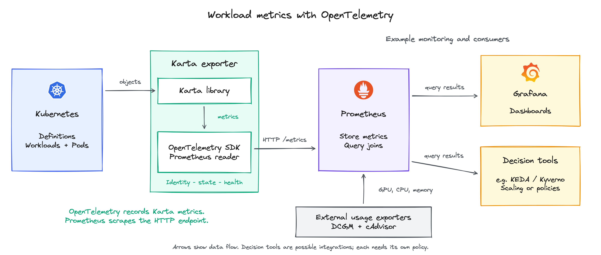

<!-- SPDX-License-Identifier: Apache-2.0 -->
<!-- Copyright (c) 2026 NVIDIA Corporation -->

# Karta metrics exporter configuration

Proposed configuration for [KEP-0001](../../keps/0001-metrics-exporter/README.md).
The exporter runs separately from the Karta controller. Helm configures its
definitions, observation scope and metric delivery.

## Helm values

```yaml
exporter:
  enabled: true # Deploy the exporter; default false.
  image:
    tag: "<exporter-tag>" # Exporter image version.
  metricsExporter: prometheus # Default: prometheus. Set otlp for native push.
  otlp: # Used only when metricsExporter is otlp.
    protocol: http/protobuf # Or grpc.
    endpoint: https://metrics.example.com:4318/v1/metrics
    interval: 30s
    timeout: 10s
    headersSecretRef: {name: karta-otlp-auth, key: headers} # Optional.
    tls: # Optional custom CA and mutual TLS.
      caSecretRef: {name: karta-otlp-tls, key: ca.crt}
      clientCertSecretRef: {name: karta-otlp-tls, key: tls.crt}
      clientKeySecretRef: {name: karta-otlp-tls, key: tls.key}
  http:
    port: 8080 # /healthz and /readyz; also /metrics in Prometheus mode.
  kartaDefinitionSource:
    catalog:
      enabled: true # Built-in definitions; default false.
      include: []
      exclude: [core-pod-v1] # Clear to opt into bare-Pod catalog attribution.
    cluster:
      enabled: true # Cluster-installed Karta definitions; default true.
      include: []
      exclude: []
      labelSelector: {}
  namespaceSelector: # Default null or {}: all namespaces.
    matchExpressions:
      - key: example.com/tenant
        operator: Exists
      - key: kubernetes.io/metadata.name
        operator: NotIn
        values: [kube-system, karta-system]
  objectSelector: # Default null or {}: all resolved workload roots.
    matchExpressions:
      - key: example.com/purpose
        operator: NotIn
        values: [reservation]
  podSelector: # Default null or {}: all Pod attribution rows.
    matchExpressions:
      - key: example.com/purpose
        operator: NotIn
        values: [reservation]
  resourceRules: [] # Empty: no root API-type restriction.
  excludeResourceRules: [] # Exclusions take precedence.
  ignoredOwnerKinds: # Stop the owner walk before these exact GVKs; default [].
    - example.com/v1/PlatformWrapper
  requiredKinds: [] # Optional expected APIs; failed checks mark dependent observations unhealthy.
    # Example: ["jobset.x-k8s.io/v1alpha2/JobSet"]
  metrics:
    workloadPhases: ["all"] # Emit every workload phase as a 0/1 series.
  serviceMonitor:
    enabled: true # Create the optional ServiceMonitor; default false.
    interval: 30s # How often Prometheus scrapes metrics.
    scrapeTimeout: 25s # Maximum duration of one scrape.
```

`exporter.enabled` defaults to `false`. The example enables it and the built-in
catalog. `http.port` serves `/healthz` and `/readyz` in both delivery modes, plus
`/metrics` in Prometheus mode. It also sets the container, probe and Service ports.

## Selection

| Setting under `exporter` | Selects |
| --- | --- |
| `namespaceSelector` | Namespaces by labels; `kubernetes.io/metadata.name` selects names. |
| `objectSelector` | Resolved workload roots by their labels. |
| `podSelector` | Pods whose attribution rows are exported, using each Pod's labels. |
| `resourceRules` / `excludeResourceRules` | Root API types, using group, version and plural resource name. Exclusions win. |
| `kartaDefinitionSource.cluster.labelSelector` | Cluster Karta definitions by their labels. |
| Definition-source `include` / `exclude` | Definition names. Empty includes mean all; exclusions win. |

Label selectors use Kubernetes `matchLabels` and `matchExpressions`. Requirements
are ANDed. `In`, `NotIn`, `Exists` and `DoesNotExist` are supported; `NotIn` also
matches missing labels. Omitted, null or `{}` selectors impose no restriction.
A nonempty selector with no matches selects nothing. Labels are not inherited.
See [Kubernetes label selectors](https://kubernetes.io/docs/concepts/overview/working-with-objects/labels/#label-selectors).

All Pods remain watched in selected namespaces for ownership and submitter checks.
`objectSelector` filters whole workloads; `podSelector` filters their exported Pod
rows. Both must match for a Pod row to appear. Workload status describes the full
workload, while usage joined through filtered Pod rows covers only those Pods.

Namespace scoping reduces LIST/WATCH traffic. Pod filtering reduces output, not
watch traffic. Root filters do not remove owner dependencies: a selected JobSet
still needs its Jobs. An excluded root emits no workload metrics or Pod
attribution; its children do not become replacement roots. Scope changes update
the selected set and remove observations that leave it. A failed scope refresh
does not widen selection.

The legacy `exporter.namespace` selects one namespace when `namespaceSelector`
is omitted or null. Combining it with a non-null selector, including `{}`, is invalid.

### Workload API types

```yaml
exporter:
  resourceRules:
    - apiGroups: ["batch"]
      apiVersions: ["v1"]
      resources: ["jobs", "cronjobs"]
    - apiGroups: ["jobset.x-k8s.io"]
      apiVersions: ["*"]
      resources: ["jobsets"]
  excludeResourceRules:
    - apiGroups: ["batch"]
      apiVersions: ["v1"]
      resources: ["cronjobs"]
```

A root matches its label selector, at least one inclusion rule when configured,
and no exclusion rule. Group, version and resource must all match within a rule;
list entries are alternatives. `"*"` matches any value; `""` is the core API group.
Core Pods use group `""`, version `v1` and resource `pods`.

The fields follow Kubernetes [MatchResources](https://kubernetes.io/docs/reference/kubernetes-api/definitions/match-resources-v1-admissionregistration/),
without admission operations or subresources. Each supplied rule needs nonempty
group, version and resource lists. Invalid selectors, malformed rules and unknown
catalog names reject configuration. Other served API versions do not create
duplicate observations.

### Definition sources and owner boundaries

Source filters apply before precedence. A selected cluster Karta overrides a
selected catalog definition for the same group/kind. Disabled sources contribute
none. Cluster definition names and their label selector must both match. Ties use
oldest creation time, then name.

The catalog excludes `core-pod-v1` by default. Clearing that exclusion, or selecting
a cluster Pod Karta, enables bare-Pod workloads. `objectSelector` also applies to
those roots.

`ignoredOwnerKinds` stops the owner walk before an exact GVK. The last verified
object below it becomes the root; missing owners below that boundary still fail.
A Karta definition on an intermediate owner does not by itself stop the walk.
An ignored owner can still be selected independently. `requiredKinds` checks
remain active; failed checks invalidate dependent observations.

## Submitter admission

`submitterAdmission` captures direct Kubernetes callers. Exporter CEL extraction
is configured separately, as shown in [Who submitted the workload](../../keps/0001-metrics-exporter/README.md#who-submitted-the-workload).

Capture uses `MutatingAdmissionPolicy` and `ValidatingAdmissionPolicy` with their
bindings. Both run in the API server without a Karta operator. MAP is
[stable in Kubernetes 1.36+](https://kubernetes.io/docs/reference/access-authn-authz/mutating-admission-policy/);
[1.34-1.35 requires beta feature/API enablement](https://v1-35.docs.kubernetes.io/docs/reference/access-authn-authz/mutating-admission-policy/).
VAP is [stable since 1.30](https://kubernetes.io/docs/reference/access-authn-authz/validating-admission-policy/).
The chart rejects capture if required APIs are unavailable.

This example captures Deployments and Jobs in opted-in namespaces:

```yaml
submitterAdmission:
  enabled: true
  matchConstraints:
    namespaceSelector:
      matchLabels:
        karta.run.ai/capture-submitter: "true"
      matchExpressions:
        - key: kubernetes.io/metadata.name
          operator: NotIn
          values: [kube-system, karta-system]
    resourceRules:
      - operations: ["CREATE"]
        apiGroups: ["apps"]
        apiVersions: ["v1"]
        resources: ["deployments"]
        scope: Namespaced
      - operations: ["CREATE"]
        apiGroups: ["batch"]
        apiVersions: ["v1"]
        resources: ["jobs"]
        scope: Namespaced
    excludeResourceRules: []
  matchConditions: [] # Optional CEL conditions on the admission request.
```

Capture follows [native Kubernetes matching](https://github.com/kubernetes/kubernetes/blob/v1.36.0/staging/src/k8s.io/api/admissionregistration/v1/types.go#L554-L642).
Rules select namespaced CREATE requests. Exclusions win and all conditions must
pass. An empty namespace selector matches all namespaces. Direct Pod capture uses
group `""`, version `v1`, resource `pods`. These settings do not filter exporter watches.

Mutation fills a missing `karta.run.ai/submitted-by` annotation. Within capture
scope, CREATE validation rejects a supplied value that differs from the caller.
Captured identity must stay protected from UPDATE overrides or removal, including
after capture scope narrows. The exact UPDATE matching rules are TBD in the
[implementation design](../design/metrics-exporter/README.md).
Administrators control namespace labels and policy settings. Policies use
`failurePolicy: Fail`; validation bindings use `validationActions: [Deny]`.

## Metric delivery

| Mode | Configuration | Requirements |
| --- | --- | --- |
| Prometheus pull | `metricsExporter: prometheus` | Prometheus scrapes `/metrics`. ServiceMonitor is optional. |
| Native OTLP push | `metricsExporter: otlp` | An OTLP receiver; endpoint and protocol under `otlp`. |
| Collector bridge | Prometheus mode, scraped by a Collector | The Collector forwards to the chosen backend. |

Combined native pull and push is deferred. CPU, memory and GPU measurements come
from other exporters; the [query guide](README.md) shows how to join them.

### Prometheus



`serviceMonitor.enabled: true` creates a ServiceMonitor. Its CRD must be installed
and the Prometheus selector must match it. The Prometheus Operator turns it into
scrape configuration. Without the Operator, Prometheus uses its own scrape configuration.
See [ServiceMonitor discovery](https://prometheus-operator.dev/docs/developer/getting-started/#using-servicemonitors).

Prometheus discovers and scrapes each exporter endpoint separately. A single
load-balanced Service address can hide conflicting observations during a rollout.
Target identity remains available until query aggregation. The HTTP endpoint has
no built-in authentication; access is restricted by network policy or an
authenticated proxy.

### Native OTLP

In OTLP mode, `serviceMonitor.enabled` is `false`. An OTel periodic reader sends
the current metric snapshot, including unchanged values, to `otlp.endpoint`.
HTTP uses `POST /v1/metrics`; gRPC uses `MetricsService.Export`.
For gRPC, the endpoint is `https://metrics.example.com:4317`, without `/v1/metrics`.

`interval` and `timeout` accept positive whole-millisecond durations. The timeout
bounds the collection/export cycle and the client request. Unsupported protocols,
invalid durations and invalid endpoints reject startup.

Authentication and TLS Secrets live in the exporter's namespace. The chart mounts
only the referenced TLS keys read-only at `/etc/karta/otlp`. Kubernetes supplies
the files; no PVC or Secrets API read permission is needed. Missing referenced
Secrets or keys prevent startup.

`headersSecretRef` supplies comma-separated `key=value` headers through a generated
Secret-backed environment variable. HTTPS uses system trust by default. A custom
CA is optional; mutual TLS requires both client certificate and key. Secret
changes require an exporter restart. See [Secret projection](https://kubernetes.io/docs/concepts/storage/projected-volumes/)
and [OTLP settings](https://opentelemetry.io/docs/languages/sdk-configuration/otlp-exporter/).

Removed objects stop appearing in exports. The backend needs expiry or stale-series
handling; omission is not an immediate delete command. Delivery success does not
certify observation validity. See the [OTLP gauge model](https://opentelemetry.io/docs/specs/otel/metrics/data-model/#gauge).

### Collector bridge

An [OTel Collector](https://opentelemetry.io/docs/platforms/kubernetes/helm/collector/)
can scrape `/metrics` and forward the samples. PromQL joins require a compatible
query backend. The Collector and backend control label translation, deletion and
freshness.

## Deployment and permissions

| Value under `exporter` | Purpose |
| --- | --- |
| `rbac.workloadRules` | Read access for workload kinds and intermediate owners. |
| `resources` | CPU and memory requests/limits. |
| `nodeSelector`, `tolerations`, `affinity` | Pod placement. |
| `networkPolicy` | Access to the metrics endpoint. |

Example read permissions for JobSet and its intermediate Jobs:

```yaml
exporter:
  rbac:
    workloadRules:
      - apiGroups: ["jobset.x-k8s.io"]
        resources: ["jobsets"]
      - apiGroups: ["batch"]
        resources: ["jobs"]
```

The chart adds `get`, `list` and `watch`; Pod and Karta-definition reads are
separate built-in rules. This list replaces the defaults. A separately managed
ClusterRole labeled `karta.run.ai/exporter-rbac: "true"` can extend the aggregated role.
The chart binds that read-only role even for an existing service account.
Namespace filtering does not narrow authorization; that requires custom RBAC.

Platforms can deploy exporters with disjoint namespace scopes. More replicas
watch the same scope rather than divide it. Karta does not manage that deployment.
