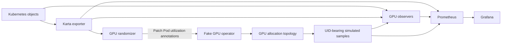

<!-- SPDX-License-Identifier: Apache-2.0 -->
<!-- Copyright (c) 2026 NVIDIA Corporation -->

# Exporter and simulated GPU demo

This bundle records the setup completed on 2026-11-02. It includes the exporter
release, three dashboards, workload fixtures, GPU load randomizer, observers,
source snapshots and verification evidence. Start with [SETUP.md](SETUP.md).
[SESSION.md](SESSION.md) records the changes, failures and fixes.

The exporter runs commit `9c14b074d03dac9fde4f0b64616d7216a3ad9374` from
`AviadHayumi/workload-map:exporter-controller-runtime`. Its source was unchanged
for this deployment. The [published prerelease](https://github.com/AviadHayumi/workload-map/releases/tag/exporter-runtime-9c14b074d03d)
contains the binary, chart, image digest and checksums.

GPU simulation runs in separate containers. The helper image shares the fork's
image repository but has a different digest and different entrypoints. It does
not replace the exporter. [versions.json](versions.json) pins both images.

## What runs

| Component | Responsibility |
| --- | --- |
| `karta-metrics-exporter` | Publishes workload identity, phases and observation validity. |
| `demo-generator` | Creates a Job every two minutes and a PyTorchJob every six minutes. |
| `gpu-demo-randomizer` | Runs every minute. Chooses new active/quiet workload groups every ten minutes. |
| Existing fake GPU operator | Reads Pod annotations and updates simulated device allocation/usage state. |
| `karta-demo-dcgm` | Reads named topology ConfigMaps and emits synthetic samples with allocation Pod UIDs. |
| `karta-workload-gpu-observer` | Checks identities and device counts, then calculates workload activity. |
| `karta-gpu-observer` | Provides per-device diagnostics through one observer process per configured node. |
| Prometheus and Grafana | Store samples, evaluate queries and display workload histories. |

The steady fixtures contain 24 Pods and request 13 fake GPUs. They cover
Deployment, StatefulSet, standalone Pod, PyTorchJob, TFJob, JAXJob, XGBoostJob and
LeaderWorkerSet. CPU loops provide real CPU and memory measurements. They do not
run ML frameworks or physical GPU computation.

A finite Job runs about 60 seconds. A finite PyTorchJob runs about 75 seconds.
Finished workloads expire after 20 minutes. The namespace has a 100-Pod quota.
Steady processes have a ten-day lifetime. Submission timing and resource types
are fixed; GPU workload assignments are randomized.

## How GPU load changes

The randomizer patches `run.ai/simulated-gpu-utilization` on eligible demo Pods:

- Quiet workload: `0-3` percent.
- Active workload: `60-95` percent.

It requires the demo label, a Running Pod, positive GPU limits and a healthy,
unique Karta root mapping. All eligible GPU Pods of a root receive the same range.
JSON patch tests check Pod UID, resourceVersion and the opt-in label. A ConfigMap
stores each round. CronJob concurrency and a compare-and-swap lease prevent
concurrent runs from overwriting one another.

A round chooses its workload membership when it starts. Newly created workloads
join the next round if still eligible. Short-lived GPU Jobs can finish before that
happens and use the fake operator's default utilization. The workload generator
and the load randomizer are separate jobs.

The source reads actual simulator topology, including the allocating Pod UID.
Desired randomizer settings are shown separately from observed activity. The
observer requires complete current device coverage. One busy GPU makes a workload
active. Low activity requires every assigned GPU to stay at or below 5% for 180
seconds. Missing samples, changed membership or restart reset that window.
No-GPU workloads are distinct from low activity. Per-device diagnostics use 60
seconds. All GPU readings remain synthetic; activity is not a reclamation policy.

## Files

| Path | Purpose |
| --- | --- |
| `../workloads.json` | Overview, utilization charts and activity timelines. |
| `../workload-structure.json` | Workload graph and individual workload history. |
| `../metric-samples.json` | Current raw exporter metrics. |
| `manifests/` | Exporter values, monitoring rules, Grafana template and demo fixtures. |
| `scripts/render_setup.py` | Renders Grafana and current dashboard ConfigMaps locally. |
| `scripts/render_gpu.py` | Renders GPU helpers for an explicit fake-node allowlist. |
| `scripts/verify.py` | Checks panel queries and Grafana time fields against live data. |
| `scripts/build_helpers.py` | Reconstructs, tests and builds the preserved helper sources. |
| `sources/` | Exact helper code/tests and the historical exporter release workflow. |
| `evidence/` | Sanitized results from the completed restoration. |

Node names, cluster endpoints, credentials and raw cluster snapshots are omitted.
Generated files and verification output belong outside the checkout.
