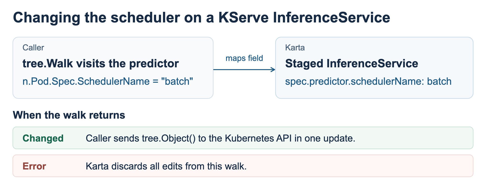

<!-- SPDX-License-Identifier: Apache-2.0 -->
<!-- Copyright (c) 2026 NVIDIA Corporation -->

# KEP-0003: Edit a workload during a tree walk

- Status: provisional
- Authors: @AviadHayumi
- Issue: https://github.com/dsx-ai-factory/workload-map/issues/341
- Depends on: [Workload front door](../0002-sdk-workload-front-door/README.md)
- Created: 2026-11-25
- Last updated: 2026-11-25

## Summary



A controller can inspect a workload instance and edit its pod template in the same visit.
Karta applies the changed fields in memory. The caller saves the workload.
See the [worked examples](examples.md) for pod shapes, failed writes and action arguments.

## Motivation

A controller wants to give a KServe predictor a scheduler when its owner has
left that field empty. These are the relevant fields of the `InferenceService`.

```yaml
spec:
  predictor:
    minReplicas: 2
    model:
      modelFormat: {name: sklearn}
      storageUri: s3://example/model
```

KEP-0002 lets a controller edit instances it names up front. Here the controller
decides what to edit from the data it sees during the visit, as in Go's
[syntax tree walker](https://pkg.go.dev/golang.org/x/tools/go/ast/astutil#Apply).

## Proposal

`definition.Load(obj)` accepts a Kubernetes `runtime.Object` such as
`*unstructured.Unstructured`. Its `Workload` gains `Walk` alongside the targeted
`MutatePodTemplates` call. The excerpt shows the methods used here.

```go
type Workload interface {
	Walk(ctx context.Context, visit func(Node) error) (bool, error)
	Actions() []Action
	ApplyAction(ctx context.Context, name ActionName, args map[string]any) (bool, error)
	Object() *unstructured.Unstructured
}

type Node struct {
	Component  string
	InstanceID string
	Pod        *corev1.PodTemplateSpec
}

// CanWrite reports whether this instance has a writable route for a pod field.
func (n Node) CanWrite(field string) bool
```

```go
func setScheduler(ctx context.Context, tree karta.Workload, c client.Client) error {
	changed, err := tree.Walk(ctx, func(n karta.Node) error {
		if n.Component == "predictor" && n.Pod != nil && n.Pod.Spec.SchedulerName == "" {
			n.Pod.Spec.SchedulerName = "batch"
		}
		return nil
	})
	if err != nil || !changed {
		return err
	}
	return c.Update(ctx, tree.Object())
}
```

Walk starts at the root. It visits a component's instances in ID order, then
its children in definition order. A component with no instances gets one visit
with an empty ID. `Pod` is nil when the visit has no pod mapping or the optional
pod is absent. Otherwise `Pod` presents template metadata and spec as one
`corev1.PodTemplateSpec`. A full template supplies both. A bare pod spec supplies
the spec. A fragmented definition supplies only the fields it maps. `tree.Object()`
returns a deep copy of the current workload, including status and CR-specific fields.
Edits through the pod pointer count only until the callback returns.
[Normalized pod read proposal](https://github.com/dsx-ai-factory/workload-map/issues/344)

For this input Karta adds only `spec.predictor.schedulerName: batch`. The model
and replica count keep their original values.
[KServe mapping](../../catalog/serving-kserve-io-inferenceservice-v1beta1.yaml)

An empty Go value can mean the field is unset or the definition cannot supply it.
A policy can use `n.CanWrite("spec.schedulerName")` before editing. An attempted
edit to an unmapped field fails with the component, instance and field.
A no-op returns `false, nil`.

### Safe write-back

Adding one label to a core Pod currently can erase its `apiVersion`, `kind` and
`status`. Its catalog path is `.`, and the legacy writer replaces the workload
with a serialized template. A KServe transformer exposes the same bug at a
nested path. [Write-back issue](https://github.com/dsx-ai-factory/workload-map/issues/346)

1. Compare the typed pod before and after the visit. Resolve each changed field
   to a concrete address on the original instance. Bind keyed entries by their
   ID. Reject a leaf shared with an unselected instance. A computed read or an
   ambiguous destination needs an explicit write mapping. Without one, return
   an error. `CanWrite` uses the same check.
2. Apply just those edits to a private copy of the raw workload. Preserve fields
   outside the edit, unknown fields inside list entries, and explicit empty values.
   Reject a list edit if its entries cannot be matched safely.
3. Check that the changed fields read back as requested and that the raw changes
   are confined to the intended addresses. Publish the copy only after the whole
   walk succeeds. Any error or cancellation discards it.

Use the same writer for `Walk`, `MutatePodTemplates` and the existing resource
update methods. For a sparse fragment update, compare only the supplied fields.
A typed scalar that was already zero cannot express a new explicit zero through
assignment alone. The [open write-back PR](https://github.com/AviadHayumi/workload-map/pull/17)
is the starting point for the SDK fix. Enable walk writes after the shared writer
passes the [whole-object regression cases](#test-plan).

### Workload actions

`Actions` and `ApplyAction` replace KEP-0002's `CanSuspend`, `Suspend` and
`Resume`. An action runs once on the workload. `Actions()` lets a caller discover
the name, accepted arguments and allowed choices before it runs an action.

```go
type ActionName string
type ParameterType string // "string", "integer" or "boolean"

type Action struct {
	Name       ActionName
	Parameters []ActionParameter
}

type ActionParameter struct {
	Name     string
	Type     ParameterType
	Required bool
	Enum     []string // Optional choices for a string parameter.
}
```

Existing suspend and resume declarations contribute their ordered assignments to
one workload action per name, root first. They take no parameters. Call
`ApplyAction(ctx, "suspend", nil)`. New catalog actions can bind named parameters
to assignment values. At compile time Karta rejects duplicate names, collisions
with existing actions and references to undeclared parameters.

Before any write, Karta checks required arguments, names, types and choices.
Omitting an optional argument skips its assignment. Zero and false are supplied
values. An integer accepts signed Go integers. A string or boolean requires its
corresponding Go type. Each action is atomic and reports whether the object changed.
[Action definition and caller examples](examples.md#discover-and-run-an-action-with-arguments)

## Compatibility and alternatives

Existing catalog definitions need no migration. Declaring parameterized actions
requires an additive CRD change. A mutable map per node would make the caller
learn every workload's layout. The Go pod view covers portable edits. Editing a
KServe model URI would require its own declared write target.

## Test plan

- Run the core Pod, KServe transformer and KServe predictor cases through the
  public SDK setters and the integrated `Walk`. Compare the complete raw object
  with the input plus the requested edit. A second walk must report no change.
  If a later visit fails, the complete input must survive.
- Apply `"suspend"` to JobSet and Kueue. Discover the arguments of a declared
  action, pass zero, omit an optional argument, and reject invalid input without
  changing the object.

### Write-back validation

In-memory replay covered 512 workload snapshots from 95 recordings. The
[candidate writer](https://github.com/AviadHayumi/workload-map/tree/cc64a09742780cfe411be142fe2dddde5fba7431)
returned the expected whole object for all 893 no-op writes and all 584
scheduler edits on present, mapped targets. Another 28 reads of optional
components failed before a write. Four additional cases exposed failures.
Cover them in the public setters and exercise each edit the pod view exposes
through the integrated walk before enabling walk writes.

| Case | Observed on the candidate | Required outcome |
| --- | --- | --- |
| Change only `tolerationSeconds` from 10 to 20 | A successful update dropped a neighboring extension field. A second test lost an explicit `value: ""`. | Preserve every sibling field or reject the edit and keep the input intact. |
| Edit a KServe model container when the predictor filter matches no model | The update returned success and wrote nothing. | Return an error naming the field and leave the predictor intact. |
| Target `workers` with a test JobSet definition that reverses only the instance IDs | The edit landed on `leader`. The stock mapping uses matching order. | Bind the edit to `workers` by ID or reject the mapping. The leader keeps its original template. |
| Load an object with `metadata.generation: 9007199254740993`, then set its scheduler | Reading the object already returned `9007199254740992`. The scheduler edit kept the rounded value. | Preserve the exact integer at load, after the edit and in the object returned to the caller. |

The integrated walk and parameterized actions still need end-to-end coverage.
The action argument examples ran against a test double.

## History

- 2026-11-25: Proposed.
