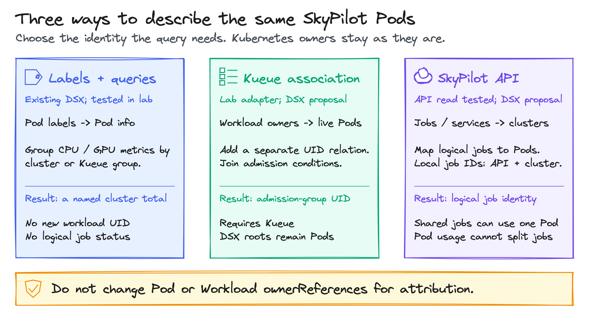
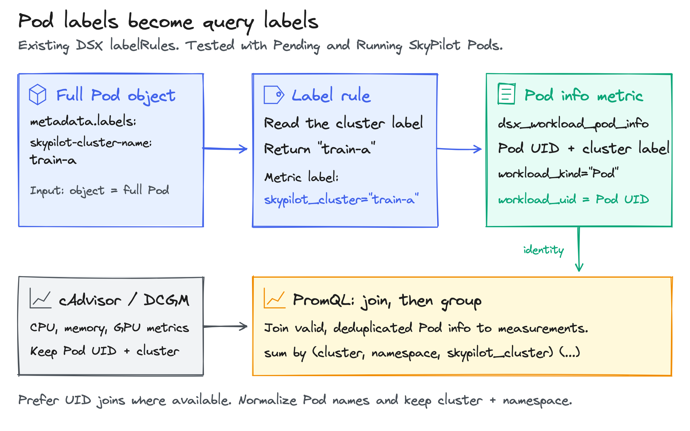
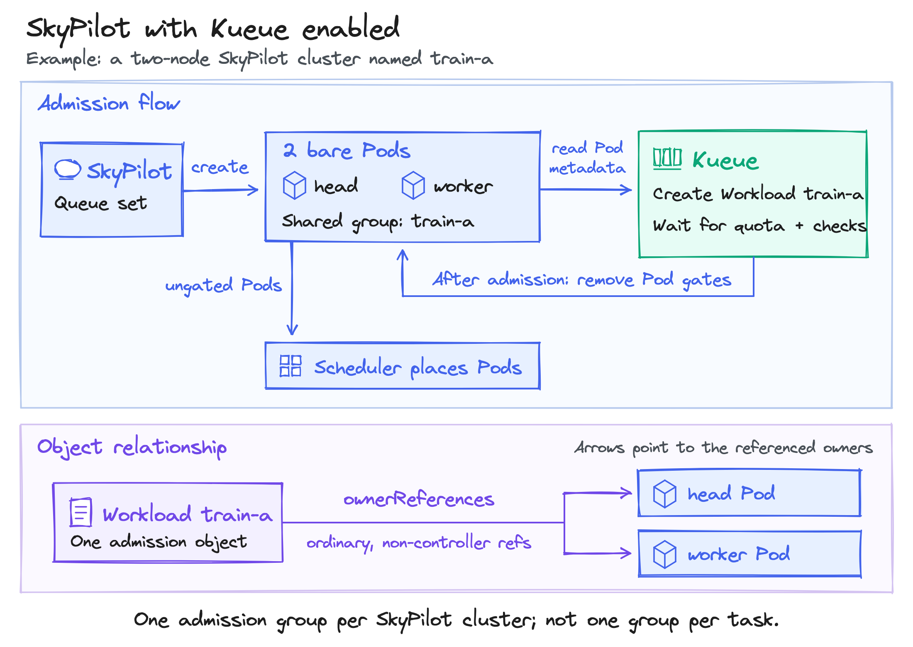
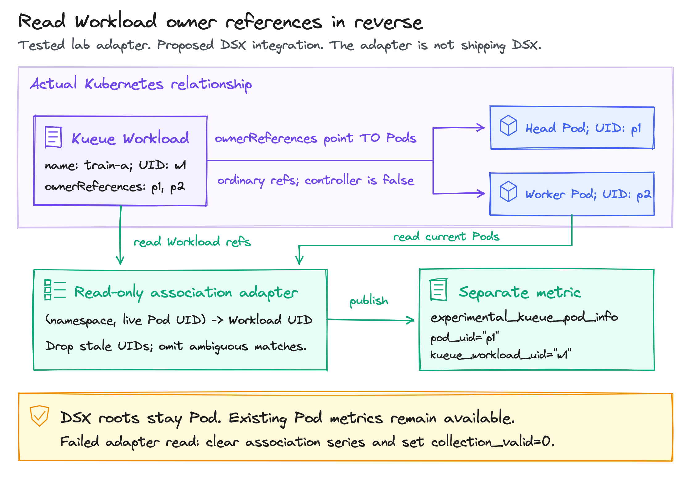
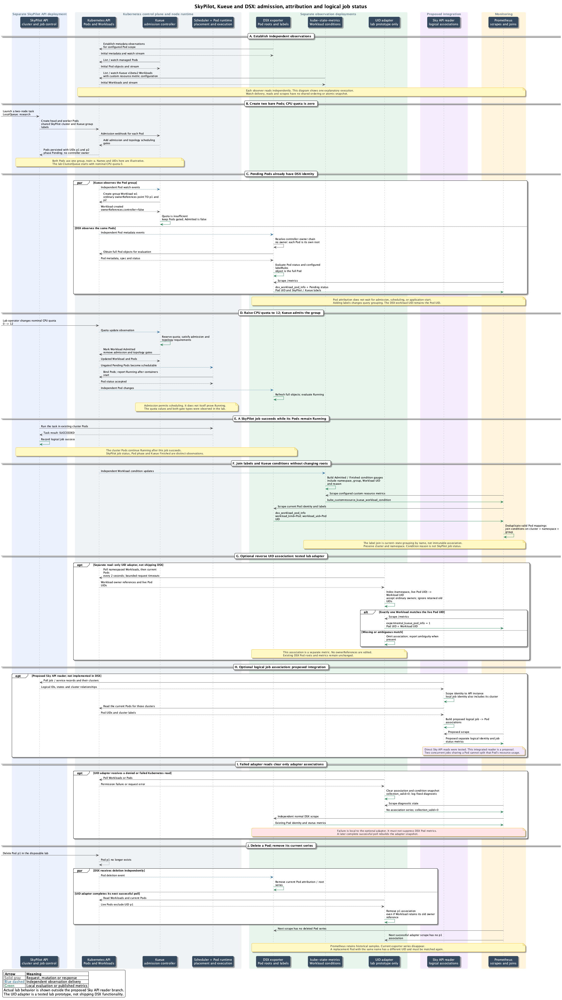

<!-- SPDX-License-Identifier: Apache-2.0 -->
<!-- Copyright (c) 2026 NVIDIA Corporation -->

# KEP-0006: SkyPilot workload attribution with optional Kueue

- Status: provisional
- Authors: @AviadHayumi
- Issue: [Label-based workload roots](https://github.com/dsx-ai-factory/workload-map/issues/463)
- Created: 2026-11-07
- Last updated: 2026-11-07

## Problem

SkyPilot creates a head Pod and a worker Pod for cluster `train-a`. Both have
`skypilot-cluster-name=train-a`, but neither has a controller owner. DSX reports
two Pod roots. The customer wants to see one cluster, its resource usage and the
jobs running on it.

These are three different questions. Labels can group resource measurements.
A Kubernetes object can give the group a UID. SkyPilot knows which jobs ran.
Kueue is optional: SkyPilot uses it only when a LocalQueue is configured.
It provides admission, not a SkyPilot job database.

## Recommendation

Start with existing Pod labels and Prometheus grouping. If the customer already
uses Kueue, add its Workload conditions through kube-state-metrics (KSM).
Neither needs exporter code changes.

If a real group UID is needed, add a separate, read-only association to the
Kueue Workload. Keep the original Pod identity. Read SkyPilot's API only when
job or service identity is required. Do not change Pod ownership for monitoring.



## Alternatives and what was tested

Each live comparison used its own exporter namespace. All observed the same
small workload namespace. The exporter image stayed unchanged.
[Versions, assertions and limits](experiments.md).

| Approach | Result | Change needed | Evidence |
| --- | --- | --- | --- |
| 1. SkyPilot labels + PromQL | One query group for head and worker | Helm label rules | Live: two Pod rows grouped into one cluster. |
| 2. Kueue labels + KSM conditions | Pod group, Workload UID and admission conditions | KSM config and a join | Live: both Pods joined to the admitted Workload. |
| 3. Karta for Kueue Workload | A separate Workload status record | Karta and watched kind | Status test blocked by platform reconciliation; cannot attach bare Pods to that root. |
| 4. Reverse UID association | Pod UID -> Kueue Workload UID | Small optional collector | Live prototype, including denied reads and replacement. |
| 5. SkyPilot API association | Cluster -> local job IDs and statuses | API reader and polling | Live prototype: three jobs joined to one cluster. |
| 6. Virtual root from labels | One exporter root without a CRD | Discovery, store and lifecycle changes | Query grouping tested; exporter virtual roots are not implemented. |
| 7. Synthetic root CR | A real object with its own UID | CRD, adapter and relation resolver | Live prototype: recreation changes group UID without deleting Pods. |
| 8. Producer creates native Jobs | Existing Job -> Pod ownership | SkyPilot backend change | Native Job control passed; unchanged SkyPilot does not produce it. |

<details>
<summary>1. Labels: the smallest change</summary>

The rule receives the full Pod as `object`. This input:

```yaml
metadata:
  name: train-a-head
  namespace: research
  labels:
    skypilot-cluster-name: train-a
```

produces `skypilot_cluster="train-a"` on that Pod's info metric:

```yaml
exporter:
  labelRules:
    - name: skypilot_cluster
      metrics: [dsx_workload_pod_info]
      sources: [pod]
      expression: |
        has(object.metadata.labels) && "skypilot-cluster-name" in object.metadata.labels
          ? object.metadata.labels["skypilot-cluster-name"] : ""
```



For one exporter per cluster, this counts the members:

```promql
count by (namespace, skypilot_cluster) (
  dsx_workload_pod_info{skypilot_cluster!=""}
)
```

The live result was `2`. Join CPU, memory or GPU measurements to the Pod info
first, then aggregate. See the existing [query guide][queries] for measurement
joins. The test verified identity joins, not real GPU usage.

In a shared Prometheus, retain Kubernetes cluster identity in every join and
group. Select one exporter instance or deduplicate equivalent replicas before
joining. A missing label must not become a shared empty-name workload.

The cloud cluster label normally includes a user hash. The same-named Pod
annotation can contain the human cluster name instead. Neither is an immutable
Kubernetes UID. Name reuse can combine different lifetimes in historical queries.
Custom labels do not change `workload_uid`, creation time or phase.

</details>

<details>
<summary>2. Kueue labels and existing state metrics</summary>

SkyPilot adds a queue label, a Pod-group label and the expected member count:

```yaml
metadata:
  labels:
    kueue.x-k8s.io/queue-name: research
    kueue.x-k8s.io/pod-group-name: train-a
  annotations:
    kueue.x-k8s.io/pod-group-total-count: "2"
```

Kueue's webhook gates the Pods. Its controller creates Workload `research/train-a`.
Quota and admission checks permit Kueue to remove its gates. The Kubernetes
scheduler then places the Pods. Admission alone does not prove they are running.
[SkyPilot template][sky-template], [Kueue Pod integration][pod-guide].



Add `kueue_group` from the Pod-group label using the same label-rule pattern.
Configure KSM to read the Workload's `status.conditions`. The tested config used
`kueue.x-k8s.io/v1beta2` and produced:

```text
kube_customresource_kueue_workload_condition{
  namespace="research", kueue_group="train-a", kueue_workload_uid="w1",
  condition="Admitted", condition_status="True", reason="Admitted"
} 1
```

For a single-cluster, single-instance scrape, attach that UID to Pod info:

```promql
dsx_workload_pod_info{kueue_group!=""}
  * on(namespace, kueue_group) group_left(kueue_workload_uid)
    (kube_customresource_kueue_workload_condition{
      condition="Admitted", condition_status="True"
    } == 1)
```

This query intentionally returns admitted members only. Keep the unfiltered Pod
metric for queued, missing or unreadable groups. Match namespace as well as name.
A name-based join can briefly mismatch generations during deletion and recreation;
use UID verification when that risk matters.

Kueue's own queue metrics are also useful for pending and admitted demand.
Their resource quantities describe requests or quota, not measured CPU/GPU use.
They complement attribution; they do not replace a Pod measurement exporter.

</details>

<details>
<summary>3. Why a Karta alone does not join the Pods</summary>

A Karta tells the SDK how to interpret an object. Discovery chooses the root
before Karta lookup. It follows `controller: true` owner references.

Kueue's group Workload has ordinary owner references pointing to its member
Pods. The Pods do not point to the Workload. Watching that Workload can therefore
create a separate workload record, while both Pod records remain Pod roots.

A Workload Karta can interpret admission conditions. It cannot turn admission
into SkyPilot task execution or reverse those references. Likewise, Karta
component selectors and gang-scheduling group keys operate after root discovery.
They do not provide a root-lookup expression.
[Discovery][discovery], [leaf reconciliation][leaf], [Kueue references][group-refs].

</details>

<details>
<summary>4. Reverse UID association: reuse Kueue's real object</summary>



An optional collector reads Pods and Workloads. For each Workload owner reference,
it checks that the referenced Pod UID still exists in the same namespace. It
publishes a separate association:

```text
Pod UID p1 -> Workload UID w1
Pod UID p2 -> Workload UID w1
```

The lab prototype emitted `experimental_kueue_pod_info`. That is an experiment
name, not a proposed stable DSX metric contract. It polled every two seconds;
a production implementation should use watches and a small UID index.

- Workload creation or update: recompute affected memberships.
- Pod replacement: accept the new UID only when the Workload references it.
- Deletion: remove the old relationship.
- Failed reads: report invalid collection and clear stale associations.
- Multiple Workloads referencing one Pod: report ambiguity rather than choose one.

Normal DSX Pod metrics remain independent. A real permission-removal test kept
both Pod records while the association collector reported failure.

This is simpler than replacing the exporter's root model. If the Workload must
become the actual root:

- Change discovery, watches, requeueing and publication validation together.
- Verify identity beyond a matching name. Handle a Pod arriving before its
  Workload and a Workload being recreated with a new UID.
- Define an explicit identity-change policy for fallback to a Pod root.

</details>

<details>
<summary>5. SkyPilot API: jobs, pipelines and services</summary>

The Kubernetes cluster is infrastructure for SkyPilot execution. Two local jobs
can share the same running Pods. The live test ran jobs `2` and `3` concurrently
on the same two-node cluster. All three test jobs later succeeded while those
Pods stayed Running.

A read-only collector can associate Pods with local jobs:

1. Query `sky.status()` and `sky.queue(cluster)`.
2. Match `handle.cluster_name_on_cloud` to the Pod label.
3. Scope each local job ID by API instance and cluster.

Polling introduces delay and API availability requirements. On a failed poll,
report unknown collection rather than invent completion.

| Shape | Association | Source of execution state |
| --- | --- | --- |
| Local job | API + cluster + local job ID | SkyPilot local queue |
| Managed job or pipeline | API + managed job ID + task ID + attempt cluster | `sky.jobs.queue_v2()` |
| SkyServe | API + service + replica + cluster | `sky.serve.status()` |

For pinned SkyPilot 0.14.2, managed-task records include cloud cluster names.
SkyServe strips replica handles from newer wire responses; use replica names
and the matching Pod cluster-name annotation instead. Do not assume `sky.status`
returns managed service-replica clusters. [Request API][sky-jobs], [serialization][sky-wire].

These relationships do not divide resource consumption between concurrent jobs.
Joining one Pod's usage to two jobs and summing it counts the same usage twice.
Per-job consumption needs isolation or measurements from inside the execution
system. Service replica metrics can be aggregated when each Pod belongs to one
replica.

The new Kueue lab verified local-job API joins. Managed pipelines and SkyServe
were exercised earlier without Kueue; their new Kueue associations remain
source-backed proposals, not newly verified end-to-end paths.

</details>

<details>
<summary>6-8. When the exporter must show one actual root</summary>

A virtual label root avoids a CRD, but requires a new internal object model.
The current root reader fetches a real GVK/name and verifies its UID. A label
string cannot satisfy that contract. Define creation, last-member deletion,
label changes, name reuse and phase aggregation before adding this model.

A synthetic root CR supplies a real Kubernetes UID. An adapter owns its members,
status and retention. The lab created an experimental `ClusterGroup` with two
Pod UIDs. Deleting it removed the association, left both Pods alive, and
recreation produced a new group UID. Membership was supplied by the test;
no production adapter reconciler or SkyPilot status model was implemented.
A CR alone still needs a relation resolver to become the DSX root.

A producer that creates a native Job gets Job -> Pod discovery today. The native
Job control exported `Completed=1`. SkyPilot's normal backend creates Pods
directly; changing it to Jobs must account for head/worker naming, retries,
shared clusters and teardown. This is a backend project, not a Helm switch.

Do not patch Pod owner references as a shortcut. Non-controller references are
ignored by current discovery. Controller references change garbage collection.
Making Pods depend on their Kueue Workload also creates a cycle with the existing
Workload-to-Pod references. Monitoring should not take over workload lifecycle.

</details>

## End-to-end flow

[Open the zoomable sequence](full-flow.html) or [view the SVG](full-flow.svg).
The optional association paths are lab prototypes. They are not shipping DSX
features.

<details>
<summary>Show the complete sequence from submission to cleanup</summary>



[Editable sequence](diagrams/full-flow.puml).

</details>

## Status must keep its meaning

In Kueue 0.20.5 with default feature gates, the live mixed-terminal test produced:

```text
Pod outcomes: 1 Succeeded, 2 Failed
Finished=True, reason=Succeeded, message="Pods succeeded: 1/3."
```

The inspected `DeclareWorkloadFailureOnUnretriablePodGroups` feature gate changes
that behavior, but was not enabled in this lab. Regardless of that setting,
Kueue observes Pod termination, not a SkyPilot job finishing inside a running Pod.
Do not map `Admitted` to Running or `Finished` to SkyPilot success.
[Completion implementation][completion].

## Next decision

Choose the required identity: query group, Kubernetes admission object, or
SkyPilot job. Labels plus KSM solve the first two display needs with existing
components. A separate UID association is the smallest next implementation when
name-based joins are insufficient. Agree its metric schema and freshness behavior
before changing discovery.

## History

- 2026-11-07: Proposed labels first, with optional Kueue and SkyPilot associations.
- 2026-11-07: Compared eight approaches and tested six isolated exporter setups.

[sky-template]: https://github.com/skypilot-org/skypilot/blob/39b151e11075f1d0029f8fc411a42334775fb3e7/sky/templates/kubernetes-ray.yml.j2#L306-L330
[pod-guide]: https://kueue.sigs.k8s.io/docs/tasks/run/plain_pods/
[group-refs]: https://github.com/kubernetes-sigs/kueue/blob/bee9304a8aa9a83412b5d91516fdd3779ff1b331/pkg/controller/jobs/pod/pod_controller.go#L1140-L1164
[completion]: https://github.com/kubernetes-sigs/kueue/blob/v0.20.5/pkg/controller/jobs/pod/pod_controller.go#L420
[sky-jobs]: https://github.com/skypilot-org/skypilot/blob/39b151e11075f1d0029f8fc411a42334775fb3e7/sky/server/requests/payloads.py#L479
[sky-wire]: https://github.com/skypilot-org/skypilot/blob/39b151e11075f1d0029f8fc411a42334775fb3e7/sky/server/requests/return_value_serializers.py#L128
[discovery]: ../../../dsx-workload-exporter/pkg/discovery/resolve.go
[leaf]: ../../../dsx-workload-exporter/pkg/controller/leaf.go
[queries]: ../../dsx-workload-exporter/queries.md
