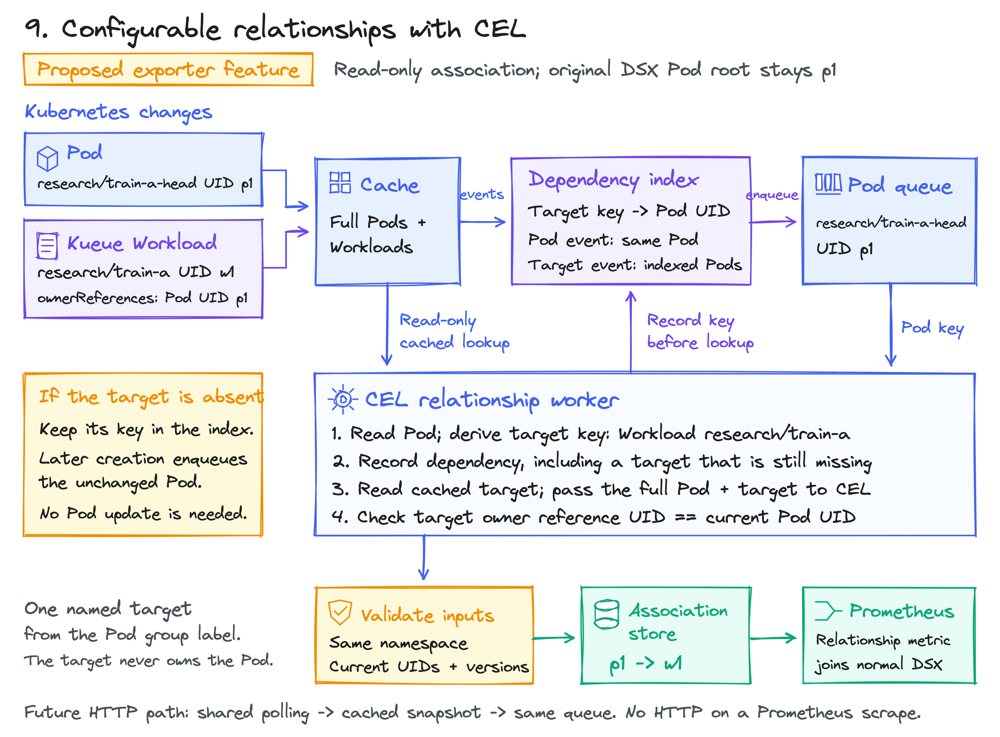

<!-- SPDX-License-Identifier: Apache-2.0 -->
<!-- Copyright (c) 2026 NVIDIA Corporation -->

# KEP-0006: SkyPilot workload attribution with optional Kueue

- Status: provisional
- Authors: @AviadHayumi
- Issue: [Label-based workload roots](https://github.com/dsx-ai-factory/workload-map/issues/463)
- Created: 2026-11-07
- Last updated: 2026-11-08

## Problem

SkyPilot creates a head Pod and a worker Pod for cluster `train-a`. Both have
`skypilot-cluster-name=train-a`, but neither has a controller owner. DSX reports
two Pod roots. The customer wants to see one cluster, its resource usage and the
jobs running on it.

Labels group measurements; SkyPilot records job execution. Kueue optionally
decides when the Pod group is allowed to start. This is called admission, and
Kueue records it in a separate Kubernetes Workload object.

## How SkyPilot uses Kueue


Example: a two-node SkyPilot cluster in namespace `research`, with cloud cluster name
`train-a`. A SkyPilot cluster is a group of machines or Pods used to run tasks,
not another Kubernetes cluster. This one has a head Pod and a worker Pod.

An administrator installs Kueue with its Pod integration and creates LocalQueue
`research` in that namespace. The LocalQueue points to a ClusterQueue, where
quota and admission policy are configured. SkyPilot's API server selects the LocalQueue:

```yaml
kubernetes:
  kueue:
    local_queue_name: research
```

This is SkyPilot configuration, not an exporter setting. It selects an existing
queue; it does not install Kueue or create the queue. [SkyPilot setup][sky-kueue].

1. SkyPilot creates the head and worker Pods for a task with `num_nodes: 2`.
   They are bare Pods, not children of a Kubernetes Job. Both receive the metadata below. [Pod creation](https://github.com/skypilot-org/skypilot/blob/39b151e11075f1d0029f8fc411a42334775fb3e7/sky/provision/kubernetes/instance.py#L2515-L2520).
2. Kueue's webhook adds scheduling gates before the API server saves each Pod.
   A gate tells the scheduler to wait. The saved Pods remain visible while Pending.
3. Kueue's Pod controller waits for both group members, then creates one Workload
   named `research/train-a`. Its `spec.podSets` describes their resource requests.
   SkyPilot does not create this Workload directly.
4. Kueue routes the request through LocalQueue `research` to its ClusterQueue.
   It waits for quota and required admission checks. Admission permits scheduling;
   it does not mean the Pods are Running.
5. Kueue removes its scheduling gates when the group can proceed. The Kubernetes
   scheduler places the Pods on nodes, and kubelets start their containers.
6. SkyPilot prepares its runtime and starts the task's commands inside those Pods.
   SkyPilot tracks that execution as a job. Kueue tracks the Pod group's admission.
7. A finished job can leave both Pods Running. `sky exec` reuses them for another
   job without creating another Pod group or repeating Kueue admission. Teardown
   or eviction releases cluster resources; job completion alone does not. [Execution stages](https://github.com/skypilot-org/skypilot/blob/39b151e11075f1d0029f8fc411a42334775fb3e7/sky/execution.py#L1051-L1070).

Both Pods carry these fields. The queue selects policy; the group selects members:

| Pod field | Example | Meaning |
| --- | --- | --- |
| Label `kueue.x-k8s.io/queue-name` | `research` | Which namespaced LocalQueue receives the request. |
| Label `kueue.x-k8s.io/pod-group-name` | `train-a` | Which Pods belong to the same admission group. |
| Annotation `kueue.x-k8s.io/pod-group-total-count` | `"2"` | Expected number of Pods in this group. |

The Workload's ordinary owner references point to the member Pods, not the other
way around. It is an admission record, not their controller parent. DSX therefore
still discovers each bare Pod as its own root. [Pod metadata][sky-template],
[Pod integration][pod-guide], [owner references][group-refs].

## Recommendation

Use the Kueue Workload as the metric identity for its bare Pod group:

1. Select the catalog Karta for `kueue.x-k8s.io/v1beta2/Workload`. The exporter
   watches these objects and publishes their admission and readiness status.
2. Set `workloadMetricSelector` to exclude roots with the Pod-group label.
   This removes the individual Pod roots' status and creation-time metrics
   while keeping their Pod info rows.
3. Enable `podWorkloadAssociation` for those bare Pods. Read the target name
   from the group label and find the Workload in the same namespace. Associate
   it only when its owner references contain the Pod's name and current UID.

For `research/train-a-head`, the group label selects Workload
`research/train-a`. The Pod info row keeps the Pod UID and component but uses
the Workload UID. The head and worker then share one workload identity. A
Job-owned Pod keeps its existing Job root. Kubernetes ownership is unchanged.

Association uses the existing watched-object cache. It performs no per-Pod GET.
If the Workload is absent or its owner UID does not match, Pod info keeps the
original Pod root UID. The workload-metric selector still applies independently.
Both settings preserve existing behavior when omitted.

The Karta maps `Admitted=False` to Initializing and requires both
`Admitted=True` and `PodsReady=True` for Running. Finished, evicted and
replacement-waiting Workloads cannot remain Running through stale readiness.
Other states remain Undefined. `Finished` is not mapped to Completed: a Pod
group can report reason `Succeeded` even when some Pods failed. These conditions
also cannot describe a SkyPilot command finishing inside long-lived Pods.

The [configuration guide](../../dsx-workload-exporter/configuration.md#workload-metrics-and-pod-association)
contains the settings, defaults and fallback behavior. SkyPilot job identity and
execution status still require its API.

## Alternatives and what was tested

The earlier comparisons below predate the implementation above. Each used its
own exporter namespace. All observed the same
small workload namespace. The exporter image stayed unchanged.
[Versions, assertions and limits](experiments.md).


| Approach | Result | Change needed | Evidence |
| --- | --- | --- | --- |
| 1. SkyPilot labels + PromQL | One query group for head and worker | Helm label rules | Live: two Pod rows grouped into one cluster. |
| 2. Kueue labels + KSM conditions | Pod group, Workload UID and admission conditions | KSM config and a join | Live: both Pods joined to the admitted Workload. |
| 3. Karta for Kueue Workload | A separate Workload status record | Karta and watched kind | Status test blocked by platform reconciliation; cannot attach bare Pods to that root. |
| 4. Reverse UID association | Pod UID -> Kueue Workload UID | Small optional collector | Live prototype, including denied reads and replacement. |
| 5. SkyPilot API association | Cluster -> local job IDs and statuses | API reader and polling | Live prototype: three jobs joined to one cluster. |
| 6. Virtual root from labels | One exporter root without a CRD | Discovery, store and lifecycle changes | Query grouping tested; exporter virtual roots are not implemented. |
| 7. Synthetic root CR | A real object with its own UID | CRD, adapter and relation resolver | Live prototype: recreation changes group UID without deleting Pods. |
| 8. Producer creates native Jobs | Existing Job -> Pod ownership | SkyPilot backend change | Native Job control passed; unchanged SkyPilot does not produce it. |
| 9. Configurable CEL associations | Customer-defined relationships, including options 4 and 5 | Read-only lookup provider, dependency tracking and association publication | SDK source research and local expression probe; no exporter integration. |

<details>
<summary>1. Labels: the smallest change</summary>

The rule receives the full Pod as `object`. This input:

```yaml
metadata:
  name: train-a-head
  namespace: research
  labels:
    skypilot-cluster-name: train-a
```

produces `skypilot_cluster="train-a"` on that Pod's info metric:

```yaml
exporter:
  labelRules:
    - name: skypilot_cluster
      metrics: [dsx_workload_pod_info]
      sources: [pod]
      expression: |
        has(object.metadata.labels) && "skypilot-cluster-name" in object.metadata.labels
          ? object.metadata.labels["skypilot-cluster-name"] : ""
```


For one exporter per cluster, this counts the members:

```promql
count by (namespace, skypilot_cluster) (
  dsx_workload_pod_info{skypilot_cluster!=""}
)
```

The live result was `2`. Join CPU, memory or GPU measurements to the Pod info
first, then aggregate. See the existing [query guide][queries] for measurement
joins. The test verified identity joins, not real GPU usage.

In a shared Prometheus, retain Kubernetes cluster identity in every join and
group. Select one exporter instance or deduplicate equivalent replicas before
joining. A missing label must not become a shared empty-name workload.

The cloud cluster label normally includes a user hash. The same-named Pod
annotation can contain the human cluster name instead. Neither is an immutable
Kubernetes UID. Name reuse can combine different lifetimes in historical queries.
Custom labels do not change `workload_uid`, creation time or phase.

</details>

<details>
<summary>2. Kueue labels and existing state metrics</summary>

Use the Pod-group label from the [admission flow](#how-skypilot-uses-kueue).
Add `kueue_group` with the same label-rule pattern as option 1.
Configure KSM to read the Workload's `status.conditions`. The tested config used
`kueue.x-k8s.io/v1beta2` and produced:

```text
kube_customresource_kueue_workload_condition{
  namespace="research", kueue_group="train-a", kueue_workload_uid="w1",
  condition="Admitted", condition_status="True", reason="Admitted"
} 1
```

For a single-cluster, single-instance scrape, attach that UID to Pod info:

```promql
dsx_workload_pod_info{kueue_group!=""}
  * on(namespace, kueue_group) group_left(kueue_workload_uid)
    (kube_customresource_kueue_workload_condition{
      condition="Admitted", condition_status="True"
    } == 1)
```

This query intentionally returns admitted members only. Keep the unfiltered Pod
metric for queued, missing or unreadable groups. Match namespace as well as name.
A name-based join can briefly mismatch generations during deletion and recreation;
use UID verification when that risk matters.

Kueue's own queue metrics are also useful for pending and admitted demand.
Their resource quantities describe requests or quota, not measured CPU/GPU use.
They complement attribution; they do not replace a Pod measurement exporter.
`Finished` describes the Pod group, not a SkyPilot command finishing inside it.
The [mixed-terminal test](experiments.md#results) also shows why its reason must
be interpreted with the Kueue version and feature gates in mind.

</details>

<details>
<summary>3. Why a Karta alone does not join the Pods</summary>

A Karta tells the SDK how to interpret an object. Discovery chooses the root
before Karta lookup. It follows `controller: true` owner references.

Watching the Workload can create a separate record. Its references to the Pods
do not connect the Pod owner chains to that record.

A Workload Karta can interpret admission conditions. It cannot turn admission
into SkyPilot task execution or reverse those references. Likewise, Karta
component selectors and gang-scheduling group keys operate after root discovery.
They do not provide a root-lookup expression.
[Discovery][discovery], [leaf reconciliation][leaf], [Kueue references][group-refs].

</details>

<details>
<summary>4. Reverse UID association: reuse Kueue's real object</summary>


An optional collector reads Pods and Workloads. For each Workload owner reference,
it checks that the referenced Pod UID still exists in the same namespace. It
publishes a separate association:

```text
Pod UID p1 -> Workload UID w1
Pod UID p2 -> Workload UID w1
```

The lab prototype emitted `experimental_kueue_pod_info`. That is an experiment
name, not a proposed stable DSX metric contract. It polled every two seconds;
a production implementation should use watches and a small UID index.

- Workload creation or update: recompute affected memberships.
- Pod replacement: accept the new UID only when the Workload references it.
- Deletion: remove the old relationship.
- Failed reads: report invalid collection and clear stale associations.
- Multiple Workloads referencing one Pod: report ambiguity rather than choose one.

Normal DSX Pod metrics remain independent. A real permission-removal test kept
both Pod records while the association collector reported failure.

This is simpler than replacing the exporter's root model. If the Workload must
become the actual root:

- Change discovery, watches, requeueing and publication validation together.
- Verify identity beyond a matching name. Handle a Pod arriving before its
  Workload and a Workload being recreated with a new UID.
- Define an explicit identity-change policy for fallback to a Pod root.

</details>

<details>
<summary>5. SkyPilot API: jobs, pipelines and services</summary>

The Kubernetes cluster is infrastructure for SkyPilot execution. Two local jobs
can share the same running Pods. The live test ran jobs `2` and `3` concurrently
on the same two-node cluster. All three test jobs later succeeded while those
Pods stayed Running.

A read-only collector can associate Pods with local jobs:

1. Query `sky.status()` and `sky.queue(cluster)`.
2. Match `handle.cluster_name_on_cloud` to the Pod label.
3. Scope each local job ID by API instance and cluster.

Polling introduces delay and API availability requirements. On a failed poll,
report unknown collection rather than invent completion.

| Shape | Association | Source of execution state |
| --- | --- | --- |
| Local job | API + cluster + local job ID | SkyPilot local queue |
| Managed job or pipeline | API + managed job ID + task ID + attempt cluster | `sky.jobs.queue_v2()` |
| SkyServe | API + service + replica + cluster | `sky.serve.status()` |

For pinned SkyPilot 0.14.2, managed-task records include cloud cluster names.
SkyServe strips replica handles from newer wire responses; use replica names
and the matching Pod cluster-name annotation instead. Do not assume `sky.status`
returns managed service-replica clusters. [Request API][sky-jobs], [serialization][sky-wire].

These relationships do not divide resource consumption between concurrent jobs.
Joining one Pod's usage to two jobs and summing it counts the same usage twice.
Per-job consumption needs isolation or measurements from inside the execution
system. Service replica metrics can be aggregated when each Pod belongs to one
replica.

The new Kueue lab verified local-job API joins. Managed pipelines and SkyServe
were exercised earlier without Kueue; their new Kueue associations remain
source-backed proposals, not newly verified end-to-end paths.

</details>

<details>
<summary>6-8. When the exporter must show one actual root</summary>

A virtual label root avoids a CRD, but requires a new internal object model.
The current root reader fetches a real GVK/name and verifies its UID. A label
string cannot satisfy that contract. Define creation, last-member deletion,
label changes, name reuse and phase aggregation before adding this model.

A synthetic root CR supplies a real Kubernetes UID. An adapter owns its members,
status and retention. The lab created an experimental `ClusterGroup` with two
Pod UIDs. Deleting it removed the association, left both Pods alive, and
recreation produced a new group UID. Membership was supplied by the test;
no production adapter reconciler or SkyPilot status model was implemented.
A CR alone still needs a relation resolver to become the DSX root.

A producer that creates a native Job gets Job -> Pod discovery today. The native
Job control exported `Completed=1`. SkyPilot's normal backend creates Pods
directly; changing it to Jobs must account for head/worker naming, retries,
shared clusters and teardown. This is a backend project, not a Helm switch.

Do not patch Pod owner references as a shortcut. Non-controller references are
ignored by current discovery. Controller references change garbage collection.
Making Pods depend on their Kueue Workload also creates a cycle with the existing
Workload-to-Pod references. Monitoring should not take over workload lifecycle.

</details>

## 9. Configurable relationships with CEL



A customer could describe the Kueue relationship instead of adding a dedicated
Kueue adapter. Pod `research/train-a-head`, UID `p1`, names group `train-a`.
The rule reads Workload `research/train-a`, UID `w1`, and checks whether its
owner references contain Pod UID `p1`. The result is a separate association
`p1 -> w1`. It does not change either object's ownership or the DSX Pod root.

Kyverno's CEL libraries provide Kubernetes `Get`/`List` and HTTP functions.
They can supply the lookup operation. They do not define which object becomes
a DSX workload, how its status is calculated, or when DSX should evaluate again.
Current exporter CEL rules return label strings after discovery has chosen the
root. Karta component matching also happens after discovery and uses JQ.
This needs a new relationship rule, not an extra function in today's label rule.
[Kyverno functions][kyverno-functions], [current label evaluator][label-cel].

<details>
<summary>Rule inputs, refresh and required code changes</summary>

### Start with one named Kubernetes lookup

Keep the first rule contract small. These are proposed inputs, not available
Helm values:

| Input | Kueue example |
| --- | --- |
| Pod filter | Has a nonempty `kueue.x-k8s.io/pod-group-name` label. |
| Target resource | `kueue.x-k8s.io/v1beta2`, `workloads`. |
| Target name | Value of that Pod-group label. |
| Target namespace | Always the input Pod's namespace. |
| Match expression | Target has an ordinary owner reference to the current Pod UID. |

The local probe supplied the Pod above as `object` and evaluated this lookup
using the real SDK binding and an in-memory read provider:

```cel
resource.get("kueue.x-k8s.io/v1beta2", "workloads", object.metadata.namespace,
  object.metadata.labels["kueue.x-k8s.io/pod-group-name"])
```

Its result became `related`, a dynamic CEL variable, for this second expression:

```cel
related != null &&
  related.metadata.namespace == object.metadata.namespace &&
  has(related.metadata.ownerReferences) &&
  related.metadata.ownerReferences.exists(r,
    r.apiVersion == "v1" && r.kind == "Pod" && r.uid == object.metadata.uid)
```

For Workload `w1` referencing Pod `p1`, the result was `true`. A missing target
returned `null` and matched `false`. A stale Pod UID also matched `false`.
Denied reads returned an error, not a normal no-match. [Probe results](experiments.md#local-kyverno-cel-probe).

The runtime supplies the full Pod and cached target to CEL. A match returns a
boolean. The runtime builds the association from their actual UIDs; an expression
cannot invent a Kubernetes UID. No match produces no association. A read or
evaluation failure clears that association and reports invalid observation.
Normal DSX Pod and workload metrics continue independently.
An unsynced cache is unavailable, not proof that the target is absent.

### What makes an unchanged Pod refresh

The controller registers each declared resource watch once per scope. Before a
lookup, it records the target key and dependent Pod UID, including a missing
target. This is a reverse index: target key -> Pods that need another evaluation.

1. A Pod event queues that Pod. The worker reads it and computes the target key.
2. Target creation, update or deletion requeues its dependent Pods.
3. Pod deletion or a filter that no longer matches removes its associations and
   index entries. A changed target label replaces the Pod's old dependency.
4. Validate source health and the evaluated Pod and target versions as part of
   the association write. A cache change or invalidation must not happen between
   that check and the write. Include missing-target results; retry stale work.

Load rules at startup initially. Changing rules requires a restart, which rebuilds
the index. Dynamic rule updates can be added separately.

For example, a Pod can arrive before its Kueue Workload. Recording the missing
target key lets Workload creation trigger the successful match without a Pod
update. Recreating that Workload replaces `w1` with its new UID. A failed watch
invalidates dependent associations until the source has recovered and resynced.

An arbitrary `List` expression needs more machinery. A newly matching object
was not in the previous result, so tracking only returned UIDs misses it. Track
the queried resource scope and requeue on relevant changes, or maintain a query
index. Set result limits and reject ambiguous matches. Start with named reads
to avoid a namespace scan for every Pod event.

### HTTP needs a separate refresh path

For SkyPilot, a shared background reader should fetch a snapshot, then queue
affected Pods when it changes. Rules evaluate that snapshot. Do not make HTTP
calls from a Prometheus scrape or repeat the same API request for every Pod.
Define a refresh interval and maximum age; failed or expired snapshots invalidate
their associations. Local jobs still need API-instance and cluster scope.
They need an external-job identity contract rather than a Kubernetes object UID.

Kyverno's GlobalContext controller already separates resource watches from HTTP
polling. Importing its CEL library does not import those controllers into DSX.
SkyPilot's asynchronous request protocol may still need an API adapter. A generic
HTTP GET is not a substitute for `sky.queue()` or its complete request lifecycle.
[Resource cache][kyverno-cache], [HTTP poller][kyverno-poller].

### Reuse the expression functions, keep the runtime explicit

| Component | Proposed change |
| --- | --- |
| Configuration and compiler | Compile Pod filter, target-name and match expressions. Declare allowed targets before evaluating Pods. |
| Read provider | Serve scoped, read-only cached objects. Track missing keys and reject undeclared reads. |
| Controller | Maintain target-to-Pod dependencies and refresh associations on Pod or target changes. |
| Association store and collector | Publish validated UID pairs separately; remove stale pairs and expose failures. Agree the metric schema before implementation. |
| Discovery and Karta inventory | Keep existing root discovery and definition lookup for association-only mode. Actual root replacement still needs the changes in options 4 and 6-8. |

The inspected SDK registers `Post` alongside reads. Its provider decides what
operations actually run. Use restricted bindings or reject writes in the provider;
installing the library alone does not make it read-only. Kyverno's own resource
provider performs client calls rather than automatically using DSX's cache.
[Provider interface][kyverno-provider], [Kyverno client calls][kyverno-client].

For HTTP, restrict destinations and methods, set request deadlines and response
size limits, and keep credentials outside expressions. CEL evaluation limits do
not bound blocking network calls. A first implementation can omit HTTP entirely.
The pinned SDK also has a broader Go dependency graph than these small function
interfaces suggest; compare importing it with a thin CEL binding over the
existing exporter cache before choosing a dependency.
[HTTP implementation][kyverno-http], [SDK module][kyverno-module].

Configurable rules can express an observable relationship. They cannot recover
a missing job identifier, infer SkyPilot execution status from admission, or
split one Pod's measurements between concurrent jobs.

</details>

## End-to-end flow

[Open the zoomable sequence](full-flow.html) or [view the SVG](full-flow.svg).
This diagram records the earlier lab prototypes. The current association path
is described in [Recommendation](#recommendation).

<details>
<summary>Show the complete sequence from submission to cleanup</summary>


[Editable sequence](diagrams/full-flow.puml).

</details>

## Next decision

Decide whether SkyPilot job identity and execution status are also required.
The Workload association provides admission identity. A SkyPilot API reader
would supply job IDs and task status separately.

## History

- 2026-11-07: Proposed labels first, with optional Kueue and SkyPilot associations.
- 2026-11-07: Compared eight approaches and tested six isolated exporter setups.
- 2026-11-08: Clarified the flows and recorded cleanup results.
- 2026-11-08: Researched Kyverno CEL lookups and proposed cached relationship rules.
- 2026-11-08: Explained cluster creation, queue admission and job execution as one flow.
- 2026-11-08: Selected the Kueue catalog, workload-metric filtering and verified Pod association.

[sky-template]: https://github.com/skypilot-org/skypilot/blob/39b151e11075f1d0029f8fc411a42334775fb3e7/sky/templates/kubernetes-ray.yml.j2#L306-L330
[sky-kueue]: https://docs.skypilot.ai/en/latest/reference/kubernetes/examples/kueue-example.html
[pod-guide]: https://kueue.sigs.k8s.io/docs/tasks/run/plain_pods/
[group-refs]: https://github.com/kubernetes-sigs/kueue/blob/v0.20.5/pkg/controller/jobs/pod/pod_controller.go#L1497
[sky-jobs]: https://github.com/skypilot-org/skypilot/blob/39b151e11075f1d0029f8fc411a42334775fb3e7/sky/server/requests/payloads.py#L479
[sky-wire]: https://github.com/skypilot-org/skypilot/blob/39b151e11075f1d0029f8fc411a42334775fb3e7/sky/server/requests/return_value_serializers.py#L128
[discovery]: ../../../dsx-workload-exporter/pkg/discovery/resolve.go
[leaf]: ../../../dsx-workload-exporter/pkg/controller/leaf.go
[queries]: ../../dsx-workload-exporter/queries.md
[label-cel]: ../../../dsx-workload-exporter/pkg/labelevaluator/cel.go
[kyverno-functions]: https://kyverno.io/docs/policy-types/cel-libraries/
[kyverno-provider]: https://github.com/kyverno/sdk/blob/68d74afcb07a4ad8c941e8bc43e9da31d9f703b0/extensions/cel/libs/resource/types.go#L13-L22
[kyverno-client]: https://github.com/kyverno/kyverno/blob/3bb926936656bfb14ae1a6306a6d9208a4b77613/pkg/cel/libs/context.go#L156-L184
[kyverno-cache]: https://github.com/kyverno/kyverno/blob/3bb926936656bfb14ae1a6306a6d9208a4b77613/pkg/globalcontext/k8sresource/entry.go#L63-L181
[kyverno-poller]: https://github.com/kyverno/kyverno/blob/3bb926936656bfb14ae1a6306a6d9208a4b77613/pkg/globalcontext/externalapi/entry.go#L82-L166
[kyverno-http]: https://github.com/kyverno/sdk/blob/68d74afcb07a4ad8c941e8bc43e9da31d9f703b0/extensions/cel/libs/http/http.go#L441-L495
[kyverno-module]: https://github.com/kyverno/sdk/blob/68d74afcb07a4ad8c941e8bc43e9da31d9f703b0/go.mod
