<!-- SPDX-License-Identifier: Apache-2.0 -->
<!-- Copyright (c) 2026 NVIDIA Corporation -->

# Real A100 cluster: implementation and validation report

Baseline recorded on 2026-10-14 UTC, before the MIG investigation.
Follow-up results preserve the original failures and their verified repairs.
Local calendar date crossed into 2026-10-15 during the tests.

## Current status

Full-GPU and MIG validation passed on real A100 hardware with native NVIDIA
DCGM. Only the GPU worker was drained and rebooted, with explicit approval.
All six nodes are Ready. The cluster now exposes one full A100 and two
3g.20gb MIG instances. The finite GPU CronJob is resumed. Post-DRA full-GPU and MIG CUDA
probes passed after the regular allocator was restored.

Every submitted CUDA test completed successfully. Both final workloads passed
Active -> Warming -> Low activity -> Active -> No GPUs, with no low classification
before a complete 180-second evidence window. Knative routing is also repaired
and returns HTTP 200. Karta public metrics and Helm values are unchanged.

The report includes the original baseline, failures and fixes, workload
manifests, actual Grafana images, native MIG queries, timing measurements, and
scope limits. Recreate the baseline with `README.md` and mixed MIG configuration
with `mig/README.md`. The final evidence is in `mig/interval-fixed/`.

The approved DRA follow-up passed real full-GPU and static-MIG CUDA tests,
all 14 activity/attribution checks, and all seven contention/lifecycle checks.
The temporary DRA plugin was removed; ordinary allocation, native DCGM,
all six nodes, and Knative routing were verified healthy. DRA reproduction
steps are in `dra/README.md`; detailed evidence and images follow below.

## Environment and deployed components

| Component | Configuration |
| --- | --- |
| GPUs | Two physical NVIDIA A100 PCIe 40 GB devices on one worker |
| Kubernetes | v1.35.9; six Ready nodes at initial inventory |
| NVIDIA driver | 580.173.02 |
| Existing GPU operator | v26.7.1 |
| Existing native DCGM exporter | 4.6.1-4.8.4-distroless |
| Karta operator | Released 0.2.6 image; dedicated karta-system namespace |
| Karta exporter | Two replicas; exact image digest in exporter.json |
| Monitoring | Dedicated Prometheus, Grafana, device observer, workload GPU observer |
| Existing metrics reused | Native DCGM, kube-state-metrics, kubelet/cAdvisor |
| Storage | local-path; Prometheus 10 GiB and Grafana 2 GiB volumes |
| Access | SSH API tunnel; local Grafana and Prometheus port forwards |

Namespaces created: `karta-system`, `karta-monitoring-system`,
`karta-metrics-poc`, `karta-metrics-workloads`, and the currently unused
`karta-finite-workloads`. Existing GPU, PyTorch, LWS, Knative, and NIM operators
were reused. The existing Grafana operator was present but had no instance;
this isolated Grafana deployment uses the previously validated provisioning.
The shared gateway was not changed during the baseline tests.

Native DCGM Pod UID collection was enabled using the GPU operator's
`spec.dcgmExporter.enablePodUID` field. The attempted five-second interval used
an invalid environment variable.
The initial tests actually used the default 30-second collection interval.
This setup bug was found and corrected during MIG timing validation below.
The Prometheus scrape is every ten seconds. The GPU value itself is
not generated or rewritten by Karta. No fake GPU operator or mock NVML is used.

## Every submitted workload

All listed workloads are in `karta-metrics-workloads`.

| Name | Kubernetes kind | Components/Pods | GPU request | Purpose and result |
| --- | --- | --- | --- | --- |
| real-pytorch-cycle | PyTorchJob | Master 1, Worker 1 | 1 per Pod, 2 total | Real CUDA activity cycle; Succeeded |
| real-pytorch-verified | PyTorchJob | Master 1, Worker 1 | 1 per Pod, 2 total | Repeat after integration fixes; Succeeded |
| real-gpu-cycle | CronJob | One finite compute Pod per scheduled Job | 1 | Every 15 minutes; first scheduled run later verified Succeeded before MIG |
| matrix-lws | LeaderWorkerSet | One group: leader 1, worker 1 | 0 | Ownership and Component structure; Available |
| matrix-knative | Knative Service | One Revision Pod with application and queue-proxy | 0 | Initially blocked routing; subsequently Ready and HTTP 200 |
| matrix-deployment | Deployment | One worker Pod | 0 | Native ownership and resource attribution; Running |
| matrix-deployment-zero | Deployment | Zero Pods | 0 | Zero-replica workload observation; observed |
| matrix-statefulset | StatefulSet | One worker Pod | 0 | Stateful ownership; Running |
| matrix-job | Job | One finite worker Pod | 0 | Completion and phase observation; Succeeded |
| matrix-cronjob | CronJob | Suspended; no scheduled Pods | 0 | Parent workload observation without active Pods |
| matrix-pod | Pod | One standalone worker Pod | 0 | Standalone Pod root attribution; Running |
| real-pytorch-mig-probe | PyTorchJob | Master 1, Worker 1 | 1 MIG 3g.20gb per Pod | Real partition CUDA and native DCGM probe; Succeeded |
| real-pytorch-mig-verified | PyTorchJob | Master 1, Worker 1 | 1 MIG 3g.20gb per Pod | Succeeded; activity-window checks passed; interval bug found |
| real-full-with-mig | Job | One finite compute Pod | 1 full GPU | Succeeded; full-GPU behavior alongside MIG passed |
| real-pytorch-mig-timed | PyTorchJob | Master 1, Worker 1 | 1 MIG 3g.20gb per Pod | Succeeded; final timing and activity-window checks passed |
| real-full-mig-timed | Job | One finite compute Pod | 1 full GPU | Succeeded; full-GPU regression and timing passed |

The CPU fixtures exercise ownership and lifecycle. They do not claim to run
GPU training or inference. NIM model serving was not submitted or validated.
Ray, Dynamo, Grove, JobSet, MPI, and KServe workloads from the fake playground
were not submitted to this physical-GPU cluster.

## Actual computation and observed transitions

The image is official CUDA-enabled PyTorch 2.5.1, pinned by digest. Each GPU
container allocates approximately 2.25 GB of tensors. The Master executes
synchronized FP16 4096x4096 matrix multiplications. The Worker holds its
allocation and sleeps. This is real CUDA computation under the training
operator, not a distributed training or model inference benchmark.

Each run executes 120 seconds of Master computation, 240 seconds of quiet on
both devices, 90 seconds of resumed Master computation, then 30 seconds of
quiet before both processes exit normally. The first Master completed 158,953
and 121,975 matrix multiplications in its two compute phases.

| Evidence | Observed result |
| --- | --- |
| Maximum GPU utilization | 98% on the computing GPU |
| Worker GPU during Master computation | 0% |
| Framebuffer memory | Approximately 2.6 GiB per GPU, from DCGM |
| Native GR engine active ratio | Up to 0.979056 |
| Native tensor pipeline active ratio | Up to 0.860545 |
| Whole workload with one busy GPU | Active, despite the quiet Worker |
| Low activity threshold | Every assigned GPU <=5% for 180 seconds |
| Earliest repeat-run low classification | 180.002 seconds of uninterrupted evidence |
| Resumed computation | Workload changed back to Active |
| Terminal state | Both PyTorchJobs Succeeded; GPU allocations released |
| Attribution | Correct workload UID, Pod UID, master and worker Components |
| Monitoring | All scrapes and Karta observation-health checks healthy |
| Queries | All 57 remaining dashboard expressions valid; GPU Component queries populated |
| Browser | Overview, workload UID drill-down, and native metric-sample page passed |
| Tests | Existing observer tests plus native DCGM tests passed with race detector |

## Screenshots from the real measurements

### Whole workload GPU activity

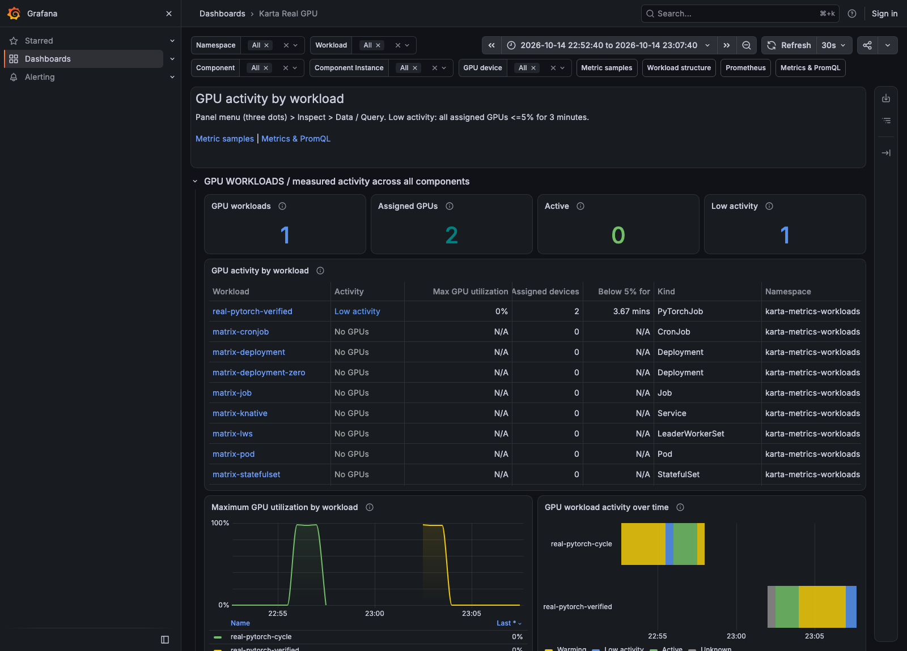

### Karta workload, Components, and Pods

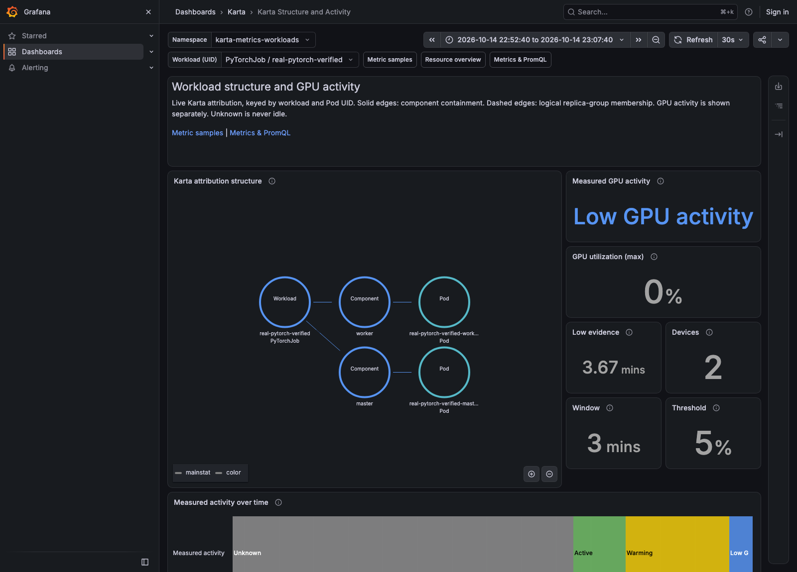

### Native DCGM labels and values

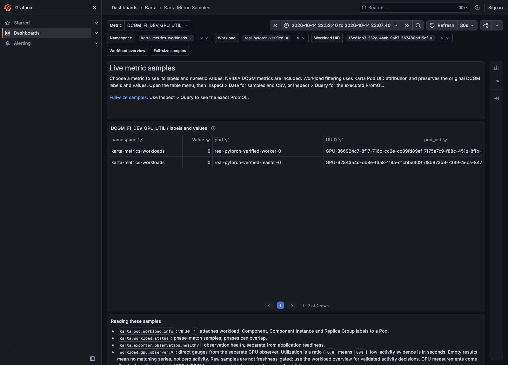

## What failed and what was fixed

| Failure | Cause | Fix and verification |
| --- | --- | --- |
| Karta operator image failed to pull | Incorrect v0.2.6 tag | Changed to published 0.2.6; Helm deployment became Ready |
| Native GPU samples lacked stable Pod identity | DCGM Pod UID disabled | Enabled through GPU operator; native pod_uid matched real Kubernetes Pod UIDs |
| Native scrape initially absent | Service port named gpu-metrics, not metrics | Corrected ServiceMonitor; scrape and raw samples verified |
| Observer could not read native telemetry | Previous prototype required simulator timestamps and health metadata | Added native DCGM input path in separate observer; tested and deployed by digest |
| Wrong UID label assumption | Native label is pod_uid, not podUID | Corrected adapter and removed relabel rule that could erase native identity |
| Two GPU Component panels were empty | Copied expressions selected old bridge job | Changed to karta-real-dcgm-native; both queries returned Component series |
| Missing operator APIs appeared unhealthy | Definitions/catalog selection included absent operators | Removed irrelevant definitions and used explicit installed definitions; health returned to normal |
| Real-GPU dashboard still mentioned simulator metadata | Copied demo panels and descriptions | Removed simulator-only panels and refreshed the visible query reference |

No Karta public metric or Helm API was changed. The native adapter is isolated
in the separate workload GPU observer. Source patch, exact images, manifests,
logs, raw measurements, and test evidence are saved beside this report.

## What did not work at the baseline checkpoint

Knative's application Revision was ready, but Ready and RoutesReady stayed
Unknown. Its net-gateway-api configuration was left at example defaults. The
generated HTTPRoutes referenced nonexistent Istio gateways. The installed
network gateway is kgateway. Karta still correctly observed the workload and
its Pods; observation health does not certify application routing readiness.
This issue was repaired before starting MIG tests; the verification is below.

## Metrics and query semantics

`karta_pod_workload_info` supplies workload, Pod UID, and Component identity.
`karta_workload_status` supplies matching lifecycle phases.
`DCGM_FI_DEV_GPU_UTIL` and other `DCGM_FI_*` series come from NVIDIA DCGM.
`workload_gpu_observer_*` are direct metrics from the separate observer.
`karta:pod_attribution:unique` is a Prometheus recording rule that deduplicates
exporter replicas and prevents conflicting Pod mappings from being joined.

```promql
DCGM_FI_DEV_GPU_UTIL{namespace="karta-metrics-workloads"}
```

```promql
workload_gpu_observer_state{namespace="karta-metrics-workloads"}
```

```promql
max by (namespace, workload, workload_uid, component) (
  DCGM_FI_DEV_GPU_UTIL{job="karta-real-dcgm-native", pod_uid!=""}
  * on(namespace, pod_uid) group_left(workload, workload_uid, component)
  karta:pod_attribution:unique
)
```

The dashboard additionally checks freshness and observation health. Missing
telemetry is Unknown, never zero or idle. Native DCGM does not expose a driver
sample timestamp here; the observer's window measures successful HTTP reads.
Low GPU kernel activity does not itself prove application idleness or safe
reclaimability. MIG, sharing, DRA claims, and multiple GPU nodes were not
validated by these full-GPU tests.

## Reproduction, artifacts, and controls

- `README.md`: connection, deployment order, queries, and pause/resume commands.
- `RESULTS.md`: concise baseline outcome.
- `acceptance.json`: both successful finite runs and live health checks.
- `real-pytorch-*-history.json`: historical native observer evidence.
- `query-validation.json`: evaluated expressions and returned series counts.
- `browser-acceptance.json`: browser results and visible text.
- `gpu-workload.json`, `gpu-verified.json`, `gpu-cronjob.json`: GPU workload manifests.
- `cpu-workloads.json`: every CPU fixture submitted.
- `gpu_cycle.py`: exact computation and phase control.
- `definitions.json`, `exporter.json`, `monitoring.json`, `dashboard.json`: Karta and monitoring configuration.
- `native-servicemonitor.json`, `observer.json`: native DCGM integration.
- `observer-provenance.json`: deployed native observer and source hash.
- [Observer source and tests](../../../exporter/examples/workload-gpu-observer): native integration.

The recurring GPU CronJob uses concurrencyPolicy Forbid, no retries, a
15-minute execution deadline, one-hour TTL, and bounded history. GPU tests
must account for this scheduled workload before reconfiguring hardware.
Kubeconfig and authentication material are excluded from this report and
these deployment artifacts.

## Follow-up execution log

### Knative routing repaired before MIG

At 20:18:55 UTC, ConfigurationsReady, RoutesReady, and Ready were all True.
A real HTTP request through the dedicated external Knative gateway returned
HTTP 200 and `Hello smoke!`. Both generated HTTPRoutes now have real gateways.

Created dedicated kgateway GatewayParameters, a GatewayClass, and external/local
Knative Gateways with ClusterIP Services. Configured the KnativeServing resource
through its operator-owned gateway settings. The existing shared TLS gateway and
its MetalLB allocation were preserved. The external Knative route is tested
through a loopback port forward; this does not create a public load balancer.

Evidence: `knative-fix/http-acceptance.json`, `knative-fix/httproutes-after.json`,
and the saved before/after resources. The original failure remains documented
above as the baseline, and is now resolved.

Configuration reference: [Knative operator Gateway API configuration](https://knative.dev/blog/articles/gateway-api-ingress-with-knative-operator/).

### MIG investigation

Started after the Knative HTTP verification passed. The first scheduled CUDA
CronJob completed normally. New CronJob runs were suspended. A live inventory
confirmed no active GPU Pods and no CUDA processes before reconfiguration.

Both A100s advertised the supported `3g.20gb` profile. The requested test geometry
keeps GPU 1 whole and creates two `3g.20gb` instances on GPU 0. The operator uses
`mig.strategy=mixed` and a saved custom MIG manager ConfigMap. Hardware activation
and metrics validation were the next gates at that point.

Saved pre-change resources, driver output, configuration manifests, and CronJob
completion evidence are in `mig/`. No unrelated GPU workload was interrupted.


#### First MIG activation failure

MIG manager validated the requested profile, stopped its known GPU clients,
and attempted the A100 reset. The driver rejected the reset with `In use by
another client`. GPU 0 remained in pending-enable state. No MIG workload was
submitted. The manager restarted its clients and reported failed configuration.
The next action was to identify remaining device holders before retrying. Evidence: `mig/manager-failed.log`.

The device holder was the preinstalled `nvidia-dcgm.service` host engine.
Its recorded start time was 20:24:32 UTC, after MIG manager stopped it and before
the 20:24:56 reset attempt. The exact agent that restarted it was not established.
A temporary runtime mask of that unit and its `dcgm.service` alias was used to
prevent the restart race during one retry. The retry script restores the original enabled
service in a finally block. No permanent host service disable was applied.

#### Reset remained blocked; worker reboot approved

The runtime mask removed the visible host DCGM handle, but did not resolve the
reset failure. A direct reset of GPU 0 also returned `In use by another client`
while `fuser` found no users of the GPU device nodes. The host DCGM unit was
unmasked and restored to active/enabled. Its temporary mask was not left behind.
The root cause of the remaining driver-side refusal is not yet established.

The GPU worker is an OpenStack VM. NVIDIA documents that A100 passthrough MIG
activation can require a VM reboot. A reboot of only the GPU worker, after
draining it, was explicitly approved. The other five nodes and control plane
are outside that action. The standalone CPU demo Pod was saved for recreation;
completed CUDA logs were saved before draining. No MIG workload or query was
declared working while mode activation was blocked.

The approved drain completed successfully. Controller-managed Pods were evicted
through Kubernetes, with disruption budgets enforced. DaemonSets remained for
node recovery. The saved standalone fixture was removed separately and subsequently
recreated. The worker reboot was then requested through its existing SSH route.

During worker recovery, Grafana and Prometheus returned HTTP 200. All five
other Kubernetes nodes remained Ready with unchanged boot IDs. The cluster
manager reported the rebooted worker as INSTALLING, with provisioning SYNC
in progress. This environment synchronizes its boot image during node startup.
GPU validation remained paused until provisioning and Kubernetes recovery finished.
The standalone CPU demo Pod was recreated from its saved manifest.

#### MIG mode and instance creation succeeded after reboot

The worker returned Ready with a new boot ID. GPU 0 now reports MIG Enabled;
GPU 1 remains Disabled. At 20:38:02 UTC MIG manager reported success and restored
all GPU client deployment selectors. It created GPU instances 1 and 2, each
with one compute instance, 42 SMs, and approximately 20 GB of framebuffer.
The driver reports no running compute processes at this checkpoint.

This resolves the hardware activation blocker. Device-plugin capacity and
actual partition workloads were the next verification gates. Evidence:
`mig/node-after-reboot.json` and `mig/manager-after-reboot.log`.

#### Real MIG probe and observer correction

Submitted `real-pytorch-mig-probe`, a finite PyTorchJob with one Master and one
Worker, each requesting one `nvidia.com/mig-3g.20gb` resource. Both CUDA processes
reported an A100 MIG 3g.20gb device, 42 SMs, and 21,072,183,296 bytes of device
memory. Native DCGM reported approximately 98.2% GR-engine activity for the busy
Master and 0% for the quiet Worker, with distinct Pod UIDs and GPU instance IDs.

The full-GPU query is insufficient: `DCGM_FI_DEV_GPU_UTIL` is absent for these
MIG instances. `DCGM_FI_PROF_GR_ENGINE_ACTIVE` is available as a 0..1 ratio.
The new observer path uses this counter for MIG, checks the requested profile,
and identifies allocations by parent UUID plus GPU/compute instance IDs.
The original full-GPU utilization path remains supported. Parent aggregates
are excluded when instance measurements are used.

The first test run caught an init-container rejection-reason regression, which
was fixed before publishing. Existing and new race-enabled tests then passed.
Coverage includes busy/quiet transitions, complete 180-second windows, missing
instances, duplicate instances, multiple compute instances, wrong profiles,
missing or reused Pod UIDs, invalid values, and changed allocation identity.
The immutable deployed digest is recorded in `observer-provenance.json`.

The component query now selects full-GPU utilization or MIG GR-engine activity,
with freshness checked before conversion to percent. Its live validation
returned both MIG Component series. The workload-level classification was then
verified over a complete new activity cycle. `real-full-with-mig` was also
submitted to verify the remaining full GPU alongside MIG allocations.

Native power and temperature values repeat across the two MIG instance labels.
These are physical-device measurements here, not independent partition costs.
Summing the repeated power samples would double-count the A100.

## DCGM interval correction and repeated timing test

The first MIG/full-GPU run completed and passed its 12 acceptance checks,
including complete 180-second low-activity evidence, resumed activity, and
allocation release. However, comparison with CUDA phase logs showed delayed
telemetry: the Master entered quiet at 20:51:17 UTC and native GR-engine
activity did not become quiet until about 20:52:10.

The setup used `DCGM_EXPORTER_COLLECT_INTERVAL=5000`. The installed exporter
help confirms its valid variable is `DCGM_EXPORTER_INTERVAL`, with a default
of 30,000 ms. The attempted setting was silently ignored. The earlier
five-second baseline claim has been corrected. This is a deployment setup
bug, not a Karta API change.

The repair replaces only that environment setting in the NVIDIA ClusterPolicy,
preserves other settings, and rolls the native DCGM exporter. Final timing
acceptance uses new finite workloads, `real-pytorch-mig-timed` and
`real-full-mig-timed`, after verifying the new exporter is healthy. Previous
evidence is preserved in `mig/acceptance.json`; the repeat is under
`mig/interval-fixed/`.

## Other GPU observations and limits

A read-only `nvidia-smi -q -x` snapshot was saved during the resumed compute
phase. `mig/gpu-health-summary.json` extracts its relevant counters.

| Observation | Recorded value or implication |
| --- | --- |
| ECC | Reported volatile and aggregate SRAM/DRAM counters were zero on both devices |
| Thermal behavior | MIG parent 71 C, memory 72 C; thermal slowdown reasons inactive |
| Power limit | MIG parent approximately 250 W against a 250 W limit; software power-cap reason active during compute |
| Quiet full GPU | 55 C and approximately 46 W in that snapshot |
| Row remapping | Full GPU reported zero corrected/uncorrected remaps, no pending remap or failure; MIG parent field was N/A |
| Error visibility | XID error metric was absent from the current exported counter set; absence does not mean zero errors |
| Memory | Quiet MIG Worker retained approximately 2.4 GiB of framebuffer; low compute activity does not mean memory is free |
| Physical counters | Power and temperature repeat under MIG instance labels; aggregate once per physical UUID and node |

Power-cap activity is a clock-management observation under this workload, not
a failed CUDA test. No power limit, clocks, ECC setting, or hardware recovery
policy was changed for these checks. No intrusive DCGM stress diagnostic was
run. The raw XML and native counters remain available for inspection.

Only A100 3g.20gb with one compute instance per GPU instance and unshared
Kubernetes device-plugin allocations was tested. Time slicing, MPS, DRA,
multiple compute instances within one GPU instance, other MIG profiles,
multi-node collection, and a 100,000-workload scale were not validated here.
The observer rejects unsupported or ambiguous allocation evidence rather
than declaring it low activity. Native HTTP freshness cannot independently
prove that a driver-side sample has advanced; DCGM exposes no sample timestamp
in these series.

The native MIG query uses `DCGM_FI_PROF_GR_ENGINE_ACTIVE` as a ratio, with
`GPU_I_ID` and `GPU_CI_ID` preserved. Multiplication by 100 is only a display
conversion. This measures GR-engine activity; it is not identical to the
full-GPU GPU_UTIL counter, application throughput, or useful model work.

```promql
max by (namespace, workload, workload_uid) (
  DCGM_FI_PROF_GR_ENGINE_ACTIVE{
    job="karta-real-dcgm-native", GPU_I_ID!="", GPU_CI_ID!="", pod_uid!=""
  }
  * on (namespace, pod_uid) group_left (workload, workload_uid)
  karta:pod_attribution:unique
)
```

The raw query helps inspect attribution. The dashboard's low-activity decision
comes from the separate observer after checking all expected allocations and
the full 180-second evidence window.

```promql
sum(max by (node, UUID) (
  DCGM_FI_DEV_POWER_USAGE{job="karta-real-dcgm-native"}
))
```

This query totals physical GPU watts without counting the MIG parent twice.
It does not allocate power costs to individual MIG workloads.

References: [DCGM exporter collection configuration](https://docs.nvidia.com/datacenter/dcgm/latest/reference/command-line-reference/dcgm-exporter.html),
[DCGM entity and label reference](https://docs.nvidia.com/datacenter/dcgm/latest/reference/dcgm-exporter-metrics.html),
and [MIG profiling semantics](https://docs.nvidia.com/datacenter/dcgm/latest/learn/modules/profiling.html).

## MIG screenshots after the collection-interval fix

These are browser captures of Grafana using the real native DCGM samples and
Karta attribution from the corrected-interval run. The first view shows both
whole workloads before drilling down to Components. Two physical A100 devices
provide three allocations in the mixed configuration.

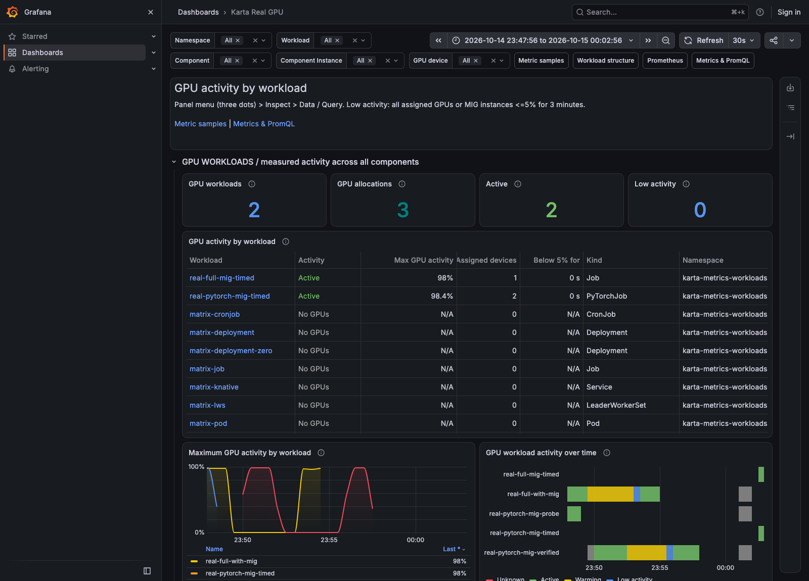

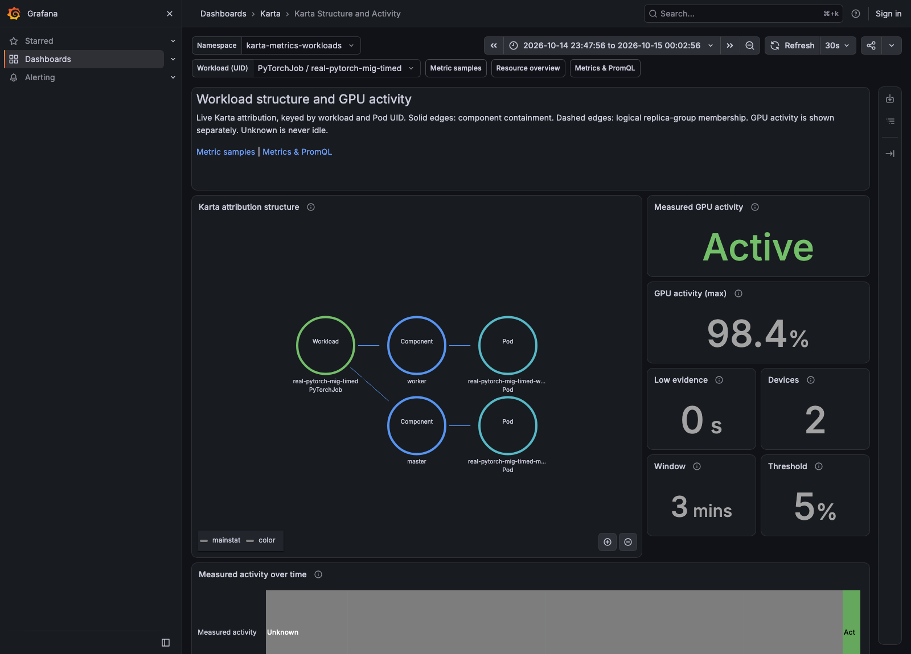

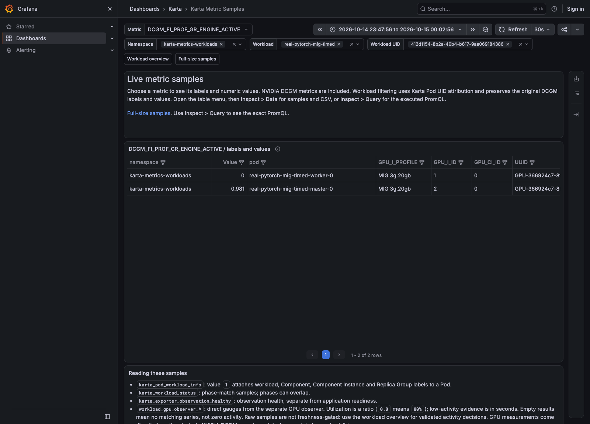

## Final verified outcome

The corrected exporter Pod uses `DCGM_EXPORTER_INTERVAL=5000`; the invalid
variable is absent. Both final workloads completed normally. All 12 end-to-end
acceptance checks passed, including MIG instance isolation, stable Pod UID
attribution, full-GPU behavior alongside MIG, complete low-activity windows,
resumed activity, released allocations, and healthy scrapes.

| Workload | Result | Allocations | Peak activity | Earliest low evidence | Largest observed native transition delay |
| --- | --- | --- | --- | --- | --- |
| real-pytorch-mig-timed | Succeeded | 2 | 98.54% | 189.983 s | 10.000 s |
| real-full-mig-timed | Succeeded | 1 | 98.00% | 189.986 s | 9.000 s |

Transition delay compares logged CUDA phase times with the first matching
Prometheus value, evaluated on a one-second query grid. It includes collection
and scrape latency. These are observed timings for this run, not a latency SLA
or a proof of driver sample timestamps. `timing.json` preserves each phase.

At initial workload creation, the history includes a brief Unknown sample
with `karta_unhealthy` while attribution converged. It recovered automatically
and was never treated as low activity.

Both workloads remained Warming while the evidence window accumulated. They
became Low activity only after at least 180 seconds, returned to Active when
CUDA computation resumed, and became No GPUs after completion. The direct
observer metric supplies this state; the dashboard does not infer it from a
single low utilization sample.

All 57 dashboard expressions succeeded. Browser verification passed
without JavaScript errors or failed HTTP responses. The overview, Karta
workload/Component structure, and raw native MIG labels were verified.

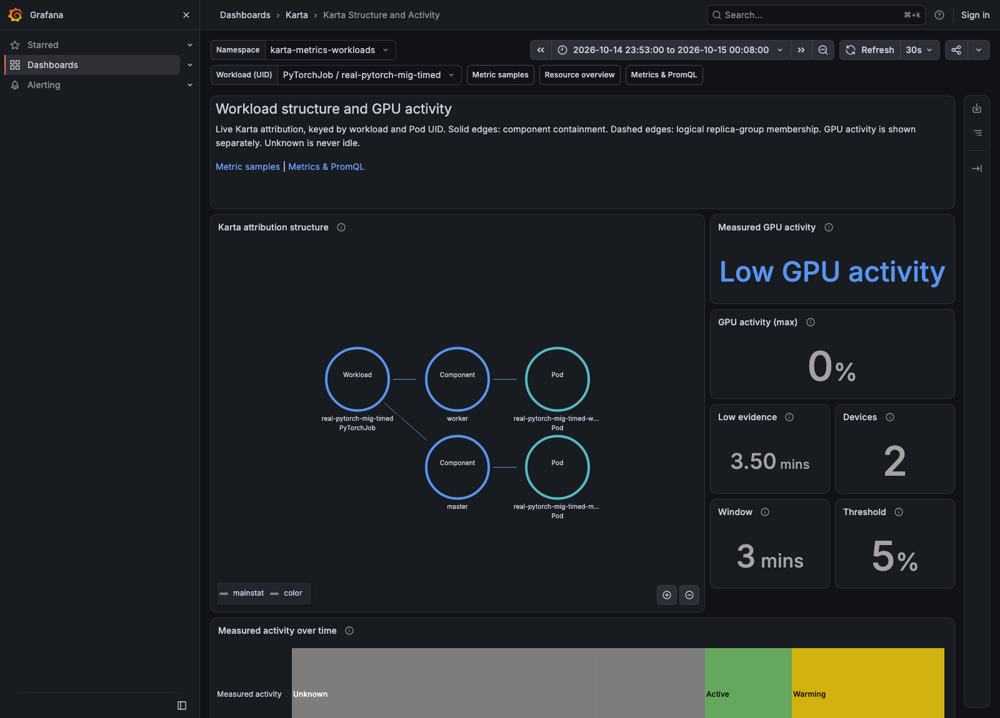

The final checks found all six nodes Ready, the GPU worker schedulable,
MIG manager state success, and the expected one full-GPU plus two MIG resources.
The original finite one-GPU CronJob was resumed only after tests passed. The
existing CPU fixtures remain available; Knative still returned HTTP 200.

No active test blocker remains. The driver-side reason for reset refusal with
no visible device-file holder was not proven; the approved worker reboot
resolved the activation blocker. Unsupported scenarios listed above remain
unvalidated rather than being represented as passing.

Final evidence:

- `mig/interval-fixed/acceptance.json`: 12 live acceptance checks and per-workload states.
- `mig/interval-fixed/timing.json`: CUDA-to-native-metric phase timing.
- `mig/interval-fixed/*-history.json`: observer history across complete runs.
- `mig/interval-fixed/*-native-timing.json`: native DCGM history.
- `mig/interval-fixed/*.log`: CUDA phase and native exporter startup logs.
- `mig/interval-fixed/query-validation.json`: every evaluated dashboard expression.
- `mig/interval-fixed/browser-acceptance.json`: final browser evidence.
- `mig/interval-fixed/final-state.json`: restored CronJob, node health, and Knative check.
- `mig/observer-tests.json`: race-enabled observer regression results.
- `observer-provenance.json`: deployed immutable observer image and source hash.

This published copy includes selected evidence, manifests, and original screenshots.
Node names and IP addresses in text evidence are anonymized. Private cluster-wide
snapshots, kubeconfigs, credentials, and local build directories are excluded.

## Operational findings before DRA validation

The verified signal path is CUDA on a physical A100 or MIG instance -> native
NVIDIA DCGM exporter -> Prometheus -> Grafana. Karta supplies workload and Pod
identity; the separate GPU observer verifies that all requested allocations
have valid, attributable telemetry before accumulating low-activity evidence.
It does not generate GPU measurements.

| Layer | What it establishes | What it does not establish |
| --- | --- | --- |
| CUDA logs | Device visibility, actual matrix multiplication, phase times, normal process completion | A model-training or inference performance benchmark |
| Native DCGM | Measured activity, framebuffer memory, physical-device counters, Pod UID labels | Workload ownership without attribution or guaranteed per-sample driver freshness |
| Karta | Workload UID, Component identity, Pod ownership and lifecycle | Application readiness or GPU activity by itself |
| Separate GPU observer | Complete allocation evidence, conservative Unknown behavior, sustained <=5% activity | Whether a quiet application is safe to evict or reclaim |
| Grafana | Whole workload first, then Components, raw labels, exact PromQL, historical states | A substitute for allocation and telemetry validation |

The most consequential setup corrections were enabling native `pod_uid`,
selecting the actual native scrape job and Service port, replacing the invalid
collection-interval variable, and using a MIG-specific activity counter. An
HTTP scrape succeeding was insufficient to establish any of those semantics.
The tests compared raw values with CUDA phase logs and with Kubernetes resource
requests before accepting dashboard results.

For the full GPU, `DCGM_FI_DEV_GPU_UTIL` is already a percentage. For the tested
MIG devices, `DCGM_FI_PROF_GR_ENGINE_ACTIVE` is a ratio and is multiplied by 100
only for display. Each MIG allocation needs physical UUID, GPU instance ID, and
compute instance ID. Grouping only by parent UUID would merge distinct
allocations. Summing repeated parent power values would overstate consumption.

The node is deliberately left in mixed mode: one whole GPU and two 3g.20gb
allocations. The original two-full-GPU PyTorchJob no longer fits that geometry.
The continuing CronJob requests only the remaining full GPU and finishes in
about eight minutes. Forbid concurrency, deadlines, bounded history, and TTL
keep recurring demonstrations finite.

Screenshots and saved JSON/log evidence survive workload cleanup. Prometheus
retains 24 hours in this deployment, so historical live queries eventually
expire even though the report's images remain available.

## DRA follow-up

Requested after full-GPU and MIG validation passed. The first gate is to inspect
the installed DRA driver capabilities, Kubernetes DeviceClasses/ResourceSlices,
active consumers, and DCGM attribution support. Existing results above remain
the verified device-plugin baseline. DRA results will be appended only after
actual ResourceClaim allocation and finite CUDA workloads have been observed.

### Initial DRA readiness findings

The existing DRA 0.5.0 controller and GPU/MIG DeviceClasses were present, but
there was no DRA GPU kubelet plugin and no ResourceSlice inventory. No claims
existed. DeviceClasses alone therefore did not demonstrate working DRA GPU
allocation. The controller belongs to an existing Argo CD application.

The full-GPU and static-MIG probe manifests are prepared under `dra/`, along
with explicit ResourceClaimTemplates, finite CUDA activity cycles, an isolated
node-selected plugin, and exact device-plugin disable/restore patches. The
existing DRA controller and DeviceClasses are preserved. The chart is pinned
to 0.5.0 and its digest is recorded.

The installed DCGM 4.8.4 source includes DRA Pod UID enrichment and claim/device
labels. This is source inspection, not a live telemetry pass. At this checkpoint, the separate
workload observer rejected ResourceClaims as unsupported; DRA low
activity must not be claimed without implementing and testing claim-aware
inventory validation.

Automatic approval review rejected temporarily disabling the NVIDIA device
plugin because it changes shared GPU scheduling. At that initial checkpoint, explicit approval for
the switch was requested. The disable patch had not been applied and no DRA
workload or plugin had been created. Approval subsequently arrived and the
verified execution is documented below. `dra/README.md` records the prepared steps, rollback,
and the distinction between a standalone test and GPUCluster-managed DRA.

The API server accepted both ResourceClaimTemplates, both finite CUDA probes,
the full-GPU Job, and the MIG PyTorchJob in server dry-run mode. This validates
the manifests, not scheduling, claim preparation, CUDA execution, or telemetry.

The recurring GPU CronJob was restored while approval is pending. Final
read-only checks confirmed the device plugin remains enabled, all six nodes
are Ready, and there are no failed Prometheus scrapes. `dra/preflight-result.json`
records this checkpoint. This preserved the original demo
until the subsequent approved DRA validation.

### DRA allocation switch approved

Explicit approval was received for temporary device-plugin disablement, DRA
validation, and restoration afterward. The recurring GPU CronJob is suspended
again, with active consumers checked before changing allocation control.
Subsequent results below supersede the earlier approval-pending checkpoint.
### DRA plugin installation: failure and correction

The first node-plugin apply was denied by the existing privileged-container
policy in a new namespace. The official node plugin needs privileged host
device access. The corrected deployment uses the existing `gpu-operator`
infrastructure namespace, which the policy already permits. The policy was
not modified. Test objects have unique names and preserve the existing
Argo CD controller and DeviceClasses.

The DRA node plugin became Ready and published one ResourceSlice containing
one full A100 and two static `3g.20gb` MIG devices. This establishes device
discovery. CUDA allocation and telemetry checks follow separately.

### DRA CUDA probes and native attribution passed

Both finite probes completed successfully. The full-GPU Pod saw exactly one
A100 with 42,404,806,656 bytes; the MIG Pod saw exactly one A100 MIG 3g.20gb
with 21,072,183,296 bytes. Both executed CUDA matrix multiplication and checked
finite results. `NVIDIA_VISIBLE_DEVICES=void` prevents the image's legacy
visibility setting from exposing devices beyond the CDI allocation.

Native DCGM reported Pod UID, claim name/namespace, driver, pool, and device
name for both probes. MIG also reported its MIG UUID and 3g.20gb profile,
alongside the parent UUID and GPU/compute instance IDs. The DRA mapper needed
`KUBERNETES_ENABLE_DRA=true` and ResourceSlice read permissions. Existing
Pod UID enrichment and the 5-second collection interval were preserved.

The first 45-second rollout wait expired because the readiness probe became
Ready later; exporter startup had succeeded. Readiness was verified before
the CUDA probes were submitted. No exporter crash occurred.

Evidence: `dra/probe-jobs-final.json`, `dra/probe-claims.json`,
`dra/probe-dcgm.prom`, and `dra/real-dra-*-probe.log`.

### Claim-aware workload observation

The separate GPU observer now reads ResourceClaims only when an active Pod
uses claims. It reads the selected namespace and a bounded ResourceSlice
inventory. The supported path is NVIDIA exclusive full GPUs and static MIG
with ExactCount requests. It verifies the current Pod UID reservation,
claim UID, driver/pool/device tuple, device UUID, MIG profile, and native DCGM
claim labels. The workload and Component join still uses Karta Pod UID.

A changed claim or device restarts the evidence window. Missing, ambiguous,
shared, administrative, fractional, or unsupported allocations remain Unknown.
The observer does not turn a pending claim into zero GPUs or zero activity.
Claim sharing across containers, init-container claims, opaque allocation
configuration, and unsupported DRA modes are deliberately rejected.

No Karta metric name, label, CRD field, or Helm value changed. The new code is
in the [separate demo observer](../../../exporter/examples/workload-gpu-observer);
the immutable deployed image and source hash are in
`dra/observer-provenance.json`. The race-enabled observer tests passed,
including existing full-GPU/MIG tests and new DRA negative cases.

This remains a bounded single-node demo observer, not evidence of a
production DRA observer validated at 100,000 workloads.

### What DRA changes in the metrics

DRA changes allocation and adds claim identity. It does not replace native
DCGM measurements or Karta workload identity. The tested full GPU still uses
`DCGM_FI_DEV_GPU_UTIL`; the tested MIG instances still use
`DCGM_FI_PROF_GR_ENGINE_ACTIVE`. The latter is a ratio, not a percentage.

Raw full-GPU samples, including native DRA labels:

```promql
DCGM_FI_DEV_GPU_UTIL{
  job="karta-real-dcgm-native",
  namespace="karta-metrics-workloads",
  dra_claim_name!=""
}
```

Raw static-MIG samples:

```promql
DCGM_FI_PROF_GR_ENGINE_ACTIVE{
  job="karta-real-dcgm-native",
  namespace="karta-metrics-workloads",
  dra_claim_name!="",
  GPU_I_ID!="",
  GPU_CI_ID!=""
}
```

A Component-level MIG view adds Karta identity through the existing unique
Pod UID attribution recording rule:

```promql
100 * DCGM_FI_PROF_GR_ENGINE_ACTIVE{
  job="karta-real-dcgm-native",
  namespace="karta-metrics-workloads",
  dra_claim_name!="",
  GPU_I_ID!="",
  GPU_CI_ID!=""
}
* on(namespace, pod_uid) group_left(workload, workload_uid, component)
karta:pod_attribution:unique
```

This example exposes the join. Dashboard activity decisions additionally
require valid current inventory and fresh successful observations. The direct
workload observer metric for sustained low activity remains:

```promql
workload_gpu_observer_low_activity{
  namespace="karta-metrics-workloads",
  workload="real-dra-mig-cycle",
  source="dcgm"
}
```

Value 1 means all verified allocations stayed at or below 5% throughout a
complete three-minute sampled window. Missing output does not mean idle.

Native DRA identity labels observed in this run:

| Label | Meaning |
| --- | --- |
| pod_uid | Kubernetes Pod identity used for the Karta join |
| dra_claim_name, dra_claim_namespace | ResourceClaim identity within its namespace |
| dra_driver_name | NVIDIA DRA driver, gpu.nvidia.com |
| dra_pool_name, dra_device_name | Device selected from the published resource pool |
| dra_mig_device_uuid | MIG UUID matched to ResourceSlice inventory |
| dra_mig_profile | Selected MIG profile, 3g.20gb in this test |
| UUID, GPU_I_ID, GPU_CI_ID | Native parent GPU and instance identity |

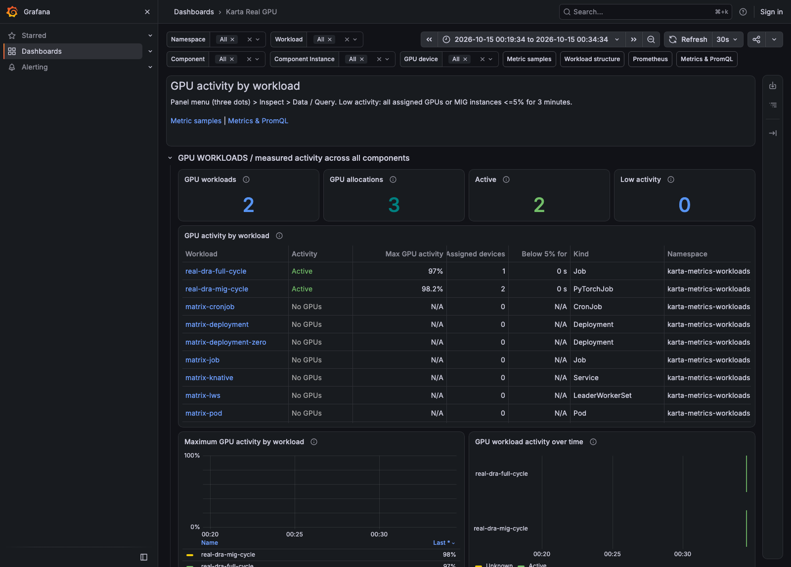

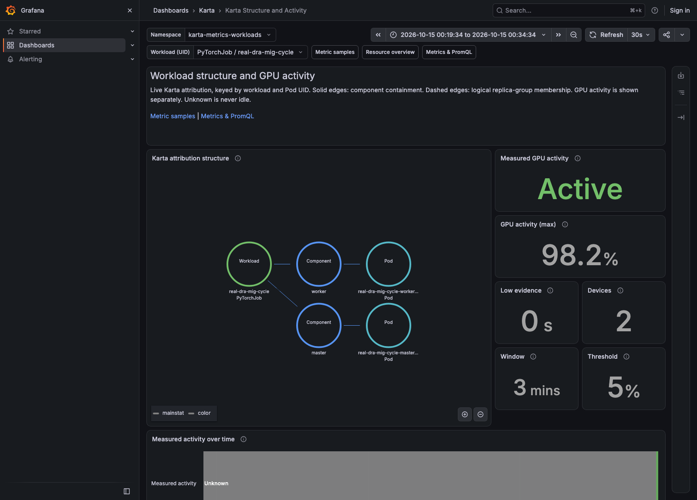

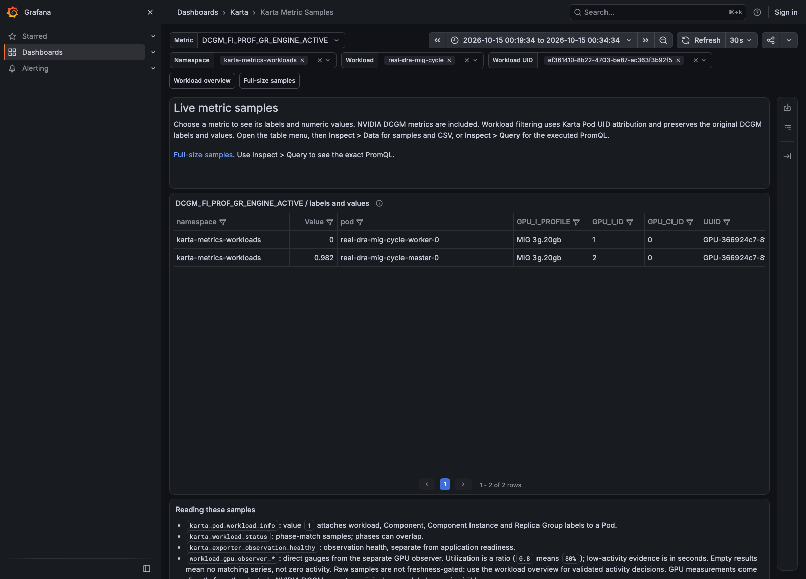

### Sustained quiet state and recovery observed

Both DRA workloads became Low activity only after a complete evidence
window. A saved live snapshot shows 199.997 seconds for the full GPU and
189.812 seconds for the two-instance MIG workload, with utilization zero
and complete allocation counts of one and two. Resumed computation returned
both to Active, with observed activity of 96% and 98.3742%.

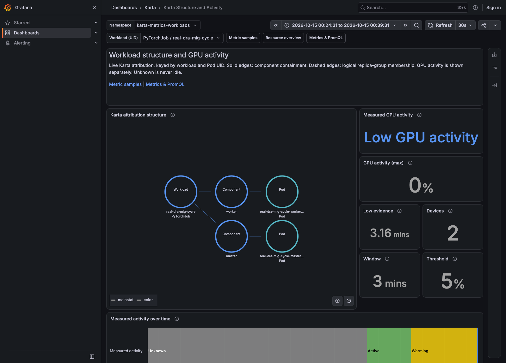

An additional full-GPU request remained Pending with no claim allocation
while all resources were occupied. The observer reported Unknown for that
workload. `dra/contention-pending.json` records the scheduler condition and
claim evidence. Its eventual allocation and completion are checked separately.

### Completed DRA activity validation

All 14 live acceptance checks passed. Both finite cycles completed normally.
The MIG Master and Worker used different MIG UUIDs on the same physical
A100. During the busy phase, the Master was above 98% and the Worker was 0%.
Karta attributed both to the same PyTorchJob UID with distinct master/worker
Components. Native DCGM claim/device identities matched ResourceClaims and
ResourceSlices.

| Workload | Allocations | Peak activity | Earliest low evidence | Largest observed native transition delay |
| --- | --- | --- | --- | --- |
| real-dra-mig-cycle | 2 | 98.48% | 189.812 s | 14.000 s |
| real-dra-full-cycle | 1 | 98.00% | 180.041 s | 9.000 s |

The DRA MIG run observed up to 14 seconds from a logged CUDA phase change
to the first matching Prometheus value; full-GPU transitions took up to
9 seconds. This includes collection and scrape timing. It is an observed
result, not a latency guarantee. The initial MIG allocation briefly showed
Unknown while the Pod was pending; it did not count toward low evidence.

All 57 dashboard expressions succeeded. Both active and low-state browser
checks passed without JavaScript errors or failed HTTP responses. The
original dashboard expressions worked with DRA because Pod UID attribution
remains stable across allocation mechanisms.

Evidence: `dra/acceptance.json`, `dra/timing.json`, native histories,
CUDA logs, `dra/query-validation.json`, and both browser acceptance files.

### DRA contention and release passed

The extra full-GPU Job stayed Pending and unallocated while the first Job
held the GPU. It started 3 seconds after the previous container finished,
saw exactly one A100, performed CUDA computation, and completed normally.
Native DCGM identified the same physical GPU with the new Pod UID and claim.
All generated ResourceClaims were removed after completion. The short probe
never accumulated enough evidence to become Low activity.

All seven contention/lifecycle checks passed. Evidence:
`dra/contention-pending.json`, `dra/contention-final.json`,
`dra/contention-native-history.json`, and `dra/claims-after-cycles.json`.

| Submitted workload | Type | Allocation | Test purpose | Result |
| --- | --- | --- | --- | --- |
| real-dra-full-probe | Job | 1 full A100 | CDI isolation and CUDA | Complete |
| real-dra-mig-probe | Job | 1 MIG 3g.20gb | CDI isolation and CUDA | Complete |
| real-dra-full-cycle | Job | 1 full A100 | Busy, quiet window, resume, completion | Complete |
| real-dra-mig-cycle | PyTorchJob | 2 MIG 3g.20gb | Component isolation and whole-workload state | Succeeded |
| real-dra-contention-probe | Job | 1 full A100 after release | No double allocation and reuse | Complete |

The PyTorchJob launches two independent finite CUDA test processes through
the installed training operator. It is not a distributed-training throughput
benchmark. All manifests are saved under `dra/`.

### Restoration verified

The temporary DRA plugin, its test RBAC/admission objects, ResourceSlice,
claim templates, test workloads, and unused test namespace were removed.
The regular NVIDIA device plugin and original native DCGM environment were
restored. Pod UID enrichment and the correct five-second interval remain.
The existing MIG geometry was preserved throughout DRA testing.

After restoration, `real-restored-full-probe` and `real-restored-mig-probe`
both completed real CUDA matrix multiplication with exactly one visible
assigned device. The updated observer verified one device for each and
never classified either short run as sustained low activity. These completed
probe Jobs were then removed after logs and metrics were saved.

Final checks passed:

- All six nodes Ready; GPU worker schedulable.
- One full A100 and two MIG 3g.20gb allocations restored.
- Device plugin and native DCGM Ready.
- No temporary DRA plugin, ResourceSlices, or claims remain.
- No failed Prometheus scrapes.
- Knative Ready and HTTP 200 with `Hello smoke!`.
- Original finite GPU CronJob resumed on its */15 schedule.

The claim-aware observer remains deployed with the same public metric
contract. Its extra RBAC is read-only. Karta public metrics and Helm API
remain unchanged. The source, guides, dashboards, workload manifests, and selected
evidence are now included in this repository. Original private snapshots remain
outside Git.

The pre-existing Argo CD DRA controller kept the same UID and specification
and remained Ready. All existing DeviceClasses kept their UIDs and
specifications. `dra/preserved-infrastructure.json` records this comparison.

Final evidence: `dra/final-state.json`, `dra/restored-probe-results.json`,
`dra/restored-infrastructure-ready.json`, and `dra/cron-resumed.json`.

### Scope and remaining limits

No unresolved blocker remains in the tested full-GPU, static-MIG, DRA
allocation, native telemetry, attribution, quiet-window, or restoration paths.
This is a standalone NVIDIA DRA 0.5.0 GPU-plugin validation on one A100 worker.
It does not validate GPUCluster-managed migration, dynamic MIG reconfiguration,
MPS, time slicing, shared/consumable claims, ComputeDomains, or multi-node DRA.
ComputeDomains require different hardware. Those scenarios are untested,
not claimed to work or to be broken.

The workload observer rejects unsupported sharing and claim shapes as Unknown.
It has bounded inventory and a single configured source node; it is not a
production scale proof for 100,000 workloads. DCGM exposes no original
per-sample driver timestamp here, so low-activity windows measure repeated
successful HTTP observations. Low activity is evidence of low GPU activity,
not permission to terminate a workload or proof that its application is idle.

Prometheus retains this deployment's history for 24 hours. The saved screenshots,
JSON, CUDA logs, queries, manifests, and source patch remain available after
live historical queries expire. The report now contains 11 actual Grafana
screenshots across the full-GPU, MIG, and DRA validation.
