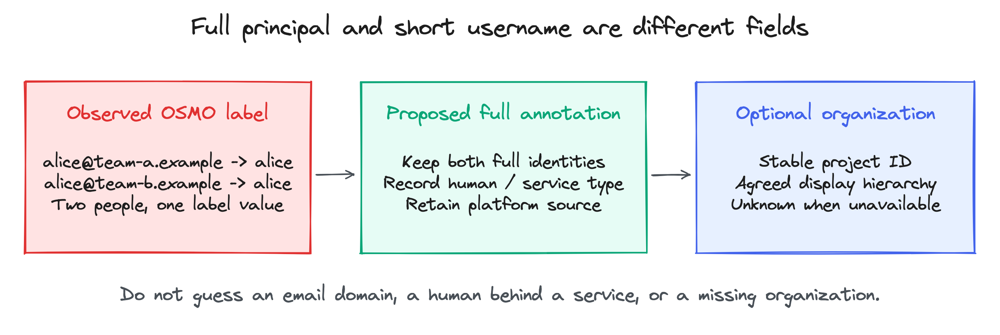
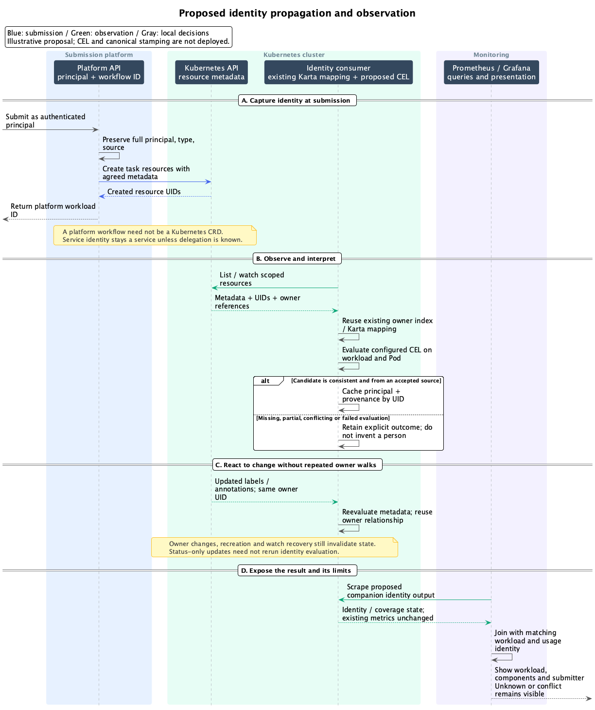

<!-- SPDX-License-Identifier: Apache-2.0 -->
<!-- Copyright (c) 2026 NVIDIA Corporation -->

# Who submitted this workload?

Workload Map | Lab evidence and integration proposal | 16 October 2026

## 1. Start with a fact that survives the platform


Two people submit OSMO workflows: `alice@team-a.example` and
`alice@team-b.example`. Both running Pods carry `osmo.submitted_by=alice`.
A dashboard can group them under that label, but cannot tell the people apart.
The workflow API still has their full identities. No CEL expression can reverse
this loss of information without another source.

The practical design has two parts. Submission platforms preserve an agreed
identity on the resources they create. A configurable extractor reads that
identity, with compatibility rules for older metadata. Karta supplies the
workload/component structure used to connect those resources to measurements.

This document proposes the extractor and metadata contract. Neither is deployed.
The completed work is the product investigation and the live tests below.

| Proven in the lab | What it does not prove |
| --- | --- |
| Four finite OSMO workflows completed | Production login or every submission mode |
| NVCF function ACTIVE and invocation HTTP 200 | A human username is present on its Pods |
| NVCT task reached COMPLETED | A shared API-key owner identifies a human |
| 32 installed lab controllers ready at final check | A production-ready installation or current cluster health |

The lab used fake GPUs and CPU/sleep fixtures. It tested execution paths and
identity propagation, not GPU computation. The existing real-GPU, MIG and DRA
reports remain separate and unchanged.

<!-- pagebreak -->

## 2. What each product actually gives us

| Path | On Kubernetes resources | Elsewhere | Conclusion |
| --- | --- | --- | --- |
| OSMO tasks | `osmo.submitted_by`, workflow ID/UUID; task Pods and PodGroups | Full `submitted_by` in workflow API | Label is useful but can be lossy or absent |
| Run:AI inspected composer | Workload annotation `run.ai/submitted-by`; Pod annotation `user` | Source supplies the request identity | Source-verified path; live authenticated submission still needed |
| NVCF function | Account, function and version IDs | Creation audit with authenticated client identity | Correlate IDs, or request identity propagation |
| NVCT task | Account/task IDs on Pod and ICMSRequest parent | Creation audit with API-key owner | Same limitation; owner can be a service |
| Direct Kubernetes request | No automatic original-human metadata guarantee | Admission request `userInfo` | Capture at the original API request, with explicit semantics |

### OSMO: four distinct inputs

| Input identity | Workflow API | Pod and PodGroup label |
| --- | --- | --- |
| `alice` | `alice` | `alice` |
| `alice@team-a.example` | Full email | `alice` |
| `alice@team-b.example` | Full email | `alice` |
| `a` | `a` | Absent |

The inspected OSMO regex requires at least two characters, although a
single-character Kubernetes label value is valid. A full-identity annotation
avoids both the email restriction and this particular label-formatting problem.
The tests supplied development identity headers. They establish propagation,
not that an authenticated human controlled those identities.

For NVCF, a creation event and an invocation are different events. The local
function creation audit identified a client; the task creation audit identified
a service-style API-key owner. Do not relabel either as a human submitter.
A service field named `owner_type=USER` is not sufficient evidence by itself.

The tested OSMO workflow is an API/database object, not a Kubernetes root CRD.
Task Pods and their grouping resources provide the Kubernetes correlation points.
An arbitrary Deployment created inside a task is outside the tested stamping path.

<!-- pagebreak -->

## 3. A contract operators can implement



Capture identity at submission, while the platform knows the authenticated
principal. Preserve it through child creation. The recommended minimum is a
full principal, its type, its source, and the platform workload ID. A short-user
label is an optional display/join convenience when the platform knows the
canonical username. Organization attribution is useful but independent.

Candidate keys and an exact YAML example are in
[OPERATOR-CONTRACT.md](OPERATOR-CONTRACT.md). All names are proposed.
The organization label is spelled `org_hierarchy`; confirm spelling before
rollout and explicitly map a legacy `org_heirarchy` only if it already exists.

| Decision | Recommendation |
| --- | --- |
| Full identity too long for a label | Preserve it in an annotation; never truncate an identity used for joins |
| Caller is a service key | Record a service principal; add a human only with verified delegation |
| Root and Pod disagree | Expose a conflict; do not choose whichever object was observed first |
| Organization is missing | Keep workload identity; report organization as unknown |
| A user edits the workload later | Keep original submitter separate from last editor |
| Organization assignment changes | Decide whether reporting uses submission-time or current organization |

A label is limited to 63 characters and a restricted character set. An annotation
can preserve a full identifier that cannot fit. A consumer must still apply its
own output-size bounds. Neither field is proof of identity if arbitrary users
can overwrite it; the platform must define which actor owns the canonical keys.

For direct Kubernetes submissions, an optional admission component can stamp the
original workload from `request.userInfo` on creation. A controller's later Pod
creation has the controller's identity. Stamp/copy the original identity through
the workload template or use the root mapping. A bare Pod submitted directly by
a user is a separate supported case. Admission observes the authenticated or
impersonated principal visible to Kubernetes, not a person's intent behind a service.

This admission component should be optional and independently configurable.
The current exporter does not install it. Capability checks and API-version
support must precede choosing a mutating policy versus a webhook.

<!-- pagebreak -->

## 4. Use the SDK when a definition exists

Karta knows resource structure through a matching definition. The following
example uses existing APIs on the report's repository base. It performs no
cluster reads and does not extract a submitter automatically.

```go
func Inspect(ctx context.Context, obj *unstructured.Unstructured) (
    *tree.WorkloadTree, bool, error,
) {
    def, err := catalog.Get(obj.GroupVersionKind())
    if errors.Is(err, catalog.ErrNotFound) {
        return nil, false, nil
    }
    if err != nil {
        return nil, false, fmt.Errorf("resolve Karta: %w", err)
    }
    factory := resource.NewComponentFactoryFromObject(def, obj)
    result, err := tree.Build(ctx, factory)
    if err != nil {
        return nil, true, fmt.Errorf("build workload tree: %w", err)
    }
    return result, true, nil
}
```

Imports are `context`, `errors`, `fmt`, Kubernetes `unstructured`, and this
repository's `pkg/catalog`, `pkg/resource` and `pkg/tree`. The object must carry
its correct API version and kind. `catalog.Get` checks built-in definitions only;
a consumer that supports cluster-provided Karta CRs must resolve those separately.

If the caller already has a verified matching Karta definition, it can directly
construct the factory shown above. The tree contains component instances and
extracted data. It is not a live owner walker or an authenticated-user lookup.

If `known` is false, ordinary Kubernetes metadata remains readable through
`obj.GetLabels()` and `obj.GetAnnotations()`. A generic CEL layer can use those
maps without any Karta definition. Keep the result tied to that resource UID;
do not invent a workload root or component hierarchy. The consumer owns API
watching, root resolution and joining observations from different objects.

| Desired action | Existing API or proposed responsibility |
| --- | --- |
| Inspect components and instances | Existing `tree.Build` |
| Read a component's Pod template | Existing component/resource accessors, when the definition supports it |
| Read labels/annotations without a definition | Existing Kubernetes metadata accessors |
| Map a live Pod to its root workload | Existing exporter owner index and definition selection |
| Normalize submitting identity | Proposed consumer/exporter CEL layer |
| Suspend, scale or change an object | Separate explicit operation; identity extraction performs no writes |

The submitter design does not require changing Karta's CRD or SDK contract.
It should consume the existing mapping rather than build a second owner graph.

<!-- pagebreak -->

## 5. CEL reads metadata; it does not create identity

This is a proposed chart shape, not a supported value today. The host supplies
`labels` and `annotations` as `map<string,string>`, with empty maps when absent.
The expression returns a string; an empty string means no candidate was found.

```yaml
# Proposal only. No chart flag with this contract is deployed.
submittedByExpression: |
  ("workload.dgxc.nvidia.com/submitter-id" in annotations &&
   annotations["workload.dgxc.nvidia.com/submitter-id"] != "")
    ? annotations["workload.dgxc.nvidia.com/submitter-id"]
    : ("run.ai/submitted-by" in annotations &&
       annotations["run.ai/submitted-by"] != "")
      ? annotations["run.ai/submitted-by"]
      : ("user" in annotations && annotations["user"] != "")
        ? annotations["user"]
        : ("osmo.submitted_by" in labels)
          ? labels["osmo.submitted_by"]
          : ""
```

This example establishes lookup order only. The generic `user` annotation is
not unique to Run:AI; use it only in a configured trusted scope. Ten or more keys
are possible, but a long expression becomes difficult to review. Prefer named,
ordered extraction rules once source-specific provenance or transforms are needed.
The full-identity annotation is preferred here; the separate short-user label can
be exposed as a display field rather than replacing the principal ID.

| Input | Expected candidate | Required surrounding behavior |
| --- | --- | --- |
| Canonical full annotation exists | Full principal | Read its declared type/source; validate the configured authority |
| Run:AI annotation exists | Stored requester value | Preserve the fact that this is platform-provided metadata |
| Only OSMO label exists | Possibly shortened value | Mark it partial; never invent the missing email domain |
| NVCF IDs only | Empty | Unknown identity; optional API/audit adapter is a separate feature |
| Expression fails or exceeds budget | No trusted result | Mark evaluation failure; do not publish a plausible empty success |

A string result cannot explain which branch matched, detect every conflicting
key, or prove the principal's type. The host must carry rule/source metadata
and combine results from the workload and its Pods. A later named-rule contract
can return those facts explicitly; it is not part of this one-field sketch.

Compile/type-check rules when configuration changes, require a string result,
reuse compiled programs, bound evaluation cost and returned length, and keep the
last valid configuration on a rejected update. Evaluate from cached objects,
never by making an API request for every Prometheus scrape. These are proposed
requirements, not results of a deployed CEL test.

<!-- pagebreak -->

## 6. Cache owners, but do not freeze identity

Owner references are usually stable within an object lifetime. Labels and
annotations can still be added or corrected later. An unchanged owner edge says
nothing about whether the submitter changed. `metadata.generation` is also not
a reliable metadata-change signal.

The existing exporter already stores ownership by UID and compares controller
owner references. Its lifecycle tests cover owner arrival, reparenting and
replacement. Reuse that path rather than repeatedly traversing owners for CEL.

| Event | Proposed work |
| --- | --- |
| Status-only update, metadata unchanged | Skip identity evaluation; normal status processing continues |
| Labels/annotations change, same owner | Reevaluate this resource; update dependent identity results |
| Owner edge changes | Reuse owner-index invalidation and rejoin affected descendants |
| Object deleted/recreated under the same name | Drop old UID state; never transfer the old submitter automatically |
| Missing owner becomes available | Retry parked attribution; keep identity/root confidence separate |
| CEL configuration changes | Invalidate extraction results using a new rule revision |
| Watch restarts or relists | Reconcile current objects and remove stale results |

<details>
<summary>Inside the proposed update path</summary>

Use two caches with separate invalidation rules: the existing owner relationship
index and an identity result cache. Key identity by cluster plus object UID and
rule revision. Compare the actual label/annotation maps before reevaluating;
a general CEL expression can inspect any key, so do not guess its dependencies
by scanning the expression text. Keep retained metadata and evaluation work bounded.

A root-identity change should update the shared root record. Keep Pod-to-root
edges separate so every Pod does not store a duplicate full identity record.
If per-Pod output requires fan-out, queue only affected descendants. Evict on
delete and recover after relist. Stop treating a stale cache entry as a verified
current identity when observation health is lost.

For 100,000 workloads, measure cache memory, update throughput, compile time,
evaluation time, fan-out, recovery and scrape latency. The workload count alone
does not bound Pods, intermediate owners, metadata bytes or metric series.
No 100,000-workload submitter benchmark has been run. Avoiding per-scrape API
reads is a design requirement, not a performance guarantee.

</details>

The recommendation is event-driven reuse, not a periodic full owner scan.
Retain the existing reconciliation/recovery behavior. Removing update handling
would be problematic even if owner-reference changes are rare.

<!-- pagebreak -->

## 7. Make the result useful in metrics

An immediate integration can expose existing Pod metadata through
`kube_pod_labels` or `kube_pod_annotations`, with only the relevant keys allowlisted.
That path does not require the proposed CEL implementation. It still cannot
recover a missing or shortened identity.

Illustrative kube-state-metrics arguments:

```text
--metric-annotations-allowlist=pods=[user]
--metric-labels-allowlist=pods=[osmo.submitted_by]
```

This single-cluster PromQL joins Run:AI-style Pod annotations with the existing
Karta mapping. It is a source-derived recipe, not a query tested against the lab's
Prometheus. `uid` is renamed to `pod_uid` so both sides identify the same Pod lifetime.

```promql
max by (namespace, workload, workload_uid, pod, pod_uid) (
  karta_pod_workload_info
)
* on (namespace, pod, pod_uid) group_left(annotation_user)
max by (namespace, pod, pod_uid, annotation_user) (
  label_replace(
    kube_pod_annotations{annotation_user!=""},
    "pod_uid", "$1", "uid", "(.+)"
  )
)
```

The result is an identity table with value 1, not a utilization measurement.
It adds `annotation_user` to Pod/workload mapping rows. Each Pod must have at
most one identity on the right; detect conflicting candidates before joining.
For multiple clusters, carry a common cluster label on both sides and include
it in every match and aggregation. Do not join historical usage to today's
mapping after a Pod name has been reused.

| Consumer | Useful result |
| --- | --- |
| Grafana | Workload first, then components, submitter and organization; show unknown/conflict explicitly |
| Usage reporting | Join identity with GPU/CPU measurements at matching times and aggregate by stable identity |
| Notifications | Route to a known human/team or a service contact without guessing |
| Integration dashboard | Show identity coverage, conflicts, partial identities and stale observations |

For the CEL rollout, prefer a separately versioned companion identity output so
existing Karta metric families and labels remain unchanged. Define that contract
before implementation. Do not add raw annotations to every measurement or emit
an unbounded set of source keys. Prometheus labels are observable data, not an
authorization boundary. Low GPU activity alone does not prove a job is idle.

<!-- pagebreak -->

## 8. Fix the source of missing identity

| Area | Suggested change | Acceptance evidence |
| --- | --- | --- |
| OSMO full identity | Add an authoritative full-principal annotation through the common task-resource metadata builder; keep the existing label | Email identities remain distinct on Pods and grouping resources |
| OSMO label validation | Accept a valid one-character label while preserving length/character checks | Boundary tests for 1, 63, 64 characters, punctuation and email fallback |
| NVCF propagation | Define actor semantics at the API, carry them in the launch spec, and stamp resource metadata in NVCA | Personal-key, service-key, function and task paths; no guessed human |
| Run:AI consistency | Verify every supported composer/submission path and document root/Pod behavior | Authenticated live tests plus propagation tests for each supported path |
| Direct Kubernetes | Optional creation-time admission stamping with controlled ownership of the keys | Direct workload and bare-Pod requests, controller-created children, impersonation and edit behavior |
| Generic extractor | Bounded CEL evaluation with provenance, conflict handling and update invalidation | Unit fixtures, lifecycle tests and real platform submissions |

The OSMO extension should happen in the shared metadata path, not only in one
Pod template. Keep the full API identity and existing labels for compatibility.
Do not claim arbitrary manifests or nested Deployments are covered until tested.

NVCF's missing workload-level user is a product capability request. An internal
environment variable may carry the value through the launch spec; a metadata
observer still needs NVCA to copy approved fields into annotations/labels.
The [issue draft](NVCF-FEATURE-REQUEST.md) separates creator, deployer and invoker.

<details>
<summary>What failed in the lab, and how it was handled</summary>

OSMO required matching released charts and runtime images, corrected bootstrap
routing/shell behavior, and smaller lab CPU requests. NVCF required corrected
Cassandra heap and OpenBao replica settings, service startup ordering and placement.
These were lab fixes, not evidence of an upstream patch.

The NVCT chart referenced task-helper images that did not resolve on the tested
registry path. Registry-verified OSS helper images worked. Early test fixtures
then failed because of shell quoting, a root-owned results directory, or a missing
progress timestamp. The final fixture waited for the helper-owned directory and
reported valid monotonic progress from 1 to 100 with an RFC3339 timestamp.
It completed with result uploads disabled.

A malformed request did not disappear after API cancellation. The lab cleanup
verified no owned workload/storage resources before removing its finalizer.
The upstream lifecycle behavior remains unfixed. Optional telemetry export and
unreconciled Helm release values remain documented follow-up items.

</details>

Before deployment, test unknown/conflicting identities, late annotations, same-name
recreation, missing/recovered owners, rule reload errors, bounded evaluation,
watch recovery, and service identities. Verify that existing metric output is
unchanged when extraction is disabled. Run authenticated Run:AI tests and agreed
platform conformance tests before advertising broad support.

<!-- pagebreak -->

## 9. One end-to-end flow



This is an illustrative proposed integration, not a replay of an implemented CEL
pipeline. It follows an OSMO-like task whose platform can preserve a full identity.
The platform API/database workflow need not be a Kubernetes CRD. Owner resolution
and identity extraction are separate decisions; unknown structure can still yield
resource-level metadata, and known structure can still have an unknown submitter.

Use the [zoomable sequence](design.preview.html) for the full-size diagram.
Editable source: [PlantUML](diagrams/submission-sequence.puml).

## 10. Evidence and public references

The [evidence map](EVIDENCE.md) records tested versions, source symbols, sanitized
observations and the limits of each claim. The [experiment log](FINDINGS.md)
retains failed attempts as well as the successful final runs.

| Evidence boundary | Recorded version or condition |
| --- | --- |
| OSMO live installation | 6.3.1 with development identity headers |
| NVCF control/compute stacks | self-managed v1.0.1 / compute v1.0.0; NVCA 3.10.0 |
| Successful task helpers | init OSS 1.2.1 and task OSS 1.1.4; uploads disabled |
| Existing SDK and exporter | Repository base `5d0661ab` |
| Final lab checkpoint | 15 October 2026 UTC; historical readiness only |

The evidence package retains API outcome and selected Kubernetes metadata, not
credentials or a complete installation backup. Both email-to-alice observations
were logged during execution; independent raw Pod snapshots for those two runs
were not retained. The final API results and inspected formatting code remain.

### Decisions to request from platform teams

- Agree which principal means submitter for each operation, including service keys.
- Confirm where canonical identity can be stamped on parents and Pods.
- Agree a stable organization/project ID separately from display hierarchy.
- Choose conformance tests and document unsupported submission modes.

Appendix A provides candidate metadata and propagation rules. Appendix B is a
sendable NVCF issue draft. Neither constitutes an approved platform contract.

### Public source references

- [Kubernetes owners](https://kubernetes.io/docs/concepts/overview/working-with-objects/owners-dependents/): ownership links describe object relationships.
- [Kubernetes admission](https://kubernetes.io/docs/reference/access-authn-authz/extensible-admission-controllers/#request): the request includes the authenticated principal.
- [Kubernetes labels](https://kubernetes.io/docs/concepts/overview/working-with-objects/labels/#syntax-and-character-set): label value constraints.
- [kube-state-metrics Pod metrics](https://github.com/kubernetes/kube-state-metrics/blob/main/docs/metrics/workload/pod-metrics.md): labels, annotations, allowlists and Pod UID.
- [CEL Go](https://github.com/google/cel-go): compile/check a program and reuse it for evaluation.
- [OSMO source](https://github.com/NVIDIA/OSMO/blob/19b5170268bc2e221f2db9367f5893687b060864/src/utils/job/task.py): inspected label generation.

No private discussion links, credentials, kubeconfigs or rendered Secrets are
included. This package adds findings and a proposal; it does not change running
workloads, the Karta API, or existing exporter metrics.
