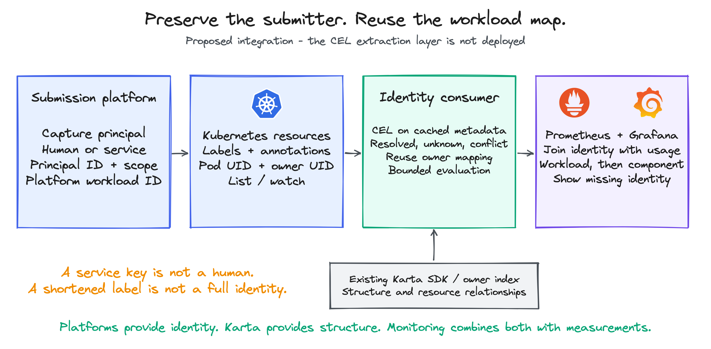

<!-- SPDX-License-Identifier: Apache-2.0 -->
<!-- Copyright (c) 2026 NVIDIA Corporation -->

# Workload submitter attribution

Verified lab findings and a proposed integration contract. 16 October 2026.

A workload map answers which application owns a Pod. Submitter attribution adds
who requested that application and which organization should receive its usage.
These are separate facts. Kubernetes ownership alone does not identify a person.

The lab completed four OSMO workflows, invoked an NVCF function successfully,
and completed an NVCT task. It also proved why a single metadata expression is
not a complete solution: OSMO can shorten an identity, and the tested NVCF
resources do not contain a human submitter.

The recommended direction is a common metadata contract populated by submission
platforms, plus optional CEL extraction for older metadata. Karta continues to
provide workload structure. CEL submitter extraction, the proposed chart values,
and the proposed companion output are not implemented or deployed.

The proposed principal key is `(identity-source, submitter-id)`. The source names
an agreed identity authority and tenant scope, not merely the platform carrying
the value. Cross-source equivalence requires an explicit verified mapping.

| Read this | Purpose |
| --- | --- |
| [Shareable PDF](submitter-attribution.pdf) | Findings, examples, design decisions and next actions |
| [Design and examples](DESIGN.md) | How to consume identity with or without a Karta definition |
| [Operator contract](OPERATOR-CONTRACT.md) | What a platform should attach, and how to handle missing values |
| [NVCF feature request](NVCF-FEATURE-REQUEST.md) | Ready-to-review issue draft; no issue has been opened |
| [Verified results](RESULTS.md) | Test scope, successful paths and remaining limits |
| [Experiment log](FINDINGS.md) | Setup failures, corrections and final lab state |
| [Evidence map](EVIDENCE.md) | Source symbols, versions and selected sanitized observations |
| [Full sequence](design.preview.html) | Zoomable end-to-end proposed flow |

## What worked, and what the data means

| Product | Verification | Identity available |
| --- | --- | --- |
| OSMO 6.3.1 | Four finite workflows completed | Full `submitted_by` in the workflow API; lossy or absent `osmo.submitted_by` on task Pods and PodGroups |
| NVCF self-managed | Function ACTIVE; invocation HTTP 200 | Account, function and version IDs on resources; creation audit identifies the authenticated client |
| NVCT self-managed | Finite task COMPLETED | Task/account IDs on Pod and parent; creation audit identifies the API-key owner |
| Run:AI | Source inspected; no authenticated submission test | The inspected composer writes `run.ai/submitted-by` on workload annotations and `user` on Pod annotations |

OSMO example: `alice@team-a.example` and `alice@team-b.example` both became
`alice` in the Pod label. The workflow API retained both complete identities.
The one-character identity `a` had no submitter label. Those tests used
development identity headers, not production OIDC authentication.

The tested NVCF client and NVCT API-key owner were service identities. Neither
observation proves which human initiated a request through that service.

## What a consumer can do

| If the goal is... | Use... | Keep this limit visible |
| --- | --- | --- |
| Group GPU usage by submitter | Pod-to-workload mapping plus a verified identity mapping | Missing identity is unknown, not an anonymous user or zero usage |
| Show a workload's components | A matching Karta definition and the existing SDK | A definition explains structure; it does not authenticate a user |
| Identify an unsupported resource | Standard Kubernetes metadata and platform workload IDs | Keep it at resource/Pod level until a root is established |
| Notify the submitting team | The normalized principal and optional organization mapping | A service identity needs an explicit contact or delegation mapping |
| Track allocation by project | An agreed stable organization/project ID | Organization lookup belongs to the platform or its directory |
| Find integration gaps | Counts of unknown, conflicting and stale identity mappings | Extraction coverage is different from proof of identity |

## Recommended next steps

1. Agree the minimal [operator contract](OPERATOR-CONTRACT.md). Make identity type
   explicit and keep organization attribution optional until its source is known.
2. Ask NVCF to preserve the authenticated submitter in the launch specification
   and materialize it on Kubernetes resources. An environment variable alone is
   insufficient for a metadata-only observer.
3. Add a full-identity annotation to OSMO task resources; retain the existing
   label for compatibility. Fix the single-character label validation separately.
4. Implement CEL as an optional consumer/exporter extension. Evaluate workload
   and Pod metadata independently, retain provenance, and report conflicts.
5. Test updates, deletion/recreation, watch recovery and missing identities before
   claiming complete coverage. Keep the existing Karta metrics unchanged.

Owner references change less often than status, but that is a reason to cache
relationships, not to ignore updates. Submitter metadata can change without an
owner change. The design reuses owner resolution and reevaluates identity only
when relevant metadata, identity policy or object lifetime changes.

## What remains unproven

Production authentication, hosted NVCF, all submission modes, shared-cache/Helm
workloads, and 100,000-workload performance were not tested here. The lab uses
fake GPUs; these are identity and execution-path tests, not GPU benchmarks.

One malformed NVCA request remained after API cancellation and required scoped
cleanup. The underlying cancellation behavior was not fixed upstream. Optional
telemetry export and some installed Helm values still need follow-up, as recorded
in [RESULTS.md](RESULTS.md). Successful workload execution is not a claim that
all installation and lifecycle issues are solved.

The diagrams describe the proposal. Sources sit beside this file as `.excalidraw`
and under `diagrams/` as PlantUML. Open the Excalidraw source at excalidraw.com.
Existing GPU, MIG and DRA reports in the parent directory are preserved.

## Rebuild the PDF

Run `python3 render_pdf.py` from this directory in a Python environment with
ReportLab and pypdf installed. The PDF expands the Markdown details and includes
the operator contract and NVCF issue draft. Its sequence page uses A3 portrait
so the full flow remains readable; the remaining pages use A4.
