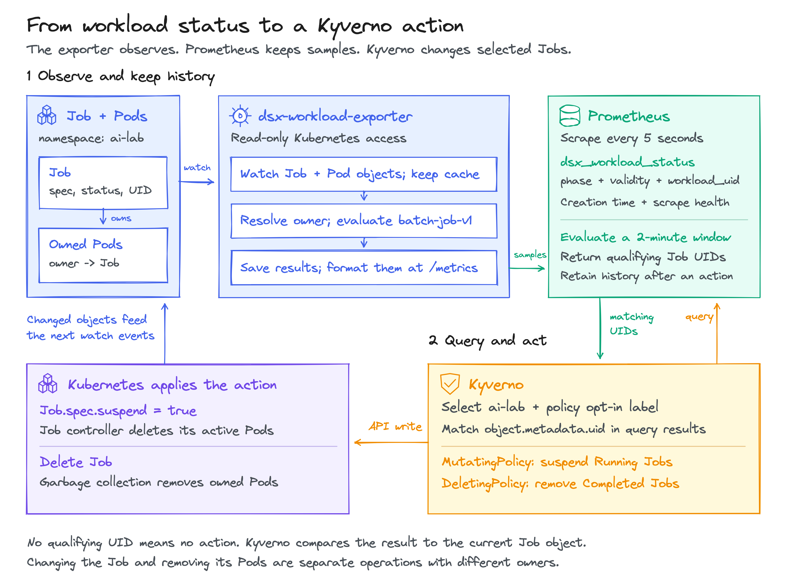
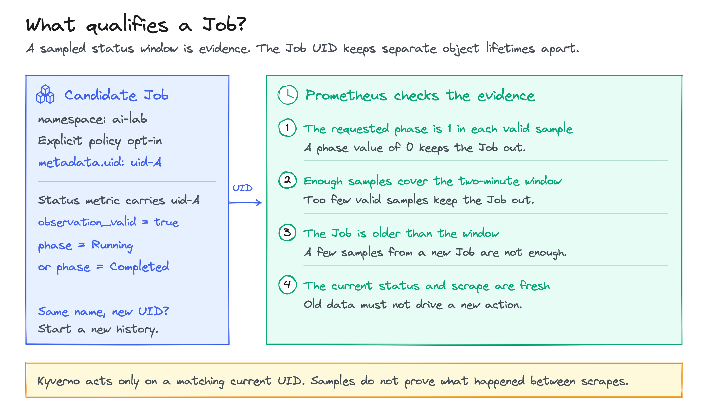

<!-- SPDX-License-Identifier: Apache-2.0 -->
<!-- Copyright (c) 2026 NVIDIA Corporation -->

# Run the lab: reclaim Job capacity and clean up finished work

A batch Job can keep running after its useful work is done. A completed Job can
also remain in the cluster long after anyone needs it. This tutorial connects
DSX workload observations to Kyverno so an administrator can apply two policies:

| Input in `ai-lab` | Policy operation | Result |
| --- | --- | --- |
| `running-worker`, labelled `action: suspend`, with Running observations across a two-minute window | Set `Job.spec.suspend: true` | The Job controller removes its active Pods. |
| `completed-report`, labelled `action: delete`, with Completed observations across a two-minute window | Delete the Job | Kubernetes garbage collection removes its owned Pods. |

The full label key is `tutorial.karta.run.ai/action`. Jobs without an action's
label are left alone. Failed Jobs are retained for inspection.

These are the verified runtime-limit and retention examples from
[Reclaim idle compute](reclaim-idle-compute.md). That guide also covers GPU
idleness, CPU and memory requests, other phases and proposed policies.
This lab uses short windows so the result is visible.



## 1. Create the lab

Run commands from this repository's root. Install Docker, kind, kubectl, Helm,
Bash, curl and Python 3 first. Docker must be running. No GPU is required.

```sh
bash docs/tutorials/kyverno-exporter/up.sh
export KUBECONFIG="$PWD/.artifacts/kyverno-exporter-tutorial/kubeconfig"
kubectl config current-context
```

The context must be `kind-kyverno-exporter-tutorial`. The script creates that
separate kind cluster and kubeconfig. It installs:

| Component | Version or source |
| --- | --- |
| Kubernetes | `kindest/node:v1.34.3` |
| Kyverno | Helm chart `3.9.1`, application `1.19.1` |
| Prometheus | `quay.io/prometheus/prometheus:v3.14.0` |
| DSX workload exporter | Built from this checkout, loaded into kind |
| Example Job image | `busybox:1.37.0` |

The exporter uses the bundled `batch-job-v1` definition. It watches `ai-lab`
and discovers Jobs and their Pods. This installation does not need the Karta
operator or Karta CRD. The [exporter values](manifests/exporter-values.yaml)
show the selection and permissions.

Prometheus scrapes every five seconds and evaluates the
[recording rules](manifests/prometheus-rules.yaml) every five seconds. A recording
rule saves a query result as a metric that another query can read.
Kyverno's background scan runs every 30 seconds. Its cleanup schedule runs
once a minute. Actions therefore happen after the window qualifies and a
controller processes the Job, rather than at an exact two-minute deadline.

Rerunning `up.sh` rebuilds the exporter and restarts exporter and Prometheus
Pods. Prometheus uses an `emptyDir` volume, so this clears the lab's metric
history. The script does not apply the workload policies.

## 2. Observe a workload

```sh
kubectl apply -f docs/tutorials/kyverno-exporter/manifests/workloads.yaml
kubectl -n ai-lab get jobs
kubectl -n ai-lab get job running-worker -o jsonpath='{.metadata.uid}{"\n"}'
```

The manifest also creates three controls: an unselected running Job, an
unselected completed Job, and a failed Job selected for cleanup. None should
be changed by these policies.

In a second terminal, with the same kubeconfig:

```sh
kubectl -n monitoring port-forward service/prometheus 19090:9090
```

Open [the local Prometheus query page](http://127.0.0.1:19090/query), or query
its API from the first terminal:

```sh
curl -fsSG http://127.0.0.1:19090/api/v1/query \
  --data-urlencode 'query=dsx_workload_status{namespace="ai-lab",workload_name="running-worker",phase="Running",observation_valid="true"}'
```

Once the Job has a ready Pod, the result has value `1`. Its `workload_uid`
label equals the Job's `metadata.uid`. The exporter reads the Job's active and
ready counts through its bundled definition. `observation_valid="true"`
means the exporter verified the inputs for that observation; it does not mean
the application is healthy.

The current exporter also publishes Pod attribution, creation timestamps and
observation diagnostics. The [metric reference](../../keps/0001-metrics-exporter/README.md#metrics)
describes these four families. Historical examples on the runtime-rules branch
use older `karta_*` names; this tutorial uses the current `dsx_*` contract.

## 3. Suspend an opted-in running Job

```sh
kubectl apply -f docs/tutorials/kyverno-exporter/manifests/policies.yaml
kubectl -n ai-lab get jobs --watch
```

Wait until `running-worker` shows `Suspended`, then press Ctrl-C to stop the
watch. The manifest installs both policies. `tutorial-suspend-running` is a
`MutatingPolicy` with admission mutation disabled and mutation of existing
resources enabled. It selects Jobs in `ai-lab` with the suspend label, then
checks the current target's label, namespace, active Pods and suspension state.

The policy's CEL expression receives the Job as `object`. Its relevant input
fields look like this (`uid-A` is illustrative):

```yaml
apiVersion: batch/v1
kind: Job
metadata:
  name: running-worker
  namespace: ai-lab
  uid: uid-A
  labels:
    tutorial.karta.run.ai/action: suspend
spec: {suspend: false}
status: {active: 1, ready: 1}
```

Kyverno calls Prometheus's `/api/v1/query` endpoint. The query selects
`tutorial:job_running:eligible` with a saved result less than 15 seconds old.
For this example, one row in the response's `data.result` array is:

```json
{"metric":{"namespace":"ai-lab","workload_name":"running-worker","workload_uid":"uid-A"},"value":[1794141000,"1"]}
```

The expression compares `object.metadata.uid` and
`object.metadata.namespace` with that row. Both match, so `exists(...)` returns
`true`. The JSON patch adds `/spec/suspend` with value `true`. The
[complete policy](manifests/policies.yaml) includes these checks and the patch.
The exporter performs no writes.

```sh
kubectl -n ai-lab get job running-worker -o jsonpath='{.spec.suspend}{"\n"}'
kubectl -n ai-lab get pods -l batch.kubernetes.io/job-name=running-worker
```

The first command should print `true`. After Job reconciliation, the second
shows no Pods. Inspect the actual Job to establish that a mutation happened;
a completed Kyverno work item alone is not proof of that result.

## 4. Delete a completed Job after the observation window

`tutorial-delete-completed` is a `DeletingPolicy`. Once a minute it selects
Jobs with the delete label and checks two conditions: the current Job has
`Complete=True`, and its UID is in `tutorial:job_completed:eligible` with a
fresh recording sample.

The policy sets `deletionPropagationPolicy: Background`. Kyverno deletes the
Job, then Kubernetes garbage collection removes its Pods. The explicit setting
prevents orphaned Pods; deleting only the Job did leave Pods behind in this lab.

```sh
kubectl -n ai-lab wait --for=delete job/completed-report --timeout=5m
kubectl -n ai-lab get pods -l batch.kubernetes.io/job-name=completed-report
kubectl -n ai-lab get jobs
```

`completed-report` and its Pods disappear. `unselected-report` and
`failed-report` remain.
The age check uses the object's creation time, while the phase window checks
its completion history. Creation age by itself does not establish how long a
Job has been completed.

The [namespaced roles](manifests/kyverno-rbac.yaml) grant the background
controller update and patch access to Jobs in `ai-lab`. The cleanup controller
gets delete access there. Its DeletingPolicy controller also needs a ClusterRole
to list Jobs before filtering namespaces. That grant is read-only; update and
delete permissions remain confined to `ai-lab`. Kyverno retains its chart's
baseline permissions.

## 5. Understand when the rule waits



Each recording rule requires all of these checks for the same workload UID:

- Every available valid phase sample in the two-minute range is `1`.
- At least 23 phase samples exist. A five-second interval normally gives 24;
  the floor allows one missing status sample.
- The phase is also `1` now and at the two-minute anchor. Both endpoint samples
  must be less than 15 seconds old relative to their evaluation time.
- The Job is older than 120 seconds.
- No invalid status sample or workload-error observation appears in the window.
- Exporter scrapes have enough samples, all available `up` values in the window
  are `1`, and the current scrape is fresh and successful.

Kyverno also checks the recording sample's freshness. Empty query results do
not match a target. An HTTP or evaluation error cannot supply a matching UID.
Samples cannot establish what happened between scrapes. The rules are designed
for this single exporter and single-cluster lab; they are not a distributed
history or transactional action system.

Deleting and recreating a Job with the same name gives it a new UID. Its old
history cannot qualify the replacement. A failed scrape prevents action until
it leaves the window and enough new observations exist.

## 6. Resume a Job and opt out

Opt out and resume in one update:

```sh
kubectl -n ai-lab patch job running-worker --type=merge -p \
  '{"metadata":{"labels":{"tutorial.karta.run.ai/action":"observe"}},"spec":{"suspend":false}}'
```

The Job controller creates a new Pod. The suspension policy skips this Job.
Changing only `spec.suspend` leaves the Job eligible for another suspension
once its Running history qualifies again. Re-enabling the label can use
existing history; this policy does not track a separate opt-in timestamp.

## 7. Run the live verification

```sh
python3 docs/tutorials/kyverno-exporter/verify.py
```

The script resets only its labelled Jobs and its two named policies in the
lab cluster. It checks effective permissions before creating fresh fixtures.
It checks initial waiting, suspension, Pod removal, cleanup,
negative controls, same-name replacement, exporter and Prometheus outages,
recovery, and opt-out before resume. It also opts a previously eligible Job in
while exporter telemetry is unavailable. Expect several minutes of real waiting.
During the outage tests it scales the lab exporter and Prometheus to zero, then restores
one replica of each. Do not run setup or edit policies while verification is running.

After the query-service outage, suspension recovers automatically. The test
explicitly requeues the cleanup policy using the recovery below. Its pass result
includes that operator-assisted recovery; it does not establish automatic
cleanup recovery.

Results are written to `.artifacts/kyverno-exporter-tutorial/verification.json`.
See [the recorded run](results.md) for the checked revision, verified outcomes
and limitations. The final run passed in 670 seconds, including dependent Pod
removal. The test checks API outcomes as well as Prometheus responses.

## Recover cleanup after a Prometheus outage

On the pinned Kyverno 1.19.1 release, repeated query errors can exhaust the
cleanup controller's retries. The DeletingPolicy then stops being scheduled,
even after Prometheus recovers. The live outage test reproduced this behavior.
Check `status.lastExecutionTime` if cleanup has stopped but Prometheus returns
eligible Jobs.

After Prometheus is healthy, requeue this policy by changing its spec:

```sh
kubectl patch deletingpolicy tutorial-delete-completed --type=merge \
  -p '{"spec":{"schedule":"* * * * *"}}'
kubectl patch deletingpolicy tutorial-delete-completed --type=merge \
  -p '{"spec":{"schedule":"*/1 * * * *"}}'
```

Both schedules mean once per minute. The spec changes requeue the policy and
restore its original configuration. An annotation change or reapplying an
unchanged manifest does not do that. Verify that `status.lastExecutionTime`
advances and that the eligible Job disappears. See the
[pinned scheduler](https://github.com/kyverno/kyverno/blob/v1.19.1/pkg/controllers/deleting/controller.go#L264)
and [retry handling](https://github.com/kyverno/kyverno/blob/v1.19.1/pkg/utils/controller/run.go#L66).

## Inspect a problem

```sh
kubectl get mutatingpolicy tutorial-suspend-running -o yaml
kubectl get deletingpolicy tutorial-delete-completed -o yaml
kubectl -n kyverno get updaterequests
kubectl -n kyverno logs deployment/kyverno-background-controller --tail=80
kubectl -n kyverno logs deployment/kyverno-cleanup-controller --tail=80
```

In Prometheus, inspect `up{job="dsx-exporter"}`, the raw status, and the two
`tutorial:job_*:eligible` recording rules in that order. Check `/api/v1/rules`
for evaluation errors. Observe the Job and its Pods to confirm the result.

## Limits and extensions

The exporter normalizes workload observations across kinds. These policies
still name `batch/v1` Jobs and their concrete suspend field. A different kind
needs a supported mutation, permissions, and a separately tested policy.
Runtime rules in the historical KEP are a proposal, not a controller installed
by this tutorial.

GPU utilization can be joined to workload identity using
`dsx_workload_pod_info`. The [GPU query examples](../../dsx-workload-exporter/queries.md#3-gpu-measurements-by-pod-uid)
explain the UID join and missing-device checks. GPU idleness and automatic GPU
reclamation are outside this lab's verified scenarios.

Prometheus here retains two hours of samples in an ephemeral volume. It is
not a durable action audit. Production deployment also needs suitable resource
limits, retained audit records, and decisions about user overrides and action
concurrency. Those are separate from the two policies demonstrated here.

## Remove the lab

```sh
kind delete cluster --name kyverno-exporter-tutorial
```

Only the named lab cluster is removed. Stop the port-forward with Ctrl-C.
The ignored artifact directory remains for inspecting results.

## References

- [Kyverno MutatingPolicy](https://kyverno.io/docs/policy-types/mutating-policy/).
- [Kyverno DeletingPolicy](https://kyverno.io/docs/policy-types/deleting-policy/).
- [Prometheus range and timestamp functions](https://prometheus.io/docs/prometheus/latest/querying/functions/).
- [Kubernetes Job termination and cleanup](https://kubernetes.io/docs/concepts/workloads/controllers/job/).
