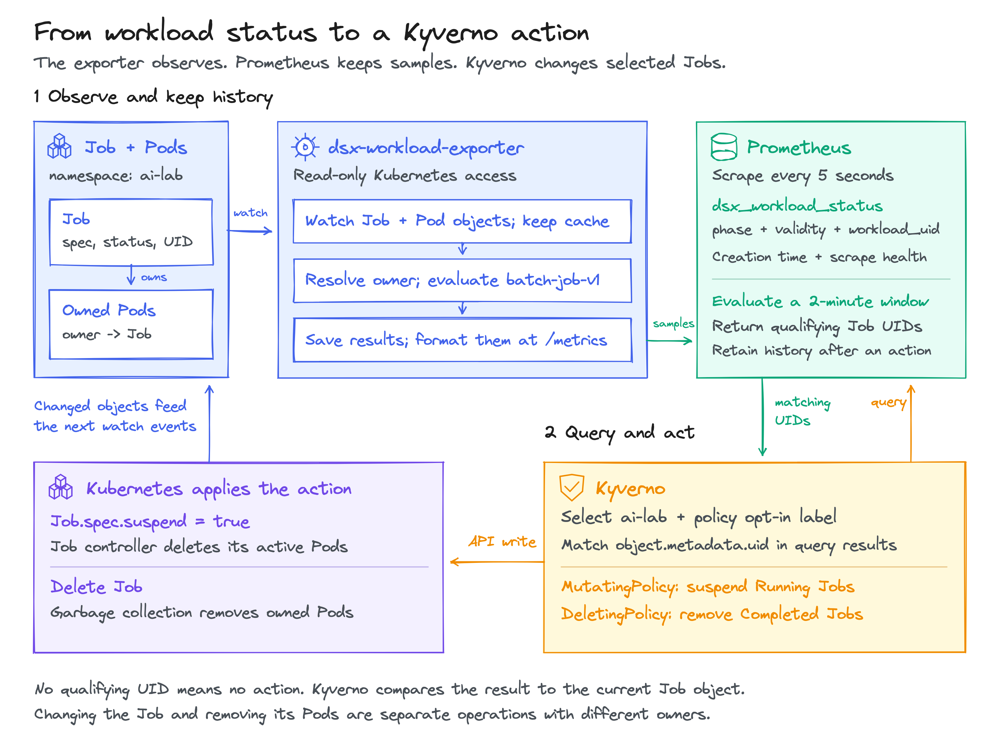
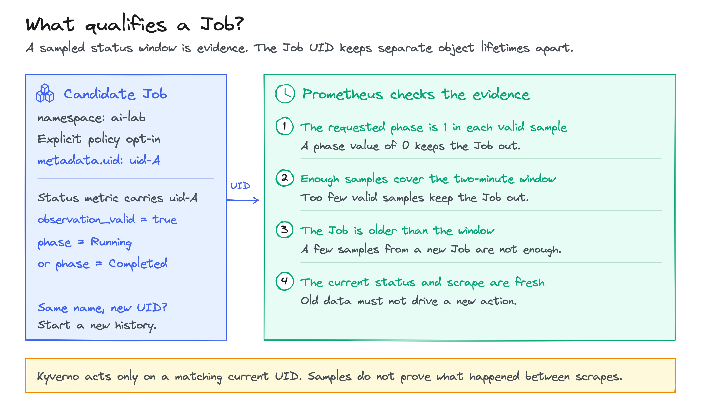
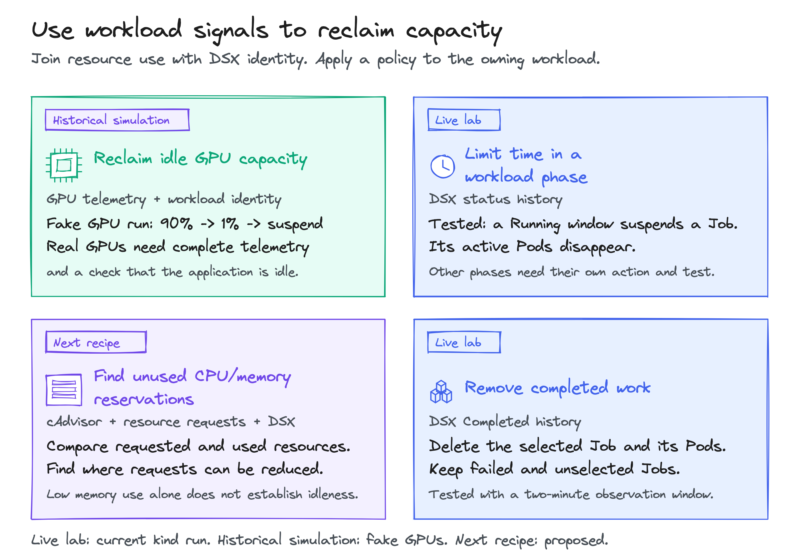

<!-- SPDX-License-Identifier: Apache-2.0 -->
<!-- Copyright (c) 2026 NVIDIA Corporation -->

# Reclaim idle compute with Kyverno and DSX

An idle Job can hold resources that other workloads need. Suspending it stops
its Pods and releases their requests so other work can be scheduled. DSX links
signals to the owning workload, Prometheus evaluates them, and Kyverno acts.

| Benefit | Example policy | Evidence |
| --- | --- | --- |
| Release idle GPUs | Suspend a safely restartable Job after every GPU stays below 5% for an hour and no work is queued. | Historical fake-GPU test; real-GPU recipe below. |
| Free CPU and memory requests | Suspend a confirmed-idle Job that requests 8 cores and 16 GiB but uses under 0.1 core and 300 MiB. | Proposed cAdvisor integration. |
| Limit time in status X | Suspend after a Running budget; investigate a long Initializing or Degraded phase. | Running-Job policy tested live. |
| Remove Completed Jobs and Pods | Delete after a retention window. | Tested live. |
| Warn before a budget is exhausted | Notify owners before a runtime or cost limit. | Proposed; needs an alert delivery service. |

Lower bills also need node scale-down or release of paid capacity.
No financial savings were measured.

## Create and run the demo

The demo enforces a two-minute Running budget and Completed retention window.
No GPU is needed. The [GPU and cAdvisor recipes](#extend-the-policies) add usage signals.

### 1. Create the lab

From the repository root, with Docker running and kind, kubectl, Helm, Bash,
curl and Python 3 installed:

```sh
bash docs/tutorials/kyverno-exporter/up.sh
export KUBECONFIG="$PWD/.artifacts/kyverno-exporter-tutorial/kubeconfig"
kubectl config current-context
```

The context must be `kind-kyverno-exporter-tutorial` before applying manifests.
Setup installs the exporter, Prometheus and Kyverno, but no demo Jobs or policies.

### 2. Create the example Jobs

```sh
kubectl apply -f docs/tutorials/kyverno-exporter/manifests/workloads.yaml
kubectl -n ai-lab get jobs
```

Five Jobs appear. The policies target `running-worker` and `completed-report`.
Unselected and failed Jobs serve as controls and must remain.

### 3. Activate the policies

These are the two complete policies from [policies.yaml](manifests/policies.yaml).
Setup installs their required [Prometheus rules](manifests/prometheus-rules.yaml)
and [RBAC](manifests/kyverno-rbac.yaml). Both act only on opted-in Jobs in `ai-lab`.
Suspension terminates Pods; it does not create an application checkpoint.

<details>
<summary>Suspend a Running Job: full MutatingPolicy YAML</summary>

After two minutes of valid Running history, Kyverno matches the current Job's
UID and namespace to Prometheus, then sets `spec.suspend=true`.
Admission mutation is disabled; the background controller mutates existing Jobs.

```yaml
# SPDX-License-Identifier: Apache-2.0
# Copyright (c) 2026 NVIDIA Corporation
apiVersion: policies.kyverno.io/v1
kind: MutatingPolicy
metadata:
  name: tutorial-suspend-running
spec:
  matchConstraints:
    namespaceSelector:
      matchLabels:
        kubernetes.io/metadata.name: ai-lab
    objectSelector:
      matchLabels:
        tutorial.karta.run.ai/action: suspend
    resourceRules:
      - apiGroups: [batch]
        apiVersions: [v1]
        operations: [CREATE, UPDATE]
        resources: [jobs]
  evaluation:
    admission:
      enabled: false
    mutateExisting:
      enabled: true
  targetMatchConditions:
    - name: current-target-is-opted-in
      expression: >-
        object.metadata.namespace == 'ai-lab' &&
        has(object.metadata.labels) &&
        'tutorial.karta.run.ai/action' in object.metadata.labels &&
        object.metadata.labels['tutorial.karta.run.ai/action'] == 'suspend'
    - name: still-running-and-not-suspended
      expression: >-
        !object.spec.?suspend.orValue(false) &&
        object.status.?active.orValue(0) > 0 && object.status.?ready.orValue(0) > 0
    - name: verified-running-history-for-this-uid
      expression: >-
        http.Get('http://prometheus.monitoring.svc:9090/api/v1/query?query=tutorial%3Ajob_running%3Aeligible%20and%20%28time%28%29%20-%20timestamp%28tutorial%3Ajob_running%3Aeligible%29%20%3C%2015%29').data.result.exists(r, r.metric.workload_uid == object.metadata.uid && r.metric.namespace == object.metadata.namespace)
  mutations:
    - patchType: JSONPatch
      jsonPatch:
        expression: "[JSONPatch{op: 'add', path: '/spec/suspend', value: true}]"
```

For a Job with UID `uid-A`, a fresh query result with `workload_uid="uid-A"`
and the same namespace makes `exists(...)` true. A different UID cannot match,
even when the Job name is reused. The Job must still have active and ready Pods.

</details>

<details>
<summary>Delete a Completed Job and its Pods: full DeletingPolicy YAML</summary>

Once a minute, Kyverno checks `Complete=True` and two minutes of valid Completed
history for that UID. Kyverno deletes the Job. With `Background` propagation,
Kubernetes garbage collection removes Pods owned by that Job.

```yaml
apiVersion: policies.kyverno.io/v1
kind: DeletingPolicy
metadata:
  name: tutorial-delete-completed
spec:
  matchConstraints:
    namespaceSelector:
      matchLabels:
        kubernetes.io/metadata.name: ai-lab
    objectSelector:
      matchLabels:
        tutorial.karta.run.ai/action: delete
    resourceRules:
      - apiGroups: [batch]
        apiVersions: [v1]
        operations: [CREATE, UPDATE]
        resources: [jobs]
  schedule: "*/1 * * * *"
  deletionPropagationPolicy: Background
  conditions:
    - name: still-completed
      expression: >-
        object.status.?conditions.orValue([]).exists(c,
          c.type == 'Complete' && c.status == 'True')
    - name: verified-completed-history-for-this-uid
      expression: >-
        http.Get('http://prometheus.monitoring.svc:9090/api/v1/query?query=tutorial%3Ajob_completed%3Aeligible%20and%20%28time%28%29%20-%20timestamp%28tutorial%3Ajob_completed%3Aeligible%29%20%3C%2015%29').data.result.exists(r, r.metric.workload_uid == object.metadata.uid && r.metric.namespace == object.metadata.namespace)
```

</details>

Apply both policies:

```sh
kubectl apply -f docs/tutorials/kyverno-exporter/manifests/policies.yaml
```

### 4. Observe suspension and cleanup

```sh
kubectl -n ai-lab get jobs --watch
```

After the observation window, `running-worker` is suspended and its Pods stop.
`completed-report` and its Pods disappear. Unselected and failed Jobs remain.
Two minutes is an observation window, not an exact action deadline.
Press Ctrl-C to stop watching. Cleanup after a Prometheus outage may need the
[requeue documented under live results](#live-results).

Inspect the actual API outcome:

```sh
kubectl -n ai-lab get job running-worker -o jsonpath='{.spec.suspend}{"\n"}'
kubectl -n ai-lab get pods -l batch.kubernetes.io/job-name=running-worker
kubectl -n ai-lab wait --for=delete job/completed-report --timeout=5m
kubectl -n ai-lab get pods -l batch.kubernetes.io/job-name=completed-report
```

The first command returns `true`; both Pod lists should be empty after reconciliation.

### 5. Opt out and resume

Opt out and resume in one update:

```sh
kubectl -n ai-lab patch job running-worker --type=merge -p \
  '{"metadata":{"labels":{"tutorial.karta.run.ai/action":"observe"}},"spec":{"suspend":false}}'
```

The Job controller creates a new Pod. Resuming without opting out can trigger
suspension again. Re-enabling the label can use existing history for that UID.

<details>
<summary>Inspect metrics and run the disruptive verifier</summary>

To inspect metrics, run this in another terminal with the same kubeconfig:

```sh
kubectl -n monitoring port-forward service/prometheus 19090:9090
```

Open [Prometheus](http://127.0.0.1:19090/query) and query:

```promql
dsx_workload_status{namespace="ai-lab",workload_name="running-worker",phase="Running",observation_valid="true"}
```

Before suspension, a ready Job reports `1`. Its `workload_uid` matches the
Job UID. A valid observation verifies exporter inputs, not application health.
For policy decisions, inspect `tutorial:job_running:eligible`,
`tutorial:job_completed:eligible` and `/api/v1/rules` for errors.

The complete verifier resets its labelled Jobs and two policies, temporarily
stops the lab exporter and Prometheus, then restores one replica each. Do not
edit or rerun setup during the test. Results go to
`.artifacts/kyverno-exporter-tutorial/verification.json`.

```sh
python3 docs/tutorials/kyverno-exporter/verify.py
```

</details>

### 6. Remove the lab

Stop any port-forward, then remove the dedicated cluster:

```sh
kind delete cluster --name kyverno-exporter-tutorial
```

Rerunning setup clears Prometheus's ephemeral history; it retains only two hours.

## How the demo works

<details>
<summary>Lab versions and exporter setup</summary>

The lab uses kind 0.30.0, Kubernetes 1.34.3, Kyverno 1.19.1 (chart 3.9.1),
Prometheus 3.14.0 and busybox 1.37.0. The recorded host used Docker 29.0.1,
Helm 4.0.1 and Linux arm64 nodes. The exporter is built from the checkout.
Its bundled `batch-job-v1` definition needs no Karta operator or CRD.

</details>

<details>
<summary>How DSX, Prometheus and Kyverno decide when to act</summary>



DSX publishes identity, status, creation time and observation diagnostics.
Prometheus saves eligible workload UIDs in recording rules. Kyverno's `object`
is the current Job; it compares that Job with the query result before writing.
The exporter performs no writes. Kubernetes controllers remove the Pods.

The full opt-in label is `tutorial.karta.run.ai/action`, with `suspend` or `delete`.
The lab grants background update/patch and cleanup delete access in `ai-lab`.
Cleanup also needs read-only cluster-wide Job listing. Kyverno keeps its chart's
baseline permissions.

Prometheus scrapes and evaluates every five seconds. Kyverno's background
controller scans for suspension every 30 seconds. Its DeletingPolicy runs
once a minute. Two minutes is an observation window, not an exact action
deadline. Each rule requires:

- All available valid phase samples to equal `1`, with at least 23 samples.
- The phase to equal `1` now and two minutes ago, with both samples under 15 seconds old.
- Creation age over 120 seconds, no invalid status or workload-error observations,
  and sufficient healthy exporter scrapes with a fresh successful current scrape.

Kyverno also requires the recording sample to be under 15 seconds old.
Empty results and query errors cannot supply a matching UID. A failed scrape
blocks eligibility until it leaves the window and fresh history qualifies.



Samples cannot prove what happened between scrapes. Querying and writing are
not atomic. Production use needs retained audit records, resource limits and
an explicit policy for concurrent user changes.

</details>

## Extend the policies

Real GPU idleness needs functional GPUs and DCGM. CPU/memory policies need
cAdvisor usage plus request metrics. Neither integration is installed by this
lab; the following recipes describe additional work to validate.

<details>
<summary>GPU idleness, CPU/memory use versus requests, and time in status X</summary>

### Idle GPU allocations

Example: a Job holds four dedicated GPUs. Every device stays below 5% for an
hour, the workload is Running, no work is queued, and a checkpoint allows restart.
A Kyverno suspension policy can then release the allocation by terminating Pods.

Prerequisites: supported NVIDIA GPUs on Linux, working drivers and container
access, device allocation, and [DCGM Exporter](https://docs.nvidia.com/datacenter/dcgm/latest/installation/install-dcgm-exporter.html).
GPU Operator can manage this stack. First run a real GPU workload and verify
that Prometheus scrapes both DCGM and DSX with the expected Pod/device labels.

Enable DCGM Kubernetes mapping and `DCGM_EXPORTER_KUBERNETES_ENABLE_POD_UID=true`.
Join by namespace and Pod UID, preserve device IDs, and deduplicate measurements.
Use the highest utilization across all allocated devices and the whole window.
Require complete allocation coverage, valid Running history and application
idleness. Seeing only three of four devices is insufficient. MIG, shared GPUs
and DRA need separate attribution validation. See the [GPU query examples](../../dsx-workload-exporter/queries.md#3-gpu-measurements-by-pod-uid).

The fork's [historical fake-GPU run](https://github.com/AviadHayumi/workload-map/blob/f28da01bdf140355964fff5d450f867265371608/labs/exporter-kyverno-rr/captures/75-gpu-idle-fake-gpu.txt)
kept a Job at 90% simulated utilization, then suspended it after a change to 1%
and expiry of the last busy sample. It used a two-minute window and did not
measure physical GPUs. The [original proposal](https://github.com/AviadHayumi/workload-map/blob/1a90457bbdc349bdc1fb5c7f0924198f291e6a04/keps/0003-runtime-rules/README.md#2-the-goals)
also covers phase duration, retention and warnings. This lab uses current `dsx_*` metrics.

### Unused CPU and memory requests

Illustrative Job: one regular container, no init containers or Pod overhead,
requesting 8 cores and 16 GiB. For an hour it uses under 0.1 core (1.25% of its
CPU request) and has a working set under 300 MiB. Suspending it releases its
requests from scheduler accounting after its Pod terminates. It does not mean
16 GiB of physical memory was in use.

Prerequisites: authorized kubelet `/metrics/cadvisor` scrapes, request metrics
from kube-state-metrics or kube-scheduler, and DSX attribution. cAdvisor CPU use
is measured in cores:

```promql
rate(container_cpu_usage_seconds_total{
  namespace!="", pod!="", container!="", container!="POD"
}[5m])
```

Memory use is `container_memory_working_set_bytes`, a gauge in bytes; do not
apply `rate()`. For requests, copy kube-state-metrics' Pod `uid` to `pod_uid`
and join the [deduplicated DSX attribution rule](../../dsx-workload-exporter/queries.md#1-deduplicate-pod-attribution):

```promql
label_replace(
  kube_pod_container_resource_requests{resource="cpu",unit="core"},
  "pod_uid", "$1", "uid", "(.+)"
)
* on (namespace, pod_uid)
  group_left (workload_name, workload_uid, workload_group, workload_kind)
  dsx:pod_attribution:unique{observation_valid="true"}
```

For memory requests, use `resource="memory",unit="byte"`. These are diagnostic
fragments, not installed action rules. Deduplicate scrapes; compare the same
current running Pods and containers; require a positive request denominator.
Record each workload's usage/request ratio and require its maximum to stay low
for the full hour, with fresh, complete history and application-idle confirmation.

The [CPU/memory query examples](../../dsx-workload-exporter/queries.md#2-cpu-and-memory-by-component-instance-and-group)
join usage by Pod name, so automatic actions need stronger identity checks across
Pod replacement. Container-request sums omit init/overhead scheduling effects;
use the scheduler's `kube_pod_resource_request` for effective Pod requests with a
validated identity join. See the [request metric reference](https://github.com/kubernetes/kube-state-metrics/blob/main/docs/metrics/workload/pod-metrics.md).

Low CPU may mean useful I/O waiting. A small memory footprint does not prove
inactivity. Choose between reporting oversized requests and suspending an idle
Job; the latter needs a safe restart path.

### Time in status X

Examples: `Running` for eight hours -> suspend; `Initializing` for 90 minutes ->
investigate; `Degraded` for ten minutes -> notify; `Completed` for 24 hours ->
delete after outputs are retained. Only Running and Completed are tested here.

Changing the phase or duration means updating the recording rule's window,
sample count, age and offset checks together. Workload age is not phase duration.
Check the definition's phase meaning and the target kind's supported operation;
`Job.spec.suspend` does not apply to every resource. Native Job deadlines or TTL
are simpler when `activeDeadlineSeconds` or `ttlSecondsAfterFinished` fit.

</details>

<details>
<summary>More policy ideas: stalled training, priority queues, idle services and budgets</summary>



These are proposed extensions, each needing its own inputs and validation:

- Stalled training: require absent progress and checkpoint confirmation before suspension.
- Priority queues: reclaim verified idle low-priority Jobs when important work waits.
- Idle development services: require no sessions or traffic; scale to zero with a restore owner and autoscaler coordination.
- Retain results: require artifact retention before deleting Completed workloads.
- Repeated schedule failures: suspend the CronJob; handle existing Jobs separately.
- Quiet components: check attributed demand before scaling, such as quiet decode workers alongside busy prefill workers.
- Team budgets: join an attributed cost source, define price/currency/period, and warn before action. Sampling is not an exact financial cap.

Notifications need a delivery service; checkpointing needs application support.
The exporter supplies neither. Actions follow the target's
[Job](https://kubernetes.io/docs/concepts/workloads/controllers/job/#suspending-a-job),
[Deployment](https://kubernetes.io/docs/concepts/workloads/controllers/deployment/#replicas) or
[CronJob](https://kubernetes.io/docs/concepts/workloads/controllers/cron-jobs/#schedule-suspension) API.

</details>

## Live results

The kind verifier passed in 670 seconds on 2026-11-08. Suspension, completed-Job
and Pod removal, UID isolation, controls and outage recovery were checked.
Cleanup recovery included an explicit policy requeue.

<details>
<summary>Test evidence, limitations, and cleanup recovery commands</summary>

| Check | Result |
| --- | --- |
| Suspension and cascading deletion | Both selected Jobs' Pods removed; initial actions checked by 189s. |
| Controls and replacement | Unselected/failed Jobs retained; a new UID did not inherit eligibility. |
| Exporter and Prometheus outages | Selected Jobs unchanged during the tested outages, including opt-in while exporter scrapes were unavailable. |
| Recovery | Fresh history required; suspension recovered automatically; cleanup recovered after explicit requeue. |
| Permissions and resume | Update/delete allowed in `ai-lab`, denied in `default`; combined opt-out/resume stayed active. |

Exporter source was upstream `8370c0b5a720771dcb2e8c944d2e4bba39e7df3a`.
The final check found all six deployments and both recording rules healthy.
Local evidence is under `.artifacts/kyverno-exporter-tutorial/`, including
`verification.json`, `final-health.json` and `inventory.json`.

Physical-GPU idleness and cAdvisor-driven actions were not tested. Neither were
production scale, multiple clusters or fault-injected invalid observations.
The historical runtime-rules proposal is not an installed controller.

On Kyverno 1.19.1, repeated query failures can exhaust ten cleanup retries and
leave the DeletingPolicy unscheduled. After Prometheus recovers, change the
spec twice to requeue it and restore its original once-per-minute schedule:

```sh
kubectl patch deletingpolicy tutorial-delete-completed --type=merge \
  -p '{"spec":{"schedule":"* * * * *"}}'
kubectl patch deletingpolicy tutorial-delete-completed --type=merge \
  -p '{"spec":{"schedule":"*/1 * * * *"}}'
```

Verify `status.lastExecutionTime` advances and the eligible Job and Pods disappear.
Reapplying the same spec or changing an annotation does not requeue it. See the
[pinned scheduler](https://github.com/kyverno/kyverno/blob/v1.19.1/pkg/controllers/deleting/controller.go#L264)
and [retry handling](https://github.com/kyverno/kyverno/blob/v1.19.1/pkg/utils/controller/run.go#L66).

The final Pod checks followed an earlier run that left orphaned completed Pods.
Explicit `deletionPropagationPolicy: Background` fixed that path. Current
verification checks dependent Pods by Job UID after deletion and recovery.

</details>
