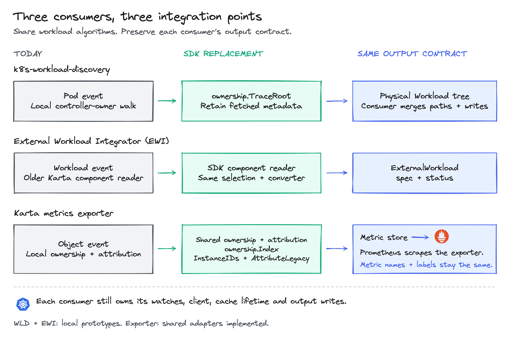
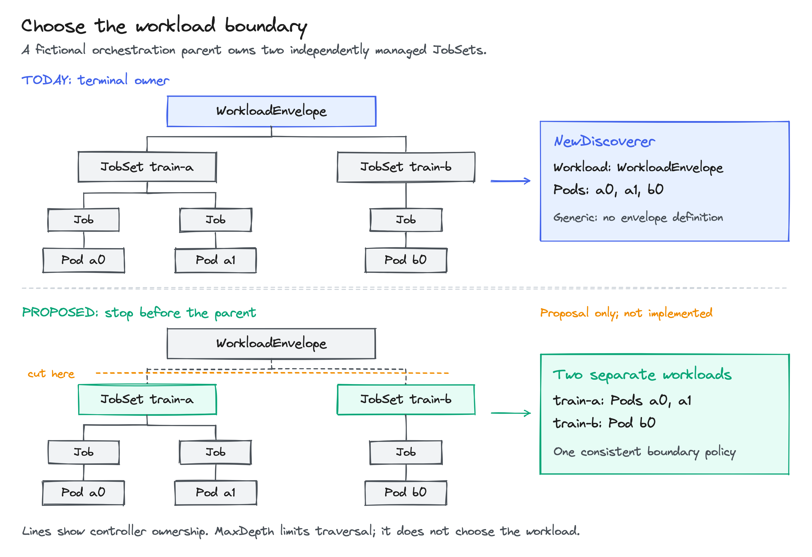

<!-- SPDX-License-Identifier: Apache-2.0 -->
<!-- Copyright (c) 2026 NVIDIA Corporation -->

# Proposal: share workload discovery and interpretation through Karta

- Status: proposed integration; selected adapters have local validation
- Authors: @AviadHayumi
- Updated: 2026-10-16
- Scope: consumer integration, with no CRD, metric or Helm contract change

## Summary



Move reusable workload logic into Karta and call it from existing controllers.
Each project keeps its watches, Kubernetes client, output model and writes.
The first integration replaces a specific operation in each consumer.
Broader membership and grouping changes require separate compatibility checks.

This proposal covers three consumers:

- k8s-workload-discovery: follow controller owners and build a physical inventory.
- External Workload Integrator (EWI): interpret workload components and maintain workload records.
- Karta metrics exporter: attach workload coordinates to Pods and expose metrics.

The [operator recipe](OPERATORS.md) contains the complete wiring.
The [usage guide](README.md) shows how to inspect and traverse the returned workload.

## Motivation

Consider the JobSet used by the [executable examples](traversal_test.go):

```text
JobSet training-set
  Job training-0   -> Pod training-0-pod
  Job training-1   -> Pod training-1-pod
  Job evaluation-0 -> Pod evaluation-0-pod
```

A Pod event starts with only one member of this tree.
An inventory controller needs its physical owners.
An integration controller needs templates, replicas and workload status.
A metrics exporter needs the Pod's workload, component, instance and replica group.

Today these consumers either maintain their own traversal/classification code or
use a different Karta version behind their own adapter.
A change in ownership, definition interpretation or Pod classification must be
checked in each place. The proposal shares those algorithms while preserving
the different outputs and policies around them.

### Goals

- Replace repeated ownership and interpretation logic with explicit SDK calls.
- Reuse each operator's existing client and cache through small interfaces.
- Keep controller-runtime types out of the SDK integration contracts.
- Preserve existing consumer output before expanding the migration.
- Make known and unknown workload kinds usable through the same discovery API.

### Non-goals

- Move watch lifecycle, queues, retries, persistence or scheduling decisions into Karta.
- Replace every EWI handler or its persistent grouping model in one change.
- Change exporter metrics, labels, failure values or Helm options.
- Claim equal performance or complete consumer migration from a passing example.

## Proposal

### What changes in the three consumers

| Consumer | Logic today | First replacement | Consumer keeps |
| --- | --- | --- | --- |
| k8s-workload-discovery | Its controller-owner walking loop | `ownership.Trace` | Metadata cache, filters, merged physical tree and Workload writes |
| EWI | Older Karta component reader | SDK `resource.ComponentFactory` | Handler selection, accounting, phases, grouping, IDs and writes |
| Karta metrics exporter | Local owner index, instance extraction and Pod attribution | `ownership.Index`, `attribution.InstanceIDs`, `attribution.AttributeLegacy` | Watch controller, root policy, definition selection, metric store and scraping |

"Today" means the consumer logic before these adapters.
The first replacements have been exercised locally; they are not deployed consumer migrations.
The exporter adapters are implemented in this repository.
[Measured revisions and comparison scope](benchmarks/consumer-comparison/README.md#what-was-replaced)
are recorded separately from the proposal.

### k8s-workload-discovery: replace the owner walk

Today, the Pod controller runs this flow:

```text
Pod event -> queue -> read current Pod
  -> local owner-walking loop -> reverse and merge owner paths
  -> write the physical Workload tree and reconcile its status
```

The walker reads owner metadata through its existing cache.
The consumer retains the labels, annotations and physical nodes it needs.
A Karta definition is not required to follow an unknown custom resource's owners.

Replace the walking loop inside `OwnerWalker.WalkPod` with:

```go
path, err := ownership.Trace(ctx, start, readOwner, maxHops)
```

- `start` is an `ownership.Object`: Pod identity, complete owner references and scope.
- `readOwner` implements `ownership.Lookup` using the existing metadata cache.
- `maxHops` is the consumer's configured owner-depth limit.
- `path` contains the Pod followed by its verified controller owners.

The adapter handles `err` before publishing a result.
For success, it converts the path into the same consumer nodes and merges it.
For a missing owner or depth limit, the local prototype preserves the verified
partial path under the consumer's existing policy. Other structural errors fail.

The proposed flow becomes:

```text
Pod event -> queue -> read current Pod
  -> ownership.Trace -> existing path conversion and merge
  -> write the same physical Workload tree and reconcile its status
```

For `training-0-pod`, the SDK path is `Pod -> Job -> JobSet`.
The consumer reverses that path for its displayed tree.
It still merges the other Pods' paths; one trace does not list sibling Pods.
References alone do not contain the consumer's labels and annotations.

The SDK adds stricter UID, scope, cycle and controller-owner validation.
Those intentional differences need explicit acceptance; normal-fixture output
parity does not make every error case identical.

#### Reuse an existing metadata cache

Keep cache population, UID-aware refresh and eviction in `readOwner`.
This integration introduces no second owner cache.
At this lower level, `maxHops=0` permits no owner hops.

For a new reader-based integration, `sdk.OwnershipPath` supplies the simpler path
query and lists no sibling Pods. It returns no successful path on error, although
its typed error may retain a diagnostic prefix.
[Traversal implementation](../../pkg/ownership/trace.go) and
[reader-based path tests](../../pkg/discovery/ownership_path_test.go).

### EWI: reuse the SDK component reader

EWI has two separate jobs: parse the workload and maintain its Pod grouping.
The first replacement covers parsing. Grouping needs a later adapter.

Today, parsing follows this flow:

```text
Workload event -> choose handler and Karta definition
  -> older Karta component factory -> selected-component conversion
  -> ExternalWorkload spec and observed status
```

The existing converter chooses which components to read.
It calculates resource totals and applies its phase precedence and product defaults.
EWI already uses Karta here; this proposal consolidates the reader version.

After converting the selected definition to the SDK's `*v1alpha1.Karta`, use:

```go
factory := resource.NewComponentFactoryFromObject(definition, object)
rootComponent, err := factory.GetRootComponent()
if err != nil { return err }
childComponents, err := factory.GetChildComponents()
if err != nil { return err }
// The existing converter consumes rootComponent and childComponents.
```

`object` is the workload already read by EWI.
The prototype converts the older definition type through JSON on each parse.
That conversion is included in the performance measurements.
The existing converter still produces the ExternalWorkload output.
[Component-factory implementation](../../pkg/resource/component_factory.go).

#### Preserve an existing parser's selection rules

A recursive `Tree` is useful when the consumer wants the complete declared structure.
It is not a drop-in replacement for selective parsing:

- An ignored descendant may now fail an expression.
- Scale on a structural component may fail even if only its children are needed.
- One globally extracted child can appear beneath multiple parent instances.
  Summing each appearance can count the same resources more than once.

Keep current selection and accounting in the first migration.
Native handler precedence and workload-boundary selection remain with EWI.

#### Later: share classification without replacing persistent grouping

Today, EWI's grouping path also:

1. Reads its selected Pod set and existing element labels.
2. Skips updates when the persisted element set is unchanged.
3. Reads needed owner chains and classifies Pods using component rules.
4. Reuses or creates element IDs, updates workload status and labels Pods.

Its classification can use selectors, physical owner-kind fallback and logical groups.
The SDK does not automatically reproduce all those policies.

The proposed next adapter keeps the consumer's confirmed root and selected Pods,
and replaces only compatible definition-driven classification:

```go
plan, err := attribution.Compile(definition)
if err != nil { return err }
prepared, err := attribution.Prepare(ctx, plan, rootObject)
if err != nil { return err }
for _, pod := range selectedPods {
    member, err := attribution.Evaluate(ctx, pod, prepared)
    if err != nil { return err }
    fmt.Printf("pod=%s component=%s path=%v issues=%v\n",
        pod.Name, member.Component, member.Path, member.Issues)
}
```

Compile once per definition and prepare once per root observation.
The result supplies component coordinates and unresolved issues.
It does not prove ownership or complete Pod coverage.
The consumer converts coordinates into its existing IDs, groups and writes.

This grouping replacement is proposed, not implemented in the EWI prototype.
EWI can append multiple matching components in sorted order.
SDK `Evaluate` chooses one most-specific producer and reports unrelated matches
as ambiguous. Compare those paths, owner-kind fallback and persistent IDs before
replacing the existing grouping engine.
A scheduler-filtered Pod cache is insufficient for full SDK workload discovery.

### Karta metrics exporter: share algorithms during events

Today, the exporter has two paths:

```text
Object event -> local owner index -> local instance extraction / Pod attribution
             -> compact metric records
Prometheus scrape -> metric-store snapshot -> existing metric families
```

Replace the event-time algorithms with shared SDK implementations.
The existing exporter adapters now delegate as follows:

```go
// InstanceIDs adapter:
return attribution.InstanceIDs(ctx, entry.Karta, workload, false)
```

```go
// Attribute adapter:
return Result(attribution.AttributeLegacy(
    ctx, pod, entry.Summary, entry.Definitions, instanceIDs,
))
```

The [owner adapter](../../exporter/pkg/owner/index.go) aliases `ownership.Index`.
The [attribution adapter](../../exporter/pkg/attribute/attributor.go) contains the
calls above. The resulting flow is:

```text
Object event -> shared owner index -> shared instance extraction / Pod attribution
             -> the same compact metric records
Prometheus scrape -> metric-store snapshot -> the same metric families
```

`AttributeLegacy` preserves first-match selection, degraded fields and existing
failure reasons. Switching to strict discovery is a separate behavior change.
The [collector](../../exporter/pkg/collector/collector.go) still reads `Store.Snapshot()`.
Scraping does not discover workloads or reevaluate their definitions.
Root-status evaluation stays separate from template and scale extraction.

The [exporter comparison](COLLECTOR.md) shows a complete Pod metric and remaining
PoC differences, including newer cluster-scope behavior.
Sharing these algorithms does not mean every newer PoC change is integrated.

### Use the classification discovery already computed

For a new consumer that needs the complete workload, use the higher-level API.
This is broader than the compatibility replacements above:

```go
observed, err := sdk.WorkloadForPod(ctx, discovery.PodReference(pod))
if err != nil { return err }

root := observed.Root()
fmt.Printf("workload=%s/%s generic=%t pods=%d\n",
    root.GVK.Kind, root.Name, observed.Generic(), len(observed.Pods()))
for uid, member := range observed.PodMemberships() {
    fmt.Printf("pod=%s component=%s path=%v issues=%v\n",
        uid, member.Component, member.Path, member.Issues)
}
```

For `training-0-pod`, the workload is `JobSet/training-set` with all three Pods.
The exact root group/version/kind determines which selected definition applies:

| Definition selection | Returned workload | Classification |
| --- | --- | --- |
| JobSet definition available | Same JobSet and complete Pod set | `replicatedjob`, named instance, replica key |
| No selected definition for this GVK | Same JobSet and complete Pod set | Generic `pods` component |
| Definition provider cannot read its source | Query fails | No false generic result |

Unknown definition does not mean unknown ownership.
`PodMemberships()` returns detached classification already computed in the observation.
It does not rerun selectors; retain `Issues` when a coordinate is unresolved.
Map iteration order is unspecified.

Use component, instance and replica scopes for full Pods, and `DesiredTree(ctx)`
for declared templates, scale and status. That logical tree is different from
the physical owner tree. [Tree-first examples](README.md#read-the-workload-tree)
show traversal and the exact Pods returned at each scope.

### Keep clients, caches and definition watches with the consumer

Construct the SDK using a caller-supplied `discovery.Reader` and selected definitions:

```go
definitions, err := discovery.NewDefinitionRegistry(selectedDefinitions...)
if err != nil { return err }
sdk, err := karta.NewDiscoverer(reader, discovery.Options{
    DefinitionProvider: definitions,
    MaxDepth: 32,
})
if err != nil { return err }
```

`selectedDefinitions` is the complete chosen set of `*v1alpha1.Karta` values.
This explicit provider is authoritative; omitted kinds are generic.
Without a provider, constructor `Definitions` overrides the built-in catalog.
Do not combine `Definitions` with `DefinitionProvider`.

| Existing data source | Integration choice | Requirement |
| --- | --- | --- |
| Kubernetes dynamic client | Shipped client-go reader and REST mapper | Complete paginated Pod lists and readable owner chain |
| Existing metadata cache | `ownership.Lookup` for owner tracing | Scope and UID-aware metadata reads |
| Operator client or full-object cache | Consumer adapter implementing `discovery.Reader` | Complete declared coverage, readiness and detached objects |
| Caller-fed workload index | `discovery.Index` | Complete initial data, ordered changes and recovery |

No SDK interface requires a controller-runtime client type.
Its adapter stays in the consumer, using that project's chosen version.
Kubernetes Go types still need compatible module versions; this is not a promise
that every dependency combination compiles unchanged.

`MaxDepth` limits owner hops; its high-level zero value selects 32.
Optional `CacheOptions` reuses derived attribution only with a concrete
`*discovery.Index`. Its workload/Pod limits are cardinality limits, not byte limits.
It does not populate a Kubernetes cache or synchronize watches.

Definition updates follow the same consumer-owned lifecycle:

```text
Karta event -> definition queue -> read complete current selection
  -> definitions.Replace(selected...) -> enqueue affected workload roots
  -> acquire and publish each root through its serialized reconciliation
```

A failed replacement keeps the last valid selection and returns an error.
The consumer reports/retries it, retains selected catalog entries in the next
publication, and gates readers until initial synchronization succeeds.
An intentionally empty selection is different from an unavailable source.
The [tested operator recipe](OPERATORS.md#4-select-definitions-and-update-them-from-your-own-watch)
shows catalog merging, updates and deletion without adding an SDK watcher.

### Keep a workload below an orchestration parent



Some controllers manage independently useful child workloads.
For EWI's WorkloadRunner case, the consumer can treat the runner as reference-only
and choose a supported child handler. The high-level SDK cannot yet express that policy.

The diagram uses a fictional `WorkloadEnvelope` that owns two JobSets.
With no envelope definition, current `NewDiscoverer` returns the generic envelope
and all three Pods. Adding a JobSet definition does not change the selected root.
An explicit child query currently returns `ErrNotWorkloadRoot`.
`MaxDepth` is an error limit, not a workload-boundary selector.

The proposed first policy is an immutable set of exact parent GVKs to stop before:

- Keep terminal-owner discovery as the default.
- Validate the owner reference, then stop before mapping or reading that parent.
- Return the last verified child, even without a matching Karta definition.
- Preserve object bodies and original owner references.
- Keep sibling workloads separate during collection, indexing and querying.
- Expose why traversal stopped; do not claim to verify an unread parent's UID.

No ignored-parent constructor option is implemented.
This proposal needs a shared policy across `Collect`, `Index.Replace`, captures,
explicit-root validation and attribution-cache invalidation.
Changing only the final query could merge siblings before the cutoff is applied.
An explicit parent observation must not reabsorb workloads separated by cut edges.

The exporter's lower-level `ownership.Index.Resolve` already has a different rule:
it stops before an ignored exact GVK and keeps the highest accepted workload
candidate below it. Without a candidate it does not invent a generic workload.
A successful boundary result uses `ignored_owner`.

```text
Pod -> defined Job -> undefined Bridge -> ignored Envelope

Existing exporter candidate selection: Job
Proposed generic child cutoff:        Bridge
```

Stopping before a parent is not skipping through it to a grandparent.
Exporter/EWI candidate selection needs a separate acceptance rule and no-candidate
behavior. It must not silently become the generic discovery policy.

## Compatibility and migration

Adopt one operation at a time:

1. Keep a frozen baseline and compare complete consumer outputs.
2. Replace ownership or extraction while preserving the consumer's surrounding policies.
3. Accept intentional error differences and measure CPU, allocations and retained memory.
4. Migrate membership/grouping only after its separate compatibility cases pass.
5. Deploy through the consumer's own rollout and rollback process.

The SDK starts no watches or background reconciliation.
On Pod deletion or reparenting, the consumer refreshes the former workload too.
Concurrent workers must serialize acquisition plus publication by workload root;
a write lock alone cannot prevent an older observation overwriting a newer one.

Public Karta definitions, exporter metric names/labels and Helm values stay unchanged
in these first adapters. Existing Go `Tree()` usage remains valid.
Detailed [client contracts](../../docs/Live%20Workload%20Discovery.md) and
[operator concurrency rules](OPERATORS.md) remain part of integration review.

## Validation and test plan

| Replacement | Evidence available | Required before broader adoption |
| --- | --- | --- |
| WLD owner walk | Complete normal-fixture output, GET-count comparisons and focused race checks | Accept stricter malformed-chain behavior; validate consumer deployment |
| EWI component reader | Complete parse-output comparisons, input immutability and focused race checks | Compare multi-match paths, fallback selection and persistent IDs before replacement |
| Exporter algorithms | Matching complete fixture exposition and exporter race checks | Integrate newer PoC behavior and test the target deployment |
| SDK discovery | Recorded-object replay, live membership, mutation and grouping evidence | Keep documented exclusions; do not infer deployed consumer coverage |
| Proposed parent boundary | Design only | Direct, indexed and cached boundary tests before claiming support |

The [validation record](VALIDATION.md) identifies exact test scope and revisions.
Historical replay includes the documented Grove extraction limitation and excluded
recordings; those cases are not new passing claims.
[Consumer measurements](benchmarks/consumer-comparison/README.md#correctness-controls)
identify the output checks used alongside timing.

For the proposed parent boundary, acceptance must cover:

- Sibling isolation, zero-Pod children and all Pod phases.
- No lookup of a missing or unreadable ignored parent.
- Exact API versions and rejection of malformed/multiple controller references.
- UID replacement, invalid scope, cycles and depth errors below the boundary.
- Reparenting and policy changes while old observations remain unchanged.
- Exporter candidate selection, degraded fields and boundary provenance.
- Cluster-scoped parents and explicit parent queries without reabsorbing cut children.

### Performance is part of acceptance

The [before/after report](benchmarks/consumer-comparison/README.md) includes all
200 comparison processes, raw samples, CPU, retained heap, peak RSS and GC.

| Measured integration | Result |
| --- | --- |
| WLD | Most paths 8-17% slower; deep warm-chain allocation traffic rises 34% |
| EWI | Small parses 15-20% slower while allocating 13-15% fewer bytes; 128 instances close |
| Exporter | Pod event +2.3%, workload update +0.6%, scrape -0.2%; isolated ownership lookup slower |
| Retention | Similar bounded-fixture retention; 100k ownership index about 145 MiB in both versions |

These results do not establish performance parity.
The 100k test covers the ownership index, not a complete exporter deployment.
Resolve the relevant regressions or explicitly accept their measured cost before rollout.

## Risks and alternatives

| Choice | Tradeoff |
| --- | --- |
| Keep separate implementations | Preserves each existing path, but fixes and semantics continue to diverge |
| Force every consumer through `WorkloadForPod` | Requires complete coverage and full objects even when only an owner path or metric record is needed |
| Replace EWI parsing with recursive `Tree` immediately | Changes which expressions are evaluated and can change resource accounting |
| Share lower-level algorithms first | Keeps migration reviewable, but adapters and consumer policies still need tests |
| Hide an orchestration parent in a reader wrapper | Makes objects disagree with their real ownership and can produce inconsistent membership |

Related design: the [operator integration decision](../../docs/design/sdk-operator-integration-decision.md)
explains reader/provider separation. [Resource-reference discussion](REFERENCES.md)
covers reading external workload objects; it does not implement a root cutoff.

## Implementation history and remaining work

- 2026-10-16: local ownership and component-reader adapters, shared exporter
  algorithms and consumer comparisons are available. EWI grouping migration and
  high-level parent boundaries remain proposal-only; consumer deployment is pending.

Diagram sources: [consumer integration](images/consumer-integration.excalidraw) and
[workload boundary](images/workload-boundary.excalidraw). Open them at excalidraw.com to edit.
