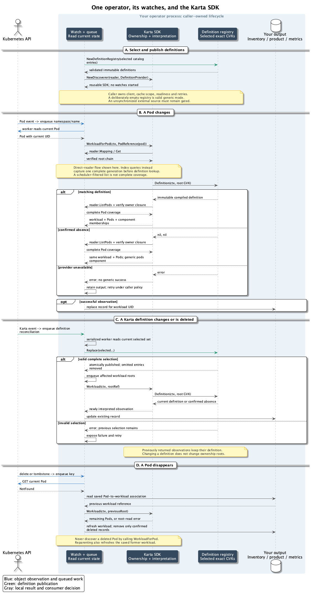

<!-- SPDX-License-Identifier: Apache-2.0 -->
<!-- Copyright (c) 2026 NVIDIA Corporation -->

# Watch Pods and reuse Karta

Keep your operator's watches and client.
Call Karta from reconciliation, then project the result into your existing output.

| If your project needs... | Call Karta for... | Keep in your project |
| --- | --- | --- |
| A physical ownership inventory | `OwnershipPath` or `ownership.Trace` | Metadata cache, filters, merged resource tree and inventory writes |
| A workload with all its Pods | `WorkloadForPod` | Queue, reader readiness, workload record and writes |
| Workload components, instances and replicas | `PodMemberships` or scoped `Pods` queries | Product IDs, scheduling policy and presentation |
| Templates, requested scale and status | `karta.New`, then `workload.Tree(ctx)` | Resource accounting and product status precedence |
| Compatibility with selective extraction | `resource.NewComponentFactoryFromObject` | Existing component selection and conversion |
| Existing exporter behavior | `ownership.Index`, `attribution.InstanceIDs`, `AttributeLegacy` | Watch lifecycle, root policy, metric store and scrape contract |

## 1. Your Pod watcher calls your queue

This is ordinary client-go event wiring. `podInformer` and `queue` belong to the operator:

```go
enqueue := func(obj any) {
    name, err := cache.DeletionHandlingObjectToName(obj)
    if err != nil {
        reportError(err)
        return
    }
    queue.Add(types.NamespacedName{Namespace: name.Namespace, Name: name.Name})
}
registration, err := podInformer.AddEventHandler(cache.ResourceEventHandlerFuncs{
    AddFunc: enqueue,
    UpdateFunc: func(_, current any) { enqueue(current) },
    DeleteFunc: enqueue,
})
if err != nil { return err }
```

The callback only queues a key. Your worker reads the current Pod.
It does not discover workloads from an old event object.
Wait for the operator's required caches and initial processing to synchronize
before publishing inventory. A handler that queues work can be synchronized while
its worker still has unpublished work.

The [executable example](operator_test.go) uses these real client-go handler and
queue types. It delivers fixture events to the handler; it does not require a
running cluster. The [reconciler](operator.go) contains the SDK call.

## 2. Reconciliation calls Karta

For a present Pod:

```go
observed, err := sdk.WorkloadForPod(ctx, discovery.PodReference(pod))
if err != nil { return err }

root := observed.Root()
pods := observed.Pods()
if observed.Generic() {
    // Ownership is known, but no selected Karta matches this root GVK.
    return saveGenericWorkload(root, pods)
}
return saveWorkload(root, pods, observed.PodMemberships())
```

`saveGenericWorkload` and `saveWorkload` represent your existing output conversion.
They are not SDK functions.
The complete example uses a caller-supplied `Save` function and stores one record
per workload UID.

Its fixture has this Kubernetes ownership tree:

```text
JobSet training-set
  Job evaluation-0 -> Pod evaluation-0-pod
  Job training-0   -> Pod training-0-pod
  Job training-1   -> Pod training-1-pod
```

Two Pod events produce one workload record, containing all three Pods:

```text
Pod events=2 workload records=1
workload=JobSet/training-set generic=false pods=[evaluation-0-pod training-0-pod training-1-pod]
```

Karta finds the root through controller ownership.
It looks up a definition for that root's exact GVK.
With the JobSet definition, each Pod is attributed to `replicatedjob` and its
named instance/replica. Without it, the same root and complete Pod set remain
available under the generic `pods` component.
A matching definition does not move the root to an intermediate owner.

When the current Pod GET returns NotFound, use your saved Pod-to-workload mapping
to refresh its former workload. Do not call `WorkloadForPod` for a deleted Pod.
Do the same for the old workload after a Pod is reparented.
The executable example uses one worker. With concurrent Pod workers, enqueue the
root identity and have a root worker acquire `sdk.Workload` and publish the result
in one serialized operation. Make that root queue the only writer of workload
records. Pod, owner and definition events feed that same root queue.
Two Pod keys can refer to the same root.
A write lock alone cannot stop an older observation overwriting a newer one.

## 3. Replace an ownership-discovery loop

An existing workload-discovery controller often already has a metadata cache:

```text
Pod event -> existing reconcile -> existing metadata-cache lookup
          -> repeated owner-walking loop -> merged physical tree -> write
```

Replace the loop with the lower-level shared function:

```go
path, err := ownership.Trace(ctx, start, readOwner, maxHops)
```

- `start` contains the Pod identity, all owner references and namespace scope.
- `readOwner` reads the requested owner through your existing metadata cache.
- `maxHops` is your configured owner-depth limit.
- `path` contains the Pod followed by its verified controller owners.
- The existing converter reverses and merges paths into its physical tree.

No definition is required. An unknown custom-resource kind still participates
in the owner chain when the caller can map and read it.
The [consumer comparison](INTEGRATION.md#reuse-an-existing-metadata-cache)
describes partial-path and UID-cache compatibility choices.

If you use the standard SDK reader instead of an existing metadata cache:

```go
path, err := sdk.OwnershipPath(ctx, discovery.PodReference(pod))
if err != nil { return err }
```

The [ownership example](operator_test.go) proves this path lists zero Pods.
It prints `JobSet -> Job -> Pod` in root-first order.
`DesiredTree` is a different, logical Karta tree; it does not replace these physical owners.

## 4. Select definitions and update them from your own watch

Select only the catalog entries your operator wants:

```go
jobSet, err := catalog.Get(schema.GroupVersionKind{
    Group: "jobset.x-k8s.io", Version: "v1alpha2", Kind: "JobSet",
})
if err != nil { return err }

catalogSelection := []*v1alpha1.Karta{jobSet}
definitions, err := discovery.NewDefinitionRegistry(catalogSelection...)
if err != nil { return err }

sdk, err := karta.NewDiscoverer(reader, discovery.Options{
    DefinitionProvider: definitions,
    MaxDepth: 32,
})
if err != nil { return err }
```

This registry is the authoritative selection.
Other catalog kinds do not appear implicitly.
Without `DefinitionProvider`, existing `Options.Definitions` still overrides the
full built-in catalog as before. Do not supply both options.

When adding a Karta watch, keep all workload workers gated until the first
successful publication from the synchronized definition source.
A static-only catalog registry needs no external synchronization.

Your Karta watcher queues definition reconciliation:

```text
Karta add/update/delete -> your definition queue
  -> read the current complete selected set from your synchronized source
  -> definitions.Replace(selected...)
  -> enqueue affected workload roots
  -> the same sdk observes them using the new definitions
```

`Replace` is the callable publication step for your external watcher.
It handles additions, removals and a definition's target-GVK change together.
It validates the whole set before making it visible.
On error it keeps the last valid set and returns the error for your retry/status path.
On success, definitions omitted from the replacement are removed.

Include the selected catalog entries in every publication. Passing only watched
Karta objects would intentionally remove the catalog entries from this registry.
The [tested selection helper](definition_selection.go) makes the merge explicit:

```go
selected, err := workloadinterface.SelectDefinitions(catalogSelection, watchedKartas)
if err != nil { return err }
if err := definitions.Replace(selected...); err != nil { return err }
enqueueTrackedWorkloads() // The same root queue used by Pod-driven refreshes.
```

This example's consumer policy is:

- A watched Karta overrides the selected catalog entry for the same exact GVK.
- Removing that watched Karta restores the selected catalog entry.
- Two watched Kartas for one GVK return a conflict naming both objects.
  Resolve the conflict or deliberately select a winner before publication.
- A watched Karta changing its target GVK removes its previous watched mapping.
  The complete selection still includes any catalog fallback for the old GVK.

The SDK registry itself has no catalog/cluster precedence rule.
It receives the already selected set. The exporter can retain its different
oldest-wins selection policy instead of adopting this example's conflict rule.

Serialize the selection/read/publication steps in one definition worker.
Read current source state instead of applying a stale delete payload by name.
A relist that changes a definition's GVK removes the old mapping in the same publication.
A Kubernetes resourceVersion is opaque; do not sort events by converting it to a number.

An intentionally empty registry means generic discovery.
An external source that has not synchronized is a different state: gate your
worker, or return an error from a provider wrapper until initial publication succeeds.
A definition update does not itself install a CRD, grant RBAC or start a workload watch.

The SDK starts no definition watcher and owns no callback goroutine.
The operator owns source selection, precedence, retries, readiness and requeueing.
Use an exact-GVK reverse index to limit requeues when a full workload rescan is expensive.

<details>
<summary>Supply another definition provider</summary>

The interface is deliberately small:

```go
type DefinitionProvider interface {
    Definition(context.Context, schema.GroupVersionKind) (*Definition, error)
}
```

Compile a Karta with `discovery.CompileDefinition` when publishing it.
Return the same immutable handle until the definition changes.
The built-in registry does this for you.
Identical replacements preserve handle identity. Compare the handles for the
union of previous and current GVKs to avoid requeueing unchanged workloads;
include removed GVKs. The [selection example](definition_selection_test.go)
shows that comparison for one GVK.

Equality covers the complete Karta object. A metadata or status edit creates a
new handle even if its spec is unchanged. This preserves the existing `Snapshot`
contract, which compares the factory's complete definition with the observation.
Do not strip resourceVersion or status implicitly in a provider adapter.
Validation and component-ancestry preparation happen at publication.
Workload expressions still run against each observed object when it is interpreted.

- `nil, nil`: the synchronized source confirms there is no selected definition.
- Non-nil definition: use that exact-GVK interpretation.
- Error: the query fails; it does not silently become generic.

`Definition.Karta()` returns a copy for offline extraction, such as
`resource.NewComponentFactoryFromObject` or `karta.New`.
The provider should not perform a second Kubernetes list or compile every definition
for every Pod query.

</details>

## 5. Reuse your direct client or cache

| Source you already own | Integration |
| --- | --- |
| client-go dynamic client and REST mapper | `discovery/clientgo.NewReader(client, mapper)` |
| Complete `discovery.Index` | Pass the index directly; the caller feeds `Replace`/`Apply`. |
| controller-runtime API reader | Use the consumer-side API-reader adapter linked below. |
| controller-runtime cache | Use the cache adapter after confirming synchronization and complete scope. |
| A custom REST/cache implementation | Implement `Mapping`, `Get` and `ListPods` from `discovery.Reader`. |

The [controller-runtime adapter](../../operator/examples/sdk-reader/README.md)
lives in the separate operator module.
It translates that operator's framework types into Karta's three reader methods.
The SDK's root module does not import controller-runtime.

A cache must cover every Pod in the requested namespace, across all phases,
and the owner objects needed for discovery.
A scheduler-filtered cache cannot provide complete membership.
Use an unfiltered reader for discovery, then apply product filters to the result.
Alternatively, retain your existing membership source and call
`attribution.Prepare`/`Evaluate` only for classification.

For frequent queries over large clusters, reuse a complete `discovery.Index` or
retain the existing metadata-cache owner walk. Direct `WorkloadForPod` collects
Pods across the workload namespace; it is not an indexed lookup.
See [performance and reuse](PERFORMANCE.md) before choosing the reader.

Direct API lists must exhaust pagination.
Cached lists must request the complete cached set without an API page limit.
Also choose explicitly between an API reader and the cache: a default manager
client can bypass its cache for unstructured objects.

This is controller-runtime independence at the SDK boundary.
Kubernetes API machinery/client-go versions still participate in Go module selection.
The [council decision](../../docs/design/sdk-operator-integration-decision.md)
explains the tradeoffs and source evidence.

<details>
<summary>Follow the full event and definition flow</summary>



[Zoomable preview](operator-flow.preview.html), [SVG](sdk-operator-flow.svg),
and [editable sequence](diagrams/sdk-operator-flow.puml).
This is an integration flow, not a trace from a running cluster.

</details>

<details>
<summary>Handle errors without deleting valid output</summary>

Provider failures are retryable under the consumer's policy; they are never
confirmed absence. An invalid publication retains the last valid definition set
and still needs a visible error and a retry or configuration fix.

Direct readers preserve wrapped Kubernetes API errors. Ownership traversal can
wrap those errors in `ownership.Error` with the failed reference. An indexed read
can report a typed missing-object error without an API response.
A missing intermediate owner is not proof that the workload root was deleted.
Confirm the root's deletion through its own authoritative read or delete handling
before removing the saved workload record.

`Resolver.Snapshot` requires the supplied factory's object revision and complete
Karta definition to match the observation. `ErrStaleInput` includes a removed or
changed selected definition. Recheck selection and rebuild the factory when
appropriate; repeatedly retrying the same mismatched factory cannot fix it.

</details>

## 6. Keep the consumer's output contract

A workload integration service can share template extraction, phase evaluation
and component coordinates. It still owns resource accounting, persistent IDs,
product status precedence, native-handler selection and Kubernetes writes.
A selective parser should use the component factory rather than blindly replacing
its selection rules with a full recursive `Tree` walk.

The metrics exporter shares owner traversal and component attribution.
Its event handlers update a compact metric store; a scrape reads that store.
Keep its legacy attribution, root-selection and degraded-data rules until their
replacement is explicitly tested. No metric names, labels or Helm values change
through this provider addition.

[Existing consumer replacement paths](INTEGRATION.md) and
[the exporter comparison](COLLECTOR.md) show those boundaries in more detail.
