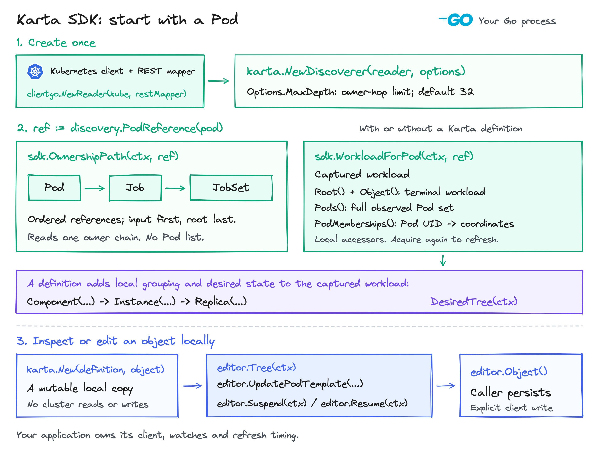
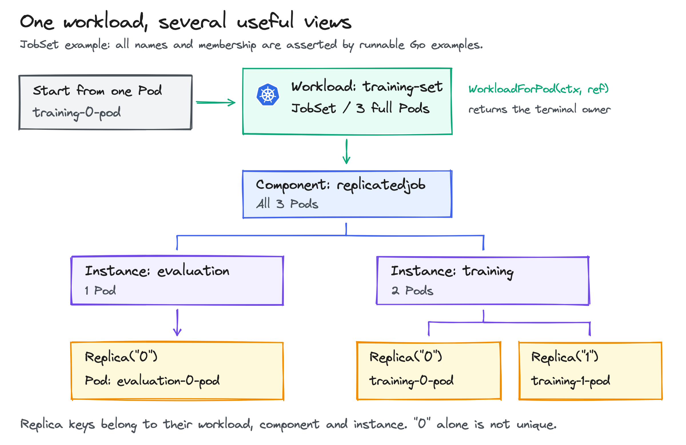
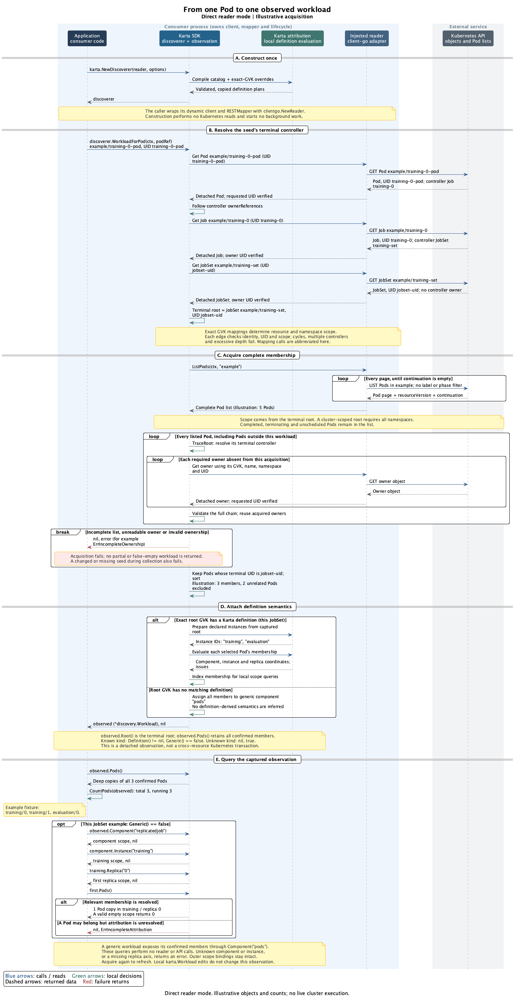

<!-- SPDX-License-Identifier: Apache-2.0 -->
<!-- Copyright (c) 2026 NVIDIA Corporation -->

# Karta SDK: find, inspect and edit Kubernetes workloads



Start with a Pod. Karta finds its workload, returns all its Pods, and groups them
by component, named instance and replica when a definition is available.
Your controller keeps its Kubernetes client, event loop and decisions.

Start with [Pod watch -> Karta call -> workload result](OPERATORS.md) to integrate
an operator. It includes selected catalog definitions, live definition updates,
and direct or cached client adapters.

See [what changes in the three consumers](INTEGRATION.md#what-changes-in-the-three-consumers)
for the before/after flows and exact calls:

- [k8s-workload-discovery: owner walking](INTEGRATION.md#k8s-workload-discovery-replace-the-owner-walk).
- [EWI: component extraction](INTEGRATION.md#ewi-reuse-the-sdk-component-reader).
- [Karta metrics exporter: event-time attribution](INTEGRATION.md#karta-metrics-exporter-share-algorithms-during-events).

This guide uses a JobSet with training and evaluation Jobs.
The same calls work with other definitions and with ordinary ownership discovery.
These APIs are implemented in this checkout; they may not be in the published module yet.

## Create the SDK once

Reuse your application's Kubernetes dynamic client and REST mapper:

```go
reader, err := clientgo.NewReader(kube, restMapper)
if err != nil { return err }

sdk, err := karta.NewDiscoverer(reader, discovery.Options{
    MaxDepth: 32,
})
if err != nil { return err }
```

- `kube` is a `dynamic.Interface`: the Kubernetes client your application owns.
- `restMapper` is a `meta.RESTMapper`: it maps a kind, such as JobSet, to its API resource and scope.
- `reader` adapts those two objects to the SDK. There is no callback to implement.
- `MaxDepth` limits controller-owner hops. Leave it out to use 32.
- Keep `sdk` and reuse it. Construction starts no watches and performs no cluster reads.

The imports are `pkg/karta`, `pkg/catalog`, `pkg/discovery` and
`pkg/discovery/clientgo` under
`github.com/dsx-ai-factory/workload-map`.
The [complete executable example](cmd/inspect/main.go) includes imports, kubeconfig
loading, client and mapper construction, and the first Pod read.

Try it against a Pod in a cluster you choose:

```bash
go run ./examples/workloadinterface/cmd/inspect \
  -kubeconfig /path/to/kubeconfig -context your-context \
  -namespace team -pod training-0-pod
```

The command only reads. It prints the workload identity, each Pod's phase and its
component coordinates. It does not install an operator or submit workloads.

## Find the whole workload from one Pod

Here `pod` is the `*corev1.Pod` your event handler or Kubernetes client received:

```go
podRef := discovery.PodReference(pod)
observed, err := sdk.WorkloadForPod(ctx, podRef)
if err != nil { return err }

root := observed.Root()
pods := observed.Pods()
fmt.Printf("workload=%s/%s pods=%d\n", root.GVK.Kind, root.Name, len(pods))
```

`PodReference` copies the Pod's namespace, name and UID and supplies `v1/Pod`.
The UID identifies this lifetime of the Pod, so a same-name replacement cannot
silently become the input to your query.

The [runnable JobSet fixture](recipes_test.go) has this ownership:

```text
JobSet training-set
  Job training-0   -> Pod training-0-pod
  Job training-1   -> Pod training-1-pod
  Job evaluation-0 -> Pod evaluation-0-pod
```

Starting at `training-0-pod` returns `JobSet/training-set` and all three Pods.
It does not stop at `Job/training-0`.

| Value | What it contains |
| --- | --- |
| `observed.Root()` | Terminal workload identity: kind, namespace, name and UID. |
| `observed.Object()` | A full copy of that Kubernetes object. |
| `observed.Pods()` | Full Pod copies, including completed, terminating and unscheduled Pods. |
| `observed.PodMemberships()` | Each Pod UID mapped to its component coordinates and any unresolved fields. |

`observed` is a captured result. These accessors make no cluster calls.
Call `sdk.WorkloadForPod` again when you need a fresh result.

Already have the workload reference? Use `sdk.Workload(ctx, rootRef)`.
A reference contains its exact group/version/kind, namespace, name and current UID.
That call also works for a workload with zero Pods.

## Read the workload tree

The JobSet fixture has this declared structure:

```text
component: jobset (workload root)
  instance: anonymous
    component: replicatedjob
      instance: evaluation   scale.replicas: 1
      instance: training     scale.replicas: 2
```

Read it from the captured workload:

```go
desired, err := observed.DesiredTree(ctx)
if err != nil { return err }
```

If you already create a workload with `karta.New(definition, object)`, keep using
`workload.Tree(ctx)`. It returns the same tree model. The Pod-selection methods
below are separate queries; they do not replace `Tree()`.

| View | Contents |
| --- | --- |
| `workload.Tree(ctx)` or `observed.DesiredTree(ctx)` | Declared components, instances, templates, scale and root status. |
| `observed.Component(...).Instance(...).Replica(...).Pods()` | Actual captured Pods matching those coordinates. |

The declared tree does not expand scale into runtime replicas or contain actual
Pods. Its builder leaves `InstanceNode.ReplicaKey` unset.

### Walk from the root through every declared instance

Each component has instances. Each instance has child components.
Start at `Root` to include the workload itself:

```go
var visit func(karta.ComponentNode, string)
visit = func(component karta.ComponentNode, indent string) {
    fmt.Printf("%scomponent: %s\n", indent, component.Name)
    for _, instance := range component.Instances {
        name := "anonymous"
        if instance.InstanceKey != nil { name = *instance.InstanceKey }
        fmt.Printf("%s  instance: %s\n", indent, name)
        for _, child := range instance.Children {
            visit(child, indent + "    ")
        }
    }
}
visit(*desired.Root, "")
```

`instance.Scale` holds requested scale; `instance.ExtractedInstance` holds extracted
Pod template/spec data. Scale and status fields can be nil when not defined.
`desired.RootStatus` preserves raw workload conditions; `desired.Status.Phases`
contains all matched phases. The fixture reports `[Running]` and `Completed=False`.
[SummarizeDesired](desired.go) is a complete consumer example retaining these values.

`Children` still exposes the first root instance's children.
`Instances()` walks that view and excludes the root.
This SDK branch adds `Root` and `RootStatus` while retaining `Children` and `Status`.
Callers that serialize the struct or use positional struct literals must account
for the added fields; the old serialized shape is not guaranteed.
Child definitions are extracted globally and appear under each parent instance.
Do not sum every appearance to infer resource totals or actual Pod counts.
Tree extraction evaluates templates, scale and root status together; a status-only
consumer can retain a separate status read.

## Select actual Pods from the workload structure



The diagram shows the captured Pods grouped by Karta coordinates.
It is a view of `PodMemberships()`, not the literal result of `DesiredTree()`.

### Follow one JobSet branch

```text
JobSet training-set
  component: replicatedjob
    instance: evaluation
      replica: "0" -> evaluation-0-pod
    instance: training
      replica: "0" -> training-0-pod
      replica: "1" -> training-1-pod
```

In the JobSet definition:

- `replicatedjob` is the component: a repeated Job template.
- `training` is a named instance: one entry in `spec.replicatedJobs`.
- `"0"` is a replica key: the Job index within that instance, read from its Pod label.

This fixture uses Job parallelism `1`. Its extracted scale is replicas times
parallelism; one Job replica can have several Pods when parallelism is greater.

```go
jobs, err := observed.Component("replicatedjob")
if err != nil { return err }
training, err := jobs.Instance("training")
if err != nil { return err }
firstJob, err := training.Replica("0")
if err != nil { return err }
trainingPods, err := firstJob.Pods()
if err != nil { return err }
fmt.Printf("training replica 0: %d Pods\n", len(trainingPods))
```

| Selection | Returned Pod names |
| --- | --- |
| Whole workload | `evaluation-0-pod`, `training-0-pod`, `training-1-pod` |
| `Component("replicatedjob")` | All three Pods. |
| Its `Instance("training")` | `training-0-pod`, `training-1-pod` |
| Training `Replica("0")` | `training-0-pod` |
| Evaluation `Replica("0")` | `evaluation-0-pod` |

These are local queries on `observed`. They preserve the enclosing instance;
replica `"0"` in training is different from replica `"0"` in evaluation.
A component selection also includes its descendant components.

### Select an inference group

First look at the observed grouping for this LeaderWorkerSet:

```text
LeaderWorkerSet inference
  component: group
    replica: "0"
      component: leader -> inference-0
      component: worker -> inference-0-1
    replica: "1"
      component: leader -> inference-1
      component: worker -> inference-1-1
```

The `group` component has one anonymous instance, omitted from this picture.
Its replica key is the operator's group ID. Follow group `"0"` to its worker Pods:

```go
groups, err := observed.Component("group")
if err != nil { return err }
firstGroup, err := groups.Replica("0")
if err != nil { return err }
workers, err := firstGroup.Component("worker")
if err != nil { return err }
workerPods, err := workers.Pods()
if err != nil { return err }
fmt.Printf("group 0 workers: %d Pods\n", len(workerPods))
```

The [group example](traversal_test.go) returns `inference-0-1` here.
Changing the final component to `leader` returns `inference-0`.
Replica keys are supplied by the consumer; replica-ID enumeration is not implemented.
There is no `observed.Tree()` method returning this Pod grouping today.
Use `PodMemberships()` when a UI needs to build it.

A scheduling gang can span components. The [SchedulingGroups example](groups.go)
combines full Pods using the definition's explicit scheduling keys.
It reuses `PodMemberships()` and performs no second attribution pass.
It supports `gangScheduling.podGroups` with explicit keys; unsupported formats
return an error. Creating scheduler objects remains the consumer's job.

## Replace a controller's ownership walk

Use the same SDK when you need the physical chain rather than every sibling Pod:

```go
path, err := sdk.OwnershipPath(ctx, discovery.PodReference(pod))
if err != nil { return err }
for _, object := range path {
    fmt.Printf("%s/%s\n", object.GVK.Kind, object.Name)
}
```

For the training Pod, the result is:

```text
Pod/training-0-pod
Job/training-0
JobSet/training-set
```

The first entry is your input; the last is the terminal workload.
`MaxDepth` comes from the SDK options above.
This query reads only that chain: no Pod list and no component classification.
Add `-owners-only` to the command to try it.

An inventory controller can feed this path to its existing tree builder.
Keep its metadata display, path merging, watches and stored records.
The path returns identities; it does not contain labels or annotations.
A Karta definition is not required.

## Reuse the result in an integration or metrics collector

Do not run selectors again to recover coordinates the SDK already calculated:

```go
memberships := observed.PodMemberships()
for _, pod := range observed.Pods() {
    membership := memberships[pod.UID]
    if len(membership.Issues) != 0 {
        return fmt.Errorf("Pod %s has incomplete component attribution", pod.Name)
    }
    fmt.Printf("pod=%s component=%s phase=%s\n",
        pod.Name, membership.Component, pod.Status.Phase)
    for _, coordinate := range membership.Path {
        if coordinate.Instance != nil {
            fmt.Printf("  %s instance=%q\n", coordinate.Component, *coordinate.Instance)
        }
        if coordinate.Replica != nil {
            fmt.Printf("  %s replica=%q\n", coordinate.Component, *coordinate.Replica)
        }
    }
}
```

The training Pod's `replicatedjob` coordinate contains instance `training` and
replica `0`. The map and coordinates are detached copies keyed by Pod UID.
An empty instance string means anonymous; a nil pointer needs the accompanying
issues to distinguish an absent axis from an unresolved value.

An integration controller can persist these coordinates with its own stable IDs.
A collector can join them to measurements keyed by Pod identity.
Karta supplies ownership and structure; CPU/GPU measurements come from the telemetry source.

For simple counts, [CountPods](pods.go) consumes only `Pods()`.
Its asserted fixture returns three Pods: one running, one succeeded and one pending.
The terminating and unscheduled counts overlap those phases.

The existing exporter retains its event-driven metric store and scrape callbacks.
Its compatibility adapters already share ownership and legacy attribution code.
It has not migrated to this high-level discovery interface.
The [exporter comparison](COLLECTOR.md) explains the remaining behavior differences.

## Inspect or edit an object you already have

A controller that already has a complete workload object can skip discovery.
Here `input` is an `*unstructured.Unstructured` returned by its dynamic client,
with the exact API version and kind set:

```go
definition, err := catalog.Get(input.GroupVersionKind())
if err != nil { return err }
editor, err := karta.New(definition, input)
if err != nil { return err }
view, err := editor.Tree(ctx)
if err != nil { return err }
if view.Root != nil {
    fmt.Printf("root component=%s instances=%d\n", view.Root.Name, len(view.Root.Instances))
}
```

`catalog` is `github.com/dsx-ai-factory/workload-map/pkg/catalog`.
`karta.New` also accepts typed Kubernetes objects that implement
[`resource.KubernetesObject`](../../pkg/resource/object.go).
Set their exact GVK and use `input.GetObjectKind().GroupVersionKind()` for catalog selection.
This local path performs no cluster reads. Handle `catalog.ErrNotFound` by keeping
ordinary inventory when semantic inspection is optional.

`editor` owns a mutable local copy; `observed` above remains an unchanged snapshot.
For a discovered known workload, create the editor from
`observed.Definition()` and `observed.Object()`.

For the JobSet, change only the training instance's scheduler:

```go
err = editor.UpdatePodTemplate(ctx, "replicatedjob", karta.Patch{
    "spec": map[string]any{"schedulerName": "example-scheduler"},
}, karta.WithInstances("training"))
if err != nil { return err }
updated, err := editor.Object()
if err != nil { return err }
// Persist updated with your Kubernetes client and handle update conflicts.
```

The [named-edit example](traversal_test.go) verifies evaluation stays unchanged.
`Components()` reports writable fields and suspend support.
`Suspend(ctx)` and `Resume(ctx)` apply the definition's actions to the same local copy.
Unsupported edits return `karta.ErrNotSupported`; a failed edit leaves the copy unchanged.
Serialize access to an editor. Only your explicit client write changes Kubernetes.

For a separate preparation Job or runtime, reuse the same client and inspect its
object through Karta. See [decisions using referenced resources](REFERENCES.md).
Automatic CEL reference resolution remains a separate prototype.

## Choose options and refresh behavior

| Setting | Default | Meaning |
| --- | --- | --- |
| `MaxDepth` | `0` selects 32 | Maximum controller-owner hops; exceeding it returns an error. |
| `Definitions` | Built-in catalog | Add or override definitions by exact group/version/kind. |
| `DefinitionProvider` | `nil` | Authoritative live selection by exact GVK; cannot combine with static `Definitions`. |
| `Cache` | `nil`, disabled | Reuse successful attribution for a concrete `*discovery.Index`. |

Static `Definitions` are copied at construction. Recreate the SDK to change those overrides.
For live updates, supply a `DefinitionProvider` and publish changes through its
registry, as shown in the [operator recipe](OPERATORS.md#4-select-definitions-and-update-them-from-your-own-watch).
`MaxDepth` does not select a child as the workload root.
The existing `Collect` helper uses a fixed 32-hop limit when initializing an index.

For repeated queries, choose how the SDK obtains its inputs:

| Input | Work done on acquisition | Who keeps it current? |
| --- | --- | --- |
| Direct reader | Read the workload's Pod coverage and resolve owners. | The API or cache behind your reader. |
| `discovery.Index` | Select a workload from one published local generation. | Your existing watch/reconcile loop. |
| Previously returned `observed` | Local accessors only; no refresh. | Acquire again when needed. |

Initialize an index from complete coverage, then pass it to the same constructor:

```go
dataset, err := discovery.Collect(ctx, reader, namespace)
if err != nil { return err }
index := discovery.NewIndex()
generation, err := index.Replace(ctx, dataset)
if err != nil { return err }
sdk, err := karta.NewDiscoverer(index, discovery.Options{
    Cache: &discovery.CacheOptions{MaxWorkloads: 1000, MaxPods: 10000},
})
if err != nil { return err }
```

`namespace` is the inventory namespace; empty means all namespaces.
Pass explicit zero-Pod root references after `namespace` to include those objects.
Publish current objects with `index.Apply(ctx, generation, changes)` and keep its
returned generation. On lost coverage, invalidate and rebuild the index.
Close the gap between initial collection and the watch feed; the SDK does not do it.

The cache limits retained attribution entries and Pod membership records.
It does not bound index memory, cache HTTP reads or start informers.
Both limits must be positive. Unsupported expressions and failed attribution bypass reuse.
See the [reader and index contract](../../docs/Live%20Workload%20Discovery.md) for complete feed rules.

## Unknown workload types and failures

No matching definition is required to find an ownership chain or workload:

| Capability | With a definition | Without a definition |
| --- | --- | --- |
| Workload identity and full Pods | Available | Available |
| `Generic()` | `false` | `true` |
| Component scopes | Definition's names | One `pods` component with anonymous instance. |
| Desired tree and semantic edits | Definition-dependent | Unsupported; no structure is invented. |

A missing owner or denied read is an error, not a generic workload or an empty result.
Direct workload discovery requires every listed Pod's ownership chain to be valid;
even an unrelated broken chain can fail collection.
Use `OwnershipPath` when the task needs only one chain.

Classification issues do not remove ownership-confirmed Pods from `Pods()`.
Read `MembershipIssues()` or each entry's issues before publishing a complete breakdown.
A relevant component/instance/replica query returns `ErrIncompleteAttribution`.
Refresh and reconcile rather than treating an error as zero Pods.

For `Pod -> Job -> WorkloadEnvelope`, discovery currently selects the envelope.
An option to stop before that parent is not implemented.
The [boundary design](INTEGRATION.md#keep-a-workload-below-an-orchestration-parent)
explains separate child workloads and the existing exporter's different candidate policy.

## Reuse one implementation across projects

| Consumer | SDK operation | Logic the consumer retains |
| --- | --- | --- |
| Ownership inventory | `OwnershipPath` | Physical tree merging, metadata display and persistence. |
| Workload integration | `WorkloadForPod`, `DesiredTree`, `PodMemberships` | Eligibility, stable IDs and product status conversion. |
| Existing known root and Pod set | Local interpretation and attribution | Its established membership policy and event handling. |
| Metrics collector | Captured Pods and memberships | Metric contract, measurement joins, store and delivery. |

The [integration guide](INTEGRATION.md) shows the exact replacement boundaries.
A filtered Pod cache cannot silently become complete workload coverage.
Existing integrations can keep their membership path and adopt local interpretation first.

The SDK reduces repeated work through:

- Reusing owner lookups within one collection.
- Optional metadata-only reads for additional intermediate owners.
- Updating affected ownership descendants instead of rebuilding the whole index.
- Preparing definitions once per SDK and instances once per workload observation.
- Reusing eligible attribution when indexed objects are unchanged.
- Returning stored Pod memberships instead of running selectors again.

The [performance guide](PERFORMANCE.md) identifies each mechanism, its cost and its evidence.
These improvements do not establish parity with every consumer or production capacity.

<details>
<summary>Inside a workload query</summary>



1. Read the input by identity and follow controller owners.
2. Obtain complete Pod coverage for the terminal root's scope.
3. Confirm membership, then calculate component coordinates.
4. Return one detached observation for all subsequent local queries.

Indexed queries select one published generation instead of collecting again.
A concrete `*Index` also gives `OwnershipPath` a single-generation chain.
Other readers perform separate reads; a Kubernetes query is not a cross-resource transaction.
The [zoomable sequence](sdk-discovery-flow.preview.html) explains the direct path.

</details>

## Run the examples and inspect the evidence

```bash
go test ./examples/workloadinterface -run '^Example' -v
```

The examples use local fixtures with asserted output.
The complete command above uses the cluster and Pod you select.
Use the Go version in [go.mod](../../go.mod).
To consume the tested SDK revision directly from the fork in another Go module:

```bash
go mod edit -replace=github.com/dsx-ai-factory/workload-map=github.com/AviadHayumi/workload-map@v0.2.1-0.20261016121607-c6cad432ab56
go get github.com/dsx-ai-factory/workload-map@v0.2.1-0.20261016121607-c6cad432ab56
```

Keep imports under `github.com/dsx-ai-factory/workload-map`, its declared module path.
The replacement selects immutable fork commit `c6cad432ab565b3f42538496546ddbad6c156218`.
It downloads from GitHub; it does not require a local Karta checkout.
This is an experiment revision, not a released SDK version.

For development against a local checkout instead:

```bash
go mod edit -replace=github.com/dsx-ai-factory/workload-map=/absolute/path/to/karta
go mod tidy
```

- [Validation](VALIDATION.md): completed checks and their source scope.
- [Live acceptance tests](../../test/discovery/README.md): real Job, JobSet and LeaderWorkerSet flows.
- [Recording replay](../../test/discovery/RECORDINGS.md): phases, mutations, grouping and known exclusions.
- [Performance](PERFORMANCE.md): mechanisms and reproducible benchmark scope.

Diagram sources sit next to this file as `.excalidraw`; open them at excalidraw.com to edit.
The sequence source is [PlantUML](diagrams/sdk-discovery-flow.puml).
