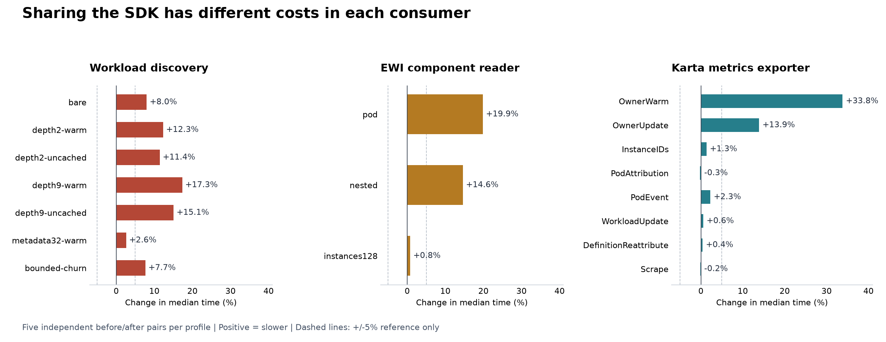

<!-- SPDX-License-Identifier: Apache-2.0 -->
<!-- Copyright (c) 2026 NVIDIA Corporation -->

# Before and after adopting the SDK

The integration is not performance-neutral across all consumers.
Output checks passed for the measured fixtures, but ownership discovery and small
EWI parses became slower. Exporter event processing and scraping stayed close.

Measured on 2026-10-16 against SDK `c6cad432ab56`.
Five alternating before/after pairs per profile produced 200 successful processes.
All samples are retained in [samples.json](samples.json); [latency.csv](latency.csv)
contains every Go benchmark sample.

| Consumer | Time per operation | CPU for the same fixed work | Memory finding |
| --- | --- | --- | --- |
| k8s-workload-discovery | +2.6% to +17.3%; most cases +8% to +17% | +11.3% for the seven-case mix | Retained heap is close; deepest warm chain allocates 33.9% more bytes |
| External Workload Integrator (EWI) | Small parses +14.6% to +19.9%; 128 instances +0.8% | Small parses +9.6% to +12.9%; 128 instances +0.7% | Small parses allocate 12.6% to 15.0% fewer bytes; total retained heap is slightly higher |
| Karta metrics exporter | Pod event +2.3%; workload update +0.6%; scrape -0.2% | Those profiles range from -0.2% to +1.0% | Event allocations are unchanged; 100k-workload ownership-index retention is close |

The exporter's isolated owner lookup is 33.8% slower: 188 ns becomes 251 ns.
That increase does not translate into a 33.8% increase for the complete Pod event.
The 5% reference lines below are a practical investigation threshold, not a
statistical equivalence test. Small differences do not establish a speedup.



## What was replaced

| Consumer | Before | After | Timed boundary |
| --- | --- | --- | --- |
| Workload discovery | Frozen original owner walk at `1f56e5bf50a3` | `ownership.Trace` with the same metadata cache | Owner walk and initial Workload projection; status reconciliation is outside timing |
| EWI | Frozen original handler/converter at `7add034fd350`, Karta `998140308a96` | SDK component reader, including definition JSON conversion on every Parse | Parse, component conversion and returned ExternalWorkload |
| Exporter | Original owner/attribution files at `5d0661ab19a6` | Shared SDK ownership and attribution adapters | Individual algorithms, controller event paths, HTTP scrape, and separate index-memory test |

The consumer adapters use the published fork module:

```go
replace github.com/dsx-ai-factory/workload-map => github.com/AviadHayumi/workload-map v0.2.1-0.20261016121607-c6cad432ab56
```

WLD and EWI remain local integration prototypes. They do not use the new live
definition provider and have not been deployed.
EWI still uses its existing component selection and accounting; this is not a
migration to `Tree` or the full discovery API.

For the exporter, Go overlays replace exactly the historical owner and attribution
files. Both binaries use the same current dependencies and benchmark harness.
The remaining 52 production, module and chart controls match the baseline.
This isolates algorithm sharing; it is not a historical whole-application rebuild
or complete parity with the latest exporter PoC branch.

## Time and allocation cost

Each cell is the median of five independent processes.
One operation means one call to the named path, except Scrape, which means one
complete HTTP exposition. Allocated bytes are cumulative traffic per operation.

| Consumer / operation | Before, us | After, us | Time change | Bytes/op before -> after | Allocs/op before -> after |
| --- | ---: | ---: | ---: | ---: | ---: |
| wld / bare | 0.801 | 0.866 | +8.0% | 1,480 -> 1,608 | 18 -> 19 |
| wld / depth2-warm | 2.307 | 2.591 | +12.3% | 4,128 -> 4,696 | 47 -> 46 |
| wld / depth2-uncached | 3.014 | 3.358 | +11.4% | 6,160 -> 6,728 | 61 -> 60 |
| wld / depth9-warm | 7.023 | 8.240 | +17.3% | 13,112 -> 17,560 | 131 -> 123 |
| wld / depth9-uncached | 10.458 | 12.032 | +15.1% | 22,536 -> 26,984 | 201 -> 193 |
| wld / metadata32-warm | 10.085 | 10.347 | +2.6% | 21,832 -> 22,368 | 75 -> 72 |
| wld / bounded-churn | 4.141 | 4.458 | +7.7% | 7,168 -> 7,704 | 73 -> 70 |
| ewi / pod | 29.227 | 35.038 | +19.9% | 41,071 -> 34,903 | 484 -> 444 |
| ewi / nested | 34.554 | 39.612 | +14.6% | 47,520 -> 41,537 | 561 -> 519 |
| ewi / instances128 | 1,506.330 | 1,518.363 | +0.8% | 2,558,011 -> 2,540,533 | 22,066 -> 21,890 |
| exporter / OwnerWarm | 0.188 | 0.251 | +33.8% | 176 -> 176 | 2 -> 2 |
| exporter / OwnerUpdate | 0.465 | 0.529 | +13.9% | 336 -> 336 | 4 -> 4 |
| exporter / InstanceIDs | 13.522 | 13.703 | +1.3% | 12,369 -> 12,689 | 205 -> 209 |
| exporter / PodAttribution | 6.029 | 6.013 | -0.3% | 6,016 -> 6,016 | 89 -> 89 |
| exporter / PodEvent | 7.902 | 8.081 | +2.3% | 6,472 -> 6,472 | 98 -> 98 |
| exporter / WorkloadUpdate | 65.936 | 66.310 | +0.6% | 85,033 -> 85,035 | 1,590 -> 1,590 |
| exporter / DefinitionReattribute | 101.271 | 101.683 | +0.4% | 112,181 -> 112,180 | 1,989 -> 1,989 |
| exporter / Scrape | 61,743.139 | 61,638.797 | -0.2% | 48,600,986 -> 48,603,888 | 779,883 -> 779,901 |

WLD fixtures cover a bare Pod, two- and nine-owner chains, warm and uncached reads,
32 labels plus 32 annotations, and bounded-cache churn. Warm reads make zero GETs.
The cache has 512 entries, or 64 in the churn case; both implementations use the
same limits. The fixture uses a one-hour TTL to exclude expiry during measurement.
It does not reproduce the production 30-second expiry pattern.

EWI covers a Pod, a nested workload and 128 selected instances. The large fixture
varies replicas while keeping image/template metadata identical, avoiding an
existing first-map-entry ambiguity. Per-Parse definition conversion is included.

Exporter latency fixtures contain 1,000 JobSets, 2,000 Jobs and 2,000 Pods.
PodEvent calls the actual controller attribution path. WorkloadUpdate alternates
resource versions and generations; DefinitionReattribute forces reevaluation.
Scrape uses the actual collector and metric store, producing about 3.46 MB of
uncompressed exposition. Network transport and queueing are outside these tests.

<details>
<summary>All five-sample latency ranges</summary>

Ranges are minimum to maximum, not confidence intervals.

| Consumer / operation | Before range, us | After range, us |
| --- | ---: | ---: |
| wld / bare | 0.785 - 0.819 | 0.862 - 0.902 |
| wld / depth2-warm | 2.293 - 2.374 | 2.555 - 2.606 |
| wld / depth2-uncached | 2.957 - 3.046 | 3.242 - 3.422 |
| wld / depth9-warm | 6.785 - 7.112 | 8.209 - 8.299 |
| wld / depth9-uncached | 10.267 - 10.886 | 11.848 - 12.163 |
| wld / metadata32-warm | 10.017 - 10.111 | 10.284 - 10.371 |
| wld / bounded-churn | 4.007 - 4.170 | 4.371 - 4.481 |
| ewi / pod | 29.030 - 29.632 | 34.612 - 35.274 |
| ewi / nested | 34.193 - 34.757 | 39.454 - 40.965 |
| ewi / instances128 | 1,500.404 - 1,577.072 | 1,509.325 - 1,536.157 |
| exporter / OwnerWarm | 0.186 - 0.192 | 0.249 - 0.257 |
| exporter / OwnerUpdate | 0.462 - 0.466 | 0.528 - 0.531 |
| exporter / InstanceIDs | 13.423 - 13.983 | 13.662 - 13.754 |
| exporter / PodAttribution | 5.989 - 6.066 | 5.989 - 6.063 |
| exporter / PodEvent | 7.833 - 8.051 | 7.886 - 8.440 |
| exporter / WorkloadUpdate | 65.059 - 66.590 | 65.192 - 68.081 |
| exporter / DefinitionReattribute | 100.352 - 103.296 | 100.493 - 102.700 |
| exporter / Scrape | 61,331.853 - 64,078.871 | 60,691.346 - 63,417.182 |

</details>

## CPU and resident memory

CPU seconds are user plus system CPU for an entire precompiled child process.
They include startup, fixture construction and Go benchmark calibration.
They exclude compilation and are not production CPU utilization percentages.
WLD's process contains all seven cases, so its CPU total cannot be assigned to
one owner-chain depth.

Peak RSS is the process's maximum resident memory reported by `wait4`.
It includes the runtime, fixtures, setup and transient allocations.
It is different from retained Go heap after garbage collection.

<details>
<summary>Fixed-work CPU and peak RSS for every profile</summary>

Medians are followed by the observed minimum-maximum range.
Memory profiles are separate runs with heap instrumentation.

| Profile | CPU seconds before -> after | Peak RSS MiB before -> after |
| --- | --- | --- |
| wld-bench-mix | 2.713 [2.676-2.738] -> 3.019 [2.978-3.034] | 40.922 [40.719-41.344] -> 41.500 [40.891-41.781] |
| ewi-bench-pod | 4.028 [4.004-4.092] -> 4.549 [4.523-4.613] | 63.969 [63.672-64.016] -> 63.656 [63.625-63.859] |
| ewi-bench-nested | 4.747 [4.708-4.777] -> 5.202 [5.189-5.342] | 63.391 [63.312-64.297] -> 63.875 [63.234-68.750] |
| ewi-bench-instances128 | 5.327 [5.307-5.545] -> 5.367 [5.339-5.416] | 72.281 [71.781-72.359] -> 72.266 [71.922-72.422] |
| exporter-bench-OwnerWarm | 0.761 [0.753-0.769] -> 0.895 [0.886-0.911] | 64.500 [63.781-64.875] -> 61.469 [61.141-62.109] |
| exporter-bench-OwnerUpdate | 0.847 [0.839-0.853] -> 0.918 [0.914-0.926] | 60.859 [60.656-61.484] -> 60.578 [59.625-60.781] |
| exporter-bench-InstanceIDs | 3.793 [3.765-3.891] -> 3.847 [3.821-3.851] | 60.078 [59.562-63.453] -> 59.234 [58.875-59.641] |
| exporter-bench-PodAttribution | 4.225 [4.209-4.252] -> 4.210 [4.199-4.248] | 61.453 [60.812-61.984] -> 61.219 [60.672-61.500] |
| exporter-bench-PodEvent | 2.270 [2.259-2.291] -> 2.293 [2.263-2.386] | 58.594 [58.234-58.984] -> 58.734 [58.094-63.000] |
| exporter-bench-WorkloadUpdate | 3.920 [3.870-3.939] -> 3.915 [3.879-3.994] | 61.188 [60.594-61.797] -> 60.578 [60.500-63.141] |
| exporter-bench-DefinitionReattribute | 1.614 [1.607-1.652] -> 1.634 [1.613-1.654] | 59.156 [58.406-60.469] -> 58.828 [58.734-59.266] |
| exporter-bench-Scrape | 4.891 [4.867-5.093] -> 4.879 [4.840-4.990] | 106.562 [105.562-106.906] -> 105.719 [105.500-106.469] |
| wld-memory-depth9-warm | 0.123 [0.121-0.127] -> 0.147 [0.144-0.150] | 45.594 [44.594-46.500] -> 45.859 [45.031-46.469] |
| wld-memory-metadata32-warm | 0.187 [0.183-0.195] -> 0.192 [0.186-0.193] | 73.375 [72.266-75.672] -> 73.156 [72.219-77.094] |
| wld-memory-bounded-churn | 0.075 [0.073-0.077] -> 0.080 [0.078-0.082] | 36.484 [36.438-36.672] -> 37.250 [37.094-37.281] |
| ewi-memory-pod | 0.475 [0.462-0.492] -> 0.526 [0.509-0.539] | 67.391 [63.781-67.875] -> 66.500 [64.047-68.219] |
| ewi-memory-nested | 0.549 [0.536-0.564] -> 0.597 [0.594-0.604] | 66.922 [63.375-68.953] -> 63.891 [63.781-70.516] |
| ewi-memory-instances128 | 1.224 [1.219-1.263] -> 1.230 [1.203-1.260] | 72.016 [68.500-74.656] -> 73.719 [72.578-76.719] |
| exporter-index-10000 | 0.052 [0.049-0.054] -> 0.051 [0.050-0.053] | 50.312 [48.781-50.766] -> 49.484 [48.109-50.781] |
| exporter-index-100000 | 0.531 [0.515-0.539] -> 0.531 [0.510-0.553] | 236.312 [224.422-239.750] -> 237.594 [225.203-241.094] |

</details>

The small EWI cases use more total CPU despite fewer allocations and GC cycles.
Their peak RSS changes are small and noisy; allocation savings do not establish
resident-memory savings.
WLD and EWI each compile old and new paths into the same test binary.
Their RSS results compare executed paths, not old and new service binary sizes.

## Retained memory and garbage collection

These measurements distinguish three costs:

- Allocation traffic: all bytes allocated while doing the fixed work.
- Retained heap: live Go heap after a forced GC, with outputs/index kept alive.
- Peak RSS: maximum resident memory over the whole process.

WLD and EWI keep the last 256 complete outputs alive.
The table reports total post-GC heap, including warmed fixtures and caches.
The raw results also contain the incremental heap since warmup.
Exporter rows report ownership-index heap above the empty baseline.

| Fixture | Work performed | Retained MiB before -> after | Natural GC cycles before -> after | Total GC pause ms before -> after |
| --- | --- | ---: | ---: | ---: |
| wld-memory-depth9-warm | 10,000 operations | 5.568 -> 5.568 | 21 -> 27 | 0.659 -> 0.948 |
| wld-memory-metadata32-warm | 10,000 operations | 11.187 -> 11.188 | 20 -> 20 | 0.790 -> 0.481 |
| wld-memory-bounded-churn | 10,000 operations | 3.613 -> 3.613 | 17 -> 19 | 0.483 -> 0.472 |
| ewi-memory-pod | 10,000 parses | 7.231 -> 7.344 | 50 -> 45 | 2.208 -> 2.174 |
| ewi-memory-nested | 10,000 parses | 7.234 -> 7.348 | 57 -> 53 | 2.527 -> 2.421 |
| ewi-memory-instances128 | 500 parses | 7.554 -> 7.697 | 133 -> 131 | 6.113 -> 5.964 |
| exporter-index-10000 | 10,000 resolves + 10% Job updates | 15.746 -> 15.652 | 0 -> 0 | 0.000 -> 0.000 |
| exporter-index-100000 | 100,000 resolves + 10% Job updates | 144.724 -> 144.746 | 0 -> 0 | 0.000 -> 0.000 |

WLD's deep warm-chain allocation traffic increases 33.9%, and GC cycles increase
from 21 to 27 per 10,000 operations. Its retained output footprint stays close.
GC pause values here are accumulated stop-the-world time, not p99 request latency.

EWI's total retained heap is about 115-146 KiB higher after adoption.
Most of that difference is already present after warmup.
For the small cases, incremental retained output heap stays around 0.485 MiB.
GC cycles fall from 50 to 45 and from 57 to 53 per 10,000 parses.
The 128-instance retained-output delta has wider ranges; no memory win is claimed.

### The 100,000-workload ownership index

Each workload has one Job and one Pod: 300,000 indexed objects in total.
The test builds the index, resolves every Pod and republishes 10% of Job metadata.

- Retained index heap after that work: 144.724 -> 144.746 MiB.
- Whole-process peak RSS: 236.312 -> 237.594 MiB.
- Allocation traffic during resolves and updates: 28.071 -> 35.700 MiB.
- Build allocation traffic: about 314.4 MiB in both versions.
- Build GC cycles, including the forced collection: 12 in both versions.
- No natural GC occurred during the warm resolve/update phase.

The extra 7.63 MiB of warm allocation traffic is transient, not retained growth.
This loop constructs a fresh owner-reference slice for every lookup.
Binary inspection confirms that its 80-byte backing array stays on the stack in
the baseline but escapes to the heap in the SDK: 100,000 additional allocations.
The isolated OwnerWarm benchmark reuses an existing Pod's owner slice, which is
why its allocated bytes per operation remain unchanged. Input construction matters.
This short test cannot establish the absence of a long-running memory leak.
It does not include a 100,000-workload metric store, full informer objects,
attribution cache, watch recovery, or concurrent scrapes.
It therefore does not establish full-service capacity for 100,000 workloads.

## Correctness controls

Performance comparisons must keep their output contract.

- WLD: complete-output parity checks and focused race tests passed.
  Timed fixtures make the same metadata GETs. Separate memory runs compare full
  serialized output digests and preserve cache bounds.
- EWI: 20 complete-output comparisons per implementation for each fixture passed.
  Inputs remain unchanged. The 21 focused race-tested handler/contract specs passed.
- Exporter: both binaries passed fixture, missing-owner and unknown-instance checks.
  Their complete sorted Prometheus exposition matched: 392 lines for 32 JobSets
  and 64 Pods. Focused race checks passed for both implementations.

Exporter exposition SHA-256:

```text
d471f9a94125e2865abeb689b4769489ba4670a7972c291768d57ebfd891d909
```

The SDK intentionally rejects some malformed ownership chains accepted by the
old WLD walker. Those stricter cases remain separate compatibility tests.
Normal-fixture parity is not a universal drop-in compatibility claim.

## Likely contributors and next work

Source inspection identifies the extra work below. Binary disassembly also
confirms one allocation difference. No CPU profile apportions the measured
latency overhead to individual functions.

1. WLD now builds the SDK ownership path and converts it to the consumer path.
   It also performs stricter context, identity, scope and cycle checks.
   Investigate path storage and conversion without removing those checks.
2. EWI converts the Karta definition through JSON on every Parse.
   Investigate converting once when a definition changes, with correct invalidation.
   The shared selector cache reduces repeated compilation, but that does not
   offset all of the measured conversion and execution cost.
3. Exporter ownership resolution delegates through callbacks and wrapper objects.
   Its compatibility mode does not enable strict traversal validation.
   Profile that adapter before trading clarity for a nanosecond-level improvement.
4. Repeat accepted candidates on a quiet Linux runner and through live controllers.
   Include startup, concurrent watches, churn, persistence and scrape pressure.

No production optimization or deployment was made for this measurement.
The result supports further optimization of WLD and small EWI paths; it does not
support declaring the SDK universally faster or equally fast.

## Method and reproduction

- Host: Apple M4 Pro, Darwin/arm64, 14 logical CPUs, 48 GiB RAM.
- Runtime controls: `GOMAXPROCS=2`, `GOGC=100`.
- Compilers: WLD Go 1.27.2, EWI Go 1.26.8, exporter Go 1.26.3.
  Each before/after pair uses the same compiler. Do not compare raw times across consumers.
- Five independent processes per implementation per profile, alternating order.
  Timed processes run serially. All successful samples are retained.
- Fixed operation counts appear in [samples.json](samples.json).
  Latency runs and instrumented heap runs are separate.
- This is a shared workstation, not a controlled production load generator.
  Fixtures use in-memory/fake clients. No network/API latency is inferred.

The public [exporter harness](../../../../exporter/pkg/controller/sdk_performance_test.go)
can run on this branch:

```sh
cd exporter
GOMAXPROCS=2 GOGC=100 go test ./pkg/controller \
  -run '^TestSDKConsumerParity$' -count=1 -v
GOMAXPROCS=2 GOGC=100 go test ./pkg/controller -run '^$' \
  -bench '^BenchmarkSDKConsumer$/^PodEvent$' \
  -benchtime=200000x -benchmem -count=5
KARTA_PERF_SIZE=100000 GOMAXPROCS=2 GOGC=100 go test ./pkg/controller \
  -run '^TestSDKConsumerIndexMemory$' -count=1 -v
```

Those commands exercise the current implementation only; `-count=5` is one
process and does not reproduce the independent-process method on its own.
For the historical comparison, run the [preparation script](prepare_exporter.py)
from the repository root. It verifies the control files, extracts the two exact
historical files and compiles both binaries with the current module graph.
It writes hashes, provenance and the Go overlay into the chosen output directory.

```sh
python3 examples/workloadinterface/benchmarks/consumer-comparison/prepare_exporter.py \
  /tmp/karta-exporter-comparison
GOMAXPROCS=2 GOGC=100 /tmp/karta-exporter-comparison/legacy.test \
  -test.run='^$' -test.bench='^BenchmarkSDKConsumer$/^PodEvent$' \
  -test.benchtime=200000x -test.benchmem -test.count=1
GOMAXPROCS=2 GOGC=100 /tmp/karta-exporter-comparison/sdk.test \
  -test.run='^$' -test.bench='^BenchmarkSDKConsumer$/^PodEvent$' \
  -test.benchtime=200000x -test.benchmem -test.count=1
```

Repeat five pairs, reversing order on even pairs. Run the binaries one at a time.
The script uses baseline `5d0661ab19a6830625f26f77faf51cbe3ea5964f` and overlays
`exporter/pkg/owner/index.go` plus `exporter/pkg/attribute/attributor.go`.

The WLD/EWI harnesses are retained in the local integration branches; they are
not distributed in this repository. Their baseline revisions, source hashes,
binary hashes, exact benchmark arguments and sanitized numeric samples are
included here. Full local logs remain in the ignored audit directory.
This is enough to inspect these results, but a fresh checkout of this repository
alone cannot rebuild the two consumer prototypes.

[Back to SDK performance](../../PERFORMANCE.md) | [Integration boundaries](../../INTEGRATION.md)
