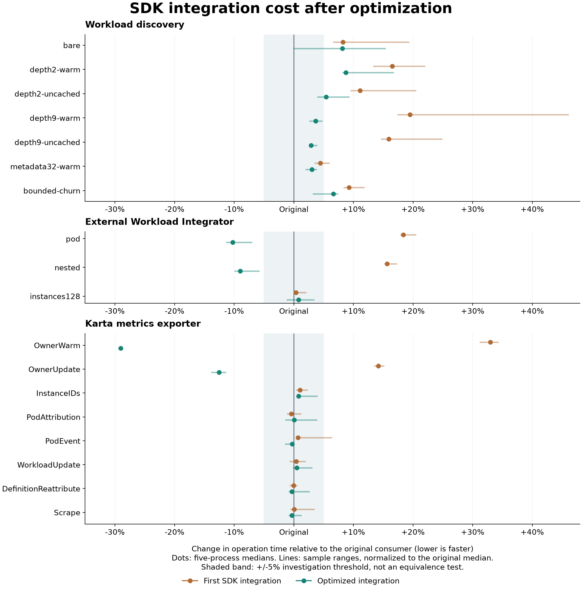

<!-- SPDX-License-Identifier: Apache-2.0 -->
<!-- Copyright (c) 2026 NVIDIA Corporation -->

# Optimizing the SDK integrations

The [first comparison](../consumer-comparison/README.md) found extra CPU and
allocation cost in ownership discovery and small EWI parses.
This follow-up removes avoidable adapter work while preserving the output and
validation contract.

The optimization reduces the measured regressions, but WLD remains slower than
the original walker. Small EWI parses are now faster, and exporter event and
scrape paths remain close to the original.

All 300 child processes completed successfully on 2026-10-16: five samples per
implementation and profile. Every sample is retained.
The original report, binaries and measurements are preserved.

## Compare the three implementations

| Implementation | Meaning |
| --- | --- |
| Original consumer | The frozen consumer algorithms used before SDK adoption |
| First SDK integration | The measured adapters using SDK `c6cad432ab56` |
| Optimized integration | The updated adapters and SDK ownership code, recorded by source and binary hashes |

All three run again in the same comparison.
The original numbers from the earlier report are not substituted for fresh runs.

The optimized WLD and exporter binaries use SDK source matching `355d8c96e5ae`.
The optimized EWI binary still uses the component reader at `c6cad432ab56`;
its optimization is entirely in the consumer's typed definition conversion.
Later dependency-pin updates do not change this measured provenance.

<!-- RESULT_SUMMARY_START -->
Changes below compare the optimized implementation with the original consumer.

| Consumer | Operation time | Fixed-work CPU | Memory |
| --- | --- | --- | --- |
| k8s-workload-discovery | Still 2.9-8.7% slower | +3.0% for the seven-case mix | Deep warm chain allocates 3.5% fewer bytes; retained heap stays close |
| External Workload Integrator (EWI) | Small parses 9.0-10.2% faster; 128 instances +0.8% | Small parses 10.0-11.0% lower; 128 instances +0.6% | Small parses allocate 15.4-17.7% fewer bytes; retained heap stays close |
| Karta metrics exporter | Owner lookup 29.1% faster; Pod event -0.3%, workload update +0.5%, scrape -0.3% | Pod event -1.1%; workload update +0.7%; scrape approximately unchanged | Owner lookup allocates nothing; 100k index retained heap remains about 144.7 MiB |

The WLD deep warm-chain allocation regression is removed:
`13,112 -> 17,560 -> 12,656` bytes/op for original, first SDK and optimized.
Its latency moves from `6.864 -> 8.201 -> 7.115` us/op.

WLD's remaining overhead is not resolved. Strict validation remains enabled,
but these measurements do not assign the residual cost to individual checks.
A 29% faster isolated exporter lookup is not a 29% faster complete exporter.
<!-- RESULT_SUMMARY_END -->

<!-- RESULT_GRAPH_START -->

<!-- RESULT_GRAPH_END -->

## What changed

### Workload discovery: retain the path once

The first adapter built the SDK's object path, retained the lookup metadata,
then built the consumer's `OwnerNode` path.

The optimized adapter:

- Calls `ownership.TraceRoot` for the same strict traversal.
- Retains the full metadata chain through the existing lookup callback.
- Projects the verified metadata directly into the consumer's physical tree.
- Uses bounded stack storage for short chains and one contiguous allocation for
  the output nodes.
- Handles an ownerless Pod with one-object scratch and direct projection after
  the same strict SDK validation.

Returning only the SDK root does not remove the consumer's physical hierarchy.
The lookup still visits every owner and retains its requested GVK and metadata.
Missing/depth results accept only the SDK error's verified prefix.
Rejected identity, scope or cancellation results never become accepted nodes.

[Strict traversal](../../../../pkg/ownership/trace.go) keeps all validation.
Cycle checks scan short prefixes and switch to a UID set beyond 16 objects,
so long-chain work does not grow quadratically.
`Trace` still returns an independent object slice when a caller needs it.
The ownerless specialization calls the same strict walker, including both
cancellation checks. Passive owner references still use the full path.

### EWI: convert types without a JSON round trip

The first adapter marshaled the old Karta definition to JSON and decoded it into
SDK types on every `Parse`.

The optimized adapter:

- Makes a private deep copy of the input definition.
- Converts the complete old schema to SDK types directly.
- Uses the existing SDK component reader and consumer accounting.
- Reads the current definition on every call, without a new cache.

This preserves edits between calls, including edits without a resource-version
change. Returned factory data cannot mutate the caller's definition.
Schema-conversion tests compare populated, nil and empty fields against the old
JSON boundary. The compatibility adapter must be maintained if that schema changes.

This does not migrate EWI to `Tree`, workload discovery or a live definition provider.

### Exporter: keep indexed resolution inside the index

The first shared index resolver used a general callback-based walker.
That introduced wrapper objects and a temporary owner-reference slice into a
path that already held the index lock and stored controller edges.

The optimized [index](../../../../pkg/ownership/index.go):

- Follows the stored edges directly under the existing read lock.
- Keeps the best matching root as a value.
- Preserves its compatibility policy, ignored-owner boundaries and depth limit.
- Avoids the external-reader adapter used by strict `Trace`.

The metric names, labels, collector, store and Helm contract stay unchanged.
Strict public traversal still uses the strict walker; indexed exporter behavior
is tested against its original compatibility contract.

## Time and allocation results

Each latency is one named operation, or one complete HTTP exposition for Scrape.
Allocated bytes are cumulative allocation traffic per operation.
They are not retained heap or resident memory.

<!-- LATENCY_TABLE_START -->
<details>
<summary>Operation timings, allocations and all five-sample ranges</summary>

Each cell is the median of five independent processes.
Negative time changes mean less elapsed time for the same operation.

| Consumer / operation | Original, us | First SDK, us | Optimized, us | vs original | vs first SDK |
| --- | ---: | ---: | ---: | ---: | ---: |
| wld / bare | 0.793 | 0.858 | 0.857 | +8.1% | -0.1% |
| wld / depth2-warm | 2.263 | 2.637 | 2.461 | +8.7% | -6.7% |
| wld / depth2-uncached | 2.957 | 3.286 | 3.118 | +5.4% | -5.1% |
| wld / depth9-warm | 6.864 | 8.201 | 7.115 | +3.7% | -13.2% |
| wld / depth9-uncached | 10.086 | 11.691 | 10.379 | +2.9% | -11.2% |
| wld / metadata32-warm | 9.773 | 10.208 | 10.069 | +3.0% | -1.4% |
| wld / bounded-churn | 3.991 | 4.361 | 4.255 | +6.6% | -2.4% |
| ewi / pod | 28.969 | 34.294 | 26.002 | -10.2% | -24.2% |
| ewi / nested | 33.842 | 39.131 | 30.807 | -9.0% | -21.3% |
| ewi / instances128 | 1,489.881 | 1,495.524 | 1,502.013 | +0.8% | +0.4% |
| exporter / OwnerWarm | 0.189 | 0.251 | 0.134 | -29.1% | -46.7% |
| exporter / OwnerUpdate | 0.462 | 0.528 | 0.404 | -12.6% | -23.4% |
| exporter / InstanceIDs | 13.392 | 13.533 | 13.501 | +0.8% | -0.2% |
| exporter / PodAttribution | 5.951 | 5.926 | 5.956 | +0.1% | +0.5% |
| exporter / PodEvent | 7.790 | 7.845 | 7.770 | -0.3% | -1.0% |
| exporter / WorkloadUpdate | 64.903 | 65.165 | 65.242 | +0.5% | +0.1% |
| exporter / DefinitionReattribute | 99.870 | 99.852 | 99.539 | -0.3% | -0.3% |
| exporter / Scrape | 60,571.895 | 60,611.646 | 60,378.022 | -0.3% | -0.4% |

Ranges below are observed minimum-maximum values, not confidence intervals.

| Consumer / operation | Original range, us | First SDK range, us | Optimized range, us |
| --- | ---: | ---: | ---: |
| wld / bare | 0.786-0.832 | 0.846-0.945 | 0.793-0.914 |
| wld / depth2-warm | 2.254-2.350 | 2.566-2.759 | 2.449-2.640 |
| wld / depth2-uncached | 2.934-2.976 | 3.241-3.561 | 3.075-3.229 |
| wld / depth9-warm | 6.753-6.935 | 8.063-10.023 | 7.050-7.185 |
| wld / depth9-uncached | 10.075-10.244 | 11.570-12.585 | 10.362-10.471 |
| wld / metadata32-warm | 9.751-9.981 | 10.124-10.348 | 9.974-10.143 |
| wld / bounded-churn | 3.956-4.045 | 4.327-4.459 | 4.122-4.283 |
| ewi / pod | 28.929-29.627 | 34.181-34.884 | 25.697-26.916 |
| ewi / nested | 33.714-34.226 | 39.018-39.669 | 30.508-31.858 |
| ewi / instances128 | 1,477.129-1,492.948 | 1,491.192-1,519.059 | 1,473.158-1,539.245 |
| exporter / OwnerWarm | 0.184-0.242 | 0.248-0.253 | 0.133-0.134 |
| exporter / OwnerUpdate | 0.459-0.465 | 0.525-0.532 | 0.399-0.409 |
| exporter / InstanceIDs | 13.324-13.632 | 13.453-13.685 | 13.479-13.912 |
| exporter / PodAttribution | 5.885-5.995 | 5.889-6.018 | 5.870-6.177 |
| exporter / PodEvent | 7.727-7.954 | 7.821-8.280 | 7.680-7.787 |
| exporter / WorkloadUpdate | 63.983-65.618 | 64.506-66.131 | 64.862-66.850 |
| exporter / DefinitionReattribute | 99.535-100.801 | 99.279-100.325 | 99.096-102.434 |
| exporter / Scrape | 60,165.741-62,210.206 | 60,277.177-62,611.649 | 60,121.103-61,293.661 |

Allocation columns read original -> first SDK -> optimized.

| Consumer / operation | Bytes/op | Allocations/op |
| --- | ---: | ---: |
| wld / bare | 1,480 -> 1,608 -> 1,480 | 18 -> 19 -> 18 |
| wld / depth2-warm | 4,128 -> 4,696 -> 4,088 | 47 -> 46 -> 41 |
| wld / depth2-uncached | 6,160 -> 6,728 -> 6,120 | 61 -> 60 -> 55 |
| wld / depth9-warm | 13,112 -> 17,560 -> 12,656 | 131 -> 123 -> 104 |
| wld / depth9-uncached | 22,536 -> 26,984 -> 22,080 | 201 -> 193 -> 174 |
| wld / metadata32-warm | 21,832 -> 22,368 -> 21,728 | 75 -> 72 -> 66 |
| wld / bounded-churn | 7,168 -> 7,704 -> 7,064 | 73 -> 70 -> 64 |
| ewi / pod | 41,071 -> 34,903 -> 33,790 | 484 -> 444 -> 421 |
| ewi / nested | 47,520 -> 41,536 -> 40,223 | 561 -> 519 -> 492 |
| ewi / instances128 | 2,558,490 -> 2,540,723 -> 2,540,038 | 22,066 -> 21,890 -> 21,862 |
| exporter / OwnerWarm | 176 -> 176 -> 0 | 2 -> 2 -> 0 |
| exporter / OwnerUpdate | 336 -> 336 -> 160 | 4 -> 4 -> 2 |
| exporter / InstanceIDs | 12,369 -> 12,689 -> 12,689 | 205 -> 209 -> 209 |
| exporter / PodAttribution | 6,016 -> 6,016 -> 6,016 | 89 -> 89 -> 89 |
| exporter / PodEvent | 6,472 -> 6,472 -> 6,296 | 98 -> 98 -> 96 |
| exporter / WorkloadUpdate | 85,033 -> 85,033 -> 85,034 | 1,590 -> 1,590 -> 1,590 |
| exporter / DefinitionReattribute | 112,182 -> 112,180 -> 111,477 | 1,989 -> 1,989 -> 1,981 |
| exporter / Scrape | 48,605,651 -> 48,607,635 -> 48,604,584 | 779,913 -> 779,925 -> 779,905 |

Raw values and allocation ranges are retained in [samples.json](samples.json).
The [latency CSV](latency.csv) includes every benchmark sample.

The final bare-Pod median is 8.1% above the original. An earlier exploratory
pilot showed a smaller gap; the final five-sample run is used throughout this
report. No sample was selected or discarded to improve that result.

</details>
<!-- LATENCY_TABLE_END -->

<details>
<summary>CPU, retained heap, peak RSS and garbage collection</summary>

CPU seconds are user plus system CPU for the whole precompiled child process.
They include startup, fixture construction and benchmark calibration.
Compilation is excluded.
These CPU totals are not production CPU utilization percentages.

WLD runs all seven latency cases in one child.
Its process CPU cannot be assigned to one owner-chain depth.

The memory measurements describe different costs:

- Allocation traffic: all bytes allocated during the fixed work.
- Retained heap: live Go heap after GC, with the required outputs or index alive.
- Peak RSS: maximum resident memory over the entire child process.
- GC pauses: accumulated stop-the-world time, not request-latency percentiles.

WLD and EWI retain their last 256 complete outputs.
Their retained-heap totals include warmed fixtures and caches.
Exporter heap values measure the index above an empty baseline.

<!-- CPU_MEMORY_TABLES_START -->
### Whole-process CPU and peak RSS

Each cell shows the median followed by its minimum-maximum range.

| Profile | CPU seconds | Peak RSS, MiB |
| --- | --- | --- |
| wld-bench-mix | Original: 2.633 [2.612-2.657]<br>First SDK: 2.974 [2.953-3.139]<br>Optimized: 2.712 [2.705-2.731] | Original: 40.922 [40.703-42.203]<br>First SDK: 41.500 [40.953-41.734]<br>Optimized: 40.734 [40.406-40.922] |
| ewi-bench-pod | Original: 3.996 [3.975-4.070]<br>First SDK: 4.470 [4.451-4.535]<br>Optimized: 3.555 [3.494-3.661] | Original: 64.141 [62.953-64.547]<br>First SDK: 63.969 [63.703-64.141]<br>Optimized: 63.625 [63.344-64.438] |
| ewi-bench-nested | Original: 4.643 [4.614-4.684]<br>First SDK: 5.126 [5.097-5.195]<br>Optimized: 4.178 [4.137-4.282] | Original: 63.703 [63.578-64.062]<br>First SDK: 63.906 [63.344-69.078]<br>Optimized: 63.953 [63.547-68.109] |
| ewi-bench-instances128 | Original: 5.252 [5.218-5.263]<br>First SDK: 5.263 [5.251-5.366]<br>Optimized: 5.283 [5.185-5.398] | Original: 72.156 [71.625-72.188]<br>First SDK: 72.000 [71.594-72.547]<br>Optimized: 72.125 [72.062-72.469] |
| exporter-bench-OwnerWarm | Original: 0.751 [0.744-0.871]<br>First SDK: 0.883 [0.879-0.901]<br>Optimized: 0.529 [0.527-0.534] | Original: 63.438 [62.578-67.375]<br>First SDK: 62.234 [61.797-62.406]<br>Optimized: 53.203 [52.281-53.641] |
| exporter-bench-OwnerUpdate | Original: 0.843 [0.837-0.857]<br>First SDK: 0.913 [0.905-0.919]<br>Optimized: 0.722 [0.715-0.732] | Original: 61.219 [60.719-61.297]<br>First SDK: 60.094 [59.562-60.656]<br>Optimized: 60.125 [59.719-60.203] |
| exporter-bench-InstanceIDs | Original: 3.729 [3.709-3.784]<br>First SDK: 3.779 [3.770-3.827]<br>Optimized: 3.774 [3.763-3.875] | Original: 59.312 [59.047-60.438]<br>First SDK: 59.312 [58.844-59.688]<br>Optimized: 59.156 [58.844-61.641] |
| exporter-bench-PodAttribution | Original: 4.154 [4.130-4.191]<br>First SDK: 4.137 [4.122-4.202]<br>Optimized: 4.167 [4.115-4.280] | Original: 61.156 [60.719-61.719]<br>First SDK: 60.516 [60.062-60.891]<br>Optimized: 61.016 [60.531-61.438] |
| exporter-bench-PodEvent | Original: 2.235 [2.216-2.270]<br>First SDK: 2.243 [2.239-2.341]<br>Optimized: 2.210 [2.198-2.223] | Original: 58.719 [58.500-59.188]<br>First SDK: 58.547 [57.516-59.062]<br>Optimized: 58.531 [57.469-59.422] |
| exporter-bench-WorkloadUpdate | Original: 3.838 [3.783-3.884]<br>First SDK: 3.858 [3.814-3.895]<br>Optimized: 3.865 [3.826-3.952] | Original: 60.797 [60.719-61.281]<br>First SDK: 60.641 [60.406-61.625]<br>Optimized: 60.797 [60.625-61.641] |
| exporter-bench-DefinitionReattribute | Original: 1.593 [1.585-1.614]<br>First SDK: 1.604 [1.593-1.611]<br>Optimized: 1.592 [1.587-1.631] | Original: 58.828 [58.109-59.062]<br>First SDK: 59.203 [58.484-59.422]<br>Optimized: 58.953 [57.859-59.328] |
| exporter-bench-Scrape | Original: 4.805 [4.794-4.914]<br>First SDK: 4.822 [4.798-4.894]<br>Optimized: 4.805 [4.786-4.914] | Original: 106.531 [106.094-107.375]<br>First SDK: 106.297 [105.781-106.656]<br>Optimized: 106.625 [106.172-107.766] |
| wld-memory-depth9-warm | Original: 0.124 [0.121-0.126]<br>First SDK: 0.144 [0.143-0.161]<br>Optimized: 0.127 [0.123-0.129] | Original: 44.359 [43.500-45.547]<br>First SDK: 46.031 [45.203-46.984]<br>Optimized: 44.688 [42.656-45.594] |
| wld-memory-metadata32-warm | Original: 0.184 [0.182-0.186]<br>First SDK: 0.190 [0.189-0.194]<br>Optimized: 0.196 [0.188-0.196] | Original: 71.531 [70.062-72.281]<br>First SDK: 72.297 [69.078-73.922]<br>Optimized: 71.641 [70.000-74.094] |
| wld-memory-bounded-churn | Original: 0.074 [0.072-0.075]<br>First SDK: 0.080 [0.077-0.097]<br>Optimized: 0.075 [0.072-0.123] | Original: 36.156 [35.734-37.172]<br>First SDK: 37.172 [36.766-37.344]<br>Optimized: 36.203 [35.578-37.984] |
| ewi-memory-pod | Original: 0.460 [0.455-0.475]<br>First SDK: 0.509 [0.505-0.523]<br>Optimized: 0.414 [0.407-0.415] | Original: 66.297 [63.344-69.156]<br>First SDK: 66.297 [64.859-67.156]<br>Optimized: 66.141 [63.000-67.500] |
| ewi-memory-nested | Original: 0.529 [0.522-0.533]<br>First SDK: 0.574 [0.570-0.578]<br>Optimized: 0.480 [0.477-0.486] | Original: 67.141 [64.547-70.875]<br>First SDK: 66.938 [66.297-68.875]<br>Optimized: 64.656 [62.938-70.328] |
| ewi-memory-instances128 | Original: 1.169 [1.162-1.227]<br>First SDK: 1.177 [1.163-1.184]<br>Optimized: 1.191 [1.174-1.237] | Original: 72.250 [71.500-73.422]<br>First SDK: 74.281 [72.375-74.938]<br>Optimized: 73.734 [72.109-78.344] |
| exporter-index-10000 | Original: 0.054 [0.053-0.057]<br>First SDK: 0.054 [0.053-0.057]<br>Optimized: 0.052 [0.047-0.056] | Original: 49.469 [49.141-50.109]<br>First SDK: 50.109 [49.766-50.438]<br>Optimized: 50.047 [49.703-50.562] |
| exporter-index-100000 | Original: 0.498 [0.460-0.505]<br>First SDK: 0.510 [0.496-0.513]<br>Optimized: 0.479 [0.457-0.516] | Original: 232.969 [223.516-234.891]<br>First SDK: 227.797 [226.266-232.594]<br>Optimized: 234.078 [226.203-238.125] |

### Retained heap and garbage collection

Columns read original -> first SDK -> optimized.
All retained-heap values are after forced collection.
Natural GC counts and pauses exclude that final forced collection.
Exporter GC columns cover only the warm lookup/update phase, excluding index
construction. The 100k index build had 12 GC cycles, including its forced GC,
in all three implementations.

| Profile | Retained heap, MiB | Natural GC cycles | GC pause, ms |
| --- | ---: | ---: | ---: |
| wld-memory-depth9-warm | 5.568 -> 5.566 -> 5.567 | 21 -> 27 -> 21 | 0.694 -> 0.769 -> 0.572 |
| wld-memory-metadata32-warm | 11.189 -> 11.188 -> 11.187 | 19 -> 20 -> 19 | 0.516 -> 0.741 -> 0.806 |
| wld-memory-bounded-churn | 3.614 -> 3.613 -> 3.612 | 17 -> 19 -> 17 | 0.452 -> 0.513 -> 0.543 |
| ewi-memory-pod | 7.232 -> 7.339 -> 7.231 | 49 -> 45 -> 41 | 2.139 -> 2.071 -> 1.701 |
| ewi-memory-nested | 7.235 -> 7.348 -> 7.231 | 57 -> 53 -> 49 | 2.407 -> 2.371 -> 2.150 |
| ewi-memory-instances128 | 7.547 -> 7.695 -> 7.560 | 136 -> 131 -> 133 | 5.798 -> 5.466 -> 6.148 |
| exporter-index-10000 | 15.611 -> 15.798 -> 15.755 | 0 -> 0 -> 0 | 0.000 -> 0.000 -> 0.000 |
| exporter-index-100000 | 144.709 -> 144.719 -> 144.729 | 0 -> 0 -> 0 | 0.000 -> 0.000 -> 0.000 |

| Profile | Original retained range, MiB | First SDK retained range, MiB | Optimized retained range, MiB |
| --- | ---: | ---: | ---: |
| wld-memory-depth9-warm | 5.567-5.572 | 5.565-5.571 | 5.566-5.568 |
| wld-memory-metadata32-warm | 11.188-11.194 | 11.187-11.188 | 11.186-11.189 |
| wld-memory-bounded-churn | 3.613-3.617 | 3.612-3.619 | 3.611-3.613 |
| ewi-memory-pod | 7.228-7.234 | 7.338-7.349 | 7.222-7.238 |
| ewi-memory-nested | 7.229-7.236 | 7.337-7.357 | 7.229-7.243 |
| ewi-memory-instances128 | 7.514-7.550 | 7.627-7.698 | 7.515-7.589 |
| exporter-index-10000 | 15.366-15.985 | 15.635-15.996 | 15.608-15.858 |
| exporter-index-100000 | 144.702-144.750 | 144.711-144.757 | 144.725-144.748 |

WLD deep-chain GC cycles return from 27 in the first SDK integration to 21,
matching the original count in this run. EWI small-case cycles fall from
49 to 41 and from 57 to 49 versus the original.
Lower allocation traffic does not imply proportionally lower RSS.

### 100,000-workload index

| Measurement | Original | First SDK | Optimized |
| --- | ---: | ---: | ---: |
| Retained index heap, MiB | 144.709 | 144.719 | 144.729 |
| Warm allocation traffic, MiB | 28.071 | 35.700 | 11.286 |
| Build allocation traffic, MiB | 314.394 | 314.395 | 314.395 |
| Whole-process peak RSS, MiB | 232.969 | 227.797 | 234.078 |

Warm allocation traffic is `29,434,088 -> 37,434,088 -> 11,834,088` bytes.
The optimized path removes the per-lookup wrapper allocation and temporary
root-reference allocations. Retained index size is still about 144.7 MiB.
There were no natural GCs during the warm phase in these samples.

The raw samples also retain elapsed wall time, separate user/system CPU,
page faults, context switches and detailed heap/GC measurements.
<!-- CPU_MEMORY_TABLES_END -->

The 100,000-workload case has one Job and one Pod per workload:
300,000 indexed objects.
It builds the index, resolves every Pod and republishes 10% of Job metadata.
It excludes a full metric store, informer objects, watch recovery and concurrent
scrapes. It cannot establish complete exporter capacity or absence of a leak.

</details>

## Correctness controls

Optimization must preserve the results being measured.

- WLD: complete physical trees, metadata, Workload output and GET counts remain
  covered by parity checks. The full controller race suite passed.
- Strict traversal: tests cover UID, name, scope, controller selection, cycle,
  depth and cancellation checks. Long-path failures retain the correct verified
  prefix after scratch growth and subsequent calls.
- EWI: complete-output comparisons, schema-conversion parity, input isolation,
  edits between calls and concurrent reads passed focused race checks.
- Exporter: metric exposition, missing owners, component instances and index
  compatibility remain explicit comparison controls.

<!-- CORRECTNESS_FINAL_START -->
The broad SDK race tests and existing discovery recording corpus passed.
The live SDK E2E suite also passed with race detection: eight top-level tests,
six membership modes and 42 workload cases, with no skipped tests.
All six WLD/EWI memory profiles produced identical complete-output digests across
all three implementations and all five samples. Exporter correctness checks
cover the full sorted 392-line exposition separately from the timed runs.
<!-- CORRECTNESS_FINAL_END -->

<details>
<summary>Live-fixture correction retained in the audit</summary>

The first live attempt found stale Pod and StatefulSet UIDs in a recorded
LeaderWorkerSet fixture. Operator logs showed a prior group recreation.
Independent verification confirmed unchanged workload roots and specs, with
four Pod and two StatefulSet UID replacements.

The recorded failure was retained. After verifying the current 32 objects,
14 Pods, seven roots and 25 ownership edges, the refreshed fixture passed the
live suite. This verification did not modify workloads.

</details>

The SDK continues to reject malformed chains accepted by the original WLD walker.
Normal-fixture parity does not remove that intentional migration boundary.

<details>
<summary>Measurement method and unchanged fixtures</summary>

The completed run has 20 profiles, three implementations and five independent
processes per cell: 300 successful child processes.

- Alternate original/first-SDK/optimized and optimized/first-SDK/original order.
- Run timed children serially, without concurrent builds or tests.
- Keep fixed operation counts and every completed sample.
- Set `GOMAXPROCS=2` and `GOGC=100` for all implementations.
- Run Go latency benchmarks separately from instrumented heap tests.
- Report medians and observed ranges; ranges are not confidence intervals.

A 5% change is an investigation threshold, not an equivalence test.
Overlapping ranges or small differences do not establish identical performance.

The host is Apple M4 Pro, Darwin/arm64, with 14 logical CPUs and 48 GiB RAM.
Compilers are Go 1.27.2 for WLD, 1.26.8 for EWI and 1.26.3 for the exporter.
Each consumer's three implementations use the same compiler.
Raw durations across different consumers should not be compared.

The workload and cache policies are unchanged:

- WLD: bare Pod, two- and nine-owner chains, warm/uncached reads, 32 labels plus
  32 annotations, and bounded-cache churn. Cache limits remain 512 entries, or
  64 for churn. The one-hour fixture TTL excludes expiry; it does not model the
  production 30-second TTL. Warm cases still perform zero GETs.
- EWI: Pod, nested workload and 128 selected instances. Replicas vary in the
  large fixture; image/template metadata stays identical to avoid the existing
  first-map-entry ambiguity. Each parse includes definition conversion.
- Exporter latency: 1,000 JobSets, 2,000 Jobs and 2,000 Pods. Controller event
  methods, reevaluation and the real HTTP collector are exercised. Scrapes
  produce about 3.46 MB of uncompressed exposition.
- Exporter memory: separate 10,000- and 100,000-workload ownership-index runs.

These are local fixtures on a shared workstation.
They do not measure API-server latency, deployed-controller throughput or
production watch/persistence pressure.

The exporter baseline uses exact historical owner and attribution files through
a Go overlay, with the same dependency graph and harness.
This isolates algorithm changes rather than rebuilding a historical service.
WLD and EWI binaries include both old and new paths; their RSS is not a comparison
of historical and current service executable sizes.

</details>

## Inspect and reproduce

<!-- ARTIFACT_LINKS_START -->
- [All samples, exact arguments and source/binary provenance](samples.json).
- [Every latency and allocation benchmark sample](latency.csv).
- [Latency comparison chart](latency.png).

The first SDK integration remains a historical measurement, not a description of
the branch's latest implementation. Full local stdout and pilot evidence remain
in the audit; the original report is unchanged.
<!-- ARTIFACT_LINKS_END -->

The public [exporter harness](../../../../exporter/pkg/controller/sdk_performance_test.go)
can exercise the current branch:

```sh
cd exporter
GOMAXPROCS=2 GOGC=100 go test ./pkg/controller \
  -run '^TestSDKConsumerParity$' -count=1 -v
GOMAXPROCS=2 GOGC=100 go test ./pkg/controller -run '^$' \
  -bench '^BenchmarkSDKConsumer$/^PodEvent$' \
  -benchtime=200000x -benchmem -count=1
```

One command does not reproduce the independent-process, three-implementation
comparison. The recorded plans and hashes identify the measured binaries.
Original two-version reconstruction is described in the
[previous report](../consumer-comparison/README.md#method-and-reproduction).

The WLD and EWI adapter harnesses remain in their local integration branches.
This repository does not distribute those consumers' source.
A fresh checkout alone cannot reconstruct all three consumer prototypes.
Local candidate builds use a separate ignored modfile when a local SDK override
is needed; published module requirements are not replaced with local paths.

[SDK performance](../../PERFORMANCE.md) | [Integration design](../../INTEGRATION.md)
