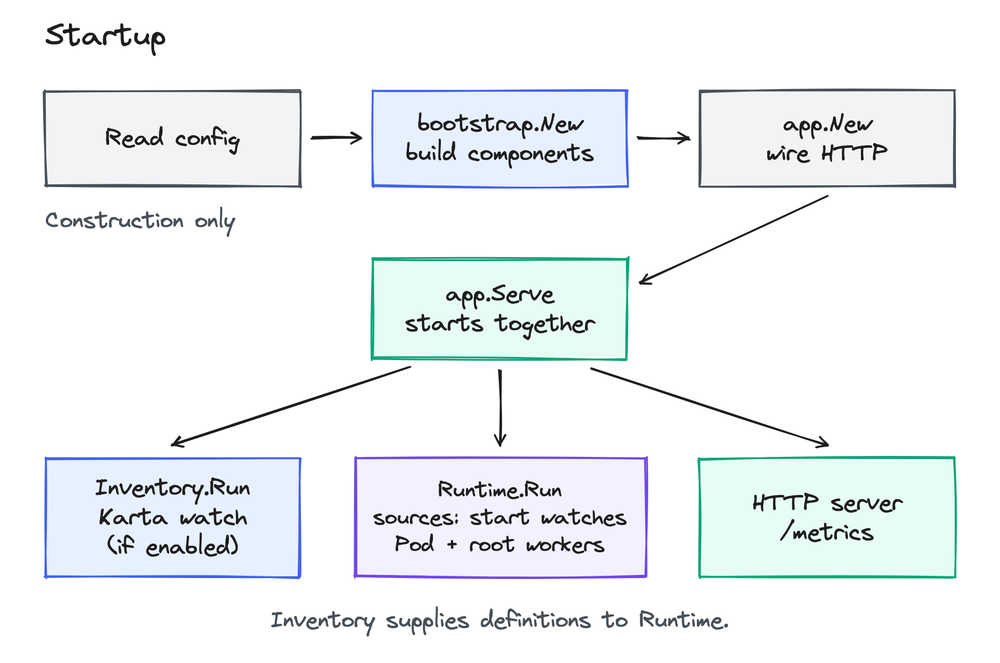
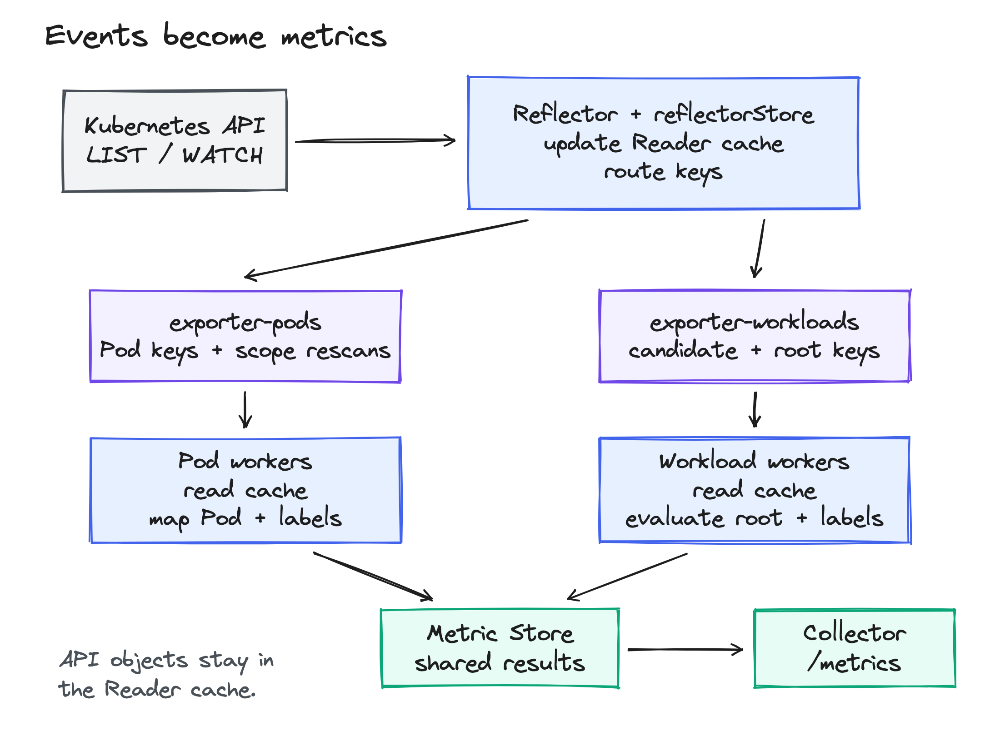
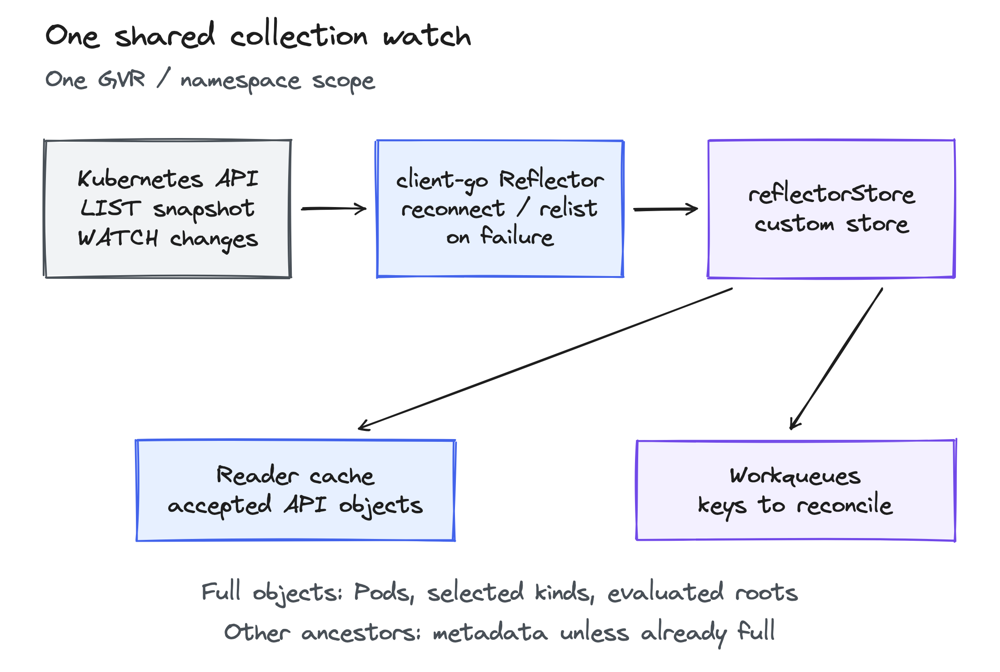
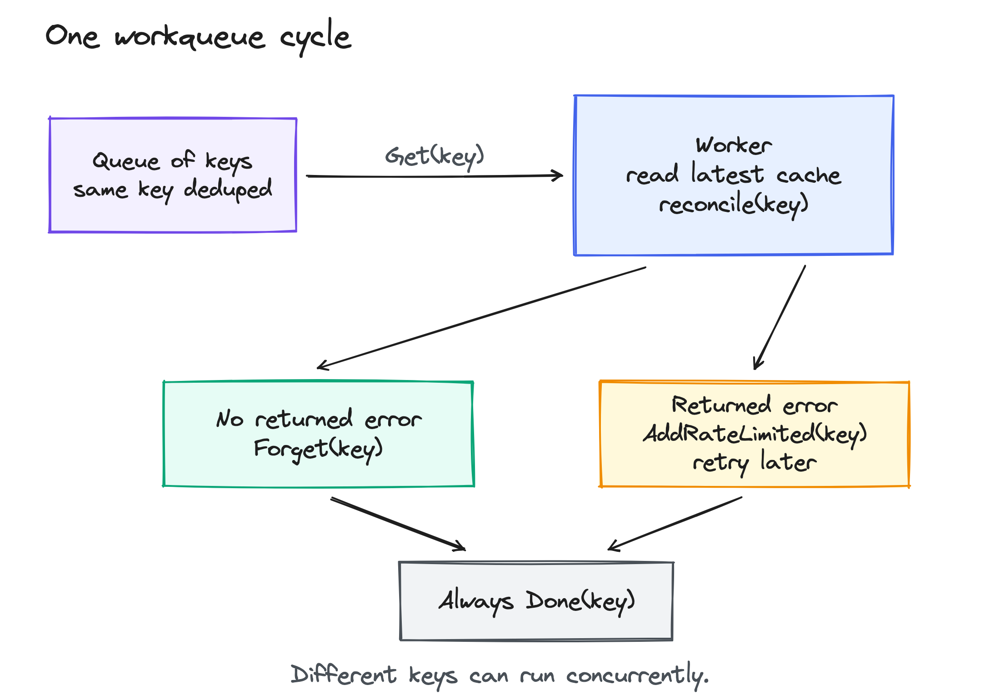

<!-- SPDX-License-Identifier: Apache-2.0 -->
<!-- Copyright (c) 2026 NVIDIA Corporation -->

# Controller

For a Pod owned by a ReplicaSet owned by a Deployment, the exporter answers:

- Which workload does this Pod belong to? The Deployment.
- What is the workload's status? Evaluate the Deployment using its Karta definition.

The Pod is the leaf. The workload returned by Discovery is the root.
The controller keeps Kubernetes objects in a cache, processes changes through
queues, and saves results for `/metrics`.

## 1. Startup: who starts what?

1. [`cmd/main`](../../cmd/main.go) reads configuration.
2. [`bootstrap`](../bootstrap/components.go) constructs clients and components. It does not start watches.
3. [`app.Serve`](../app/application.go) registers the collector and starts three things together:
   - Inventory watches Karta definitions for changes, when cluster definitions are enabled.
   - Runtime starts workers and asks the sources worker to start object watches.
   - HTTP serves `/metrics` and health endpoints.

HTTP can start before the caches are ready. `Runtime.Ready()` checks required
sources and definition health. Shutdown cancels watches and waits for workers.

## 2. Runtime: from an object change to a metric

There are two different stores:

| Store | Contains | Read by |
| --- | --- | --- |
| Reader's object cache | Kubernetes objects and watch health | Discovery and workers |
| Metric Store | Calculated Pod/workload results and errors | Collector |

A scrape reads the Metric Store. It does not call Kubernetes or evaluate Karta expressions.

### The three queues

| Queue | Work item | Worker responsibility |
| --- | --- | --- |
| `exporter-sources` | A request to refresh sources | Read Inventory, select resource kinds and namespaces, start shared watches |
| `exporter-pods` | A Pod identity, or a request to rescan a scope | Discover the Pod's root and publish its mapping and labels |
| `exporter-workloads` | A candidate object, or a known root's UID (Kubernetes object ID) | Discover candidates; evaluate known roots and publish workload results |

The sources queue has one worker. Pod and workload worker counts are configurable;
both default to two. A scope is the namespace being watched, or all namespaces.

Event routing skips leaf work for Pods that do not match the Pod selector.
Those Pods remain in the cache because another Pod may reference them as an owner.
Previously selected or tracked Pods still get queued for cleanup. Rescans use the
same rule. The worker rechecks current labels because they may change while a
key is waiting in the queue.

### Follow one Pod

1. A selected Pod's event updates the object cache and queues the Pod's identity.
2. A Pod worker reads the latest full Pod object.
3. Discovery follows controller owner references through the cache:
   `Pod -> ReplicaSet -> Deployment`.
4. The worker records the Pod's root, queues that root, and reads the full Deployment.
5. The Deployment's Karta definition maps the Pod to a component and instance.
   The label resolver receives both the full Pod and the full Deployment.
6. The worker saves the Pod result. A workload worker separately evaluates
   the full Deployment's status and labels, then saves its workload result.

A non-Pod root without a Karta definition can still provide creation information
and Pod ownership. Karta adds workload status and component mapping. A bare Pod
needs a Pod Karta definition to be included.

### How does a workload appear before it has Pods?

Objects of a kind with a selected Karta definition enter the workload queue as
candidates. A candidate is an object to discover, not necessarily the root.
The worker follows its owners and queues the resulting root's UID. That root can
then publish workload metrics even with no Pods.

## 3. Reflectors: how does the cache stay current?

A client-go Reflector maintains a shared watch for a resource collection and
namespace scope. For example, one watch serves all Deployments in that scope.
There is no separate watch for each Deployment.
A collection's group, version and resource form its GVR, such as `apps/v1/deployments`.

- `LIST` supplies a complete snapshot.
- `WATCH` supplies later additions, updates and deletions.
- The controller's `reflectorStore` writes those objects into the Reader cache
  and queues work. It does not calculate metrics.
- The Reflector reconnects and relists when needed.

### Full objects or metadata?

| Object | What is cached | Why |
| --- | --- | --- |
| Pods | Full object | Pod mapping and label evaluation |
| Selected Karta kinds and roots being evaluated | Full object | Workload status and label evaluation |
| Other ancestors encountered by Discovery | Metadata, unless already watched in full | Follow names, UIDs and owner references |

A full object includes all fields returned by Kubernetes, including metadata,
spec and status where present.
Discovery starts missing ancestor watches on demand. It does not issue an
individual API GET for every owner.

If a metadata-only kind becomes an evaluated root, Runtime starts a full watch.
The metadata cache stays active until the full snapshot is ready. Workers wait
and retry instead of evaluating metadata as if it were a full object.

## 4. Workqueues: what does a worker actually do?

Queues hold identities, not copies of Kubernetes objects. Repeated adds of the
same pending key are merged. One queue does not give the same key to two workers at
once. Different keys can run concurrently, so shared caches still need locks.

`runWorker` takes a key with `Get`, calls its handler, then calls `Done`.
A returned error schedules a retry with backoff. When the handler returns no
error, the worker calls `Forget` to clear retry history. Evaluation failures are
saved as error results and normally wait for changed inputs instead of retrying
on a timer.

## 5. What causes another evaluation?

| Change | What gets queued |
| --- | --- |
| Pod changes | That Pod, if selected, previously selected, or needing cleanup |
| Known root changes | The root and its associated Pods |
| An intermediate owner changes ownership | One scope-rescan item; it requeues cached Pods and candidates |
| Inventory reports a definition change | Refresh sources; requeue affected candidates, roots, their Pods and unresolved Pods |
| A source recovers | A scope rescan and root evaluations |

For example, a ReplicaSet can gain a different Deployment owner while its Pods
stay unchanged. The scope rescan lets those Pods discover their new root.

Removing a definition triggers reevaluation using Inventory's new selection,
including any fallback. If no definition remains, objects of that kind stop
admitting roots as candidates. A non-Pod root can still remain through its Pods, with ownership and
creation information but no Karta-derived status or component mapping.

## 6. What prevents stale or misleading results?

- Before publishing, workers recheck object identity, versions and definition selection.
- Confirmed Pod deletion removes its mapping. Root deletion removes its workload result and requeues affected Pods. UID checks protect replacements with the same name.
- Incomplete or failed lists do not erase accepted objects. Watch failures remain visible as source-health errors.
- Failed evaluations retain any previous successful value with an error. They do not silently turn it into a new successful result.

See [consistency](../../../docs/design/metrics-exporter/consistency.md) for the
detailed result and source-health rules.

## Where to read the code

| File | Responsibility |
| --- | --- |
| [runtime.go](runtime.go) | Start workers, track Pod/root membership, observe definitions and shut down |
| [sources.go](sources.go) | Start Reflectors, accept LIST/WATCH results and route changes to queues |
| [reader.go](reader.go) | Read cached objects and check their identities and source health |
| [leaf.go](leaf.go) | Discover a Pod's root and save its mapping; handle scope rescans |
| [root.go](root.go) | Discover candidate roots and save workload status and labels |

Diagram sources: [startup](images/startup.excalidraw),
[runtime](images/runtime.excalidraw), [reflector](images/reflector.excalidraw),
[workqueue](images/workqueue.excalidraw).
