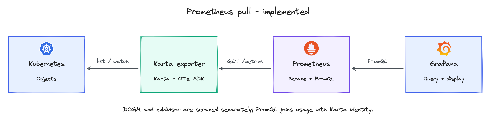
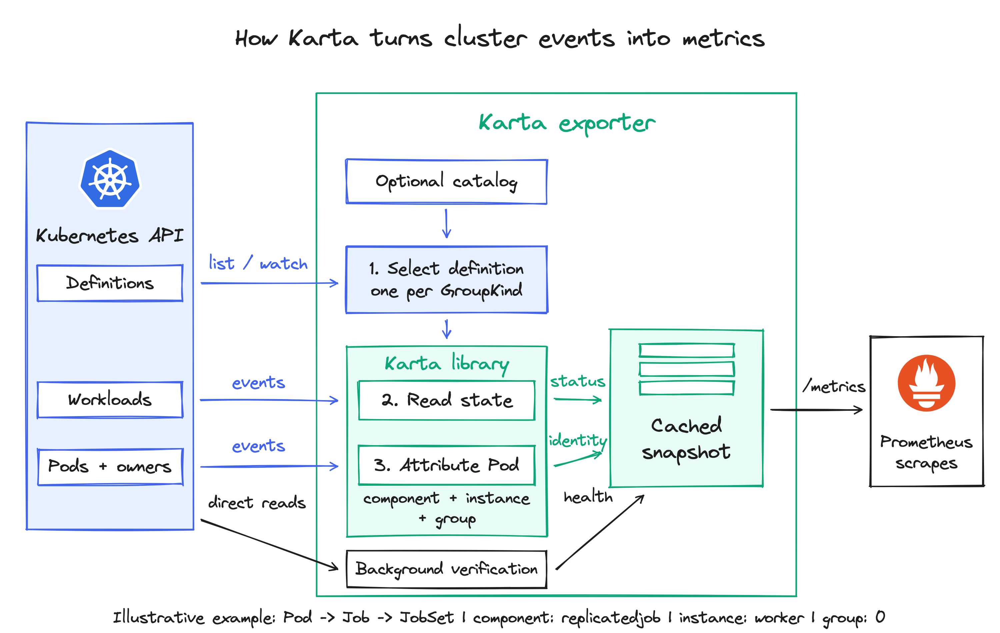

<!-- SPDX-License-Identifier: Apache-2.0 -->

<!-- Copyright (c) 2026 NVIDIA Corporation -->

# KEP-0001: Karta metrics exporter

- Status: provisional; backed by a prototype
- Authors: @AviadHayumi
- Issue: https://github.com/dsx-ai-factory/workload-map/issues/343
- Created: 2026-10-12
- Last updated: 2026-10-18

## Summary

The Karta metrics exporter has two main goals:

1. Show the status of selected root workloads, such as `Running`, `Failed`, `Degraded`, `Completed` or `Suspended`.
2. Show where each Pod belongs: its workload, component, named instance and repeated group. For example, a Pod in JobSet `train` can belong to component `replicatedjob`, instance `worker` and group `0`.


## Motivation

A workload average can hide a busy component or group. Karta makes these
relationships queryable without per-operator PromQL.

Examples:

- Dynamo: find quiet prefill GPUs while decode stays busy; check demand before changing capacity.
- LWS: find a quiet worker group hidden by the workload average.
- Workload state: see Running, Failed or Degraded workloads and their observed history.

<details>
<summary>Tools that can use these signals</summary>

- [KEDA](https://keda.sh/docs/2.18/scalers/prometheus/) can scale a compatible target from a Prometheus query.
- [Kyverno](https://kyverno.io/docs/policy-types/cluster-policy/external-data-sources/) can use a query API response as policy context.
- [Argo Rollouts](https://argoproj.github.io/argo-rollouts/features/analysis/) can evaluate Prometheus results during a rollout.

These integrations have not been validated. Sampled phase history does not provide
exact start times, restart counts or a diagnosis of flakiness.

</details>

## Proposal

### 1. Three metrics

The exporter and its metrics follow Karta releases, starting with the next release.
The metrics are initially experimental. Changes to names, labels or meanings must
be documented in release notes.

Three gauges form the contract. Each Pod mapping and workload status carries
`observation_healthy="true"` or `"false"`. Filter on `"true"` to use verified
observations; a cached value marked `"false"` is not a current verified observation.
The separate health metric reports collection health and explains workload failures.

| Metric                                 | Prometheus type | Value                                           | Why it is needed                                                                 |
| -------------------------------------- | --------------- | ----------------------------------------------- | -------------------------------------------------------------------------------- |
| `karta_pod_workload_info`            | Gauge           | Always `1`                                    | Attach workload, component and group identity to measurements from a Pod.        |
| `karta_workload_status`              | Gauge           | `1` for a matching phase, otherwise `0`     | Distinguish running, completed or failed work, including workloads with no Pods. |
| `karta_exporter_observation_healthy` | Gauge | Resource-type collection: `1` or `0`. Workload failures: `0` only. | Report collection health and failure reasons. Healthy workloads have no separate health row. |

<details>
<summary>Examples: Dynamo, LWS and JobSet</summary>

Illustrative values show the metric format.

```prometheus
karta_pod_workload_info{namespace="team-a",workload="dynamo",workload_group="nvidia.com",workload_version="v1alpha1",workload_kind="DynamoGraphDeployment",workload_uid="cea29a7c-8a8b-4dad-aa48-ef0f7c888a73",owner_resolution="resolved",pod="prefill-0",pod_uid="f6610f41-62d8-4111-92a7-05aa776ff926",component="service",component_instance="prefill",replica_group_id="",observation_healthy="true"} 1
karta_pod_workload_info{namespace="team-a",workload="dynamo",workload_group="nvidia.com",workload_version="v1alpha1",workload_kind="DynamoGraphDeployment",workload_uid="cea29a7c-8a8b-4dad-aa48-ef0f7c888a73",owner_resolution="resolved",pod="frontend-0",pod_uid="e7a66476-ee06-4d18-85b9-1045b34b2ee0",component="service",component_instance="Frontend",replica_group_id="",observation_healthy="true"} 1
karta_pod_workload_info{namespace="team-a",workload="dynamo",workload_group="nvidia.com",workload_version="v1alpha1",workload_kind="DynamoGraphDeployment",workload_uid="cea29a7c-8a8b-4dad-aa48-ef0f7c888a73",owner_resolution="resolved",pod="decode-0",pod_uid="67586fc4-4084-4de6-b980-580d7e174c02",component="service",component_instance="decode",replica_group_id="",observation_healthy="true"} 1
karta_pod_workload_info{namespace="team-a",workload="serve",workload_group="leaderworkerset.x-k8s.io",workload_version="v1",workload_kind="LeaderWorkerSet",workload_uid="e61dfa8c-9c3f-4d84-ac00-131b720b236b",owner_resolution="resolved",pod="serve-0-1",pod_uid="a63cafb3-cf1f-4b52-b490-e6fb15395eee",component="worker",component_instance="",replica_group_id="0",observation_healthy="true"} 1
karta_pod_workload_info{namespace="team-a",workload="serve",workload_group="leaderworkerset.x-k8s.io",workload_version="v1",workload_kind="LeaderWorkerSet",workload_uid="e61dfa8c-9c3f-4d84-ac00-131b720b236b",owner_resolution="resolved",pod="serve-1-1",pod_uid="8e519af8-8c76-4753-ac4f-3099ba12e9a7",component="worker",component_instance="",replica_group_id="1",observation_healthy="true"} 1
karta_pod_workload_info{namespace="team-a",workload="train",workload_group="jobset.x-k8s.io",workload_version="v1alpha2",workload_kind="JobSet",workload_uid="628cbe4e-f726-4279-a174-0d18e9cd0a28",owner_resolution="resolved",pod="train-worker-0",pod_uid="596e77f2-50af-40d9-96d5-28ab7c01b4dd",component="replicatedjob",component_instance="worker",replica_group_id="0",observation_healthy="true"} 1
karta_workload_status{namespace="team-a",workload="dynamo",workload_group="nvidia.com",workload_version="v1alpha1",workload_kind="DynamoGraphDeployment",workload_uid="cea29a7c-8a8b-4dad-aa48-ef0f7c888a73",phase="Running",owner_resolution="resolved",karta="nvidia-com-dynamographdeployment-v1alpha1",karta_source="catalog",observation_healthy="true"} 1
karta_exporter_observation_healthy{scope="resource_type",namespace="team-a",resource_group="nvidia.com",resource_version="v1alpha1",resource_kind="DynamoGraphDeployment",workload="",workload_uid="",reason="none"} 1
```

Other phase and resource-type health rows are omitted. No workload-health row is
emitted for these healthy workloads. Frontend, prefill and decode are instances of the
same `service` component; instance names preserve the keys in the workload definition.
LWS/Grove-backed Dynamo can supply a group key. Dropping LWS `replica_group_id` merges worker groups.

</details>

<details>
<summary>Labels, identity and metric semantics</summary>

| Metric | All exporter-defined labels |
| --- | --- |
| `karta_pod_workload_info` | `namespace`, `workload`, `workload_group`, `workload_version`, `workload_kind`, `workload_uid`, `owner_resolution`, `pod`, `pod_uid`, `component`, `component_instance`, `replica_group_id`, `observation_healthy`, optional `submitted_by` |
| `karta_workload_status` | `namespace`, `workload`, `workload_group`, `workload_version`, `workload_kind`, `workload_uid`, `phase`, `owner_resolution`, `karta`, `karta_source`, `observation_healthy`, optional `submitted_by` |
| `karta_exporter_observation_healthy` | `scope`, `namespace`, `resource_group`, `resource_version`, `resource_kind`, `workload`, `workload_uid`, `reason` |

The reference below uses Pod info, Status and Health for these three metrics.
For `submitted_by`, see [Who submitted the workload](#who-submitted-the-workload).

| Label | Metrics | Meaning | Example |
| --- | --- | --- | --- |
| `namespace` | Pod info, Status, Health | Namespace associated with the observation. | `team-a` |
| `workload` | Pod info, Status, Health | Selected root workload object name. Pod info and Status name the same root. Empty for resource-type health. | `train` |
| `workload_group` | Pod info, Status | API group of the observed workload; empty for the core API. | `jobset.x-k8s.io` |
| `workload_version` | Pod info, Status | API version of the attributed root: the selected definition's GVK, or the verified owner GVK when no definition exists. Not `metadata.resourceVersion`. | `v1alpha2` |
| `workload_kind` | Pod info, Status | Kind in the observed workload GVK. | `JobSet` |
| `workload_uid` | Pod info, Status, Health | Kubernetes UID identifying this workload's lifetime. Empty for resource-type health. | `628cbe4e-f726-4279-a174-0d18e9cd0a28` |
| `pod` | Pod info | Attributed Pod's name. | `train-worker-0` |
| `pod_uid` | Pod info | Kubernetes UID identifying this Pod's lifetime. | `596e77f2-50af-40d9-96d5-28ab7c01b4dd` |
| `component` | Pod info | Component name from the selected definition; `<unknown>` if unresolved. | `replicatedjob` |
| `component_instance` | Pod info | Named entry within the component; empty when there are no named instances, or `<unknown>` if unresolved. | `worker` |
| `replica_group_id` | Pod info | Definition-selected key for a repeated group of Pods within the workload/component/instance. Empty when no group applies. It is neither a Pod index nor a replica count. | `0` |
| `phase` | Status | Evaluated workload phase; its series value is `1` when matched and `0` otherwise. | `Running` |
| `owner_resolution` | Pod info, Status | `resolved` after verifying the chain; `ignored_owner` at an intentional boundary; `unknown` when owner resolution fails, including denied reads. Failure reasons are reported by Health. | `unknown` after a denied owner read. |
| `observation_healthy` | Pod info, Status | `"true"` while the verification required for this observation is valid; `"false"` for a retained cached observation after failure or expiry. | `true` |
| `karta` | Status | Name of the selected Karta definition. | `jobset-x-k8s-io-jobset-v1alpha2` |
| `karta_source` | Status | Origin of that definition: `catalog` for a built-in definition or `cluster` for a Karta custom resource. | `catalog` |
| `scope` | Health | `resource_type` reports collection health per namespace + GVK, including before object names are known. `workload` reports failures affecting a known workload; no healthy workload row is emitted. | `workload` |
| `resource_group` | Health | API group being verified. For workload scope, identifies the affected root workload, even when a dependency failed. Empty for the core API. | `jobset.x-k8s.io` |
| `resource_version` | Health | API version being verified, not Kubernetes `metadata.resourceVersion`, using the same scope as `resource_group`. | `v1alpha2` |
| `resource_kind` | Health | API kind being verified, using the same scope as `resource_group`. | `JobSet` |
| `reason` | Health | Bounded failure category. `none` is used only for healthy resource-type collection. Workload rows always carry a failure reason. Detailed errors belong in logs. | `none`, `permission_denied` |

Keep UIDs in history because names can be reused. Observe each workload through one
API version and, when available, one selected definition; do not emit duplicate mappings
for its other served versions. A version change replaces current labeled rows while the object's UID stays the
same. Previously collected history retains its original labels.

| Example                           | `component`     | `component_instance` | `replica_group_id` |
| --------------------------------- | ----------------- | ---------------------- | -------------------- |
| Dynamo prefill, Deployment-backed | `service`       | `prefill`            | empty                |
| JobSet, first worker Job          | `replicatedjob` | `worker`             | `0`                |
| JobSet, second worker Job         | `replicatedjob` | `worker`             | `1`                |
| LWS, leader in group 0            | `leader`        | empty                  | `0`                |
| LWS, worker in group 0            | `worker`        | empty                  | `0`                |
| LWS, worker in group 1            | `worker`        | empty                  | `1`                |

- For a resolved workload, empty (`""`) means the definition has no named instance or repeated group. Different Pods do not automatically form different groups.
- `<unknown>` means the component or instance could not be resolved. If the component is unknown, both component labels are `<unknown>`.
- A missing expected group key is an attribution failure, not an empty group.

Owner-resolution behavior is defined below. See [Faults and what they affect](#3-faults-and-what-they-affect) for failure diagnostics.

Each snapshot has at most one attribution per Pod, to the highest Karta-described
owner reached. If the chain has no Karta definition, use its highest verified owner
for workload identity and extract `submitted_by` when enabled. Emit no status; set
component and instance to `<unknown>` and leave the group empty. Missing a definition
is not an owner-resolution failure. Explicit selection exclusions still apply.
Status requires a selected Karta definition and can include roots with no Pods.

Without a definition, watch and verify owner metadata using the configured RBAC.
The same selection and failure rules apply; fallback never bypasses exclusions.

If an owner walk fails, retain only a previously verified mapping or status for the
same object lifetime, with `owner_resolution="unknown"` and
`observation_healthy="false"`. Keep its cached workload, UID and component labels
unchanged. Do not publish a newly guessed root. Report `unresolved_owner` for a missing or mismatched owner, or
`permission_denied` / `api_unavailable` for read failures. Logs identify the failed
hop. Replace mappings after successful resolution. Confirmed deletion or scope exit
removes rows; a replacement UID never inherits the previous object's cached row.
Bare Pods are attributed when a selected Pod definition is enabled.

Status phases are `Initializing`, `Running`, `Completed`, `Failed`, `Degraded`,
`Suspended`, `Suspending`, `Resuming` and `Undefined`. After successful evaluation,
emit each phase as `0` or `1` with `observation_healthy="true"`. Several phases can
be `1` at once. `Undefined=1` means no phase matched; it is not an evaluation failure.
A definition without status produces no status rows.

Failed status evaluation retains any previously verified phase values with
`observation_healthy="false"`; without previous values, emit diagnostics only.
Pod mapping validity is evaluated separately: a status-only failure does not
invalidate an independently verified mapping. Workload state is not Pod state or
component health.

<details>
<summary>Example: a root selected below an ignored owner</summary>

For `Pod -> Job -> JobSet`, select JobSet with `owner_resolution="resolved"`.
The child Job has no separate status row, even if it has its own Karta definition.
If JobSet has an owner whose GVK is in `ignoredOwnerKinds`, stop before that owner
and select JobSet with `owner_resolution="ignored_owner"` instead.

A root without status does not fall back to child status. Changes to the selected
root, definition or selection reason replace current labeled rows.

Illustrative status below an ignored wrapper, with other phases omitted:

```prometheus
karta_workload_status{namespace="team-a",workload="train",workload_group="jobset.x-k8s.io",workload_version="v1alpha2",workload_kind="JobSet",workload_uid="628cbe4e-f726-4279-a174-0d18e9cd0a28",phase="Running",owner_resolution="ignored_owner",karta="jobset-x-k8s-io-jobset-v1alpha2",karta_source="catalog",observation_healthy="true"} 1
```

</details>

This follows [kube-state-metrics](https://github.com/kubernetes/kube-state-metrics/blob/main/docs/design/metrics-best-practices.md):
separate identity from changing state. A failed application can have `Failed=1`
and `observation_healthy="true"`: Karta read its failure correctly.

</details>

### 2. Queries and idleness

These queries answer three questions:

- Which workload and component does each Pod belong to?
- How much CPU or memory does each component instance and group use?
- Which groups had only low observed GPU activity over the last five minutes?

Low activity alone does not prove idleness. Before acting, require complete, fresh
telemetry and no waiting work. Expand a query below for its steps; expand again for PromQL.

For current verified observations, filter the main metric directly:

```promql
karta_workload_status{phase="Running",observation_healthy="true"} == 1
```

```promql
karta_pod_workload_info{observation_healthy="true"}
```

No health join is needed for these queries. Use the health metric when the failure
reason is needed. Scrape freshness is a separate requirement; a retained historical
sample is not proof of the exporter's current state.

<details>
<summary>The measurements supplied by DCGM and cAdvisor</summary>

```prometheus
DCGM_FI_DEV_GPU_UTIL{namespace="team-a",pod="prefill-0",UUID="GPU-a",gpu="0"} 90
DCGM_FI_DEV_GPU_UTIL{namespace="team-a",pod="decode-0",UUID="GPU-b",gpu="0"} 1
DCGM_FI_DEV_FB_USED{namespace="team-a",pod="decode-0",UUID="GPU-b",gpu="0"} 4096
container_cpu_usage_seconds_total{namespace="team-a",pod="decode-0",container="worker"} 1234
container_memory_working_set_bytes{namespace="team-a",pod="decode-0",container="worker"} 536870912
```

GPU utilization is percent; framebuffer usage is MiB (multiply by `1048576` for bytes).
CPU is cumulative seconds: `rate()` gives cores. cAdvisor working set is bytes.
Occupied memory is not activity. A CPU-only frontend legitimately has no GPU series.

</details>

<details>
<summary>Inputs and rule ownership</summary>

The queries match usage to Karta by Pod identity. On both inputs, `namespace`
and `pod` must identify the workload Pod, not the exporter Pod. If scraping renames
them to `exported_namespace` and `exported_pod`, normalize those labels before joining.
The examples use one cluster; duplicate handling and multi-cluster setup are shown below.

Karta provides query examples only; it does not ship recording or alerting rules.
Users decide how to query and combine Karta, DCGM and cAdvisor metrics.
For extra metadata, relabel existing sample labels or add static labels through the
ServiceMonitor. Join workload or Pod labels and annotations from
[kube-state-metrics](https://github.com/kubernetes/kube-state-metrics/blob/main/docs/developer/cli-arguments.md),
with the relevant allowlists enabled for supported resources. Relabeling does not
fetch arbitrary workload metadata; general label export is outside this proposal.

</details>

<details>
<summary>What to do if you have multiple clusters?</summary>

When one backend combines several clusters, add a `cluster` label to Karta, DCGM and
cAdvisor metrics through the monitoring configuration. With Prometheus Operator,
configure each source's ServiceMonitor endpoint:

```yaml
relabelings:
  - action: replace
    targetLabel: cluster
    replacement: cluster-a
```

Use the same value for all sources in one cluster and a different value for each
other cluster. An OTel Collector can supply the same label through enrichment.
Preserve `cluster` in deduplication, joins and aggregations so matching workload
or Pod names from different clusters remain separate.

</details>

<details>
<summary>1. Remove duplicates when two exporters report the same Pod</summary>

- Merge identical mappings; reject differences in identity, submitter or observation health.
- Check conflicts before filtering for healthy mappings, so a healthy replica cannot hide a failing replica.
- Record the result for reuse, or inline its expression in the following queries.

<details>
<summary>Show an optional recording rule managed by the platform</summary>

```yaml
groups:
  - name: karta-attribution
    interval: 30s
    rules:
      - record: karta:pod_attribution:unique
        expr: |
          max by (namespace, pod, pod_uid, workload, workload_group, workload_version, workload_kind,
                  workload_uid, owner_resolution, component, component_instance, replica_group_id,
                  observation_healthy, submitted_by) (
            karta_pod_workload_info
          )
          and on (namespace, pod)
          (count by (namespace, pod) (
            group by (namespace, pod, pod_uid, workload, workload_group, workload_version, workload_kind,
                      workload_uid, owner_resolution, component, component_instance, replica_group_id,
                  observation_healthy, submitted_by) (
              karta_pod_workload_info
            )
          ) == 1)
```

</details>

</details>

<details>
<summary>2. CPU and memory by component instance and group</summary>

- Convert CPU seconds into average cores over five minutes with `rate()`.
- Exclude empty container names and `POD` sandbox rows.
- Attach verified Karta mappings to each Pod's usage. Multiplying by `1` preserves usage.
- Sum by workload, component, named instance and repeated group.

<details>
<summary>Show the CPU query</summary>

```promql
sum by (namespace, workload_group, workload_version, workload_kind, workload, workload_uid,
        owner_resolution, component, component_instance, replica_group_id, submitted_by) (
  rate(container_cpu_usage_seconds_total{
    namespace!="", pod!="", container!="", container!="POD"
  }[5m])
  * on (namespace, pod)
    group_left (workload_group, workload_version, workload_kind, workload, workload_uid,
                owner_resolution, component, component_instance, replica_group_id, submitted_by)
    karta:pod_attribution:unique{observation_healthy="true", component!="<unknown>", component_instance!="<unknown>"}
)
```

</details>

For memory, replace `rate(...)` with
`container_memory_working_set_bytes{namespace!="",pod!="",container!="",container!="POD"}`.
The same join and sum return bytes.

For average GPU percent, use valid `DCGM_FI_DEV_GPU_UTIL` samples and `avg` instead
of `sum`. Averages can hide a busy device.

For a GPU join across Pod-name reuse, enable DCGM's
`DCGM_EXPORTER_KUBERNETES_ENABLE_POD_UID=true` (default false) and verify its
`pod_uid` output. Kubernetes mapping and Pod-read RBAC must also be enabled;
see [DCGM Exporter configuration](https://docs.nvidia.com/datacenter/dcgm/latest/reference/command-line-reference/dcgm-exporter.html).
After label normalization, the following query keeps device
labels and attaches workload attribution from the same optional rule above:

```promql
DCGM_FI_DEV_GPU_UTIL{namespace!="",pod_uid!=""}
* on (namespace, pod_uid)
  group_left (workload_group, workload_version, workload_kind, workload, workload_uid,
              owner_resolution, component, component_instance, replica_group_id, submitted_by)
  karta:pod_attribution:unique{observation_healthy="true",component!="<unknown>",component_instance!="<unknown>"}
```

UID identity avoids joining a replacement Pod to its predecessor. It does not prove
telemetry coverage. Name-based cAdvisor joins retain their name-reuse limitation.
For multiple clusters, add `cluster` to the join, deduplication and grouping keys.
The rule preserves `submitted_by` when enabled and rejects differing mapping/identity
rows for the same Pod; absent optional labels work with attribution disabled.

</details>

<details>
<summary>3. Find low GPU activity over five minutes</summary>

- Find each observed device's maximum utilization over five minutes.
- Attach verified Karta mappings; keep the highest device value per group.
- Keep groups below `5%` whose workload has verified Running status now.
- Reject any current unhealthy status replica and any workload failure observed in the window.

Reservation Pods may hold GPUs at low activity by design. Exclude them from tenant
idleness decisions using the selection settings below.

<details>
<summary>Show the low-GPU-activity query</summary>

```promql
(
  max by (namespace, workload_group, workload_version, workload_kind, workload, workload_uid,
          owner_resolution, component, component_instance, replica_group_id, submitted_by) (
    max_over_time(DCGM_FI_DEV_GPU_UTIL{namespace!="",pod!=""}[5m])
    * on (namespace, pod)
      group_left (workload_group, workload_version, workload_kind, workload, workload_uid,
                  owner_resolution, component, component_instance, replica_group_id, submitted_by)
      karta:pod_attribution:unique{observation_healthy="true",component!="<unknown>",component_instance!="<unknown>"}
  ) < 5
)
and on (namespace, workload_uid)
  (min by (namespace, workload_uid) (
    karta_workload_status{phase="Running",observation_healthy="true"}
  ) == 1)
unless on (namespace, workload_uid)
  karta_workload_status{observation_healthy="false"}
unless on (namespace, workload_uid)
  (min_over_time(karta_exporter_observation_healthy{scope="workload"}[5m]) == 0)
```

</details>

Results keep the observed maximum. `5%` and `5m` are examples. Failure diagnostics
are sparse: their absence does not prove complete health history. This query also
cannot detect missing devices or rule out reused Pod names. Treat results as low
observed activity; require the coverage checks below before acting.

</details>

<details>
<summary>Check before stopping or scaling down a workload</summary>

Low GPU usage is a clue, not proof that a workload has no work left.
For example, a workload has two GPUs: one is busy and one is quiet. If the busy
GPU stops reporting metrics, the chart can incorrectly make the whole workload look idle.

Before acting, check:

1. Every expected Pod and GPU is reporting. Missing measurements do not mean zero usage.
2. Measurements and Karta samples are recent and cover the full five minutes. Require verified mappings and status throughout the window; absence of workload failure rows alone does not establish coverage.
3. The same Pods and groups were present for the full window. After a Pod replacement, group change or health recovery, start a new five-minute window.
4. Each device is counted once. For shared or partitioned GPUs, confirm whose usage each measurement represents.
5. The application has no queued requests or jobs waiting to run. GPU metrics alone cannot tell you that.

A100 tests covered full GPUs, static MIG and DRA allocation/attribution.
MIG used `DCGM_FI_PROF_GR_ENGINE_ACTIVE` (0..1); DRA may need a claim-to-Pod mapping.
The query above does not establish idleness for every GPU-sharing mode.

</details>

### 3. Faults and what they affect

`observation_healthy` on Pod info and Status says whether that observation is
currently verified. `karta_exporter_observation_healthy` explains failures and
reports API collection health:

| Scope | Emission | Meaning |
| --- | --- | --- |
| `resource_type` | Always `1` or `0` per selected namespace + GVK. | Required collection is freshly verified, or has failed/expired. It does not certify every workload's evaluation. |
| `workload` | `0` only while a known workload has a verification failure. | A failure diagnostic for that workload. Remove it after verified recovery; do not emit a healthy workload row. |

Missing diagnostics do not prove health. Use the main metric's explicit flag and
a fresh scrape. Prometheus supplies `up` for scrape success; `up=1` does not mean
Karta's Kubernetes reads or evaluations succeeded.

<details>
<summary>Examples: collection health, cached status and recovery</summary>

Dynamo API collection is healthy in `team-a`. Workload fields are empty:

```prometheus
karta_exporter_observation_healthy{scope="resource_type",namespace="team-a",resource_group="nvidia.com",resource_version="v1alpha1",resource_kind="DynamoGraphDeployment",workload="",workload_uid="",reason="none"} 1
```

For JobSet `train`, a required read fails after Running was verified. Selected
labels are shown; other identity labels and phase rows are omitted:

```prometheus
karta_workload_status{namespace="team-a",workload="train",workload_uid="628cbe4e-f726-4279-a174-0d18e9cd0a28",phase="Running",observation_healthy="false"} 1
karta_exporter_observation_healthy{scope="workload",namespace="team-a",resource_group="jobset.x-k8s.io",resource_version="v1alpha2",resource_kind="JobSet",workload="train",workload_uid="628cbe4e-f726-4279-a174-0d18e9cd0a28",reason="permission_denied"} 0
```

The status value is cached; the false flag makes that visible. After access is
restored and fresh verification still finds Running:

```prometheus
karta_workload_status{namespace="team-a",workload="train",workload_uid="628cbe4e-f726-4279-a174-0d18e9cd0a28",phase="Running",observation_healthy="true"} 1
```

The false-labeled status and workload failure diagnostic stop being emitted.
Recovery does not create a `scope="workload",reason="none"` row.

</details>

| Event | Main metrics | Diagnostic |
| --- | --- | --- |
| A Job exits with an error and has no retries left. Karta verifies its Failed status. | `phase="Failed"` has value `1` because the Job failed; `observation_healthy="true"` because Karta read that status correctly. | No observation failure. |
| Status evaluation fails | Retain verified phase values with `"false"`; a separately verified Pod mapping can stay `"true"`. | `evaluation_failed` or `invalid_definition`. |
| Required ownership or attribution verification fails | Retain affected verified mappings/status with `"false"`. | `unresolved_owner`, `permission_denied`, `api_unavailable` or evaluation failure. |
| No mapping or status was ever verified | No invented observation. | Report the failure at the known scope. |
| API collection fails or verification expires | Mark dependent cached observations `"false"`. | Resource-type `0`; failure rows for known affected workloads. Expiry uses `api_unavailable`. |
| Fresh verification succeeds | Replace each affected cached observation with its newly verified value and `"true"`. | Restore resource-type `1` where verified; remove resolved workload failures. |
| Confirmed deletion or scope exit | Remove current rows for that object lifetime. | Remove its workload diagnostics; historical samples remain. |

Collection faults affect dependent observations. A status-only failure does not
invalidate an independently verified Pod mapping. An unknown owner root
conservatively invalidates known workloads in that namespace. Unrelated
observations remain usable.

Keep reasons bounded: `permission_denied`, `api_unavailable`, `invalid_definition`,
`evaluation_failed` and `unresolved_owner`. Detailed errors belong in logs.
Only resource-type success uses `reason="none"`. Static metric HELP text must
explain the flag and diagnostics; it cannot communicate changing health itself.

## Who submitted the workload

Add `submitted_by` from the Kubernetes caller or from workload and Pod metadata.

<details>
<summary>Show configuration, examples and metric output</summary>

The label appears on Pod info and workload status. Karta's core API stays unchanged.

### Direct Kubernetes submissions

Enable admission capture and configure the exporter to read the captured annotation:

```yaml
operator:
  enabled: true
webhook:
  enabled: true
exporter:
  enabled: true
  useCatalog: true
  attribution:
    admission:
      enabled: true
    submittedByExpression: |
      ("workload.dgxc.nvidia.com/submitter-id" in annotations)
        ? annotations["workload.dgxc.nvidia.com/submitter-id"]
        : ""
```

The default capture types are Deployments, Jobs and Pods. An administrator enables
capture for an existing namespace:

```sh
kubectl label namespace team-a karta.run.ai/capture-submitter=true
```

With the operator's TLS webhook ready, create a new Job using the submitter's
normal kubeconfig:

```sh
kubectl auth whoami
kubectl apply -n team-a -f - <<'EOF'
apiVersion: batch/v1
kind: Job
metadata:
  name: submitter-demo
spec:
  template:
    spec:
      restartPolicy: Never
      containers:
        - name: worker
          image: busybox:1.37.0
          command: ["sh", "-c", "sleep 300"]
EOF
kubectl get job submitter-demo -n team-a -o go-template='{{ index .metadata.annotations "workload.dgxc.nvidia.com/submitter-id" }}{{ "\n" }}'
```

On CREATE, admission records `request.userInfo.username`. For a caller authenticated
as `alice`, the Job contains:

```yaml
metadata:
  annotations:
    workload.dgxc.nvidia.com/submitter-id: alice
```

Admission rejects a different prefilled identity and later changes to captured
identity annotations. Applying an update does not replace the original submitter.
For example, this update is rejected while the Job remains in the protected scope:

```sh
kubectl annotate job submitter-demo -n team-a \
  workload.dgxc.nvidia.com/submitter-id=bob --overwrite
```

Controller-created children do not replace the workload's identity with the
controller's service account. The exporter carries the resolved workload identity
to its Pod metrics; it does not need to copy the annotation onto each Pod.

### CEL from workload and Pod metadata

Supply `submittedByExpression` when identity is already present in annotations or
labels. The same expression runs on each workload and each Pod's own metadata.
This example prefers the captured caller, then a custom annotation, then a label:

```yaml
exporter:
  attribution:
    submittedByExpression: |
      (
        ["workload.dgxc.nvidia.com/submitter-id", "identity.example.com/submitted-by"]
          .filter(key, key in annotations && annotations[key] != "")
          .map(key, annotations[key])
        + ["identity.example.com/submitted-by"]
          .filter(key, key in labels && labels[key] != "")
          .map(key, labels[key])
        + [""]
      )[0]
```

For example, a workload can carry this annotation:

```yaml
metadata:
  annotations:
    identity.example.com/submitted-by: alice
```

Or its Pods can carry this label, supplied through the Pod template:

```yaml
metadata:
  labels:
    identity.example.com/submitted-by: alice
```

Set `admission.enabled: false` for extraction only. A nonempty expression enables
the label. CEL reads cached `annotations`, `labels` and `resource` metadata
(`namespace`, `name`, `group`, `version`, `kind`); it makes no platform API calls.
Invalid expressions reject startup. Configuration changes restart the exporter.

### Result and limits

The exporter combines identity from a workload and its attributed Pods. A
consistent value appears on both metrics. Relevant labels are shown below; other
identity labels are omitted:

```prometheus
karta_workload_status{namespace="team-a",workload="submitter-demo",phase="Running",submitted_by="alice",observation_healthy="true"} 1
karta_pod_workload_info{namespace="team-a",workload="submitter-demo",pod="submitter-demo-abcde",submitted_by="alice",observation_healthy="true"} 1
```

With attribution disabled, `submitted_by` is absent. On emitted rows with attribution
enabled, missing metadata, conflicting values, evaluation failure or unhealthy
observation produce `submitted_by=""`. A retained observation marked
`observation_healthy="false"` must not retain a trusted submitter value.
A caller can be a service account. CEL does not prove
that arbitrary metadata belongs to a human, or recover a user identity that was
never propagated.

<details>
<summary>Choose where admission captures the caller</summary>

Add this under the same `exporter.attribution.admission` block. Keep the expression
above. Namespace labels and admission settings are administrator-controlled.

```yaml
exporter:
  attribution:
    admission:
      enabled: true
      namespaceSelector:
        matchLabels:
          karta.run.ai/capture-submitter: "true"
        matchExpressions:
          - key: kubernetes.io/metadata.name
            operator: NotIn
            values: [kube-system, karta-system]
      resourceRules:
        - apiGroups: ["apps"]
          apiVersions: ["v1"]
          resources: ["deployments", "statefulsets"]
        - apiGroups: ["batch"]
          apiVersions: ["v1"]
          resources: ["jobs", "cronjobs"]
        - apiGroups: [""]
          apiVersions: ["v1"]
          resources: ["pods"]
      matchConditions:
        - name: exclude-cronjob-capture
          expression: '!(request.kind.group == "batch" && request.kind.kind == "CronJob")'
```

Namespace requirements are ANDed. Resource rules use API group, version and plural
resource names. `matchConditions` use native admission CEL, require Kubernetes
1.30+, and all must pass. These settings select capture requests; exporter watches
are configured separately under [Selection](#selection).

Capture conditions must not allow removal or replacement of an already captured
identity on UPDATE. Protection uses the old captured annotations within the
configured namespace/resource scope, even if capture labels change. The PoC
currently mirrors conditions onto both webhooks; separating capture conditions
from this continuing protection remains implementation work.

</details>

<details>
<summary>Compatibility with existing PoC settings</summary>

`operator.webhookOnly` can run the operator just for admission. The top-level
`submitterAdmission` alias remains supported; configuring it together with the
nested admission block is rejected.

Existing `attribution.rules` remain available with `attribution.enabled: true`;
configure them or `submittedByExpression`, not both. Their `matchExpression`,
`identitySourceExpression`, `submitterTypeExpression` and `partial` settings
control extraction and identity comparison, without adding metric labels.
`attribution.resourceKinds` adds metadata watches and requires explicit read RBAC.
The examples above need only the single expression.

</details>

</details>

## Exporter configuration

Deploy the exporter separately from the Karta controller. Configure it through Helm
values; the chart generates the command-line arguments.

<details>
<summary>Helm values</summary>

```yaml
exporter:
  enabled: true # Deploy the exporter; default false.
  replicaCount: 1 # Number of exporter Pods.
  image:
    tag: "<exporter-tag>" # Exporter image version.
  metricsExporter: prometheus # Expose metrics for Prometheus scraping.
  ports:
    metrics: 8080 # Metrics/probe listener, container and Service port.
  useCatalog: true # Enable built-in definitions; default false.
  useClusterKartas: true # Read cluster-installed Karta definitions; default true.
  catalogSelection: {include: [], exclude: [core-pod-v1]} # Bare-Pod catalog opt-in.
  clusterKartaSelection: {include: [], exclude: [], labelSelector: {}}
  namespaceSelector: # Default null or {}: all namespaces.
    matchExpressions:
      - key: example.com/tenant
        operator: Exists
      - key: kubernetes.io/metadata.name
        operator: NotIn
        values: [kube-system, karta-system]
  objectSelector: # Default null or {}: all resolved workload roots.
    matchExpressions:
      - key: example.com/purpose
        operator: NotIn
        values: [reservation]
  podSelector: # Default null or {}: all Pod attribution rows.
    matchExpressions:
      - key: example.com/purpose
        operator: NotIn
        values: [reservation]
  resourceRules: [] # Empty: no root API-type restriction.
  excludeResourceRules: [] # Exclusions take precedence.
  ignoredOwnerKinds: # Stop the owner walk before these exact GVKs; default [].
    - example.com/v1/PlatformWrapper
  requiredKinds: [] # Optional expected APIs; failed checks mark dependent observations unhealthy.
    # Example: ["jobset.x-k8s.io/v1alpha2/JobSet"]
  metrics:
    workloadPhases: ["all"] # Emit every workload phase as a 0/1 series.
  serviceMonitor:
    enabled: true # Create the optional ServiceMonitor; default false.
    interval: 30s # How often Prometheus scrapes metrics.
    scrapeTimeout: 25s # Maximum duration of one scrape.
```

Use Helm `--namespace karta-system` to install the operator and exporter.
`namespaceSelector` selects the workload namespaces the exporter observes.
The ServiceMonitor requires its CRD and a matching Prometheus selector.

</details>

### Selection

Namespace, workload and Pod labels use the same Kubernetes `LabelSelector` shape:
`matchLabels` and `matchExpressions`. API-type filters are separate because group,
version and kind are not labels.

| Setting | Selects |
| --- | --- |
| `namespaceSelector` | Namespaces by their labels. Use `kubernetes.io/metadata.name` for namespace names. |
| `objectSelector` | Resolved workload roots by their labels, including bare Pods when a Pod definition is selected. |
| `podSelector` | Pods whose attribution rows are exported, using each Pod's own labels. |
| `resourceRules` | Workload root API types, using `apiGroups`, `apiVersions` and plural `resources`. |
| `excludeResourceRules` | Root API types to exclude, using the same rule shape. Exclusions win. |
| `clusterKartaSelection.labelSelector` | Cluster Karta definitions by their labels, using the same `LabelSelector` shape. |
| `catalogSelection` / `clusterKartaSelection` name lists | Definition names to include or exclude. Catalog definitions have no label schema. |

Label requirements are ANDed. `In`, `NotIn`, `Exists` and `DoesNotExist` are
supported; `NotIn` also matches objects without that label. Optional selectors
default to no restriction when omitted, null or `{}`. A nonempty selector with no
matches selects nothing. Namespaces, definitions, roots and Pods each supply their own
labels; labels are not inherited. See Kubernetes
[label selectors](https://kubernetes.io/docs/concepts/overview/working-with-objects/labels/#label-selectors).

Karta watches workloads and Pods separately: `objectSelector` selects whole
workloads; `podSelector` selects their exported Pod attribution rows. Both must
match for a Pod row to appear. All Pods remain watched in selected namespaces for
ownership and submitter checks; workload status still describes the full workload.

The example excludes reservation-marked roots and individual reservation-marked Pods.
The marker is illustrative. Pod filtering reduces output, not watch traffic; usage
joined through the remaining rows covers only those Pods, not the full workload.
Keep Pod definitions enabled when standalone notebooks must remain visible.

<details>
<summary>Optionally restrict workload API types</summary>

```yaml
exporter:
  resourceRules:
    - apiGroups: ["batch"]
      apiVersions: ["v1"]
      resources: ["jobs", "cronjobs"]
    - apiGroups: ["jobset.x-k8s.io"]
      apiVersions: ["*"]
      resources: ["jobsets"]
  excludeResourceRules:
    - apiGroups: ["batch"]
      apiVersions: ["v1"]
      resources: ["cronjobs"]
```

A root must match `objectSelector`, at least one inclusion rule when configured,
and no exclusion rule. Within a rule, group, version and resource must all match;
list entries are alternatives. `"*"` matches any value, and `""` denotes the core
API group. For example, core Pods use `apiGroups: [""]`, `apiVersions: ["v1"]` and
`resources: ["pods"]`. Discovery maps the root GVK to its plural API resource.
Root identity follows the rules in [Three metrics](#1-three-metrics).
Rules do not create duplicate observations for other served versions.

These are the resource-matching fields used by Kubernetes
[MatchResources](https://kubernetes.io/docs/reference/kubernetes-api/definitions/match-resources-v1-admissionregistration/),
adapted to observation: no admission operations or subresources. Rule lists may be
empty, but each supplied rule requires nonempty group, version and resource lists.
Invalid selectors, malformed rules and unknown catalog names reject configuration.

</details>

Filter enabled definition sources before resolving precedence. A selected cluster
Karta overrides a selected catalog definition for the same group/kind. Disabled
sources contribute none. Definition-name includes default to all; exclusions win.
Cluster Karta names and their label selector must both match. By default,
`catalogSelection.exclude` contains `core-pod-v1`; clear it to opt into bare-Pod
catalog attribution. A selected cluster Pod Karta can also enable bare-Pod workloads.

<details>
<summary>How selection affects Kubernetes watches</summary>

Watch Namespace metadata to maintain the selected namespace set. Start namespaced
Pod, workload and dependency watches only inside that set. Namespace label changes
start or stop those watches; leaving scope removes current observations. Do not
publish healthy observations until required watches synchronize and verification
succeeds. A failed namespace refresh must not silently widen scope.

Always watch Pods in selected namespaces. Root filters do not require child Pods
to carry the root's labels. Keep intermediate owner reads, such as Jobs between a
Pod and its JobSet. Root API exclusions do not forbid reading that type as a
dependency of another selected root. Explicit `requiredKinds` checks remain enabled.

Apply root filters after owner resolution. An excluded root emits no workload
status or Pod attribution; do not fall back to its children. Recompute inclusion
when namespace, definition, root or Pod labels change.

This release lets platforms split exporters across namespaces. The platform chooses
how to deploy and scale them; Karta does not orchestrate this. More replicas watch
the same scope rather than divide it.

<details>
<summary>Example: one exporter per namespace with Kyverno</summary>

Prepare a one-replica `karta-exporter` Deployment in `karta-templates`. Its
`POD_NAMESPACE` environment variable must come from the Downward API's
`metadata.namespace`, with `--namespace=$(POD_NAMESPACE)` in its arguments.
Provision its ServiceAccount, read RBAC and metrics discovery in each target namespace.

This platform-managed policy copies that Deployment into opted-in namespaces:

```yaml
apiVersion: kyverno.io/v1
kind: ClusterPolicy
metadata:
  name: karta-exporter-per-namespace
spec:
  rules:
    - name: deploy-exporter
      match:
        any:
          - resources:
              kinds: [Namespace]
              selector:
                matchLabels:
                  example.com/karta-exporter: "true"
      exclude:
        any:
          - resources:
              kinds: [Namespace]
              names: [karta-templates, kube-system, karta-system, kyverno]
      generate:
        generateExisting: true
        synchronize: true
        apiVersion: apps/v1
        kind: Deployment
        name: karta-exporter
        namespace: "{{ request.object.metadata.name }}"
        clone:
          namespace: karta-templates
          name: karta-exporter
```

Keep namespace opt-in labels admin-controlled. Kyverno needs permission to clone
and manage these Deployments; other exporter deployments should use disjoint scopes.
See [Kyverno generation](https://kyverno.io/docs/policy-types/cluster-policy/generate/).

</details>

Namespace scoping reduces LIST/WATCH traffic directly. Root label selectors can
narrow full-object root watches only if unfiltered metadata reads needed for owner
resolution are retained. Never push a root selector onto the Pod informer or a
shared owner informer if it would hide dependencies. Root filtering alone is not
a promise that all matching API traffic disappears.

</details>

Exporter observation and admission capture have independent selectors. The former
controls reads and published observations; the latter controls which requests
capture the caller. A nonempty legacy `exporter.namespace` selects one namespace
when `namespaceSelector` is omitted or null. Reject it with a non-null selector,
including `{}`. The earlier draft's `namespaces` and `resourceSelection` wrappers
are replaced by this interface, not added as aliases.

### Deployment settings

| Value under `exporter` | Purpose |
| --- | --- |
| `rbac.workloadRules` | Grant reads for workload kinds and intermediate owners. |
| `resources` | Set CPU and memory requests/limits for the exporter. |
| `nodeSelector`, `tolerations`, `affinity` | Choose where the exporter runs. |
| `networkPolicy` | Control access to its metrics endpoint. |

`ignoredOwnerKinds` uses the boundary described in the status example above.
Apply it to attribution, status and health. Missing owners below the boundary still
fail; no verified owner or eligible bare Pod below it means no attribution. Ignoring an owner does
not exclude its own independently selected status or disable `requiredKinds` checks.

<details>
<summary>Example: grant reads for a JobSet-only deployment</summary>

```yaml
exporter:
  rbac:
    workloadRules:
      - apiGroups: ["jobset.x-k8s.io"]
        resources: ["jobsets"]
      - apiGroups: ["batch"]
        resources: ["jobs"]
```

The chart adds `get`, `list` and `watch`; Pod and Karta-definition reads are separate
built-in rules. Job access is needed for `Pod -> Job -> JobSet`. Overriding this list
replaces the defaults; retain other required kinds for broader deployments. A separately
managed ClusterRole labeled `karta.run.ai/exporter-rbac: "true"` can extend the aggregated role.

The chart binds a read-only aggregated ClusterRole even for an existing service account.
Namespace filtering does not narrow authorization; that requires custom RBAC manifests.

</details>

## Ways of consuming exporter metrics

Prometheus scrapes Karta's `/metrics` endpoint. Grafana and other consumers query the
collected data through Prometheus. CPU, memory and GPU measurements come from separate
exporters and can be joined with Karta's workload labels using the examples above.

| Option | Advantages | Tradeoffs |
| --- | --- | --- |
| Prometheus pull with ServiceMonitor | Declarative target discovery; direct PromQL/Grafana queries; no Collector hop. | Requires Prometheus Operator, its CRDs and matching selectors. |
| Prometheus pull with scrape configuration | Works without the Operator; same metrics and queries. | Platform maintains endpoint discovery and scrape settings. |
| Collector scrapes, then forwards OTLP | Reuses `/metrics`; central processing and routing to compatible backends. | Extra service to run; label/freshness translation needs testing; PromQL needs a compatible backend. |
| Native OTLP HTTP push | Scheduled outbound export over HTTP to an OTLP receiver. | Configure the OTel exporter; define backend handling for stale or deleted series. |
| Native OTLP gRPC push | Scheduled outbound export to an OTLP/gRPC receiver. | Same SDK configuration and freshness policy; network/proxy path must support gRPC. |

<details>
<summary>Direct Prometheus scraping: ServiceMonitor or scrape configuration</summary>



With Prometheus Operator, set `exporter.serviceMonitor.enabled: true`. The
ServiceMonitor selects the exporter Service; the Operator configures Prometheus to
scrape its endpoints. The ServiceMonitor carries configuration, not metric traffic.
See [ServiceMonitor discovery](https://prometheus-operator.dev/docs/developer/getting-started/#using-servicemonitors).

```text
ServiceMonitor -> Operator -> Prometheus scrape configuration
Prometheus -- GET /metrics --> Karta exporter
```

Without the Operator, configure the same HTTP scrape directly in Prometheus.

Prometheus discovers each exporter endpoint through the Service and scrapes it
as a distinct target. Keep target identity until query aggregation. Direct scrape
configuration must also discover endpoints; a single load-balanced ClusterIP can
hide conflicting observations during rollout. Each endpoint receives:

```http
GET /metrics HTTP/1.1
Accept: text/plain; version=0.0.4
```

The response uses the Prometheus sample format shown in the metric examples above.

The cluster administrator configures scraping and aligns workload identity labels
across sources as described above. The prototype has no endpoint TLS/authentication;
restrict access or use an authenticated proxy. A scrape does not refresh verification.

</details>

<details>
<summary>Collector and native OTLP delivery</summary>

HTTP pull uses the OTel SDK's Prometheus reader. Changing an endpoint does not
convert Prometheus exposition into OTLP; native and combined OTLP modes remain deferred.

<details>
<summary>Collector bridge: external integration, still untested</summary>


An [OTel Collector](https://opentelemetry.io/docs/platforms/kubernetes/helm/collector/)
converts and forwards samples. It does not run the PromQL joins shown above;
those need a compatible query backend. Test identity translation, deletion and freshness.

</details>

<details>
<summary>Native OTLP: future flow and payload</summary>


On each configured interval, an [OTel reader](https://opentelemetry.io/docs/specs/otel/metrics/sdk/#periodic-exporting-metricreader)
collects and pushes current metric values, timestamps and labels, including unchanged
values. It sends no workload manifests. Prometheus triggers collection by scraping;
push uses the exporter's timer. Collections may span several requests.

HTTP uses `POST /v1/metrics`; gRPC uses `MetricsService.Export`. Both carry gauge
points like this (simplified notation):

```text
karta_workload_status: value=1, timestamp=<time>,
attributes={namespace: team-a, workload_uid: 628cbe4e-f726-4279-a174-0d18e9cd0a28, phase: Running, observation_healthy: "true", ...}
```

Deleted objects stop appearing. The backend needs expiry or stale-series handling;
omission is not an immediate delete command, and history remains. Delivery success
does not certify observation health. See the [OTLP data model](https://opentelemetry.io/docs/specs/otel/metrics/data-model/#gauge).

</details>
</details>

## Inside the exporter

The exporter gives Kubernetes objects to the Karta library and exposes a cached snapshot.
Operator-specific selectors stay in definitions, not exporter adapters.

<details>
<summary>How the exporter follows cluster changes</summary>

1. Load definitions. Filter enabled sources using the selection settings above. Select one definition per workload group and kind. Re-evaluate when definitions change.
2. Watch workloads. List and watch the selected resource types and namespaces. Resolve each workload's owner chain, apply root filters and publish status only for included roots, even without Pods. Use Karta to evaluate status and component instances. Recompute affected roots when workloads, owners or selection change; remove deleted or excluded workloads and their Pod attribution.
3. Watch Pods and their owner chains. Maintain one attribution per Pod; retry incomplete chains and remove deleted Pods.

Definition ties use oldest creation time, then name. Owner walks follow controller
references within a namespace, up to eight steps, respecting `ignoredOwnerKinds`.
Independent services and component lifecycle need separate contracts.

Background checks read Kubernetes directly, compare workload state and Pod
attribution, and record verification results and deadlines. Keep the last verified
mapping and phase values separately from their validity.

OTel gauges collect one consistent snapshot. Compute `observation_healthy` from
verification results and expiry at collection time; a scrape does not renew the
deadline. Failed or expired verification marks affected cached rows `"false"`.
Publish resource-type health as `1` or `0`, and workload health only for failures.

Fresh verification updates the value and flag together and removes resolved workload
diagnostics. A flag change replaces the prior label set; do not emit both true and
false for the same observation in one snapshot. Confirmed deletion or scope exit
removes the object's rows. Keep different Pod/workload UIDs separate. Previously
collected Prometheus history remains.



</details>

## History

- 2026-10-12 to 2026-10-13: Proposed three metric families, replica-group identity, observation health and an HTTP-pull design backed by prototype tests. Clarified fault handling and recovery; implementation of the revised contract remains pending, and native OTLP delivery is deferred.
- 2026-10-14: Proposed definition, namespace and workload selection; implementation pending.
- 2026-10-18: Documented the PoC submitter/admission settings in one generic section. Proposed inline observation health on Pod/workload metrics and failure-only workload diagnostics. Dynamic selection, the revised health contract and capture-independent UPDATE protection remain implementation work.
