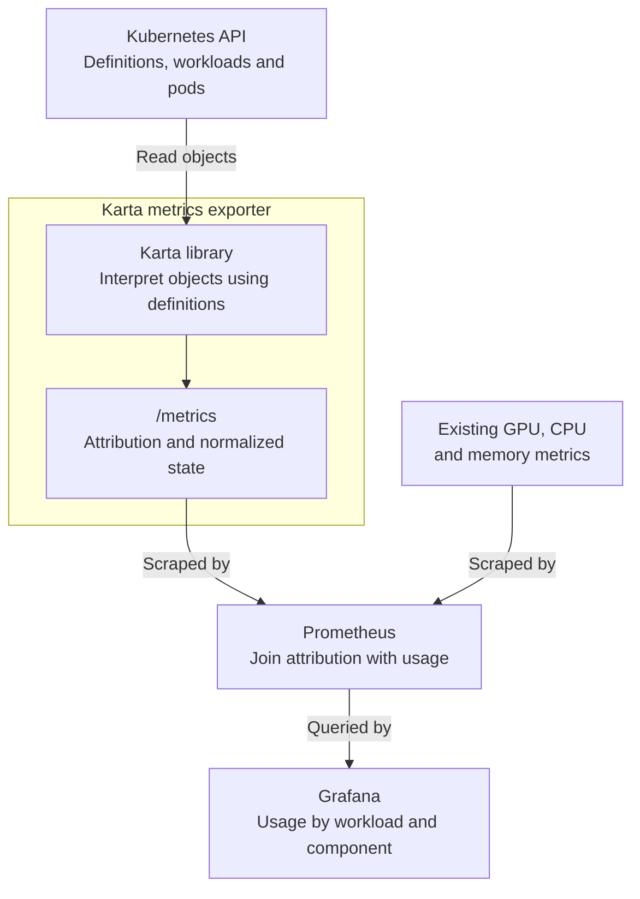

<!-- SPDX-License-Identifier: Apache-2.0 -->
<!-- Copyright (c) 2026 NVIDIA Corporation -->

# KEP-0004: Karta metrics exporter

- Status: provisional
- Authors: @AviadHayumi
- Issue: TBD before submission
- Created: 2026-10-12
- Last updated: 2026-10-12

## Summary

The Karta metrics exporter reads Karta definitions, workloads and pods from the
Kubernetes API. It uses the Karta library internally to interpret these objects
and exposes pod-to-workload attribution and normalized workload state at `/metrics`.

Prometheus scrapes these metrics and joins attribution with existing GPU, CPU
and memory measurements. Grafana queries Prometheus to show usage by workload
and component.



This proposal defines the metrics contract. Discovery, caching and deployment
details remain open.

## Motivation

A JobSet has busy prefill pods and decode pods with little GPU activity.
Grouping them requires operator-specific labels. Karta already describes those relationships, enabling
common dashboards and capacity investigation. Normalized state adds context
about running, completed or degraded work.

### Goals

Expose attribution and normalized state through a small Prometheus contract.

### Non-goals

Collect usage measurements, choose optimization thresholds, or design exporter logic.

## Proposal

### Required metrics

The exporter must provide these two gauges. Workload labels are: `namespace`, `workload` (name),
`workload_group` (API group) and `workload_kind`.

| Metric | Additional labels | Value |
|---|---|---|
| `karta_pod_workload_info` | `pod`, `uid` (pod UID), `component`, `component_instance` | Always `1`: identifies the pod's workload, component and named instance. Carries labels, not usage. |
| `karta_workload_status` | `phase` | `1` if a normalized phase matches, otherwise `0`. Workload-level state, including workloads with no pods; not component health. |

For JobSet, `component="replicatedjob"` identifies the Karta component;
`component_instance="prefill"` or `"decode"` identifies a named instance.
Group by both labels to keep prefill and decode separate.
An empty instance means no named instances. An unresolved component sets both
component labels to `<unknown>`; an unresolved instance sets only
`component_instance` to `<unknown>`. An unresolved workload has no mapping.

Each scrape contains at most one mapping per `namespace,pod`, to the outermost
described workload, such as JobSet rather than its child Job. Ambiguous ownership
has no mapping. Replace changed attribution, including old UIDs; remove deleted pods.

Status uses Karta's existing phase names: `Initializing`, `Running`, `Completed`, `Failed`,
`Degraded`, `Suspended`, `Suspending`, `Resuming` and `Undefined`.
Emit every phase. Phases are independent, not exclusive; definitions decide which match.
`Undefined` alone is `1` when evaluation succeeds but no other phase matches;
it does not signal an evaluation error. A missing status definition or evaluation
failure produces no status series. Absence is not zero.

### What these metrics enable

`karta_pod_workload_info` supplies the labels needed to group existing measurements.
Its value of `1` preserves usage when multiplied in a Prometheus label join.
`karta_workload_status` adds lifecycle context, displayed by workload labels.
`Running` does not mean busy.

| Question | Measurement joined with Karta attribution |
|---|---|
| Which component instance uses CPU? | cAdvisor `container_cpu_usage_seconds_total`, converted to cores with `rate()`. |
| How much memory does it hold? | cAdvisor `container_memory_working_set_bytes`. |
| Which component instance has low GPU activity? | DCGM `DCGM_FI_DEV_GPU_UTIL`, where supported and attributed to pods. |

Grouping by workload, component and instance separates prefill, decode and frontend
without queries tied to a specific operator. For example, sustained low decode
GPU activity identifies a candidate for investigation, not proof of wasted capacity.
Frontend may use only CPU. Missing GPU data is not zero utilization.

These two Karta metrics are sufficient for attributed usage. An idle flag is not
proposed: low CPU/GPU activity does not prove no useful work. Memory occupancy is
not activity. Requests, queue depth and latency from the application are needed
to interpret demand before scaling decisions.

<details>
<summary>Query example: CPU by workload, component and instance</summary>

For one cluster, with one current mapping per pod and deduplicated usage series.
Duplicate scrapes inflate sums; Karta does not deduplicate usage:

```promql
sum by (namespace, workload_group, workload_kind, workload,
        component, component_instance) (
  rate(container_cpu_usage_seconds_total{
    namespace!="", pod!="", container!="", container!="POD"
  }[5m])
  * on (namespace, pod)
    group_left (workload_group, workload_kind, workload, component, component_instance)
    karta_pod_workload_info{
      component!="<unknown>", component_instance!="<unknown>"
    }
)
```

The result is CPU cores per component instance. Multiplication by `1` copies Karta's
labels onto each container measurement; the outer sum combines containers and pods.

For memory, replace `rate(...)` with `container_memory_working_set_bytes` using the
same filters. For GPU activity, use `DCGM_FI_DEV_GPU_UTIL{namespace!="",pod!=""}`
and replace the outer `sum` with `avg`. This averages observed GPU series equally, not
pods or requested capacity. Plot it over time to investigate sustained low activity.
Shared-device measurements may not isolate a pod's usage.
Use valid measurements at the appropriate device or GPU-instance scope.

Grafana can run these queries directly. Optional Prometheus recording rules save
the results; they do not require additional Karta exporter metrics.

</details>

### Consumption limits

The initial contract covers one cluster and workloads whose pods share their
namespace. Sources must supply workload-pod `namespace` and `pod` labels;
relabel existing identity labels if needed. Exporter scrape-target labels alone
cannot identify the measured pod. DCGM needs Kubernetes pod attribution enabled.

Name-based joins do not protect against old telemetry during pod recreation,
even though the mapping has `uid`. The example excludes unmatched pods and
pods with an unknown component or instance from its per-instance totals.
Missing data is not zero, and totals may be partial.
Neither these metrics nor `up=1` proves completeness or freshness. Observation
health signals must be designed before implementing the exporter.

<details>
<summary>Why keep attribution separate from usage?</summary>

This follows the info-metric pattern used by kube-state-metrics: identity is exposed
as labels on a value of `1`, while measurements remain in their existing exporters.
Prometheus combines them by matching pod identity. Karta adds workload meaning
without collecting or duplicating resource usage.

</details>

<details>
<summary>Suggested metrics, outside the minimum contract</summary>

- Desired replicas per component instance: expected scale, even when no pods exist.
- Observed pod counts: only when existing series cannot supply the needed breakdown.
- Creation timestamp and generation: recreation and spec changes.
- Workload info: selected Karta definition and API version.

These need separate consumer justification. For usage relative to requested CPU
or memory, existing Kubernetes resource-request metrics can use the same pod mapping.

</details>

### Exporter logic: template

- Definition selection and discovery: TBD.
- Ownership, attribution and pod recreation: TBD.
- Permissions, freshness, partial results and health metrics: TBD.
- Deployment, scraping and resource limits: TBD.

## Compatibility and migration

No Karta schema change. Proposed names and labels are experimental and may change
until promoted to a stable contract with a migration policy.

## Test plan

Use existing JobSet, DynamoGraphDeployment and PyTorchJob catalog definitions to
check attribution, unique ownership, phases, missing/deleted objects and joins.
Add failure and recovery tests when exporter logic is designed.

## Risks and alternatives

Limit labels to defined identity fields to control series growth. Per-operator
queries remain an alternative but repeat Karta's knowledge.

## History

- 2026-10-12: Metrics contract proposed; exporter logic deferred.
