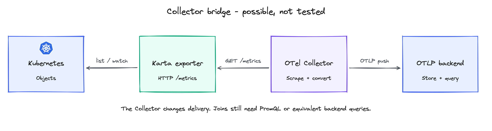
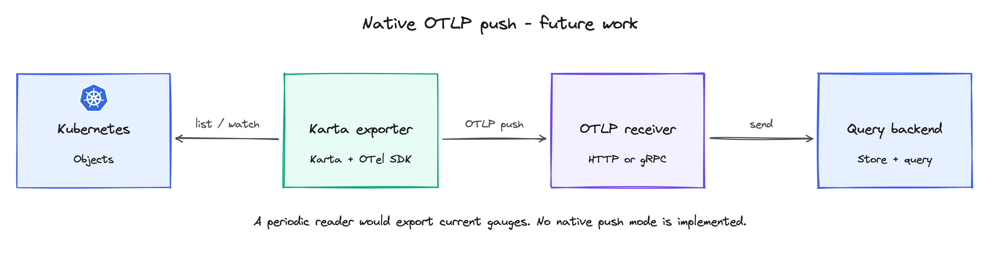

<!-- SPDX-License-Identifier: Apache-2.0 -->

<!-- Copyright (c) 2026 NVIDIA Corporation -->

# KEP-0004: Karta metrics exporter

- Status: provisional; backed by a prototype
- Authors: @AviadHayumi
- Issue: required before submission
- Created: 2026-10-12
- Last updated: 2026-10-13

## Summary

Karta maps Pods to workloads, components and repeated groups. Three metric families
expose that identity, workload state and observation health. Prometheus joins them
with DCGM and cAdvisor; Grafana shows resource usage at each level.


## Motivation

Dynamo has frontend, prefill and decode services. LWS has repeated leader/worker
groups. A workload average can hide a busy component or group. Karta makes these
relationships queryable without per-operator PromQL. Alerts and controllers can
use the same data, combined with allocation and application demand.

Examples:

- Dynamo: find quiet prefill GPUs while decode stays busy; check demand before changing capacity.
- LWS: find a quiet worker group hidden by the workload average.
- Workload state: see Running, Failed or Degraded workloads and their observed history.

<details>
<summary>Tools that can use these signals</summary>

- [KEDA](https://keda.sh/docs/2.18/scalers/prometheus/) can scale a compatible target from a Prometheus query.
- [Kyverno](https://kyverno.io/docs/policy-types/cluster-policy/external-data-sources/) can use a query API response as policy context.
- [Argo Rollouts](https://argoproj.github.io/argo-rollouts/features/analysis/) can evaluate Prometheus results during a rollout.

These are possible integrations, not validated Karta action policies. Check allocation,
telemetry freshness and application demand before acting. Sampled phase history does not
provide exact start times, restart counts or a diagnosis of flakiness.

</details>

## Proposal

### 1. Three metrics

Three gauges form the contract.

| Metric                              | Value                                           | Why it is needed                                                                          |
| ----------------------------------- | ----------------------------------------------- | ----------------------------------------------------------------------------------------- |
| `karta_pod_workload_info`         | Always `1`                                    | Attach workload, component and group identity to measurements from a Pod.                 |
| `karta_workload_status`           | `1` for a matching phase, otherwise `0`     | Distinguish running, completed or failed work, including workloads with no Pods.          |
| `karta_exporter_observation_healthy` | `1` after fresh verification, otherwise `0` | Tell whether Karta's observations can be trusted. `reason` explains a failure. |

The third metric is always present for each tracked check, including healthy checks.
`check` says what was verified; `reason` says why verification failed. It reports
Karta's ability to observe a workload, not whether that workload is healthy.
The new health name, `check` and `reason` labels are proposed; the prototype still needs updating.

<details>
<summary>Labels, identity and metric semantics</summary>

| Metric                              | All exporter-defined labels                                                                                                                                |
| ----------------------------------- | ---------------------------------------------------------------------------------------------------------------------------------------------------------- |
| `karta_pod_workload_info`         | `namespace`, `workload`, `workload_group`, `workload_kind`, `workload_uid`, `pod`, `pod_uid`, `component`, `component_instance`, `replica` |
| `karta_workload_status`           | `namespace`, `workload`, `workload_group`, `workload_kind`, `workload_uid`, `phase`                                                            |
| `karta_exporter_observation_healthy` | `check`, `namespace`, `group`, `version`, `kind`, `workload`, `workload_uid`, `reason` |

`workload` names the root; `workload_group` is its API group. `workload_uid` and `pod_uid`
identify the workload and Pod lifetimes. Keep UIDs in history: names can be reused.
Prometheus target labels such as `job` and `instance` are separate.

Proposed naming change: the prototype emits `uid`; this contract uses `pod_uid`.
Update exporter output, rules and tests together before delivery. External sources need
compatible label names and the producing Pod UID before a UID-based join is possible.

`component` names a definition component. `component_instance` names an entry within it.
`replica` identifies a repeated group, not the requested replica count.

| Example | `component` | `component_instance` | `replica` |
|---|---|---|---|
| Dynamo prefill, Deployment-backed | `service` | `prefill` | empty |
| JobSet, first worker Job | `replicatedjob` | `worker` | `0` |
| JobSet, second worker Job | `replicatedjob` | `worker` | `1` |
| LWS, leader in group 0 | `leader` | empty | `0` |
| LWS, worker in group 0 | `worker` | empty | `0` |
| LWS, worker in group 1 | `worker` | empty | `1` |

- Empty instance: the definition has no named instances, as with LWS leader/worker roles.
- Empty replica: no group applies, or its identity could not be resolved. Check observation health.
- Unknown component: both component labels are `<unknown>`.
- Unknown instance: `component_instance="<unknown>"`.
- Unresolved workload: no attribution row. Keep the Pod visible through inventory or unmatched-usage checks.

For health, `check="workload"` verifies one workload and its required dependencies.
Its namespace, name and UID identify the affected workload. `check="resource_type"`
verifies collection of an API type, such as JobSet. Its workload labels are empty:
it can report denied access before any workload names are known.
The reason values and fault impact are defined in section 3.

Each snapshot has at most one attribution per Pod, to its outermost described owner.
Replace changed mappings and remove deleted Pods. Bare Pods are excluded by default.

Status phases are `Initializing`, `Running`, `Completed`, `Failed`, `Degraded`, `Suspended`,
`Suspending`, `Resuming` and `Undefined`. After successful evaluation, emit a separate series for each `phase`, with value `0` or `1`. Several phases can be `1` at once. `Undefined=1` means no phase matched; it is not an evaluation
failure. A definition without status produces no status rows. Failed status evaluation produces no
status rows and unhealthy observation. Workload state is not Pod state or component health.

This follows [kube-state-metrics](https://github.com/kubernetes/kube-state-metrics/blob/main/docs/design/metrics-best-practices.md):
separate identity from changing state. Multiplying by `1` preserves usage. A failed
application can have `Failed=1` and observation health `1`: Karta read it correctly.

</details>

<details>
<summary>Examples: Dynamo, LWS and JobSet</summary>

Illustrative values and shortened UIDs show the proposed labels, including the pending `pod_uid` rename. They are not hardware measurements.

```prometheus
karta_pod_workload_info{namespace="team-a",workload="dynamo",workload_group="nvidia.com",workload_kind="DynamoGraphDeployment",workload_uid="w-d",pod="prefill-0",pod_uid="p-d1",component="service",component_instance="prefill",replica=""} 1
karta_pod_workload_info{namespace="team-a",workload="dynamo",workload_group="nvidia.com",workload_kind="DynamoGraphDeployment",workload_uid="w-d",pod="frontend-0",pod_uid="p-d0",component="service",component_instance="Frontend",replica=""} 1
karta_pod_workload_info{namespace="team-a",workload="dynamo",workload_group="nvidia.com",workload_kind="DynamoGraphDeployment",workload_uid="w-d",pod="decode-0",pod_uid="p-d2",component="service",component_instance="decode",replica=""} 1
karta_pod_workload_info{namespace="team-a",workload="serve",workload_group="leaderworkerset.x-k8s.io",workload_kind="LeaderWorkerSet",workload_uid="w-l",pod="serve-0-1",pod_uid="p-l1",component="worker",component_instance="",replica="0"} 1
karta_pod_workload_info{namespace="team-a",workload="serve",workload_group="leaderworkerset.x-k8s.io",workload_kind="LeaderWorkerSet",workload_uid="w-l",pod="serve-1-1",pod_uid="p-l2",component="worker",component_instance="",replica="1"} 1
karta_pod_workload_info{namespace="team-a",workload="train",workload_group="jobset.x-k8s.io",workload_kind="JobSet",workload_uid="w-j",pod="train-worker-0",pod_uid="p-j1",component="replicatedjob",component_instance="worker",replica="0"} 1
karta_workload_status{namespace="team-a",workload="dynamo",workload_group="nvidia.com",workload_kind="DynamoGraphDeployment",workload_uid="w-d",phase="Running"} 1
karta_exporter_observation_healthy{check="workload",namespace="team-a",group="nvidia.com",version="v1alpha1",kind="DynamoGraphDeployment",workload="dynamo",workload_uid="w-d",reason="none"} 1
```

Other phase/health rows are omitted. Frontend, prefill and decode are instances of the
same `service` component; instance names preserve the keys in the workload definition.
This Dynamo example uses Deployments, so `replica` is empty even with several Pods.
LWS/Grove-backed Dynamo can supply a real group key. Dropping LWS `replica` merges worker groups.

<details>
<summary>The measurements supplied by DCGM and cAdvisor</summary>

```prometheus
DCGM_FI_DEV_GPU_UTIL{namespace="team-a",pod="prefill-0",UUID="GPU-a",gpu="0"} 90
DCGM_FI_DEV_GPU_UTIL{namespace="team-a",pod="decode-0",UUID="GPU-b",gpu="0"} 1
DCGM_FI_DEV_FB_USED{namespace="team-a",pod="decode-0",UUID="GPU-b",gpu="0"} 4096
container_cpu_usage_seconds_total{namespace="team-a",pod="decode-0",container="worker"} 1234
container_memory_working_set_bytes{namespace="team-a",pod="decode-0",container="worker"} 536870912
```

GPU utilization is percent; framebuffer usage is MiB (multiply by `1048576` for bytes).
CPU is cumulative seconds: `rate()` gives cores. cAdvisor working set is bytes.
Occupied memory is not activity. A CPU-only frontend legitimately has no GPU series.

</details>
</details>

### 2. Queries and idleness

A low-activity query finds candidates for investigation. An idle decision also needs
complete, fresh device data and application demand. Recording rules add no exporter families.

<details>
<summary>CPU, memory and GPU queries</summary>

Use one cluster with deduplicated usage sources. Preserve source `namespace` and `pod` labels; DCGM
must expose Pod attribution. For multiple clusters, add a common `cluster` label to every join and
grouping. If all sources supply the producing Pod UID, also join on `pod_uid`; copying today's UID onto
old data is unsafe.

A recording rule is optional: save the expression below as `karta:pod_attribution:unique`,
or substitute its expression into each query. It merges identical exporter observations
and omits conflicting Pod mappings, including conflicting UIDs. Even one exporter replica
can overlap its replacement during a rollout. The prototype chart already embeds this guard
in its usage rules.

<details>
<summary>Who owns the rules?</summary>

Karta maintains the identity contract and tests the uniqueness/join pattern. Platform teams
choose whether to record it, configure usage sources and set action thresholds. Optional
DCGM/cAdvisor reference rules declare their expected input labels and units; their calculated
series are separate from the three exporter metric families. Long-term packaging of those
adapters is outside this contract. The prototype chart currently treats aggregate names as
contractual; that scope must be reconciled before release.

</details>

```yaml
groups:
  - name: karta-attribution
    interval: 30s
    rules:
      - record: karta:pod_attribution:unique
        expr: |
          max by (namespace, pod, pod_uid, workload, workload_group, workload_kind,
                  workload_uid, component, component_instance, replica) (
            karta_pod_workload_info
          )
          and on (namespace, pod)
          (count by (namespace, pod) (
            group by (namespace, pod, pod_uid, workload, workload_group, workload_kind,
                      workload_uid, component, component_instance, replica) (
              karta_pod_workload_info
            )
          ) == 1)
```

CPU cores per component instance and group, excluding cAdvisor sandbox rows
(`container="POD"`):

```promql
sum by (namespace, workload_group, workload_kind, workload, workload_uid,
        component, component_instance, replica) (
  rate(container_cpu_usage_seconds_total{
    namespace!="", pod!="", container!="", container!="POD"
  }[5m])
  * on (namespace, pod)
    group_left (workload_group, workload_kind, workload, workload_uid,
                component, component_instance, replica)
    karta:pod_attribution:unique{component!="<unknown>", component_instance!="<unknown>"}
)
```

For memory, replace `rate(...)` with
`container_memory_working_set_bytes{namespace!="",pod!="",container!="",container!="POD"}`. Keep the
sum and matching labels. For an average GPU chart, use valid `DCGM_FI_DEV_GPU_UTIL` measurements and
`avg` instead of `sum`. An average describes observed devices; it can hide one busy device.

<details>
<summary>A five-minute low-GPU-activity candidate</summary>

The maximum asks whether every observed device was low. This query attaches current
identity to raw history; it cannot detect an allocated device that sends no samples.

```promql
(
  max by (namespace, workload_group, workload_kind, workload, workload_uid,
          component, component_instance, replica) (
    max_over_time(DCGM_FI_DEV_GPU_UTIL{namespace!="",pod!=""}[5m])
    * on (namespace, pod)
      group_left (workload_group, workload_kind, workload, workload_uid,
                  component, component_instance, replica)
      karta:pod_attribution:unique{component!="<unknown>",component_instance!="<unknown>"}
  ) < 5
)
and on (namespace, workload_uid)
  (min by (namespace, workload_uid) (karta_workload_status{phase="Running"}) == 1)
and on (namespace, workload_uid)
  (min by (namespace, workload_uid) (
    min_over_time(karta_exporter_observation_healthy{check="workload"}[5m])
  ) == 1)
```

The result retains the observed maximum below `5%`. The threshold/window are examples.
The health minimum includes every reason, so a recorded failure still blocks the candidate
after recovery until it leaves the window. Do not filter it to `reason="none"`: that would
hide failures. Missing history needs separate checks. Running is required now, not throughout
the window. Missing targets need separate checks.

Before using a candidate for an action, the consumer must verify:

- The current eligible Pods and allocated device identities match the telemetry.
- Every expected device and health series has valid, fresh samples across the window.
- Pod replacement or membership changes start a new observation window.
- Duplicate scrapes are removed and device sharing is accounted for.
- Queue depth, in-flight requests or progress show that useful work is not waiting.

An unavailable check means insufficient data, not zero. Allocation inventory comes from
Kubernetes and device tooling; demand comes from application telemetry.

<details>
<summary>Why the extra checks matter</summary>

A missing busy GPU can leave only a `1%` device. Perfect join coverage is not device coverage.
Name reuse and lookback can also attach old data to a current Pod. Shared GPUs, MIG and DRA
need mode-specific accounting; see [NVIDIA's time-slicing limits](https://docs.nvidia.com/datacenter/cloud-native/gpu-operator/latest/gpu-sharing.html).
No real GPU hardware or sharing mode was validated here.

</details>
</details>
</details>

### 3. Faults and what they affect

`karta_exporter_observation_healthy` answers: can Karta trust this observation?
A verified observation has value `1` and `reason="none"`. A failed, incomplete or stale
observation has value `0` and a reason. Missing health is unknown, never healthy.
Pause decisions for affected workloads until verification recovers.

For example, `reason="permission_denied"` means check Kubernetes read permissions.
`check="resource_type"` identifies the API collection that failed;
`check="workload"` identifies a workload whose observation cannot be trusted.
The reason is a short category. Logs provide the failed operation and full error.

<details>
<summary>Every health label: meaning and example</summary>

| Label | What it identifies | Example |
|---|---|---|
| `check` | What Karta verifies: collection of an API type (`resource_type`) or one workload and its dependencies (`workload`). | `check="workload"` |
| `namespace` | The observed resource's namespace, not the exporter Pod's namespace. For resource-type checks, `*` means all namespaces and empty means a cluster-scoped resource. | `namespace="team-a"` |
| `group` | The Kubernetes API group. Empty means the core API group, as for Pods. | `group="jobset.x-k8s.io"` |
| `version` | The Kubernetes API version being observed, not the exporter version. | `version="v1alpha2"` |
| `kind` | The Kubernetes object type being observed. | `kind="JobSet"` |
| `workload` | The root workload's name. Empty for resource-type checks, which can fail before any names are known. | `workload="train-a"` |
| `workload_uid` | The root workload's Kubernetes UID. Distinguishes a recreated workload with the same name. Empty for resource-type checks. | `workload_uid="w-a"` (shortened) |
| `reason` | Why the check is unhealthy. A fixed category such as `permission_denied`; `none` means fresh verification succeeded. | `reason="permission_denied"` |

Read the examples together: Karta cannot verify the JobSet `train-a` in `team-a`
because Kubernetes denied a required read. The workload's identity stays the same
when the reason changes. Its UID changes if the workload is deleted and recreated.

For `check="resource_type"`, `group` + `version` + `kind` identify the API type whose
collection is checked. For `check="workload"`, they identify the root API type, even
if a child dependency caused the failure. Logs identify that failed dependency.
These labels describe the observation; Prometheus adds scrape labels such as `job`
and `instance` separately.

</details>

<details>
<summary>Which observations does a fault affect?</summary>

| Failure | Health rows set to `0` | What remains usable |
|---|---|---|
| Cannot collect a required API type, such as JobSet or Job | Its `check="resource_type"` row and known workloads that depend on it. | Workloads with no dependency on that collection. |
| Cannot collect shared Pods or Karta definitions | That resource-type row and all dependent workloads in the watched namespaces. | Only observations independent of that collection. |
| A selected definition is invalid or evaluation fails | Workloads affected by that definition or evaluation. | Unrelated workloads. Reading a definition successfully does not prove it is valid. |
| A described Pod's owner cannot be resolved | Its known root's workload row. If the root is unknown, conservatively invalidate known workload rows in that Pod's namespace. | Workloads outside the affected namespace; inside it, require ownership checks. |
| Verification expires or the cache differs from fresh API data | The affected check and dependent workload checks. | Other freshly verified observations. |

A workload row names the root, even when a child API caused the failure. Logs identify
that dependency; no extra dependency label is needed. An unknown root gets no invented
workload name or UID. If no workloads are known yet, inspect resource-type health and
unmatched Pods. Intentionally excluded bare Pods are not ownership failures.

A required API gets a row even before discovery succeeds. Optional APIs that were never
present are skipped unless explicitly required.

</details>

<details>
<summary>Reason values and the next step</summary>

Only these fixed values are allowed. Error text, URLs and object names do not belong in `reason`.

| `reason` | Value | Meaning and next step |
|---|---|---|
| `none` | `1` | Fresh verification succeeded. No observation fault. |
| `initializing` | `0` | Initial verification is incomplete. Wait; check startup logs if it persists. |
| `permission_denied` | `0` | Kubernetes rejected access. Check credentials and read permissions for the logged API and namespace. |
| `api_unavailable` | `0` | A required API is missing or cannot be reached/read. Check the logged API, installation and connectivity. |
| `invalid_definition` | `0` | A selected Karta definition is invalid. Correct the definition reported in logs. |
| `evaluation_failed` | `0` | State or attribution evaluation failed. Check the expression and object shape in logs. |
| `unresolved_owner` | `0` | A required owner cannot be resolved, including a missing owner or UID mismatch. Check the ownership chain. |
| `cache_mismatch` | `0` | Cached objects or derived results differ from fresh API reads. Check cache progress; wait for successful verification. |
| `stale` | `0` | Verification is too old. Check verifier progress and API access; require fresh verification. |

<details>
<summary>One current reason, recovery and multiple failures</summary>

Each exporter emits one current health sample per check and object identity. It is a
current-state gauge, not an error counter or one series per possible reason. On a reason
change, stop exposing the previous reason row. Recovery emits `reason="none"` with `1`
only after fresh verification. Prometheus retains the old row's history.

If several causes apply, select the first in this order: `permission_denied`,
`api_unavailable`, `invalid_definition`, `evaluation_failed`, `unresolved_owner`,
`cache_mismatch`, `initializing`, `stale`. Keep all error details in logs. Use the concrete
API failure instead of `unresolved_owner` when a failed read prevented owner lookup.
`initializing` applies before initial verification; `stale` applies after a prior
verification expires. Do not replace an unresolved concrete error with either fallback.

Known attribution rows can remain exposed while health is `0`. Failed state evaluation
produces no status rows. Neither missing status nor missing usage means zero.

</details>
</details>

<details>
<summary>Examples: permission, missing API and one workload's failure</summary>

These are illustrative samples from an exporter watching `team-a` and requiring JobSet.
They describe the proposed contract; the prototype still needs the new labels and fixes below.

<details>
<summary>JobSet collection is denied, or its API is unavailable</summary>

Permission denied before any workload names are known:

```prometheus
karta_exporter_observation_healthy{check="resource_type",namespace="team-a",group="jobset.x-k8s.io",version="v1alpha2",kind="JobSet",workload="",workload_uid="",reason="permission_denied"} 0
```

If `train-a` was already discovered, its dependent observation also becomes unhealthy:

```prometheus
karta_exporter_observation_healthy{check="workload",namespace="team-a",group="jobset.x-k8s.io",version="v1alpha2",kind="JobSet",workload="train-a",workload_uid="w-a",reason="permission_denied"} 0
```

A missing or unavailable API instead produces this resource-type row:

```prometheus
karta_exporter_observation_healthy{check="resource_type",namespace="team-a",group="jobset.x-k8s.io",version="v1alpha2",kind="JobSet",workload="",workload_uid="",reason="api_unavailable"} 0
```

The reason directs the operator to permissions or API availability; logs supply the exact error.

</details>

<details>
<summary>Startup, successful verification and workload-specific failures</summary>

Each line below is an alternative snapshot for the same workload, not simultaneous rows:

```prometheus
karta_exporter_observation_healthy{check="workload",namespace="team-a",group="jobset.x-k8s.io",version="v1alpha2",kind="JobSet",workload="train-a",workload_uid="w-a",reason="initializing"} 0
karta_exporter_observation_healthy{check="workload",namespace="team-a",group="jobset.x-k8s.io",version="v1alpha2",kind="JobSet",workload="train-a",workload_uid="w-a",reason="none"} 1
karta_exporter_observation_healthy{check="workload",namespace="team-a",group="jobset.x-k8s.io",version="v1alpha2",kind="JobSet",workload="train-a",workload_uid="w-a",reason="invalid_definition"} 0
karta_exporter_observation_healthy{check="workload",namespace="team-a",group="jobset.x-k8s.io",version="v1alpha2",kind="JobSet",workload="train-a",workload_uid="w-a",reason="evaluation_failed"} 0
karta_exporter_observation_healthy{check="workload",namespace="team-a",group="jobset.x-k8s.io",version="v1alpha2",kind="JobSet",workload="train-a",workload_uid="w-a",reason="unresolved_owner"} 0
karta_exporter_observation_healthy{check="workload",namespace="team-a",group="jobset.x-k8s.io",version="v1alpha2",kind="JobSet",workload="train-a",workload_uid="w-a",reason="cache_mismatch"} 0
karta_exporter_observation_healthy{check="workload",namespace="team-a",group="jobset.x-k8s.io",version="v1alpha2",kind="JobSet",workload="train-a",workload_uid="w-a",reason="stale"} 0
```

The table above gives the action for each reason. A workload evaluation failure can coexist
with a healthy resource-type check: the API was readable, but this workload could not be
interpreted. Only fresh verification changes its health back to `1` with `reason="none"`.

</details>
</details>

<details>
<summary>Queries and failures outside Karta observation health</summary>

List failed observations with their reason and affected identity:

```promql
karta_exporter_observation_healthy == 0
```

Show only permission failures:

```promql
karta_exporter_observation_healthy{reason="permission_denied"} == 0
```

A scrape failure cannot be reported by an unreachable exporter. For a configured scrape
job named `karta`, use Prometheus's own `up` metric:

```promql
(up{job="karta"} == 0) or absent(up{job="karta"})
```

A required API also needs an absence check. Match the expected API and exporter namespace:

```promql
absent(karta_exporter_observation_healthy{
  check="resource_type",namespace="team-a",group="jobset.x-k8s.io",
  version="v1alpha2",kind="JobSet"
})
```

These are example queries, not chart-installed alerts. Match the real scrape job and define
expected endpoints, API types and alert duration. Multiple endpoints need per-target inventory.
Old samples can remain queryable briefly after a scrape failure. Check `up` and expected
series separately; health `1` alone cannot certify a successful current scrape.

Karta health can remain `1` when DCGM or cAdvisor is unavailable. For a Pod known from
allocation inventory to need GPU telemetry, detect missing utilization with:

```promql
absent(DCGM_FI_DEV_GPU_UTIL{namespace="team-a",pod="decode-0"})
```

Check expected cAdvisor inputs and source freshness too. A CPU-only frontend needs no GPU
series. Unknown or unmatched usage and conflicting attribution need separate checks.
Missing usage is unknown, not idle.

Verification defaults to `30s`, with a `2m` maximum age. Watch errors invalidate health
immediately; verification catches other mismatches. Accumulate a new decision window after
recovery. `/metrics` works before readiness; the Service publishes unready addresses.

</details>

<details>
<summary>Confirmed prototype bugs to fix before release</summary>

- One invalid Karta definition currently makes every workload unhealthy, including
  unrelated kinds. Separate definition validity from shared collection health.
- A newly observed Pod whose owner is missing or has a different UID can have no
  attribution and no failed health row. Distinguish dangling ownership from
  intentional exclusion; invalidate namespace workload health when the root is unknown.

Both bugs were reproduced. Until fixed, require unmatched-Pod checks even at health `1`.
Adding `reason` must include these failure paths; a renamed metric alone does not fix them.

</details>

## Compatibility and migration

No new Karta CRD field is required. Names and labels remain experimental. Stabilization
requires the exact three-family output and these proposed changes across exporter and consumers:

- Attribution: rename `uid` to `pod_uid`.
- Health: rename `karta_exporter_resource_healthy` to `karta_exporter_observation_healthy`;
  replace `scope="kind"` with `check="resource_type"` and `scope="workload"` with
  `check="workload"`; add the fixed `reason` label.

The prototype still emits the old health contract without a reason. Update output, rules,
dashboards and tests together. Define a migration policy before stabilizing the contract.

## Test plan

Release validation must test the exact three-family build, not filter a larger output.

<details>
<summary>Evidence, limits and release checks</summary>

| Check                          | Evidence or requirement                                                                                                                                                                                                                                                 |
| ------------------------------ | ----------------------------------------------------------------------------------------------------------------------------------------------------------------------------------------------------------------------------------------------------------------------- |
| Attribution and grouping       | Recorded matrix: 20 described cases, 40 attributed Pods, bare-Pod exclusion; 105 grouping/health assertions using captured identities and synthetic GPU values.                                                                                                         |
| Low activity and recovery      | Live simulated-GPU Jobs exercised busy-to-low transitions and a two-minute healthy window. The five-minute example is a query example, not that live experiment.                                                                                                        |
| Fault handling                 | Startup denial, grant/revoke/recovery, required missing kind, discovery, cache/attribution and freshness tests.                                                                                                                                                         |
| HTTP output                    | OTel/Prometheus and server tests, including metrics before readiness. Unsupported output modes must fail clearly.                                                                                                                                                       |
| Chart                          | Rendered enabled/disabled output, CRD availability, flags and resource/level selection. Outstanding: check each monitoring kind, not only its API group/version; partial CRD availability currently renders an unsupported kind. Rendering does not prove installation. |
| Exact delivery contract        | Outstanding: remove extra families and legacy options; implement the proposed health name, `check` and `reason`; assert names/labels at `/metrics`; rerun matrix and faults. |
| Reason and fault isolation     | Outstanding: exercise every reason, dependency propagation, unknown owners, simultaneous failures, stale verification and recovery. Assert one current reason per check and preserve failure history in decision queries. |
| Health and rollout correctness | Outstanding: fix both health bugs above; validate endpoint discovery and duplicate/conflicting observations during a live rolling update. Synthetic query tests cover duplicates/conflicts.                                                                             |
| Container totals               | Outstanding: align chart CPU/memory filters with the examples. The chart currently includes `container="POD"` sandbox series; direct examples exclude them.                                                                                                           |
| Production decisions           | Outstanding: real GPU/device modes, full allocation/demand gates, target-cluster deployment and end-to-end action policies.                                                                                                                                             |

Fake-GPU stale Pod associations remain a source limitation. User/team metadata, occupied
idle GPU-hours, goodput and infrastructure-failure classification remain outside this contract.

</details>

## Risks and alternatives

Pod identities increase series count; fresh verification adds API reads. Scope and size
the exporter accordingly. Per-operator queries repeat definition knowledge; collecting
GPU/CPU data in Karta would duplicate existing exporters.

## Exporter execution and TBD delivery modes

Implemented: OTel instruments with Prometheus HTTP pull. Collector integration needs
end-to-end validation; native OTLP HTTP/gRPC needs a delivery adapter and lifecycle tests.

<details>
<summary>Configuration and collection</summary>

Deploy the exporter separately from the Karta controller. Configure its scope and scrape `/metrics`.
OpenTelemetry instruments are used internally; the prototype supports Prometheus HTTP pull only.

<details>
<summary>Tested chart configuration and available controls</summary>

```yaml
exporter:
  enabled: true
  replicaCount: 1
  image:
    tag: "<tested-exporter-tag>"
  useCatalog: true # Explicitly enable built-in fallbacks; default is false.
  metrics:
    workloadPhases: ["all"]
  extraArgs:
    - --metrics-exporter=prometheus
    - --namespace=team-a
    - --required-kinds=jobset.x-k8s.io/v1alpha2/JobSet
    - --health-check-interval=30s
    - --health-max-age=2m
  serviceMonitor:
    enabled: true
    interval: 30s
    scrapeTimeout: 25s
  prometheusRule:
    enabled: true
    resources: ["gpu", "cpu", "memory"]
    levels: ["workload", "component", "component_instance", "replica"]
    joinLabels: ["namespace", "pod"]
    cpuRateWindow: 5m
```

`ServiceMonitor`/`PrometheusRule` need their CRDs and matching selectors. The prototype
checks only `monitoring.coreos.com/v1`; partial CRD installs need the chart fix listed below.

<details>
<summary>What each control changes</summary>

All paths below are under `exporter` in Helm values.

| Control | What it changes and why | Example |
|---|---|---|
| `enabled` | Create the exporter resources; disabled by default. | `enabled: true` |
| `useCatalog` | Use built-in definitions when no cluster Karta overrides them; disabled by default. | `useCatalog: true` |
| `replicaCount` | Number of exporter processes. Queries must handle overlap during rollout. | `replicaCount: 1` |
| `ports.metrics` | HTTP port for metrics and probes. | `ports: {metrics: 8080}` |
| `extraArgs` | Set observation scope and fresh-verification timing. | List entries: `--namespace=team-a`, `--required-kinds=jobset.x-k8s.io/v1alpha2/JobSet`, `--health-check-interval=30s`, `--health-max-age=2m` |
| `rbac.workloadRules` | Permit reads of roots and intermediate owners used by selected definitions. | JobSet needs `jobsets` and its child `jobs`; see below. |
| `fullPodCache` | Retain full Pod objects if a custom selector reads fields outside metadata, node name and phase. Costs more memory. | `fullPodCache: true` for a selector reading `spec.containers[].resources`. |
| `serviceMonitor.*` | Tell Prometheus Operator to discover and scrape exporter endpoints. | `enabled: true`, `interval: 30s`, `scrapeTimeout: 25s` |
| `prometheusRule.resources` / `levels` | Choose optional usage recording rules and how they group results. Does not change `/metrics` families. | `resources: [cpu, memory]`, `levels: [component_instance]` gives separate prefill/decode totals. |
| `resources` | Set the exporter's CPU/memory budget. | `requests: {cpu: 50m, memory: 64Mi}`; size for the watched scope. |
| `nodeSelector`, `tolerations`, `affinity` | Choose where exporter Pods may run. | `nodeSelector: {kubernetes.io/os: linux}` |
| `networkPolicy.*` | Restrict access to workload metadata on `/metrics`. | `enabled: true` with `allowedNamespaceSelector.matchLabels` selecting the monitoring namespace. |

No namespace argument means all namespaces. `--required-kinds` makes an expected API's
absence visible as failed resource-type health; it does not grant access or install that API.
The verification interval controls fresh API checks; maximum age limits how long a successful
verification remains trustworthy. Scraping has a separate interval.

The ServiceMonitor sets `honorLabels: true` so `namespace` and `pod` continue to identify
the workload Pod, rather than being replaced by scrape-target labels for the exporter Pod.
Prometheus must select the ServiceMonitor; creating it does not itself collect metrics.

<details>
<summary>Example: grant reads for a JobSet-only deployment</summary>

```yaml
exporter:
  rbac:
    workloadRules:
      - apiGroups: ["jobset.x-k8s.io"]
        resources: ["jobsets"]
      - apiGroups: ["batch"]
        resources: ["jobs"]
```

The chart adds `get`, `list` and `watch`; Pod and Karta-definition reads are separate
built-in rules. Job access is needed for `Pod -> Job -> JobSet`. Overriding this list
replaces the defaults; retain other required kinds for broader deployments. A separately
managed ClusterRole labeled `karta.run.ai/exporter-rbac: "true"` can extend the aggregated role.

</details>

<details>
<summary>Prototype-only source adapters</summary>

Under `exporter.prometheusRule`, `gpuUtilizationMetric`, `gpuMemoryUsedMetric`,
`gpuMemoryFreeMetric`, `cpuUsageMetric` and `memoryWorkingSetMetric` choose input metric
names. `joinLabels` selects common identity labels. These are monitoring integrations,
not additional Karta metrics. For example, a platform with a renamed CPU series can set:

```yaml
exporter:
  prometheusRule:
    cpuUsageMetric: platform_container_cpu_usage_seconds_total
    joinLabels: ["namespace", "pod"]
```

The named input must exist with compatible units and labels. Changing `joinLabels` does
not rename source labels or create missing Pod UIDs. Keep source normalization and action
policy in the platform configuration. The final packaging of these adapters remains open.

</details>

Keep `workloadPhases: ["all"]`. Legacy phase subsets, Pod-count/inventory modes and
extra families must be removed or reconciled before delivery. Identity labels are fixed.

The chart binds a read-only aggregated ClusterRole even for an existing service account.
Namespace filtering does not narrow authorization; that requires custom RBAC manifests.

</details>

<details>
<summary>Pull over HTTP: who sends what?</summary>


Prometheus discovers each exporter endpoint through the Service and scrapes it
as a distinct target. Keep target identity until query aggregation. Direct scrape
configuration must also discover endpoints; a single load-balanced ClusterIP can
hide conflicting observations during rollout. Each endpoint receives:

```http
GET /metrics HTTP/1.1
Accept: text/plain; version=0.0.4
```

The response uses the Prometheus sample format shown in the metric examples above.

Prometheus scrapes usage separately. For direct scraping, set
`honor_labels: true` and a `30s` interval. The prototype has no endpoint TLS/authentication;
restrict access or use an authenticated proxy. A scrape does not refresh verification.

</details>

<details>
<summary>Push, HTTP and gRPC: comparison and deferred work</summary>

[Knative](https://knative.dev/v1.22-docs/serving/observability/metrics/collecting-metrics/)
shows how one operator offers several transports. Karta currently supports only the first route.

| Route                | Initiator and wire data                                                                      | Karta status                                    |
| -------------------- | -------------------------------------------------------------------------------------------- | ----------------------------------------------- |
| Prometheus HTTP pull | Scraper GETs `/metrics`; response contains named samples and labels.                       | Implemented and tested in the prototype.        |
| OTLP HTTP push       | Sender POSTs an OTLP protobuf metrics request, commonly to `/v1/metrics` on port `4318`. | Not implemented in this prototype.                      |
| OTLP gRPC push       | Sender calls the OTLP MetricsService Export RPC, commonly on port `4317`.                  | Not implemented in this prototype.                      |
| Collector bridge     | Collector scrapes Prometheus samples, converts them, then sends OTLP to a backend.           | Possible external integration; not tested here. |

The OTel SDK is already used, but only its Prometheus reader is wired in. The binary
rejects `--metrics-exporter=otlp`, `none` and combined modes before cluster access.
An endpoint change cannot turn Prometheus exposition into OTLP.

<details>
<summary>Collector bridge: external integration, still untested</summary>



The Collector converts and forwards samples. It does not run the PromQL joins shown above;
those need a compatible query backend. Test identity translation, deletion and freshness.

</details>

<details>
<summary>Native OTLP: future flow and payload</summary>



Both OTLP transports carry an `ExportMetricsServiceRequest`. Inside its resource/scope
metrics, labels become gauge datapoint attributes:

```text
metric.name = karta_workload_status
gauge.data_points = [{value: 1, time_unix_nano: <timestamp>,
  attributes: {namespace: team-a, workload_uid: w-j, phase: Running, ...}}]
```

This is notation, not an accepted request body. Future support needs endpoint, TLS/auth, intervals,
bounded retries, delivery-loss monitoring, staleness/deletion semantics and label translation.
Delivery success does not certify observation health.

An [OTel Collector](https://opentelemetry.io/docs/platforms/kubernetes/helm/collector/)
can bridge formats; this integration has no tested Karta chart switch.

</details>
</details>
</details>

</details>

<details>
<summary>Inside the exporter</summary>

The exporter gives Kubernetes objects to the Karta library and exposes a cached snapshot.
Operator-specific selectors stay in definitions, not exporter adapters.

<details>
<summary>Discovery, ownership, interpretation and collection</summary>

1. Load the optional catalog and watch cluster definitions.
2. Select one valid definition per root group/kind. Cluster definitions override the
   catalog; ties use oldest creation time, then name. Invalid definitions affect health.
3. Watch full root objects, intermediate-owner metadata and Pods. Retry API discovery
   during verification so newly installed APIs can appear without a restart.
4. Use Karta to evaluate root state and components. Walk Pod ownership to the outermost
   described root, then evaluate component, instance and replica selectors.
5. Store by UID. Re-evaluate on definition changes; remove deleted objects' current rows.
   Prometheus keeps previously scraped history.
6. On scrape, OTel gauges read the store; the Prometheus exporter formats the snapshot.
7. Independently verify cache UIDs/resource versions, state and attribution through fresh
   API reads. Retry pending ownership and update health. The proposed contract also records
   a bounded failure reason and propagates it to dependent workload checks.

<details>
<summary>Why combine upward attribution with root watches?</summary>

For `Pod -> Job -> JobSet`, stopping at Job loses the outer workload. Root watches
also preserve state for workloads with zero Pods. Retry pending Pods on owner arrival
and verification; do not accept an inner root while an outer edge is unresolved.

The walk stops after eight steps and follows controller ownership within a namespace.
Definitions and permissions must cover the chain. Independent services, component
lifecycle and full hierarchy need separate contracts.

</details>
</details>

</details>

## History

- 2026-10-12: Proposed three metric families, replica-group identity, observation health and an HTTP-pull exporter design backed by prototype tests. Native OTLP delivery remains deferred.
- 2026-10-13: Clarified health check names, bounded failure reasons, affected workloads and recovery. Exporter implementation of the revised contract remains pending.
