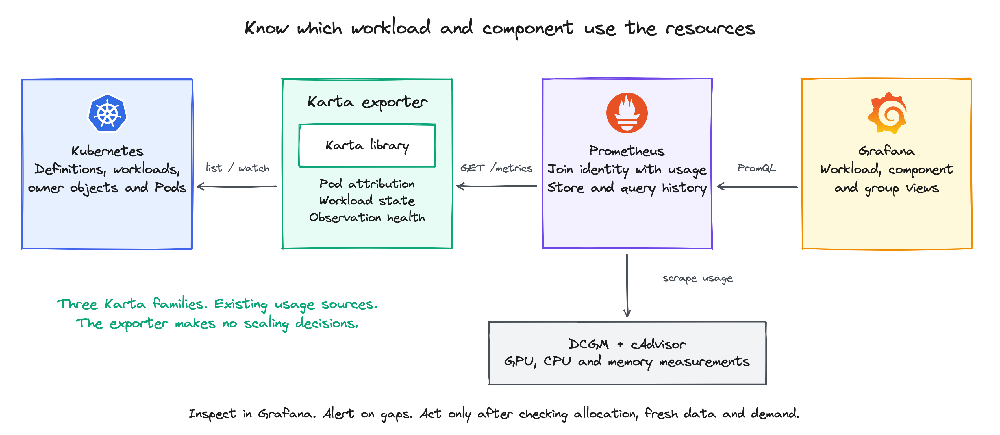

<!-- SPDX-License-Identifier: Apache-2.0 -->
<!-- Copyright (c) 2026 NVIDIA Corporation -->

# KEP-0004: Karta metrics exporter

- Status: provisional; backed by a prototype
- Authors: @AviadHayumi
- Issue: required before submission
- Created: 2026-10-12
- Last updated: 2026-10-12

## Summary

Karta maps Pods to workloads, components and repeated groups. Three metric families
expose that identity, workload state and observation health. Prometheus joins them
with DCGM and cAdvisor; Grafana shows resource usage at each level.



The first delivery uses HTTP pull. Low activity is an investigation signal, not
permission to stop work. The prototype still needs the release fixes listed below.

## Motivation

Dynamo has frontend, prefill and decode services. LWS has repeated leader/worker
groups. A workload average can hide a busy component or group. Karta makes these
relationships queryable without per-operator PromQL. Alerts and controllers can
use the same data, combined with allocation and application demand.

For example, [KEDA](https://keda.sh/docs/2.18/scalers/prometheus/) can consume a query
for a supported scaling target. Action integration is not validated by this proposal.

## Proposal

### 1. Three metrics

Three gauges form the contract. `replica` identifies a group, not a count.

| Metric | Value | Why it is needed |
|---|---|---|
| `karta_pod_workload_info` | Always `1` | Attach workload, component and group identity to measurements from a Pod. |
| `karta_workload_status` | `1` for a matching phase, otherwise `0` | Distinguish running, completed or failed work, including workloads with no Pods. |
| `karta_exporter_resource_healthy` | `1` after fresh verification, otherwise `0` | Show when permissions, collection or interpretation make Karta's observations unreliable. |

<details>
<summary>Labels, identity and metric semantics</summary>

| Metric | All exporter-defined labels |
|---|---|
| `karta_pod_workload_info` | `namespace`, `workload`, `workload_group`, `workload_kind`, `workload_uid`, `pod`, `uid`, `component`, `component_instance`, `replica` |
| `karta_workload_status` | `namespace`, `workload`, `workload_group`, `workload_kind`, `workload_uid`, `phase` |
| `karta_exporter_resource_healthy` | `scope`, `namespace`, `group`, `version`, `kind`, `workload`, `workload_uid` |

`workload` names the root; `workload_group` is its API group. `workload_uid` and `uid`
identify the workload and Pod lifetimes. Keep UIDs in history: names can be reused.
Prometheus target labels such as `job` and `instance` are separate.

`component` names a definition component. `component_instance` names an instance,
such as Dynamo `prefill`. `replica` identifies a repeated group, such as LWS `0` or `1`.

An empty instance means the definition has no named instances. An empty replica means grouping does
not apply or could not be resolved; health distinguishes successful interpretation from an
extraction failure. Unknown components use `<unknown>` for both component labels; unknown instances
use it for the instance. No resolved workload means no attribution row. Such Pods must remain
visible through external inventory or unmatched-usage checks.

Each snapshot has at most one attribution per Pod, to its outermost described owner.
Replace changed mappings and remove deleted Pods. Bare Pods are excluded by default.

Status phases are `Initializing`, `Running`, `Completed`, `Failed`, `Degraded`, `Suspended`,
`Suspending`, `Resuming` and `Undefined`. After successful evaluation, emit a separate series for each `phase`, with value `0` or `1`. Several phases can be `1` at once. `Undefined=1` means no phase matched; it is not an evaluation
failure. A definition without status produces no status rows. Failed status evaluation produces no
status rows and unhealthy observation. Workload state is not Pod state or component health.

This follows [kube-state-metrics](https://github.com/kubernetes/kube-state-metrics/blob/main/docs/design/metrics-best-practices.md):
separate identity from changing state. Multiplying by `1` preserves usage. A failed
application can have `Failed=1` and observation health `1`: Karta read it correctly.
</details>

<details>
<summary>Examples: Dynamo, LWS and JobSet</summary>

Illustrative values and shortened UIDs use tested label shapes, not hardware measurements.

```prometheus
karta_pod_workload_info{namespace="team-a",workload="dynamo",workload_group="nvidia.com",workload_kind="DynamoGraphDeployment",workload_uid="w-d",pod="prefill-0",uid="p-d1",component="service",component_instance="prefill",replica=""} 1
karta_pod_workload_info{namespace="team-a",workload="dynamo",workload_group="nvidia.com",workload_kind="DynamoGraphDeployment",workload_uid="w-d",pod="decode-0",uid="p-d2",component="service",component_instance="decode",replica=""} 1
karta_pod_workload_info{namespace="team-a",workload="serve",workload_group="leaderworkerset.x-k8s.io",workload_kind="LeaderWorkerSet",workload_uid="w-l",pod="serve-0-1",uid="p-l1",component="worker",component_instance="",replica="0"} 1
karta_pod_workload_info{namespace="team-a",workload="serve",workload_group="leaderworkerset.x-k8s.io",workload_kind="LeaderWorkerSet",workload_uid="w-l",pod="serve-1-1",uid="p-l2",component="worker",component_instance="",replica="1"} 1
karta_pod_workload_info{namespace="team-a",workload="train",workload_group="jobset.x-k8s.io",workload_kind="JobSet",workload_uid="w-j",pod="train-worker-0",uid="p-j1",component="replicatedjob",component_instance="worker",replica="0"} 1
karta_workload_status{namespace="team-a",workload="dynamo",workload_group="nvidia.com",workload_kind="DynamoGraphDeployment",workload_uid="w-d",phase="Running"} 1
karta_exporter_resource_healthy{scope="workload",namespace="team-a",group="nvidia.com",version="v1alpha1",kind="DynamoGraphDeployment",workload="dynamo",workload_uid="w-d"} 1
```

Other phase/health rows are omitted. Dynamo frontend is another `service` instance.
Deployment-backed services have no group key. Dropping LWS `replica` merges worker groups.

<details>
<summary>The measurements supplied by DCGM and cAdvisor</summary>

```prometheus
DCGM_FI_DEV_GPU_UTIL{namespace="team-a",pod="prefill-0",UUID="GPU-a",gpu="0"} 90
DCGM_FI_DEV_GPU_UTIL{namespace="team-a",pod="decode-0",UUID="GPU-b",gpu="0"} 1
DCGM_FI_DEV_FB_USED{namespace="team-a",pod="decode-0",UUID="GPU-b",gpu="0"} 4096
container_cpu_usage_seconds_total{namespace="team-a",pod="decode-0",container="worker"} 1234
container_memory_working_set_bytes{namespace="team-a",pod="decode-0",container="worker"} 536870912
```

GPU utilization is percent; framebuffer usage is MiB (multiply by `1048576` for bytes).
CPU is cumulative seconds: `rate()` gives cores. cAdvisor working set is bytes.
Occupied memory is not activity. A CPU-only frontend legitimately has no GPU series.

</details>
</details>

### 2. Queries and idleness

A low-activity query finds candidates for investigation. An idle decision also needs
complete, fresh device data and application demand. Recording rules add no exporter families.

<details>
<summary>CPU, memory and GPU queries</summary>

Use one cluster with deduplicated usage sources. Preserve source `namespace` and `pod` labels; DCGM
must expose Pod attribution. For multiple clusters, add a common `cluster` label to every join and
grouping. If all sources supply the producing Pod UID, also join on `uid`; copying today's UID onto
old data is unsafe.

First install this recording rule. It merges identical exporter observations and drops conflicting
mappings, including conflicting Pod UIDs. Even one exporter replica can overlap with its replacement
during a rolling update. The prototype chart's usage rules already embed equivalent uniqueness
checks; this standalone rule makes the direct examples below runnable.

```yaml
groups:
  - name: karta-attribution
    interval: 30s
    rules:
      - record: karta:pod_attribution:unique
        expr: |
          max by (namespace, pod, uid, workload, workload_group, workload_kind,
                  workload_uid, component, component_instance, replica) (
            karta_pod_workload_info
          )
          and on (namespace, pod)
          (count by (namespace, pod) (
            group by (namespace, pod, uid, workload, workload_group, workload_kind,
                      workload_uid, component, component_instance, replica) (
              karta_pod_workload_info
            )
          ) == 1)
```

CPU cores per component instance and group, excluding cAdvisor sandbox rows
(`container="POD"`):

```promql
sum by (namespace, workload_group, workload_kind, workload, workload_uid,
        component, component_instance, replica) (
  rate(container_cpu_usage_seconds_total{
    namespace!="", pod!="", container!="", container!="POD"
  }[5m])
  * on (namespace, pod)
    group_left (workload_group, workload_kind, workload, workload_uid,
                component, component_instance, replica)
    karta:pod_attribution:unique{component!="<unknown>", component_instance!="<unknown>"}
)
```

For memory, replace `rate(...)` with
`container_memory_working_set_bytes{namespace!="",pod!="",container!="",container!="POD"}`. Keep the
sum and matching labels. For an average GPU chart, use valid `DCGM_FI_DEV_GPU_UTIL` measurements and
`avg` instead of `sum`. An average describes observed devices; it can hide one busy device.

<details>
<summary>A five-minute low-GPU-activity candidate</summary>

The maximum asks whether every observed device was low. This query attaches current
identity to raw history; it cannot detect an allocated device that sends no samples.

```promql
(
  max by (namespace, workload_group, workload_kind, workload, workload_uid,
          component, component_instance, replica) (
    max_over_time(DCGM_FI_DEV_GPU_UTIL{namespace!="",pod!=""}[5m])
    * on (namespace, pod)
      group_left (workload_group, workload_kind, workload, workload_uid,
                  component, component_instance, replica)
      karta:pod_attribution:unique{component!="<unknown>",component_instance!="<unknown>"}
  ) < 5
)
and on (namespace, workload_uid)
  (min by (namespace, workload_uid) (karta_workload_status{phase="Running"}) == 1)
and on (namespace, workload_uid)
  (min by (namespace, workload_uid) (
    min_over_time(karta_exporter_resource_healthy{scope="workload"}[5m])
  ) == 1)
```

The result retains the observed maximum below `5%`. The threshold/window are examples.
The health minimum rejects recorded failures, not missing history. Running is required
now, not throughout the window. Missing targets need separate checks.

Before using a candidate for an action, the consumer must verify:

- The current eligible Pods and allocated device identities match the telemetry.
- Every expected device and health series has valid, fresh samples across the window.
- Pod replacement or membership changes start a new observation window.
- Duplicate scrapes are removed and device sharing is accounted for.
- Queue depth, in-flight requests or progress show that useful work is not waiting.

An unavailable check means insufficient data, not zero. Allocation inventory comes from
Kubernetes and device tooling; demand comes from application telemetry.

<details>
<summary>Why the extra checks matter</summary>

A missing busy GPU can leave only a `1%` device. Perfect join coverage is not device coverage.
Name reuse and lookback can also attach old data to a current Pod. Shared GPUs, MIG and DRA
need mode-specific accounting; see [NVIDIA's time-slicing limits](https://docs.nvidia.com/datacenter/cloud-native/gpu-operator/latest/gpu-sharing.html).
No real GPU hardware or sharing mode was validated here.

</details>
</details>
</details>

### 3. Faults and the operator's response

`up` means a scrape succeeded. Observation health means Karta recently verified its data. Neither
proves application health or complete GPU telemetry. On unknown or unhealthy observation, show the
gap and stop decisions for the affected scope until it is verified again.

<details>
<summary>Failure behavior and what to do</summary>

| Condition | Expected behavior | Operator response |
|---|---|---|
| Initial sync, denied list/watch/get, unavailable API | Affected health is `0`; known data may still be exposed. | Check logs, observed namespace and permissions for roots and intermediate owners. |
| Required kind not discoverable | Kind health is `0`, even before finding any workload. | Install the required API or correct the declared scope. |
| Optional kind never present | Skip it unless explicitly required. | Declare kinds whose absence must be reported. |
| Definition or attribution evaluation fails | Affected workload health is `0`; unresolved fields remain unknown. | Correct the definition or unexpected object shape. |
| Owner cannot be resolved | Attribution can be absent. Lookup errors invalidate namespace workload health; the prototype misses some dangling owners. | Check ownership, permissions and unmatched Pods; see release gaps below. |
| Verification stale or cache differs from fresh API data | Health becomes `0`. | Restore API access or cache progress; wait for verification. |
| Exporter cannot be scraped | `up=0`, or target absent. | Check discovery, Service, endpoint and network access. |
| DCGM/cAdvisor data missing or stale | Karta health may remain `1`. | Check those sources and allocation inventory separately. |

`scope="kind"` reports collection for a kind; its workload labels are empty. `scope="workload"`
includes the name and UID and covers interpretation and required dependencies. Kind rows use
`namespace="*"` for an all-namespace collection and `namespace=""` for cluster-scoped resources.
For kind health, `group/version/kind` is the requested API type from the selected
definition, built-in watch or `--required-kinds`. An absence query must match it exactly.

<details>
<summary>Confirmed prototype bugs to fix before release</summary>

- One invalid Karta definition currently makes every workload unhealthy, including
  unrelated kinds. Separate definition validity from shared collection health.
- A newly observed Pod whose owner is missing or has a different UID can have no
  attribution and no failed health row. Distinguish dangling ownership from
  intentional exclusion; invalidate namespace workload health when the root is unknown.

Both bugs were reproduced. Until fixed, require unmatched-Pod checks even at health `1`.

</details>

<details>
<summary>Queries to detect faults and exclude unverified results</summary>

Show failed observations:

```promql
karta_exporter_resource_healthy == 0
```

For a configured Prometheus scrape job named `karta`, detect a failed or missing target. Match the
real scrape-job name in the installation:

```promql
(up{job="karta"} == 0) or absent(up{job="karta"})
```

A known expected kind needs its own absence check. This example assumes a single-namespace exporter
configured to require JobSet:

```promql
absent(karta_exporter_resource_healthy{
  scope="kind",namespace="team-a",group="jobset.x-k8s.io",
  version="v1alpha2",kind="JobSet"
})
```

These alerts are examples, not chart-installed rules. Define expected exporter endpoints,
kinds and alert duration. A missing endpoint among several needs per-target inventory. Watch unknown or unmatched
usage and conflicting mappings; missing is not zero. Error details stay in logs.

Verification defaults to `30s`, with a `2m` maximum age. Watch errors invalidate health
immediately; verification catches other mismatches. Only fresh verification restores health.
Accumulate a new decision window after recovery. `/metrics` works before readiness;
the Service publishes unready addresses.

</details>
</details>

### 4. Deployment and collection interface

Deploy the exporter separately from the Karta controller. Configure its scope and scrape `/metrics`.
OpenTelemetry instruments are used internally; the prototype supports Prometheus HTTP pull only.

<details>
<summary>Tested chart configuration and available controls</summary>

```yaml
exporter:
  enabled: true
  replicaCount: 1
  image:
    tag: "<tested-exporter-tag>"
  useCatalog: true # Explicitly enable built-in fallbacks; default is false.
  metrics:
    workloadPhases: ["all"]
  extraArgs:
    - --metrics-exporter=prometheus
    - --namespace=team-a
    - --required-kinds=jobset.x-k8s.io/v1alpha2/JobSet
    - --health-check-interval=30s
    - --health-max-age=2m
  serviceMonitor:
    enabled: true
    interval: 30s
    scrapeTimeout: 25s
  prometheusRule:
    enabled: true
    resources: ["gpu", "cpu", "memory"]
    levels: ["workload", "component", "component_instance", "replica"]
    joinLabels: ["namespace", "pod"]
    cpuRateWindow: 5m
```

`ServiceMonitor`/`PrometheusRule` need their CRDs and matching selectors. The prototype
checks only `monitoring.coreos.com/v1`; partial CRD installs need the chart fix listed below.

<details>
<summary>What each control changes</summary>

| Control | Effect |
|---|---|
| `enabled` | Create exporter resources; default is `false`. |
| `useCatalog` | Use built-in definitions as fallbacks; default is `false`. Cluster Karta resources override them. |
| `replicaCount` | Exporter processes, not workload replicas. Rollouts can overlap even with one; queries must handle duplicate observations. |
| `ports.metrics` | HTTP port for metrics and probes; default `8080`. |
| `extraArgs` | Observation namespace, required kinds and verification settings. No namespace flag means all namespaces. |
| `rbac.workloadRules` | Read permissions for workload and intermediate kinds. Extend narrowly for selected definitions. |
| `fullPodCache` | Retain fields needed by custom Pod selectors; otherwise cache metadata, node name and phase. |
| `serviceMonitor.*` | Scrape discovery and timing; the template preserves workload labels with `honorLabels: true`. |
| `prometheusRule.resources` / `levels` | Select derived measurements and aggregation levels, not exporter families. |
| `prometheusRule.gpuUtilizationMetric`, `gpuMemoryUsedMetric`, `gpuMemoryFreeMetric`, `cpuUsageMetric`, `memoryWorkingSetMetric`, `joinLabels` | Under `exporter.prometheusRule`, choose source metric names and common identity labels. Defaults use the DCGM/cAdvisor names shown above, plus `DCGM_FI_DEV_FB_FREE`. |
| `resources`, `nodeSelector`, `tolerations`, `affinity` | Exporter placement and resource budget. |
| `networkPolicy.*` | Restrict access to workload metadata on the metrics endpoint. |

Keep `workloadPhases: ["all"]`. Legacy phase subsets, Pod-count/inventory modes and
extra families must be removed or reconciled before delivery. Identity labels are fixed.

The chart binds a read-only aggregated ClusterRole even for an existing service account.
Namespace filtering does not narrow authorization; that requires custom RBAC manifests.

</details>

<details>
<summary>Pull over HTTP: who sends what?</summary>

Prometheus discovers each exporter endpoint through the Service and scrapes it
as a distinct target. Keep target identity until query aggregation. Direct scrape
configuration must also discover endpoints; a single load-balanced ClusterIP can
hide conflicting observations during rollout. Each endpoint receives:

```http
GET /metrics HTTP/1.1
Accept: text/plain; version=0.0.4
```

The response uses the Prometheus sample format shown in the metric examples above.

Prometheus scrapes usage separately. For direct scraping, set
`honor_labels: true` and a `30s` interval. The prototype has no endpoint TLS/authentication;
restrict access or use an authenticated proxy. A scrape does not refresh verification.

</details>

<details>
<summary>Push, HTTP and gRPC: comparison and deferred work</summary>

[Knative](https://knative.dev/v1.22-docs/serving/observability/metrics/collecting-metrics/)
shows how one operator offers several transports. Karta currently supports only the first route.

| Route | Initiator and wire data | Karta status |
|---|---|---|
| Prometheus HTTP pull | Scraper GETs `/metrics`; response contains named samples and labels. | Implemented and tested in the prototype. |
| OTLP HTTP push | Sender POSTs an OTLP protobuf metrics request, commonly to `/v1/metrics` on port `4318`. | Native output unsupported. |
| OTLP gRPC push | Sender calls the OTLP MetricsService Export RPC, commonly on port `4317`. | Native output unsupported. |
| Collector bridge | Collector scrapes Prometheus samples, converts them, then sends OTLP to a backend. | Possible external integration; not tested here. |

The binary rejects `--metrics-exporter=otlp`, `none` and combined modes before cluster access.
An endpoint change cannot turn Prometheus exposition into OTLP.

<details>
<summary>What a future OTLP payload would represent</summary>

Both OTLP transports carry an `ExportMetricsServiceRequest`. Inside its resource/scope
metrics, labels become gauge datapoint attributes:

```text
metric.name = karta_workload_status
gauge.data_points = [{value: 1, time_unix_nano: <timestamp>,
  attributes: {namespace: team-a, workload_uid: w-j, phase: Running, ...}}]
```

This is notation, not an accepted request body. Future support needs endpoint, TLS/auth, intervals,
bounded retries, delivery-loss monitoring, staleness/deletion semantics and label translation.
Delivery success does not certify observation health.

An [OTel Collector](https://opentelemetry.io/docs/platforms/kubernetes/helm/collector/)
can bridge formats; this integration has no tested Karta chart switch.

</details>
</details>
</details>

### 5. Inside the exporter

The exporter gives Kubernetes objects to the Karta library and exposes a cached snapshot.
Operator-specific selectors stay in definitions, not exporter adapters.

<details>
<summary>Discovery, ownership, interpretation and collection</summary>

1. Load the optional catalog and watch cluster definitions.
2. Select one valid definition per root group/kind. Cluster definitions override the
   catalog; ties use oldest creation time, then name. Invalid definitions affect health.
3. Watch full root objects, intermediate-owner metadata and Pods. Retry API discovery
   during verification so newly installed APIs can appear without a restart.
4. Use Karta to evaluate root state and components. Walk Pod ownership to the outermost
   described root, then evaluate component, instance and replica selectors.
5. Store by UID. Re-evaluate on definition changes; remove deleted objects' current rows.
   Prometheus keeps previously scraped history.
6. On scrape, OTel gauges read the store; the Prometheus exporter formats the snapshot.
7. Independently verify cache UIDs/resource versions, state and attribution through fresh
   API reads. Retry pending ownership and update health.

<details>
<summary>Why combine upward attribution with root watches?</summary>

For `Pod -> Job -> JobSet`, stopping at Job loses the outer workload. Root watches
also preserve state for workloads with zero Pods. Retry pending Pods on owner arrival
and verification; do not accept an inner root while an outer edge is unresolved.

The walk stops after eight steps and follows controller ownership within a namespace.
Definitions and permissions must cover the chain. Independent services, component
lifecycle and full hierarchy need separate contracts.

</details>
</details>

## Compatibility and migration

No new Karta CRD field is required. Names and labels remain experimental. Stabilization
requires the exact three-family output, updated consumers and a migration policy.

## Test plan

Release validation must test the exact three-family build, not filter a larger output.

<details>
<summary>Evidence, limits and release checks</summary>

| Check | Evidence or requirement |
|---|---|
| Attribution and grouping | Recorded matrix: 20 described cases, 40 attributed Pods, bare-Pod exclusion; 105 grouping/health assertions using captured identities and synthetic GPU values. |
| Low activity and recovery | Live simulated-GPU Jobs exercised busy-to-low transitions and a two-minute healthy window. The five-minute example is a query example, not that live experiment. |
| Fault handling | Startup denial, grant/revoke/recovery, required missing kind, discovery, cache/attribution and freshness tests. |
| HTTP output | OTel/Prometheus and server tests, including metrics before readiness. Unsupported output modes must fail clearly. |
| Chart | Rendered enabled/disabled output, CRD availability, flags and resource/level selection. Outstanding: check each monitoring kind, not only its API group/version; partial CRD availability currently renders an unsupported kind. Rendering does not prove installation. |
| Exact delivery contract | Outstanding: remove extra families and legacy options; assert names/labels at `/metrics`; rerun matrix and faults. |
| Health and rollout correctness | Outstanding: fix both health bugs above; validate endpoint discovery and duplicate/conflicting observations during a live rolling update. Synthetic query tests cover duplicates/conflicts. |
| Container totals | Outstanding: align chart CPU/memory filters with the examples. The chart currently includes `container="POD"` sandbox series; direct examples exclude them. |
| Production decisions | Outstanding: real GPU/device modes, full allocation/demand gates, target-cluster deployment and end-to-end action policies. |

Fake-GPU stale Pod associations remain a source limitation. User/team metadata, occupied
idle GPU-hours, goodput and infrastructure-failure classification remain outside this contract.

</details>

## Risks and alternatives

Pod identities increase series count; fresh verification adds API reads. Scope and size
the exporter accordingly. Per-operator queries repeat definition knowledge; collecting
GPU/CPU data in Karta would duplicate existing exporters.

## History

- 2026-10-12: Proposed three metric families, replica-group identity, observation health and an HTTP-pull exporter design backed by prototype tests. Native OTLP delivery remains deferred.
