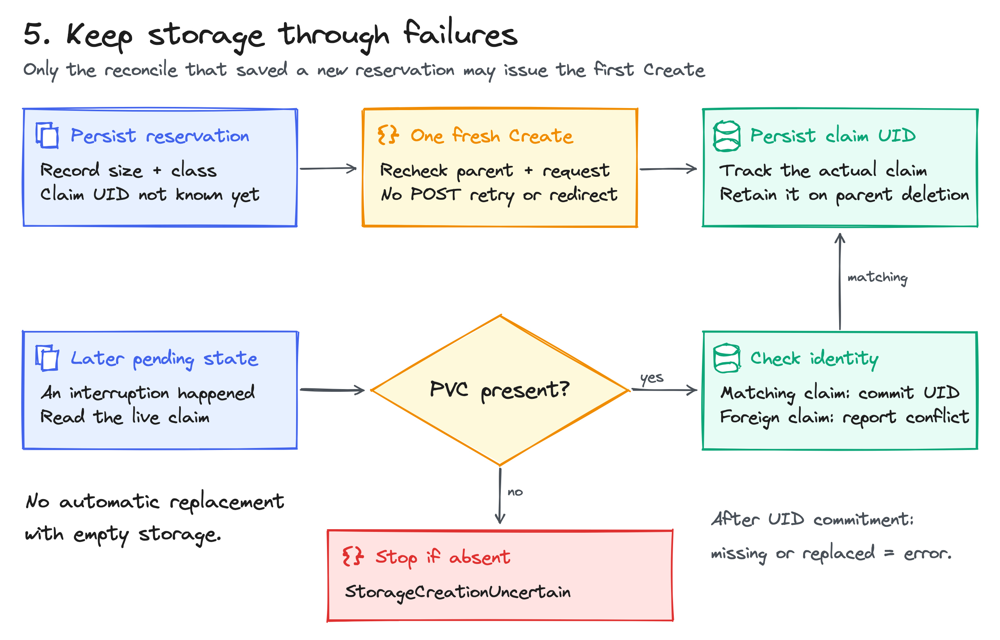

<!-- SPDX-License-Identifier: Apache-2.0 -->
<!-- Copyright (c) 2026 NVIDIA Corporation -->

# KEP-0006: Write workload policies once

- Status: provisional
- Authors: @AviadHayumi
- Created: 2026-11-10
- Depends on: the built-in Karta catalog; no earlier proposed API is required
- Tracking issue: related to [CEL support](https://github.com/dsx-ai-factory/workload-map/issues/330)

## Summary


A workload asks for storage, a node pool and a Service through annotations.
Karta finds its Pod template; the same CEL programs compute the requested
configuration for a Deployment or CronJob. A small Go controller applies that
configuration and reconciles later changes. This KEP proposes the reusable
CEL package and a three-plugin example, with Kubernetes writes owned by the
controller. The result is a way to share policy logic across workload types
without making every policy author learn each type's template path.

| What the platform gains | What the workload author does |
| --- | --- |
| Shared policy logic across native kinds | Adds annotations to the existing workload |
| Storage that survives workload deletion | Requests a claim, then mounts it through ordinary Pod fields |
| Placement that responds to changed input | Changes the requested node pool |
| A Service that recovers from drift or deletion | Declares the exposed port |
| Policy checks that run without a cluster | Evaluates the same CEL against a workload snapshot |

## Motivation

A platform runs a document server as a Deployment and a scheduled report
server as a CronJob. Both need a node pool and an HTTP endpoint. Their Pod
templates live in different places: `spec.template` and
`spec.jobTemplate.spec.template`. Copying that distinction into every policy
turns a small rule into another adapter to maintain.

The application team should declare what it needs on the native workload.
The platform should own how those requests become Kubernetes changes,
including field ownership, retries and retained data. CEL makes the rule
short; Karta removes the template-path knowledge from that rule.

### Goals

- Evaluate one CEL program over a workload and its catalog-resolved template.
- Demonstrate three useful plugins with actual reconciliation and kind tests.
- Keep policy evaluation reusable in controllers, tests and offline tools.
- Preserve unrelated fields and make child-resource lifetimes explicit.

### Non-goals

- A policy CRD, admission webhook or dynamically loaded plugin framework.
- Replacing all workload orchestration or supporting every catalog shape.
- Injecting mounts, resizing storage or moving a local volume between nodes.

## Proposal

### 1. Ask for capabilities

The first consumer is a controller installed in one namespace. It watches
`apps/v1 Deployment` and `batch/v1 CronJob`. This is the workload input;
the annotations belong to the workload, not to a wrapper object:

```yaml
apiVersion: apps/v1
kind: Deployment
metadata:
  name: web
  annotations:
    plugins.karta.dev/storage: 1Gi
    plugins.karta.dev/node-pool: blue
    plugins.karta.dev/service-port: "80"
spec:
  replicas: 0
  strategy: {type: Recreate}
  selector: {matchLabels: {app: web}}
  template:
    metadata: {labels: {app: web}}
    spec:
      containers:
        - name: web
          image: busybox:1.37.0
          command: [sh, -c, "mkdir -p /tmp/www; echo ready > /tmp/www/index.html; exec httpd -f -p 8080 -h /tmp/www"]
          ports: [{name: http, containerPort: 8080}]
```

The result is a 1Gi PVC, a blue-pool node selector and a Service exposing
port 80 to port 8080. Child names include the full workload UID:
`karta-<UID>-data` and `karta-<UID>-service`. The controller adds the Pod label
`plugins.karta.dev/workload-uid=<UID>` so the Service selects this workload.

Start a Deployment at zero replicas or a CronJob suspended. The controller
runs after persistence, so an already active workload can create Pods before
preparation. Wait for `plugins.karta.dev/result` to report `Applied`, then
activate it. `Applied` means configuration converged, not that Pods are ready.

### 2. Write the policy once

The CEL input has two names. `object` is the complete native workload.
`template` is its root Pod template, copied without losing unrelated fields
or integer values. Absent workload annotations become an empty map in the
snapshot. The input object in Kubernetes is unchanged by evaluation.

#### Use case: provision storage and keep the data

```cel
'plugins.karta.dev/storage' in object.metadata.annotations
? {'size': object.metadata.annotations['plugins.karta.dev/storage']}
: {}
```

For the workload above, the result is `{"size":"1Gi"}`. Go validates the
quantity and creates the claim. The user attaches that claim with normal
`volumes` and `volumeMounts` fields. Removing the annotation or deleting the
workload retains the PVC. Provisioning is separate from mounting and binding.

#### Use case: move a stateless service to another node pool

```cel
'plugins.karta.dev/node-pool' in object.metadata.annotations
? {'pool': object.metadata.annotations['plugins.karta.dev/node-pool']}
: {}
```

The result is `{"pool":"blue"}`. Go writes only
`template.spec.nodeSelector["plugins.karta.dev/pool"]`. Changing the
annotation to `green` triggers another reconciliation; the Deployment's own
controller rolls out the changed template. A CronJob passes it to future
Jobs. Existing Jobs are unchanged. Nodes need the corresponding pool label.

#### Use case: expose an endpoint and repair its Service

```cel
'plugins.karta.dev/service-port' in object.metadata.annotations
? {'port': int(object.metadata.annotations['plugins.karta.dev/service-port']),
   'targetPort': template.spec.containers[0].ports[0].containerPort}
: {}
```

The result is `{"port":80,"targetPort":8080}`. Go creates a Service with an
`http` port and the workload UID selector. A port change, an edited selector
or a deleted Service triggers convergence again. Other Service ports,
allocated addresses and unrelated metadata are preserved. A CronJob Service
has endpoints only while its matching Pods run.

The three programs are embedded and compiled once when the controller starts.
An annotation supplies data, never executable CEL. `{}` disables one plugin.
A malformed present value is an error. All three results are validated before
managed-resource changes; reporting an error can still write a diagnostic
annotation. Changing a program requires rebuilding the example.

### 3. Try it and use the SDK

From the tested prototype checkout linked under Implementation history:

```sh
make check-cel-plugins
KEEP_CLUSTER=1 make test-cel-plugins-e2e
```

The second command builds the controller and creates a three-node kind cluster.
It runs the storage, placement and Service scenarios, then removes successful
test fixtures. The cluster remains available. It requires Go, Docker, kind,
kubectl and make. GPU hardware is not needed for these three plugins.
An existing cluster requires explicit `REUSE_CLUSTER=1`.

The [runnable walkthrough](https://github.com/AviadHayumi/workload-map/blob/652abc46a31d081cde1a922cedf1d60c79fc2e22/docs/examples/cel-plugins/README.md)
contains the install manifests, mounted-volume example and port-change commands.
The KEP checkout contains the proposal; run the commands in the prototype.
The controller requires `--namespace`; `--storage-class` defaults to an explicit
empty class. The walkthrough selects kind's `standard` class before requests
arrive. The e2e fixtures instead bind static local volumes.

A consumer can use the proposed SDK without installing that controller.
This different rule lists container images from either workload type:

```go
package example

import (
    "context"
    "fmt"

    "k8s.io/apimachinery/pkg/apis/meta/v1/unstructured"
    kartacel "github.com/dsx-ai-factory/workload-map/karta/sdk/pkg/cel"
)

func images(ctx context.Context, workload *unstructured.Unstructured) (map[string]any, error) {
    program, err := kartacel.Compile(`{'images': template.spec.containers.map(c, c.image)}`)
    if err != nil {
        return nil, fmt.Errorf("compile image policy: %w", err)
    }
    input, err := kartacel.NewInput(ctx, workload)
    if err != nil {
        return nil, fmt.Errorf("snapshot workload: %w", err)
    }
    return program.Evaluate(ctx, input)
}
```

Passing the Deployment above returns a map whose `images` entry is
`[]any{"busybox:1.37.0"}`. A long-running consumer compiles once and reuses
`Program`; each observation gets a new `Input`. `Input.TemplatePath()` returns
a copy of the discovered path for a caller that needs to write owned fields.
Evaluation itself neither writes to Kubernetes nor calls a Kubernetes client.

### 4. Inside a reconcile


The manager registers watches for the two workload kinds, Services and PVCs
in the selected namespace. Each kind has its own controller queue keyed by
namespace/name. Startup lists discover existing workloads. Workload spec or
relevant metadata changes enqueue work; result-only and status-only updates
do not. Child events map back to their recorded parent. A completed handled
reconcile requests another check after 30 seconds; API failures use retries.

`Reconcile` reads current objects through the uncached API reader.
`NewInput` resolves the built-in catalog definition and finds the root template.
The current catalog's jq runner discovers only the path. Values come from the
original raw object, so a path lookup cannot round large integer values.
`Evaluate` produces detached JSON maps. The host validates their exact schemas
and checks existing ownership before making conditional writes.

The SDK accepts a built-in root with one complete Pod template at a
string-keyed map path. Array paths, fragmented templates and child-component
traversal are outside this contract. The example's two-kind watch list is
narrower than the SDK's supported root shapes.

<details>
<summary>Evaluation limits and owned fields</summary>

| Boundary | Rule |
| --- | --- |
| Source and activation | At most 4096 source bytes and 1 MiB serialized input |
| Result | String-keyed JSON map; at most 8192 bytes; integers remain int64 |
| Work | 10000 CEL cost units; cooperative 100 ms operation deadline |
| Traversal | Input depth 64 / 65536 nodes; result depth 16 / 1024 nodes |
| Whole example plan | One shared 100 ms context for snapshot and three evaluations |
| Storage result | Exactly `size`; positive quantity no larger than 10Gi |
| Placement result | Exactly `pool`; nonempty valid Kubernetes label value |
| Service result | Exactly `port` and `targetPort`; integer values from 1 to 65535 |

These bounds limit cooperative evaluation; they are not a process sandbox.
There are no custom functions that perform I/O. Programs and immutable inputs
can be reused concurrently. JSON conversion rejects unsupported CEL values.

The host owns two template keys: the pool node selector and the workload UID
label. On first acquisition, the key must be absent. Later changes require
that its value still matches the saved value. A user's conflicting edit
produces `FieldConflict`; it is not overwritten. Parent and Service patches
use resourceVersion checks. Multi-object writes are not one transaction;
the next reconciliation recovers completed steps.

</details>

### 5. Keep storage through failures



The controller saves a storage reservation in `plugins.karta.dev/state`
before the first PVC Create. Only the reconcile that receives that successful
reservation response may create. It rechecks workload identity, deletion,
reservation and storage input before doing so. The storage POST disables
client retries and redirects. Unrelated status changes do not revoke it.

After an interrupted request, a later reconcile can find the matching claim
and record its UID. If the reservation exists but the claim is absent, it
reports `StorageCreationUncertain`. It cannot tell whether creation never
happened or the claim was created and then deleted. Guessing would risk
replacing retained data with empty storage.

The state annotation also records owned template values. A separate
`plugins.karta.dev/result` annotation records `Applied` or `Error`, an input
hash and an optional reason. The hash identifies input; it never skips child
reconciliation. These annotations are bookkeeping, not an ownership boundary
against users who can edit the same workload.

| Event | Controller behavior |
| --- | --- |
| Annotation update | Re-evaluate all programs, validate, converge owned fields |
| Service drift or deletion | Repair or recreate the matching owned Service |
| Plugin opt-out | Remove owned template fields; delete the Service; retain storage |
| Service deletion held by a finalizer | Keep the label and saved ownership until actual deletion |
| Workload deletion | Stop changes; Kubernetes collects its Service; PVC remains |
| Same workload name, new UID | Use different child names; do not adopt the old claim |
| Committed PVC missing or replaced | Report an error; never create a replacement |
| Capacity or storage-class change | Report `StorageChangeUnsupported` |
| Controller restart | Relist workloads and recover from persisted state |

The PVC has no owner reference. The Service has the workload as its controller
owner. The namespace Role permits PVC creation but no update or deletion.
Run one controller replica with the supplied `Recreate` Deployment strategy.
Storage recovery has no reset API; a fresh request uses a new workload UID.

## Prior art

- [CEL](https://cel.dev/overview/cel-overview): compile once, evaluate repeatedly, and return structured values to a host.
- [Kubernetes controllers](https://kubernetes.io/docs/concepts/architecture/controller/): keep observed resources moving toward desired state through a control loop.
- [controller-runtime conditional patches](https://github.com/kubernetes-sigs/controller-runtime/blob/v0.25.2/pkg/client/patch.go): include resourceVersion so a stale patch becomes a conflict.

## Migration and versioning

This is an additive Go package and an example, with no new CRD version or
changes to existing catalog definitions. Existing consumers keep their current
API. CEL-Go v0.30.0 is already used by the exporter; the proposed SDK reuses it.

[KEP-0001](../0001-cel-expressions/README.md) changes expressions inside Karta
definitions. This KEP uses the existing catalog to provide inputs to consumer
policies. [KEP-0002](../0002-resource-references/README.md) covers referenced
objects; this first SDK input contains only the supplied workload and template.
[KEP-0005](../0005-explicit-mutations/README.md) defines workload mutation rules;
this example keeps its two writes in the Go host. Integrating those proposed
APIs later must preserve the input and ownership contracts here.

## Validation

Compilation rejects invalid CEL before controller startup. Runtime checks reject
unsupported workload shapes, invalid results and conflicting ownership before
managed changes. API conflicts cause a fresh read and plan. The example's
readiness endpoint waits for its four informer caches to synchronize.

## Test plan

- SDK tests: catalog paths, input isolation, integer preservation, conversion,
  evaluation limits, cancellation and concurrent reuse.
- Host tests: exact schemas, field preservation, no-op reconciliation, watch
  routing, Service defaults and identity checks.
- Fault tests: each storage write interruption, lost responses, changed input,
  status-only races, retryable HTTP responses, redirects and held finalizers.
- Live kind tests: actual PVC binding and retained data, HTTP through a Service,
  cross-node placement, future CronJob Jobs, opt-out, restart, collisions,
  garbage collection, parent replacement and stale API patches.
- Repository checks: module metadata, generated licenses, lint, race tests and
  `make check`. Tagged live tests are separate from the offline presubmit.

## Risks and mitigations

- Eventual preparation. Active workloads can start too early; the walkthrough
  prepares inactive workloads and activates them after `Applied`.
- Controller overlap. The example supports one process and uses `Recreate`;
  multi-replica operation needs a separate ownership design.
- Retained claims accumulate. Retention is deliberate; the operator of the
  cluster owns storage cleanup after checking that data is no longer needed.
- An interrupted create can block progress. Conservative recovery favors
  retaining data over automatically producing a new empty claim.

## Alternatives considered

- Per-kind plugins: duplicate template knowledge in every rule.
- Kubernetes client calls inside CEL: mix evaluation with effects and retries.
- A new policy CRD: adds rollout, schema and lifecycle work before the SDK is proven.
- Replacing full Pod templates: risks changing fields the plugin does not own.

## Future work

Additional root shapes and component selection need their own contracts and
tests. Image or resource checks can already return values through the SDK;
actions beyond these three plugins need explicit host validation and writes.
GPU-idle or long-running-state policies also need a defined source of metrics
or elapsed-time observations. The current example supplies neither.

## Implementation history

- 2026-11-10: proposal-only SDK and three-plugin controller implemented in a
  [tested prototype](https://github.com/AviadHayumi/workload-map/tree/652abc46a31d081cde1a922cedf1d60c79fc2e22).
  All nine kind scenarios, the mounted-volume walkthrough, race tests and
  `make check` passed. These results validate that prototype, not a released API.

Diagram sources sit next to this file as `.excalidraw`; open them at
excalidraw.com to edit.
