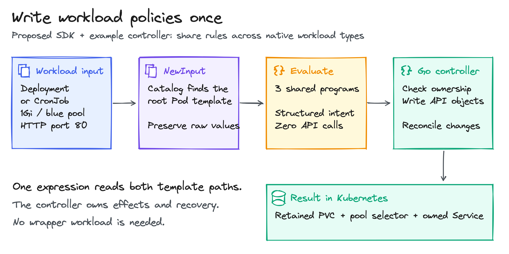
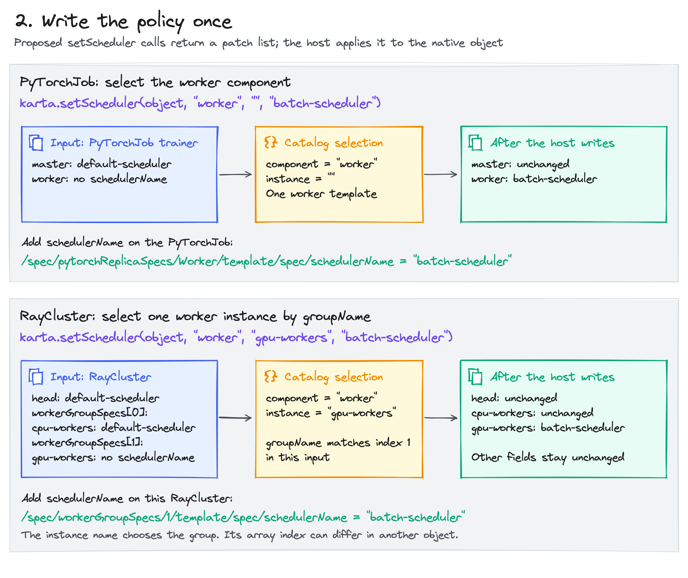
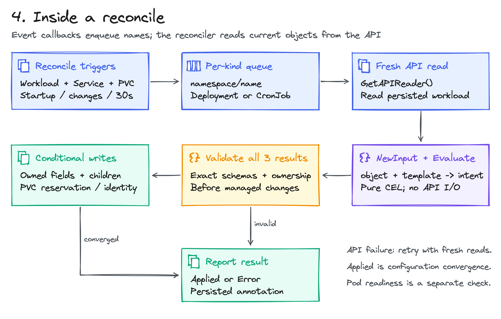

<!-- SPDX-License-Identifier: Apache-2.0 -->
<!-- Copyright (c) 2026 NVIDIA Corporation -->

# KEP-0006: Karta workload operations in CEL

- Status: provisional
- Authors: @AviadHayumi
- Created: 2026-11-10
- Depends on: the Karta catalog and Go SDK
- Tracking issue: related to [CEL support](https://github.com/dsx-ai-factory/workload-map/issues/330)
- Language proposal: [Karta helpers for CEL](https://github.com/kyverno/kyverno/issues/18547)

## Summary



A policy should ask Karta to suspend a workload or change its workers' scheduler.
It should not need to know each operator's field paths. This KEP proposes a
`karta.*` CEL library backed by Karta's catalog and SDK. The library returns
workload facts or patches; the host owns Kubernetes writes and reconciliation.
The same library can serve the Karta example controller or another CEL host.

| What a policy author gains | CEL operation |
| --- | --- |
| Suspend or resume different workload kinds | `karta.suspend(object)` / `karta.resume(object)` |
| Check lifecycle state using common names | `karta.statuses(object)` |
| Inspect one component's images and resources | `karta.podTemplate(object, 'worker', '')` |
| Change only PyTorch workers or one Ray group | `karta.setScheduler(object, component, instance, name)` |
| Test decisions without a cluster | Evaluate snapshots and inspect returned values or patches |

See [six Dromos plugin replacements](dromos-plugin-replacements.md) for complete
CEL examples covering storage, placement, networking, credentials, GPU fabric
and restart rules.

## Motivation

A Job pauses through `spec.suspend`. A PyTorchJob uses
`spec.runPolicy.suspend`. A Kueue Workload instead sets `spec.active` to false.
Repeating these differences in every policy makes each rule another adapter.
Karta already records the workload-specific knowledge in its catalog.

The same problem appears when selecting templates. PyTorch has master and
worker components. Ray has a head and named worker groups. Exposing those
concepts directly in CEL lets policies express which component to change.
The catalog determines where that change belongs in the native object.

### Goals

- Expose Karta operations as callable CEL functions.
- Reuse policies across explicitly enabled workload definitions.
- Select components and instances without writing native template paths.
- Keep evaluation local and Kubernetes effects under the host's control.

### Non-goals

- A new workload wrapper, policy CRD or mandatory Kyverno dependency.
- Identical runtime suspension behavior across operators.
- Fetching metrics, credentials or arbitrary resources during CEL evaluation.

## Proposal

### 1. Add the Karta library to a CEL host

The host supplies `object`, the complete matched Kubernetes workload.
For time-based checks it also supplies `now`, one timestamp captured for that
policy evaluation. It enables the workload definitions that the library may use.
The public CEL names follow the linked language proposal:

| Function | Result |
| --- | --- |
| `karta.statuses(object)` | `list<string>` of mapped states |
| `karta.podTemplate(object, component, instance)` | The selected Pod template as a CEL map |
| `karta.setScheduler(object, component, instance, name)` | `list<JSONPatch>` for that template's scheduler |
| `karta.suspend(object)` | `list<JSONPatch>` using the root's suspend actions |
| `karta.resume(object)` | `list<JSONPatch>` using the root's resume actions |

`component` is a catalog component name. `instance` is its instance ID:
PyTorch's single worker template uses `''`; a Ray worker group uses its
`groupName`. A `JSONPatch` here is an operation with `op`, `path` and, when
needed, `value`. For example, `add` sets the field at the given path.

<details>
<summary>How a Go host loads the CEL library</summary>

The integration uses CEL-Go's existing library interface. This host function
accepts the proposed Karta implementation as `celgo.Library` and compiles a
policy with its functions available:

```go
package example

import (
    "fmt"

    celgo "github.com/google/cel-go/cel"
)

func compilePolicy(library celgo.Library, source string) (celgo.Program, error) {
    env, err := celgo.NewEnv(
        celgo.Lib(library),
        celgo.Variable("object", celgo.DynType),
        celgo.Variable("now", celgo.TimestampType),
    )
    if err != nil {
        return nil, fmt.Errorf("create policy environment: %w", err)
    }
    ast, issues := env.Compile(source)
    if issues.Err() != nil {
        return nil, fmt.Errorf("compile policy: %w", issues.Err())
    }
    return env.Program(ast, celgo.CostLimit(10000))
}
```

Compile once. At evaluation, bind `object` and `now` to the current snapshot.
A validation policy expects a boolean; a mutation policy expects a patch list.
The host rejects results that do not match its policy type. CEL parsing and
syntax stay the same; the library adds registered functions backed by Go.

</details>

### 2. Write the policy once



This native PyTorchJob is the `object` passed to CEL. Both components have
ordinary Pod templates. The master already uses the default scheduler:

```yaml
apiVersion: kubeflow.org/v1
kind: PyTorchJob
metadata:
  name: trainer
spec:
  runPolicy:
    suspend: false
  pytorchReplicaSpecs:
    Master:
      replicas: 1
      restartPolicy: OnFailure
      template:
        spec:
          schedulerName: default-scheduler
          containers:
            - name: pytorch
              image: ghcr.io/example/trainer:v1.2.3
    Worker:
      replicas: 2
      restartPolicy: OnFailure
      template:
        spec:
          containers:
            - name: pytorch
              image: ghcr.io/example/trainer:v1.2.3
```

The entire mutation expression is:

```cel
karta.setScheduler(object, 'worker', '', 'batch-scheduler')
```

Karta selects the worker template and returns:

```json
[{"op":"add","path":"/spec/pytorchReplicaSpecs/Worker/template/spec/schedulerName","value":"batch-scheduler"}]
```

The host applies that patch to the matched PyTorchJob. Its master stays on
`default-scheduler`; its worker template requests `batch-scheduler`.
The workload's own operator decides when a template change affects Pods.

<details>
<summary>Suspend and resume without nine different policies</summary>

For the same PyTorchJob, the complete suspension expression is:

```cel
karta.suspend(object)
```

Its result changes `spec.runPolicy.suspend` to true. The host can use the same
expression for these catalog definitions:

| Workload | Native field | Suspend / resume |
| --- | --- | --- |
| Job | `spec.suspend` | `true` / `false` |
| CronJob | `spec.suspend` | `true` / `false` |
| JobSet | `spec.suspend` | `true` / `false` |
| RayJob | `spec.suspend` | `true` / `false` |
| RayCluster | `spec.suspend` | `true` / `false` |
| PyTorchJob | `spec.runPolicy.suspend` | `true` / `false` |
| MPIJob | `spec.runPolicy.suspend` | `true` / `false` |
| Sandbox | `spec.operatingMode` | `"Suspended"` / `"Running"` |
| Kueue Workload | `spec.active` | `false` / `true` |

To resume, use a separate mutation policy:

```cel
karta.resume(object)
```

For PyTorchJob this produces a patch setting `spec.runPolicy.suspend` to
false. Karta shares the operation name, not runtime behavior: CronJob pauses
future schedules, while other operators may stop running Pods. Kueue's
catalog definition is experimental and needs explicit opt-in.

</details>

<details>
<summary>Clean up failed workloads or old workloads still initializing</summary>

A cleanup host matches opted-in Pods and RayServices and evaluates this
boolean every five minutes:

```cel
karta.statuses(object).exists(s, s in ['Failed', 'Degraded']) ||
(karta.statuses(object) == ['Initializing'] &&
 now - timestamp(object.metadata.creationTimestamp) > duration('30m'))
```

Given `now` at 12:45, a Pending Pod created at 12:00 returns true; a Pending
Pod created at 12:40 returns false. Karta maps Pending to `Initializing`.
A RayService with `Ready=False` and reason `ZeroServeEndpoints` maps to
`Degraded`, so it returns true. Pods have no degraded mapping.

The host deletes the matched object when the result is true. Karta only
reads status. This checks object age, not time spent in the current state.
The host must recheck the latest object and its UID before deletion.

</details>

<details>
<summary>Check images and resource requests on PyTorch workers</summary>

This complete validation policy allows only images from the example registry
namespace in the selected worker template:

```cel
karta.podTemplate(object, 'worker', '').spec.containers
  .all(c, c.image.startsWith('ghcr.io/example/'))
```

The sample returns true. Replacing a worker image with `busybox:1.37.0`
returns false. The master template does not participate in this check.

A different policy requires both CPU and memory request fields:

```cel
karta.podTemplate(object, 'worker', '').spec.containers.all(c,
  has(c.resources) && has(c.resources.requests) &&
  'cpu' in c.resources.requests && 'memory' in c.resources.requests)
```

The sample returns false. Adding
`resources: {requests: {cpu: "250m", memory: "128Mi"}}` to its worker container
returns true. This checks field presence, not quantity bounds or usage.
Both policies inspect regular containers; init containers need their own check.

</details>

<details>
<summary>Change one Ray worker group and preserve the head and other groups</summary>

Here `object` is a RayCluster with `workerGroupSpecs` containing
`cpu-workers` at index 0 and `gpu-workers` at index 1. The GPU group's
Pod spec has no scheduler field yet. The complete mutation expression is:

```cel
karta.setScheduler(object, 'worker', 'gpu-workers', 'batch-scheduler')
```

The result is:

```json
[{"op":"add","path":"/spec/workerGroupSpecs/1/template/spec/schedulerName","value":"batch-scheduler"}]
```

Karta finds the group by `groupName`; the policy does not encode index 1.
The head and CPU worker group stay unchanged. If the group moves in the
array, a new evaluation resolves its new position. If it disappears,
evaluation fails instead of choosing another group.

</details>

### 3. Keep reads and mutations explicit

Read helpers return values from the supplied workload. Mutation helpers
return patches and never send Kubernetes requests. A policy result may be
inspected, rejected, logged or applied by its host.

The binding resolves the workload's API version and kind against the enabled
catalog snapshot. An unknown kind, missing component, missing instance or
unsupported operation is an error. In particular, it checks suspend support
before calling the SDK; the SDK's current unsupported-operation no-op must
not become a successful policy result.

Mutation evaluation uses a private copy. All actions must succeed before a
patch list is returned. An already satisfied supported operation returns
`[]`. A failure returns an error and no partial patch result.

`setScheduler` may change only the selected scheduler field. The binding must
preserve raw fields while translating SDK edits to patches. Typed template
round-trips can normalize values or drop unknown fields, so a broad diff of
the SDK's serialized result is insufficient. Resolve the selected native path
and construct the intended leaf edit, with preservation tests around it.

### 4. How the language works inside



The library registers function names, argument types and Go implementations
in the CEL environment. For a call such as `karta.setScheduler`, its Go binding
resolves the catalog definition, selects the component and instance, and uses
the SDK's template access rules to produce the patch.

The catalog owns workload paths, state mappings and supported actions. The
binding owns CEL conversion, explicit errors, evaluation bounds and patch
construction. The host owns matching, permissions, fresh reads, concurrency
checks and Kubernetes writes. No function fetches cluster objects during CEL
evaluation. Resource references need a separate input-resolution contract.

The first library version should share one deadline across CEL and catalog
queries. Bound source size, input size, result size and query work as well as
CEL cost. Custom Go function work must participate in those bounds; CEL's
expression cost limit alone does not account for all SDK work.

### 5. Run policies when workloads change

A Karta controller can host the library without Kyverno. It watches the
explicitly enabled workload kinds and compiles its configured policies once.
On create or update it reads a fresh object, evaluates matching policies and
validates their results. It applies mutations against the observed UID and
resourceVersion. A conflict triggers a new read and evaluation.

| Trigger | Host behavior |
| --- | --- |
| Workload create or update | Re-evaluate matching policies |
| Time-based cleanup | Schedule another evaluation even without object changes |
| A successful patch generates an event | Re-evaluate; converged mutations return `[]` |
| Unsupported input or evaluation failure | Report the error and perform no policy action |
| Workload deleted and recreated | Treat the new UID as a new workload |
| Child resources generated by another plugin | That plugin owns their watches and lifecycle |

A background controller runs after persistence. If preparation must precede
Pod creation, submit an inactive workload or use an admission host. A patch
being accepted means the requested configuration changed; it does not prove
that the workload operator has finished reconciling it.

## Prior art

- [Karta CEL proposal](https://github.com/kyverno/kyverno/issues/18547): the same helper names, component selection and patch-returning contract.
- [CEL-Go libraries](https://github.com/google/cel-go/blob/v0.30.0/cel/library.go): register domain functions in an existing CEL environment.
- [Kubernetes controllers](https://kubernetes.io/docs/concepts/architecture/controller/): evaluate desired state repeatedly as objects change.

## Migration and versioning

Add the CEL library alongside the existing Go API. Existing SDK consumers and
the current `Compile`/`NewInput` wrapper keep their behavior. The new host uses
the library directly so validation can return a boolean and mutation can return
a patch list. It does not inherit the prototype wrapper's map-only result rule.

[KEP-0001](../0001-cel-expressions/README.md) concerns expressions inside catalog
definitions. This KEP makes SDK operations available to consumer expressions.
[KEP-0002](../0002-resource-references/README.md) covers resource references.
[KEP-0005](../0005-explicit-mutations/README.md) defines explicit mutation rules:
Karta applies them locally; the CEL binding returns patches for the host to
validate and persist. Existing catalog jq remains an internal detail until
those definition changes are adopted.

## Validation

Type-check function arguments and each policy's result contract at startup.
At evaluation, validate the enabled definition, selected component and instance.
For mutations, validate patch scope and preserve unrelated fields. Hosts must
use the same object snapshot for a decision and its conditional write.

## Test plan

- Compile and evaluate every CEL example through real registered bindings.
- Verify the suspension mappings and unsupported-operation errors.
- Cover status mappings, multiple states and fixed-time cleanup decisions.
- Select PyTorch workers and named Ray groups; test missing and reordered groups.
- Apply returned patches and prove other components and raw fields are unchanged.
- Cover partial SDK failures, cancellation, limits and concurrent evaluations.
- Run a host in kind; check create/update reconciliation, no-op convergence,
  stale writes, UID replacement and time-triggered cleanup.
- Run the repository presubmit with `make check` before publishing code.

## Risks and mitigations

- Shared names hide operator differences. Document the catalog operation's
  native effect and keep runtime convergence with the workload operator.
- Template serialization can broaden a patch. Build only the selected field's
  change from the raw object and test preservation of unrelated fields.
- Powerful writes need explicit scope. The host enables definitions and
  operation types, and applies its ordinary namespace and permission checks.

## Alternatives considered

- Per-kind CEL paths: every policy repeats operator knowledge.
- Inject only a preselected template: useful for reads but hides components and operations.
- Kubernetes client calls inside CEL: mix decisions with effects and retry behavior.
- A separate expression syntax: unnecessary when CEL already supports domain libraries.

## Future work

Additional bindings can expose replica/min/max reads and template edits for
images, resources, labels or annotations. Capacity writes need SDK support.
GPU-idle policies need fresh metric observations supplied by the host; time
spent in a state needs transition history. Neither follows from a status name
or a declared GPU resource alone.

## Implementation history

The examples above define the proposed language. The current
[tested prototype](https://github.com/AviadHayumi/workload-map/tree/435dcb58615a35a5136e9bc4f4864ff0909e8a6e)
provides a smaller foundation: Karta-resolved `object`/`template` inputs,
bounded CEL evaluation and a Go controller for storage, placement and Services.
It does not yet register the `karta.*` functions shown here.

<details>
<summary>Run the existing controller demo and see its test evidence</summary>

In the prototype checkout:

```sh
make check-cel-plugins
KEEP_CLUSTER=1 make test-cel-plugins-e2e
```

Prerequisites are Go, Docker, kind, kubectl and make. No GPU is required.
The [walkthrough](https://github.com/AviadHayumi/workload-map/blob/435dcb58615a35a5136e9bc4f4864ff0909e8a6e/docs/examples/cel-plugins/README.md)
installs the controller and demonstrates a retained PVC, node placement and
Service repair. These commands exercise that host, not the proposed bindings.

On 2026-11-10, all nine kind scenarios and the mounted-volume walkthrough
passed on the initial prototype. Its subsequent behavior-preserving cleanups
passed offline checks and race tests. These results establish the host
foundation; the language-binding test plan above remains required.

</details>

Diagram sources accompany this document as `.excalidraw` files.
